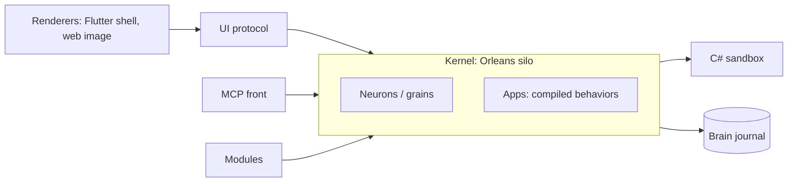

# How IntoChat OS is built

IntoChat OS is a .NET 11 kernel on Orleans. The kernel hosts modules, modules supply capabilities, and apps run on top as compiled behaviors. See [Concepts](./concepts) for the vocabulary.

## Kernel and OsCatalog

The kernel host is `IntoChat.OS.Kernel`. `OsCatalog` is the single place where the module composition is named: it lists the modules, and every host of the OS registers modules through it. A distribution is a diff against this composition, not a copy of it. `AddOperatingSystem` registers the modules plus the shipped OS apps.

An Aspire AppHost (`IntoChat.OS.AppHost`) runs one authoritative OS runtime and a separate MCP client host. Devices are connectors.

## Modules

A module is a self-contained capability family, shipped as up to three projects: `Contracts` (the public types other code may depend on), the implementation, and an `Aspire.Hosting` project that adds the containers and parameters the module needs. See [Modules](./modules).

## Neurons as grains

Neurons are Orleans grains. Each has typed operations and persisted state, and the kernel stamps provenance on every signal so authority is never derived from settings. Persisted state uses concrete arrays, and type aliases are brand-neutral so stored identities survive renames.

## Apps as compiled behaviors

An app is a specification and a manifest plus behaviors compiled from C#. The compiler checks the code, the runtime assigns the behaviors, and the app's presentation describes its UI. First-party apps live under `features/os` in the repository.

## C# sandbox

Script execution and generated code run in the separate `os-sandbox` image, not in the kernel process. The CSharp module drives it.

## UI protocol

The kernel speaks a renderer-agnostic UI protocol. The Flutter shell (desktop) and the `os-ui` web image are two renderers of the same protocol. C# wire records and their Dart mirrors are kept aligned.

## Storage

Locally, each brain has an encrypted journal under the workdir. In Azure deployments, grain state and data protection keys live in Azure storage. Optional modules add Postgres, Qdrant, ClickHouse or Supabase.

## Deployment

Tagging a release publishes `IntoChat.OS.*` NuGet packages and three images:

| Image | Contents |
| --- | --- |
| `ghcr.io/intochat/os` | The kernel |
| `ghcr.io/intochat/os-ui` | The Flutter web shell served by nginx |
| `ghcr.io/intochat/os-sandbox` | The C# sandbox |

The OS also ships an `install` command that provisions Azure through the Azure module, so you can host your own instance. A hosted IntoChat service exists separately.

## Design boundaries

| Boundary | Rule |
| --- | --- |
| Behavior and presentation | Typed UI records, app presentations and the Flutter mirrors change together |
| Replay and effects | Behaviors restart and signals can repeat; design external writes to be idempotent |
| Personal and shared | A brain owns its state; sharing goes through circles with explicit membership |
| Release and installation | A publication is immutable; an installation has its own state and configuration |
| Persisted formats | Never assume stored data is disposable; coordinate format changes explicitly |
