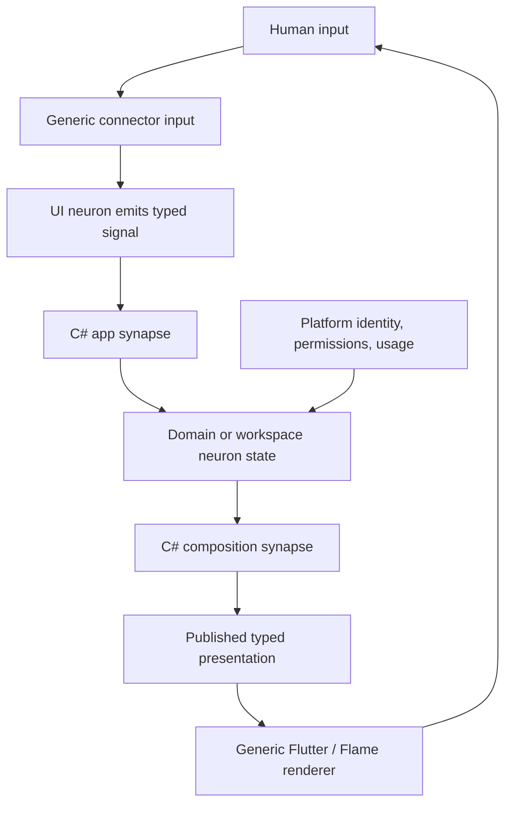

# App-composed DigitalBrain workspace: requirements and design

Date: 2026-10-14. Status: proposed architecture for review; implementation is not authorized by this document. The user explicitly requested this specification and an implementation plan together. Source baseline: `da065933d`; source inspection, not a live-runtime certification.

## 1. Outcome and scope

DigitalBrain is a programmable workspace. Its OS experience is made from installed C# apps and synapses using the same neuron, signal, behavior, and connector model as user apps. Flutter provides the generic human connector. A person, conversation, reactive tool, and discovery feed can occupy the same canvas and appear among open views. The workspace restores what the person was using; Discover does not open automatically.

The agreed visual direction removes the left sidebar and permanent organization label. A quiet bottom bar provides a launcher and pins on the left, open views in the middle, and Ino, usage, and account access on the right. A profile takes the full center workspace. Decorative repeated imagery, sphere navigation, and mandatory companion panes are removed from the default experience.

This is a product architecture change, not a reskin. It supersedes the default sphere navigation and fixed side/main composition in the 2026-10-13 neuron-space design, while retaining typed references, durable state, assignment-aware presentation publication, and authorized input. Earlier documents are historical evidence, not an implementation checklist for this design.

### Deliverables and reading order

1. This document: architecture, numbered requirements, design system, blockers, acceptance criteria.
2. [UI primitive audit](../reviews/2026-10-14-ui-primitives-audit.md): supported contracts versus actual rendering/transport/composition.
3. [Flame and motion audit](../reviews/2026-10-14-flame-motion-audit.md): scene palette, gestures, validation, animation limitations.
4. [OS composition audit](../reviews/2026-10-14-os-composition-audit.md): present ownership and paths to retire.
5. [Implementation plan](../plans/2026-10-14-app-composed-workspace.md): ordered work packages and release gates.

## 2. Evidence and current assessment

Paths below are relative to the repository root. Detailed line anchors are in the audits.

| Current evidence | Assessment | Consequence |
|---|---|---|
| `Apps.Contracts/Apps/Presentation.cs` under `src/DigitalBrain.Modules/DigitalBrain/Apps/` requires `Sphere`, optional `Side` and `Main` | Presentation is coupled to one OS visual metaphor | Replace with generic named presentation roots; scenes become optional ordinary content |
| `Flutter/Workspace/WorkspaceNeuron.cs` under `src/DigitalBrain.Modules/Google/Flutter/DigitalBrain.Modules.Flutter/` seeds Ino and only adds `/apps/<name>` keys to `Open` | Open views cannot uniformly represent people and documents; default focus is product policy | Introduce typed view identity and make the Workspace app choose defaults and composition |
| `Flutter.Contracts/Workspace/WorkspaceState.cs` has only revision/path/open | No pin order, per-view state, explicit focus, or independent activity model | Evolve persisted workspace state instead of manufacturing a second Dart tab model |
| `app/ui/lib/src/composition/neuron_view.dart` supports typed composition and change watching | Strong reusable foundation | Extend and simplify this renderer; do not build a parallel social UI renderer |
| `app/ui/lib/src/composition/application_surface.dart` invokes a supplied start callback | Host/mount lifecycle can still trigger preparation | Separate publication resolution and rendering from explicit work commands |
| `Flutter/Shared/AppUiEndpoints.cs` has product-specific profile/post branches and explicit kind switches | Transport includes social navigation policy and has a narrower palette than all declared neurons | Move social composition into apps and validate one capability manifest across transports |
| `Flutter/Shared/CompositionValidation.cs` has a fixed child-kind list | Declaring a neuron does not make it composable everywhere | Treat contract, transport, renderer, input, semantics, and nesting as one capability |
| `Apps/Apps/AppNeuron.Presentation.cs` validates app caller, expected revision, and brain-scoped slots | Useful guards exist, but same-brain root ownership is broad | Preserve guards; prove execution-assignment identity and authorize cross-app references |
| `Framework/Callers/CallerContext.cs` has app identity but no explicit assignment generation | The inspected presentation check alone does not prove that an old execution cannot supply a new revision | Trace the execution proxy and add a host-stamped generation regression test; do not assert an exploitable bypass without that trace |
| `Apps/Authoring/AgentPrompts.cs` still teaches a manifest `entry`; current `AppManifest.cs` has no entry | Creator guidance and current presentation contract diverge | Reconcile all authoring paths and examples with the chosen contract |
| `Apps/Marketplace/AppInstaller.cs` resolves exact release and digest through `FeatureLoader.Create` | Good reusable fork path | Preserve exact-publication installation and recipient-owned configuration |
| `Apps/Apps/AppNeuron.Publications.cs` reads `preview.txt`, limited to 16384 characters | Current public preview is textual content, not an isolated live app | Interactive public previews require a separate, bounded execution design |
| `app/shell/lib/workspace/compute_usage_panel.dart` owns grouping, periods, fetch/poll, and UI | Usage is a native product screen | Expose an authorized metering contract and compose Usage from C# |
| `app/ui/lib/src/theme/ui_tokens.dart` and `ui_theme.dart` define spacing, radius, typography, color | Reusable design-system seed, not a complete script-facing system | Expose semantic tokens and generic component variants without per-app Dart styling |

Verdict: the four-word model and generic neuron renderer are suitable foundations. The current contracts and shell are not yet sufficient for the proposed OS. In particular, putting existing screens in app folders without removing hard-coded composition would not meet the goal.

Current startup already reads persisted workspace state; it seeds Ino only when the path is empty. There is no implemented automatic Discover startup to remove. Preserve the existing restoration behavior while changing the empty-state policy and target model.

### Actual palette summary

The C# UI vocabulary declares 35 kinds. The Dart registry lists 33 (omitting chat/composer), marks 18 as dedicated, and the actual main renderer handles those 18 plus chat/composer: 20 kinds in total. The 15 remaining kinds are toggle, slider, progress, infobar, image, video, graph, calendar, clock, map, rating, color, expander, tree, and sheet. They reach unsupported fallback in this composition path. Some have standalone or chat widgets; that is not end-to-end composition support. Required host adapters further limit imagecanvas/browser/scene/file/voice behavior. The UI audit records the exact distinctions.

Flame renders nine node types: circle, rect, text, sprite, path, particles, group, activity_ring, sphere. Its nine tree operations are selector, sequence, repeat, condition, wait, moveTo, scale, fade, pulse; the inspected tree attachment executes on spheres. Existing scene limits (4096 nodes, 256 tree nodes, tree depth 16) are validation limits, not measured frame budgets. Schema/render mismatches include rect corner/radius, path fill/stroke, and ignored text alignment. Reduced motion and gesture enforcement need broader coverage.

### What “all logic from C#” means

**C# app/synapse ownership:** which content is shown; layout declaration; navigation policy; selected view and pins; app/profile/feed composition; domain rules; publication; durable drafts; business commands; data access; animation intent; context menus and action availability.

**C# module/platform ownership:** authenticated identity, permissions, billing facts, atomic revision checks, durable delivery, validated UI state, resource limits, supported capabilities, device connection, execution identity. Modules must not construct the product's bottom bar or social feed.

**Flutter connector ownership:** render the declared tree; apply constraints; native text/IME and focus mechanics; hit testing; platform input; semantics; pointer tracking; interpolation and frame scheduling; resource loading; event transport; reconnect mechanics; generic unsupported/unavailable presentation. It cannot choose to open Ino, create a Discover tab, decide a friendship rule, or invent navigation from a key suffix.

Flutter cannot literally contain zero logic: layout engines and responsive interaction require algorithms on the device. The enforceable rule is **zero product-specific composition or business decisions in Flutter**. C# declares motion/interaction behavior; Flutter executes that declaration locally. No synapse round trip is required for each animation frame.

## 3. Proposed architecture

### One workspace app

Add a first-party `features/os/Workspace/` app. It composes a generic layout containing the focused viewport, optional transient layers, and the bottom bar. Launcher, Usage, and Account are apps or reusable app-owned roots, not built-in Flutter screens. Reuse Friends/Circle for social ownership rather than creating a second social runtime.

The boot connector resolves one configured, authorized workspace app and mounts its published root. It does not inspect its name to choose widgets. A minimal host-level recovery path for failed authentication, connection, or invalid workspace publication is necessary; it can show diagnostics, reconnect, and restore a known-good workspace assignment, but must not become a hidden second OS. Product defaults live in shipped app data.

The workspace app reads durable workspace state and emits its composition. The state neuron enforces invariants and atomic revisions; it does not compose scenes. Views reference apps and typed presentation variants. Profile identity, domain data, and an executable app are separate concepts, even though profiles are rendered by apps.

### Root and viewport model

Proposed contract names below are design targets, not existing APIs:

- `Presentation` contains `PresentationView[] Views`; a view has an id, `UiChildRef Root`, and declared host capabilities. `full` is the default. Optional `compact` and `status` variants may be provided.
- `AppPresentation` continues carrying program revision, presentation revision, readiness/error, and metadata. Sphere and blackboard are optional scene details, not mandatory app fields.
- `WorkspaceViewRef` contains a stable `Id`, owning app key, presentation variant, and opaque context key. A context identifies a particular person/document/conversation without encoding authority in its string.
- `WorkspaceState` contains `Revision`, `WorkspaceViewRef[] OpenViews`, nullable `FocusedViewId`, ordered `Pins`, and app-owned view-state references. Closing a view and stopping execution remain separate operations.
- A generic `IViewport` neuron holds a `ViewportDefinition`: target view reference, display mode, allowed interaction mode, and a verified grant reference when crossing ownership boundaries. It never launches code merely because it became visible.
- A generic device/session neuron reports viewport class, text scale, input capabilities, and accessibility preferences. C# declares responsive rules; Flutter evaluates declared constraints locally. Continuous resize does not require server recomposition every pixel.

Do not add an untyped arbitrary JSON “UI language” or executable code inside node properties. Extend typed neurons and generic renderer capabilities. Reconcile the existing inline `UiPart` chat representation with references to the same neuron tree so embedded and full views do not drift.

### Open, focus, close, and work

Open resolves a view and adds it exactly once. Focus selects an existing view without restarting it. Close removes the view and selects the most recently focused remaining view; no remaining view means the app-composed empty canvas. Stop is an explicit app operation where supported. Completion may set attention but never focus a view.

Pinned items remain in the left group. If a pinned item is open, its existing icon indicates focus/activity and it is not repeated in the central group; central tabs hold other open views. Multiple documents from the same app can be separate views with distinct stable ids. A person's profile and conversation are local sections of one person view unless the user explicitly chooses a separate conversation view.

Ino initially opens as an ordinary full workspace view, reusing the same identity when already open. A side companion is optional later, composed by Workspace using the same viewport primitive. This is a proposed default because the last Ino-placement question was not answered; it does not block the foundational work.

## 4. Requirement register

Priority: P0 = architecture/reliability gate; P1 = first complete product; P2 = extensibility/polish after the vertical slice. “Must” describes target behavior, not a claim about the current code.

### Architecture and authority

| ID | Priority | Requirement and acceptance |
|---|---|---|
| A01 | P0 | One C# Workspace app owns the default root and bottom-panel composition; changing its behavior changes the UI without Dart edits. |
| A02 | P0 | No app-name, profile-key-suffix, or route-specific widget selection in the connector's product path. |
| A03 | P0 | Neurons hold durable state; scripts can be restarted without losing navigation, pins, drafts, or work results. |
| A04 | P0 | Each composition synapse rebuilds deterministically from current state; identical output causes no presentation churn. |
| A05 | P0 | All input targets typed edge neurons; scripts react to their signals; no product action is implemented solely in Dart. |
| A06 | P0 | Preserve kernel-stamped caller identity; no client metadata, settings, or UI node grants authority. |
| A07 | P0 | Presentation publication is tied to the executing assignment, not only a revision number supplied by the script. |
| A08 | P0 | Host-enforced authorization covers every root and child read, action, asset, subscription, and embedded view. |
| A09 | P0 | Define public-read, private-owner, and shared-member views explicitly; a path suffix is never proof of access. |
| A10 | P0 | Cross-app composition requires a declared/verified readable presentation grant; sharing does not grant arbitrary mutation. |
| A11 | P0 | Platform/kernel capabilities remain inaccessible as ordinary app neurons; add least-privilege facades where UI needs facts. |
| A12 | P0 | Workspace publication failure has a trusted recovery path without resetting user data or silently installing another app. |
| A13 | P0 | Compilation, capability validation, and live acceptance are distinct gates. Compiling does not imply renderability. |
| A14 | P1 | Default OS apps use the same publication and renderer contracts as generated apps; special privileges are explicit. |

### Workspace and navigation

| ID | Priority | Requirement and acceptance |
|---|---|---|
| W01 | P0 | Restore the last valid open views and focus; reconnect never opens Discover or Ino by itself. |
| W02 | P0 | A person, document, app, or conversation has a stable typed view identity independent of a local `/apps/` key shape. |
| W03 | P0 | Opening an existing view focuses it; duplicate delivery cannot duplicate its tab. |
| W04 | P0 | Open/focus/close/pin/reorder commands have operation ids and expected revisions; rejected conflicts preserve accepted state. |
| W05 | P0 | Reusing an operation id with different arguments is rejected; exact retries return the accepted result. |
| W06 | P0 | Closing the focused view chooses recent remaining focus, otherwise empty canvas; it never launches replacement content. |
| W07 | P0 | Close does not stop background execution; stop/cancel are separate app-owned actions with clear feedback. |
| W08 | P0 | Completion and presentation refresh never steal focus, reopen a closed view, or restore a stale navigation path. |
| W09 | P1 | Launcher, pins, open views, Ino, usage, and account access are C# composition, not hard-coded widget islands. |
| W10 | P1 | A pinned open item appears once; pin order and open-view order survive restart. |
| W11 | P1 | Bottom overflow is explicit and keyboard accessible; no overlap at narrow widths or enlarged text. |
| W12 | P1 | No permanent left navigation and no permanent organization/workspace text label in the default design. |
| W13 | P1 | Launcher searches apps, people, and commands; Discover is an explicit destination within it. |
| W14 | P1 | Empty canvas is quiet and offers Open something / Ask Ino without initiating background navigation. |
| W15 | P1 | Context menus, close actions, shortcuts, and focus order are declared by C# using generic interaction primitives. |
| W16 | P0 | Define per-device focus versus shared pins: proposed session-specific open/focus state, brain-shared pin preferences. |
| W17 | P1 | Revoked/deleted/unavailable targets show a recoverable state; other open views remain usable. |
| W18 | P1 | Profile sections remain in the same view; explicitly opening an app creates/focuses its own view. |

### Presentation, embedding, and live state

| ID | Priority | Requirement and acceptance |
|---|---|---|
| V01 | P0 | App presentation can publish any supported typed root without a sphere or fixed slots. |
| V02 | P0 | Full/compact/status variants refer to one logical app instance; changing size does not fork or restart it. |
| V03 | P0 | A viewport follows current authorized presentation revisions and preserves stable child identity. |
| V04 | P0 | Mount/unmount/rebuild are read operations; preparation is idempotent and cannot replay business effects. |
| V05 | P0 | Ready, preparing, empty, unavailable, forbidden, and failed are explicit states with distinct affordances. |
| V06 | P0 | Replace-program invalidates old presentations; late old outputs cannot become current. |
| V07 | P0 | Snapshot/watch race, reconnect, lease renewal, and missed events converge to current state. |
| V08 | P0 | Native and web transports expose equivalent supported operations and error semantics. |
| V09 | P0 | Nested root cycles, excessive depth, oversized payloads, and runaway child counts are rejected with useful diagnostics. |
| V10 | P1 | Offscreen/disposed view subscriptions release resources; durable domain work continues independently. |
| V11 | P1 | Keep scroll position, selected section, and committed draft state through focus changes; IME state stays local. |
| V12 | P1 | Rendering a live timer uses an authoritative deadline with local display interpolation, not a signal every second. |
| V13 | P0 | Public preview does not run a publisher's private instance or expose connections and private state. |
| V14 | P1 | Preview can be static or an explicitly started isolated demo; UI clearly labels the mode. |
| V15 | P1 | Cost-bearing demo work has declared limits, attribution, cancellation, and cleanup. |
| V16 | P1 | Unsupported capabilities show a specific accessible fallback and required capability; never pretend controls work. |

### UI capabilities and design system

| ID | Priority | Requirement and acceptance |
|---|---|---|
| U01 | P0 | One capability manifest reconciles C# kind, DTO, read, write, watch, renderer, composition, and semantics support. |
| U02 | P0 | Every advertised interactive kind has an actual input round trip; generic textual fallback is not full support. |
| U03 | P0 | Generic layout supports row/column/grid/stack, alignment, flexible sizing, min/max constraints, padding, and gaps. |
| U04 | P0 | Responsive layout rules are declared data; applications do not gain individual Dart breakpoints. |
| U05 | P0 | Generic dock layout can express leading/center/trailing groups, safe areas, overflow, and content insets. |
| U06 | P1 | Menus, popovers, dialogs, tooltips, toasts, and sheets are generic accessible primitives with C# ownership. |
| U07 | P0 | Button variants support label, icon, selected/pressed/disabled/busy, tooltip, semantics, and action binding. |
| U08 | P1 | Text supports semantic role, wrapping, selection, truncation, and token-based hierarchy without arbitrary HTML. |
| U09 | P1 | Forms support validation messages, pending submission, typed values, secrets as references, and recoverable drafts. |
| U10 | P0 | Edit then submit is ordered; stale-context or duplicate submit cannot apply to a newly focused conversation. |
| U11 | P1 | List/table/feed pagination and virtualization bound mounted rows and subscriptions. |
| U12 | P1 | Images/media have explicit aspect ratio, fit, alt text, loading/error state, and authorized asset resolution. |
| U13 | P1 | Chat embeds the same typed presentations as the workspace instead of maintaining divergent component semantics. |
| U14 | P1 | Themes use semantic tokens shared across native widgets, scenes, embedded apps, and overlays. |
| U15 | P1 | App-authored token overrides are scoped; cannot hide platform identity/consent or alter another app's chrome. |
| U16 | P1 | Accessibility roles, names, states, focus order, live announcements, and keyboard actions are in the contracts. |
| U17 | P1 | 200% text scaling, high contrast, reduced motion, and touch input are acceptance cases, not optional later styling. |
| U18 | P0 | A new unsupported capability follows contract + renderer + transports + tests + catalog work; app authors get actionable refusal. |

### Flame, animation, and interaction

| ID | Priority | Requirement and acceptance |
|---|---|---|
| M01 | P0 | Name the actual implementation correctly: Flame. No Flare/Rive capability is promised without a deliberate integration. |
| M02 | P0 | Scene is an optional composable UI root; no scene is required for ordinary forms, profiles, or workspace navigation. |
| M03 | P0 | Schema and renderer agree on node types, property names, accepted ranges, and inputs. |
| M04 | P0 | Input reports must match the node's declared allowed input, current revision, and authorized actor. |
| M05 | P1 | Motion intent is declared in C#: property, target, spring/easing, trigger, and reduced-motion equivalent. |
| M06 | P1 | Retargeted motion starts from displayed position and velocity; input is never blocked until animation completion. |
| M07 | P1 | Local press/hover/drag feedback is immediate; authoritative semantic changes still arrive through neurons. |
| M08 | P1 | Gesture contract includes begin/update/end/cancel, pointer identity, capture, and release velocity where applicable. |
| M09 | P1 | Bound high-frequency telemetry; do not journal every pointer sample or animation frame as domain state. |
| M10 | P1 | Reduced-motion mode applies to trees, tweens, particles, camera transitions, overlays, and reconnect behavior. |
| M11 | P1 | Scene hit targets have semantic alternatives, keyboard access, and accessible labels. |
| M12 | P1 | Behavior trees are presentation-only; they cannot perform domain side effects outside authorized signals. |
| M13 | P1 | Trees can target appropriate declared nodes, not only spheres, or their scope is honestly declared unsupported. |
| M14 | P1 | Asset/node/particle budgets and disposal rules prevent one view starving the rest of the workspace. |
| M15 | P2 | Advanced vector, timeline, shader, and animation-file support is optional capability work, not implied by Flame presence. |

### Social, profiles, and app ownership

| ID | Priority | Requirement and acceptance |
|---|---|---|
| S01 | P1 | Profile composition is owned by a C# app; public identity remains anchored to its authenticated owner. |
| S02 | P1 | A person is not forked/installed when opened; their published UI is read or rendered through an authorized projection. |
| S03 | P1 | Profile supports Posts / Apps / Starred using the same composable primitives as user apps. |
| S04 | P1 | Star saves a reference; fork creates an independent recipient app; follow controls social subscription. |
| S05 | P0 | Public/private/shared visibility is explicit and enforced for posts, apps, stars, and shared UI separately. |
| S06 | P0 | Private publication cannot use the existing `[Public]` export semantics without a deliberate permission change. |
| S07 | P1 | Fork installs the exact selected version/digest through the common loader and preserves attribution. |
| S08 | P0 | Fork excludes the publisher's secrets, private data, conversations, and live connection bindings. |
| S09 | P1 | Fork collisions and retry receipts are explicit; no silent replace of an existing app. |
| S10 | P1 | Settings-only changes retain update relationship; edited programs expose independent lineage and update choices. |
| S11 | P1 | Human, assistant, and app conversation identity is visible; an app cannot impersonate a human speaker. |
| S12 | P1 | Ino can invoke declared app operations through existing authority and make tool/app attribution visible. |
| S13 | P1 | Discovery and profiles use paginated authorized sources; no full-brain scan on every render. |
| S14 | P1 | Shared views respond to membership revocation and deletion without leaking cached private contents. |
| S15 | P2 | Public-network block/report and abuse handling precede broad open-community launch. |

### Usage, preferences, and OS apps

| ID | Priority | Requirement and acceptance |
|---|---|---|
| O01 | P0 | Usage app reads a scoped, read-only metering facade; scripts cannot fabricate billing or inspect other accounts. |
| O02 | P1 | Bottom usage shows balance compactly; details show spent period, grouping, freshness, and unavailable state. |
| O03 | P1 | Missing/failed usage is unavailable, never a displayed zero balance or zero spend. |
| O04 | P1 | Cost updates arrive through typed facts or bounded reconciliation owned outside product Dart widgets. |
| O05 | P1 | Account/workspace switching is available through launcher/account UI and explicitly changes the active authorization scope. |
| O06 | P0 | Switching account disconnects old subscriptions and clears protected transient content before new content appears. |
| O07 | P1 | Settings, Files, app catalog, usage, profiles, and conversation screens are app-authored presentations. |
| O08 | P0 | First-party apps and Creator share examples and capability discovery so generated apps can meet the same UI bar. |
| O09 | P1 | Composer/voice/model controls are generic primitives with app-owned behavior, not Assistant-only shell branches. |
| O10 | P1 | Configuration defaults are versioned app data; theme and user choices survive app rebuilds. |

### Reliability, performance, and verification

| ID | Priority | Requirement and acceptance |
|---|---|---|
| Q01 | P0 | Every requirement maps to an implementation task and observable acceptance test or explicit deferred milestone. |
| Q02 | P0 | C# and Dart wire DTO changes ship together with serializer/round-trip fixtures. |
| Q03 | P0 | Use concrete arrays in persisted grain state; test reactivation and whole-program replacement. |
| Q04 | P0 | Duplicate/out-of-order signals and disconnected clients converge without replaying domain work. |
| Q05 | P0 | Live acceptance uses Aspire health, digitalbrain-mcp state/actions, and matching telemetry. |
| Q06 | P1 | Rendered visual acceptance covers dark/light, narrow/wide, keyboard, large text, and reduced motion. |
| Q07 | P1 | Track event-to-visible latency, mounted nodes, subscription count, frame timing, and memory per view. |
| Q08 | P1 | Initial target: local pointer feedback next frame; p95 focused-view frame build/raster each below 16.7 ms on a recorded 60 Hz reference device. |
| Q09 | P1 | Large-feed test: 10000 source items, 50-item pages, mounted rows bounded by visible range plus declared cache extent. |
| Q10 | P1 | Thirty-minute mixed-view soak shows no increasing orphan subscriptions, frame-loop duplication, or monotonic memory growth. |
| Q11 | P0 | Creator-produced reference apps must work without custom Flutter code; refusals identify missing contracts truthfully. |
| Q12 | P0 | Preserve unrelated branch work; no storage wipe, dependency upgrade, or production deployment as part of this planning pass. |

There are 118 numbered requirements. They are intentionally separated into architecture gates, first-product capabilities, and later extension work rather than promising every possible app on day one.

## 5. Design system specification

### Visual foundation

Retain the repository's shared `UiTokens` baseline: spacing 8/16/24; control radius 10; surface radius 18; quick duration 120 ms and standard duration 200 ms. Extend semantic roles rather than sprinkling literals through scripts or renderer widgets.

Use the existing dark palette as the seed: navigation `#101219`, surface `#141720`, raised `#1B1F2A`, primary text `#E9EBF2`, muted text `#969CAF`. The screenshots use mint for primary actions; introduce a distinct semantic `accent` token, initially `#8FD3BA`, rather than repurposing `success`. Existing orange `signal` and blue `owner` remain semantic roles until explicitly reconciled. Validate actual foreground/background combinations for contrast; these seed values are not a certification.

Typography: platform system family (`Segoe UI Variable Text` on Windows with current fallbacks); body 15 with 1.55 line height; secondary 14; heading 28/600, tracking -0.8; ordinary component titles 15/600. Use mono only for code/technical values. Scale with user text settings. No repeated brand slogans or stock-image covers in functional tools.

### Generic component recipes

| Recipe | Composition | State/behavior |
|---|---|---|
| Workspace root | Constrained content + bottom layout region + transient layer | Root supplied by Workspace app; safe-area geometry executed locally |
| Open view item | Icon/avatar, short title, focus marker, optional activity/attention | Selected is different from running; person avatar has no execution dot |
| Pin | Compact icon, tooltip, keyboard label | Opens/focuses target; shared pin preferences, no duplicate open tile |
| Profile header | One avatar/name, handle, short bio, Message/Follow | No duplicate top title or cover required |
| App listing | Icon, title, description, attribution, star | Flat row; hover/selected state; open/fork explicit |
| Embedded app | One bounded viewport with title and mode label | Compact presentation; expand preserves instance/context |
| Feed post | Author/time, text, optional viewport, restrained actions | No cards inside cards merely for layout |
| Usage summary | Small balance and labeled icon | Opens Usage; unavailable and stale states explicit |
| Ino access | Small identity icon and accessible name | One canonical view; preserves conversation |
| Error/empty/pending | Semantic icon, specific explanation, allowed action | Not an empty rectangle; no full-shell blocking for one failed child |

Bottom bar target is 64 logical px plus platform safe inset, with minimum 44 logical px touch targets and at least 8 px inter-group separation. At larger text sizes allow height growth. At narrow widths use C#-declared overflow rules rather than squeezing controls or hiding usage entirely. Focused content uses app-declared width constraints; a profile can use a centered 960 logical px max width while a canvas/data app uses the full available width.

Overlay and theme roots remain generic. The Workspace app declares which layers exist, their anchoring, order, dismissal, and focus return. Flutter performs geometry and focus trapping. Do not turn a data table into a scene to obtain basic styling.

### Motion policy

Instant press feedback; normal state changes use the existing quick/standard durations. Add a semantic spring recipe with damping ratio 1.0 and response around 0.3–0.4 seconds for interruptible motion; momentum gestures may use about 0.8 damping. These are proposed design parameters, not currently supported contract fields or hard-coded animation durations.

The connector maps declared parameters to local simulations. Retarget from current displayed value and velocity. Enter/exit paths match; preserve focus/scroll context. Reduced motion uses static changes or brief opacity transitions, with no looping pulse/particles/camera zoom. Native preferences constrain any app-authored motion; an app cannot override accessibility settings.

## 6. Blockers and risk order

| Blocker | Why it blocks the vision | Resolution / task |
|---|---|---|
| B01 Mandatory sphere and fixed slots | Forces every app into a particular OS layout | Generic presentation and viewport, T03/T05 |
| B02 Workspace state and module composer own navigation assumptions | People cannot behave as normal open views; shell cannot be entirely app composed | Typed state + Workspace scripts, T04/T06 |
| B03 Advertised neuron palette exceeds end-to-end support | Creator can compile UI that cannot be nested, read, rendered, or used | Capability manifest and core primitive completion, T02/T05 |
| B04 Authoring prompts conflict with current manifest | Generated UI may be undiscoverable or never published | Creator contract alignment, T12 |
| B05 Cross-app/root/assignment authority is incomplete as a proven invariant | App-composed OS needs safe shared roots without broad trust | Authority trace and tests, T01/T03/T09 |
| B06 Public previews are text, not runnable views | Mockup promises more than current publication supports | Static first; isolated demo milestone T10 |
| B07 Usage/Account/native shell product panels | Entire OS still depends on Dart product screens | Scoped facades + app conversion, T07/T08 |
| B08 Theme/layout/semantics lack sufficient script control | Apps cannot reproduce unified responsive UI without custom Dart | Generic constraints, tokens, semantics, T05/T11 |
| B09 Flame schema/render/input mismatches | Accepted scene declarations can fail or behave inconsistently | Palette fixtures and allowed-input enforcement, T02/T13 |
| B10 Unbounded/eager UI and subscription cost | A social feed or many embedded apps can stall the OS | Pagination/virtualization/watch ownership, T05/T14 |
| B11 Product behavior spans module, scripts, Dart | A backend-only reskin would leave multiple composition authorities | Explicit path retirement, T15 |
| B12 Existing public export is intentionally public | Private/shared app visibility cannot be a label-only change | Visibility contract and export authorization, T09 |

Security findings here are architectural gaps or insufficiently demonstrated guarantees, not a claim that the inspected application is exploitable. Validate each complete request path before implementing an enforcement change.

## 7. What “apps are not blocked” can realistically guarantee

The first release should support conversational apps, forms/calculators, personal databases, task tools, media viewers, social profiles/feeds, and modest interactive scenes entirely through C# composition. It cannot honestly promise any arbitrary native UI, professional editor, game engine feature, or platform API without connector work.

A new app composing existing capabilities needs no Dart or shell change. A genuinely new drawing/input/platform primitive requires a generic capability addition with a typed contract, native renderer, web/native transport parity, semantics, resource budget, and tests. Publish-time capability checks and Creator refusals make this boundary visible instead of disguising it with nonfunctional controls.

The reference acceptance set is: calculator; editable paginated tracker; profile/posts/starred; human/app/Ino conversations; timer compact/full/status views; chart/table; files/media viewer; and optional Flame scene with interruptible drag. Add a mixed app combining these to prove composition rather than independent demos.

## 8. Acceptance gates

1. A newly authored Workspace app changes bottom-bar order and layout without Flutter changes.
2. A new app with a never-before-used name composes the same primitives and appears correctly in all supported variants.
3. Profile, app, and conversation open/focus/close consistently; duplicate input and reconnect preserve one view and draft state.
4. Empty/reopened workspace never chooses Discover or Ino without configured first-run policy or human action.
5. A timer continues while another view is focused; closing it does not cancel it; reopening shows the same deadline.
6. A person can inspect a public app without touching the publisher's private instance, then fork an exact release into their own brain.
7. Revoked presentation grants, stale executing assignments, malformed input, and private exports are refused at the server boundary.
8. The bottom panel and Usage screen are app compositions backed by authentic metering facts.
9. Every supported kind passes C#/Dart round-trip, nested rendering, read/write/watch, keyboard, semantics, and unsupported-client tests.
10. Aspire health, MCP-driven state/action evidence, telemetry, and rendered interaction checks prove the same scenario; source inspection alone is not completion.

## 9. Proposed decisions needing review before execution

- Adopt generic presentations and retire mandatory sphere navigation; retain Flame for optional app content.
- Use session/device-specific open/focus state and brain-shared pins. This avoids one screen stealing another's focus.
- Ino defaults to an ordinary full view; optional companion presentation is later app composition.
- Public launch initially uses explicit static previews; isolated runnable demos are a separate gated work package.
- Reuse existing Friends/Circle/Assistant capabilities behind app-authored experiences, not a new parallel identity/social runtime.
- Treat the trusted authentication/recovery/permission mechanism as connector/platform infrastructure; its product-facing layout can be declarative, its authority cannot be app-controlled.
- Resolve current repository documentation conflict about storage compatibility before state schema rollout: local-runtime guidance says preserve encrypted state/keys, while older hazard text suggests wiping stores. This plan authorizes neither wiping nor speculative migration.

## 10. External documentation checked

Current Flutter documentation was consulted through Context7 for local frame scheduling and semantics. It supports keeping animation execution in the connector rather than rebuilding the whole app on each frame: [Flutter performance guidance](https://github.com/flutter/website/blob/main/sites/www/content/blog/building-performant-flutter-widgets/index.md). Accessibility semantics must be maintained independently of pointer blocking: [Flutter semantics migration guidance](https://github.com/flutter/website/blob/main/sites/docs/src/content/release/breaking-changes/ignoringsemantics-migration.md).

These references inform generic connector implementation; repository source and the audit reports determine the current capability assessment.
