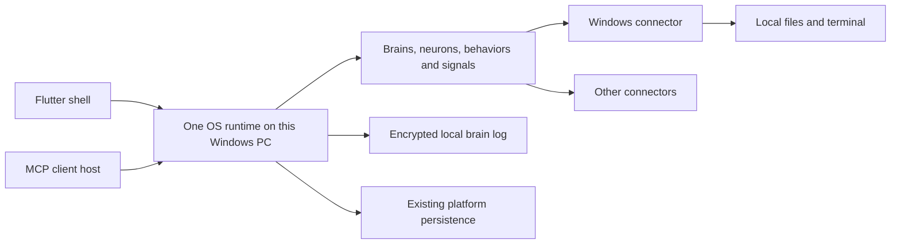

# One brain runtime; devices are connectors

Status: implemented on `codex/single-runtime-devices`, 2026-10-14. Validated in an isolated local deployment; existing deployment data is unchanged.

## Brief and scope

The user chose one brain runtime and devices as connectors, with the first simplified version running on their Windows PC. Preserve access to that PC through the existing Windows connector. A device connection must not require hosting brain state, distributed leases, an Orleans cluster of its own, or participation in a storage mesh.

One runtime means one authoritative OS process in this deployment. Existing personal and circle brain scopes, accounts and memberships remain separate inside it. It does not mean deleting all but one brain record or collapsing user authorization. MCP and Flutter remain clients; integration services are not additional brain runtimes.

Remote Windows access is explicitly outside the first implementation. A later connector agent may deliver authenticated device operations, but must not recreate distributed brain execution.

## Evidence and root cause

- `src/DigitalBrain.AppHost/AppHost.cs` builds A as the core holder and B as a separate Cloud cluster, outside the UI front. B offers volunteer storage. MCP clients also register as machines with trust.
- `docs/superpowers/specs/2026-10-10-federation-circles-mesh-design.md` Q5/Q12 require concurrent per-app execution across independent machine clusters; Q16/Q25 require mesh storage from day one. These are separate commitments from device access.
- `src/DigitalBrain.Modules/Microsoft/Windows/DigitalBrain.Modules.Microsoft.Windows/WindowsNeuron.cs` identifies the local PC and checks it on activation; `FileSystemNeuron.cs` and `ConsoleNeuron.cs` perform local operations. Their `IMachineIdentity` is the Windows module's stable device GUID, distinct from the platform's cryptographic machine identity.
- `src/DigitalBrain.Platform/DigitalBrain.Platform/Parts/MachineTrustHosting.cs` installs forwarding filters over Orleans. `PartGrainStorage.cs` creates stand-in activations when a part belongs elsewhere.
- `PartGrainStorage.cs` also commits state and signals together. Removing it without a replacement would regress durable behaviors.
- `PlatformHosting.cs` can already co-host the trust grains when no trust endpoint is configured. This is a transition mechanism, not the simplified end state: it still registers machines and mesh services.
- `Secrets/PartKeySecretSealer.cs` couples shared credentials to core-part keys and circle machine wraps. `Circles/CircleBirth.cs` currently requires a machine contribution to create a circle.
- `Microsoft/Aspire/.../Deployment/AspireCliClusterHost.cs` assumes another instance remains behind a front during rolling updates. A single runtime must explicitly accept a brief restart interruption.

## Approaches considered

1. Remove B only. Small operational improvement, but leases, trust links, mesh storage and machine-specific authorization remain on the normal path. Rejected as the final solution.
2. Collapse the deployment and remove distributed ownership while retaining local durable state/signals and connector contracts. Recommended; phased replacement permits meaningful checks at each boundary.
3. Replace persistence and all host infrastructure at once. Larger redesign, unnecessary dependency choices and difficult regression attribution. Rejected.

## Target shape

Keep Orleans as the in-process neuron runtime, existing HTTP authorization, framework rings, module contracts, script compilation, marketplace/install flow, UI and telemetry. Keep the existing platform persistence for account/integration/catalog state during this change; removing Azurite or unrelated integration databases is not required by one runtime.

The runtime is the sole execution authority. An exclusive lock on its configured state directory prevents two local processes from writing the same brain logs. Independent test/candidate hosts use distinct directories and storage identities. No shared writable directory or active-active deployment is supported.

## Windows behavior to preserve

Keep `WindowsModule.Connector`, `IWindows`, `IFileSystem`, `IConsole`, `WindowsKeys`, the device GUID file, connection state and folder selection UI. Keep the per-brain connection and authentication checks. A foreign device ID fails; it never falls back to this PC.

File reads/writes/listing, `FileWritten`, allowed-root revocation and command timeout/cancellation must continue to work. No network device transport is required for this release, and no generic device framework is introduced merely to wrap a local call.

Precision about existing protections: `MachineRoots` currently checks normalized path containment. `IConsole.Run` checks the working directory before starting `cmd.exe`; it is not an OS sandbox that confines every action of a command. Preserve these behaviors and do not describe them as stronger isolation. Symlink containment and command sandboxing are separate work, not claims of this refactor.

TPM-backed local key custody can remain independent of machine registration. Keep Windows device identity even after deleting platform machine identities.

## Durable state without distributed ownership

Keep the useful invariant: a neuron state change and its emitted signals become durable together, before notification. Keep standalone durable signals, ETag concurrency checks, restart replay and subscription watermarks. Do not switch production to `NoSignalJournal` or ordinary grain storage without an atomic signal path.

Recommended implementation: extract the existing encrypted append/recovery mechanics into one local log per brain, with a single durability rule: acknowledge after the encrypted record is flushed to disk. No sequencer, lease renewal, mesh commit, remote writer history or role-specific acknowledgment. The app/core distinction ceases to be an execution or storage-ownership boundary.

The log retains record bytes and signals in one framed entry, with monotonically increasing entry IDs and individually increasing signal IDs. A publisher's cursor and the brain-wide cursor use persisted IDs, never a re-numbered merge of currently opened app logs. Pagination cannot lose multiple signals from one save.

Preserve encryption using locally stored wrapped brain keys and the existing key-custody primitive. Keys must not depend on a contributed machine or a live trust service. Reuse cryptographic sealing, serialization and framing code; do not invent new cryptography. Bind ciphertext to stable logical brain/generation identifiers, not an absolute directory path.

Compaction writes a complete encrypted checkpoint and new tail generation, flushes it, then atomically switches a manifest. Keep the prior complete generation until the switch succeeds. A checkpoint contains latest state, ETags, sequence counters, subscription state and retained signal history. Retention must not pass an active subscription's acknowledged cursor; explicit expiration/gap behavior remains visible. Corrupt complete records fail closed; only a torn final append may be truncated. Backup/export is not replication and is not implemented in this change.

Platform grains continue using the existing `platform` persistence. This plan does not claim all platform metadata is currently encrypted or replace that backend silently.

## Removal and preservation boundaries

| Area | Decision |
|---|---|
| OS B, separate trust executable, MCP machine registration | Remove from final composition; one OS and one MCP client host by default |
| Part routing, forwarding RPC, stand-ins, handover endpoints, lease preference | Delete after local state adapters and callers are switched |
| Distributed sequencer, lease expiry, ownership CAS, writer histories, rollback memories | Delete distributed protocol; retain local ETag/recovery checks |
| QUIC machine mesh, hole punching, relay, trust pins, signed machine RPC dispatch | Delete once storage/key/identity consumers no longer need them; do not reuse for hypothetical remote devices |
| Volunteer nodes, erasure coding, placement proofs, audits and storage-credit earning | Remove from default runtime and retire implementations once all consumers are accounted for; ordinary AI usage metering and budgets remain |
| Accounts, principals, brain memberships, grants, marketplace, deployment integrations | Keep; move necessary implementations out of the Trust assembly and call them locally |
| Circles | Keep shared brains/apps/invitations/permissions; remove contributed-machine lists, machine schedules, lease/key handover and their UI |
| Credential sharing | Keep explicit selected-connection sharing and runtime authorization; seal for the destination brain locally |
| Windows connector and device GUID | Keep unchanged at public contract level |
| TPM primitives and local encryption | Keep the custody capability; remove only agreement/signing machinery proven exclusive to deleted protocols |
| YARP fronts | Keep initially for stable endpoints and TLS; no claim of failover. Removal is optional follow-up |
| Candidate build/verify/promote | Keep; stop/start the sole runtime with a visible reconnect instead of pretending rolling availability |

The file groups in the implementation plan are deletion candidates, not permission to recursively delete a folder before references are checked. Shared cryptographic, identity and metering code must first be moved or retained.

## Intentional product tradeoffs

Apps no longer migrate among PCs, friends' machines or cloud workers. Circles run in this runtime and are unavailable when it is off. There is no volunteer storage earning or distributed redundancy in the proposed end state. Those capabilities were independent product scope, not consequences required for Windows access.

The runtime holds plaintext for the brains it serves and is their execution trust boundary. Local encryption protects stored brain data; it does not turn this runtime into an untrusted host. Members' authorization remains enforced. This explicitly supersedes the previous untrusted-host/per-machine-key architecture within this deployment.

## Candidate validation

Candidates use fresh isolated platform storage, local brain directories and custody/run-token keys.
The previous Azurite-only live copy was incomplete once neuron state moved to local journals.
Candidate checks establish fresh-boot behavior; they do not establish migration compatibility with
live state. A coherent export/import and live promotion remain explicit release operations.

## Cutover and completion

Use an isolated checkout and fresh state directory for validation. Preserve existing state directories, device ID and secrets; do not automatically wipe running data. Repository policy permits state-shape changes without compatibility layers. If retained current data is required at cutover, perform a separately scoped export/import rather than running old and new writers together.

Done means a fresh and repeated Aspire boot has one healthy OS, one healthy MCP client host and the shell; Windows operations work through the public MCP path; local mutations and subscriptions survive restart; account/circle isolation remains; and the production composition no longer resolves distributed-machine services. Runtime tests, not a successful build alone, prove completion.

## Investigation limits

Source, design history, tests and selected dependency paths were inspected. No live process was stopped and no tests were executed for this documentation-only task. The deletion list requires compiler/LSP reference verification during implementation; it is not an assertion that every listed folder has zero other consumers today.
