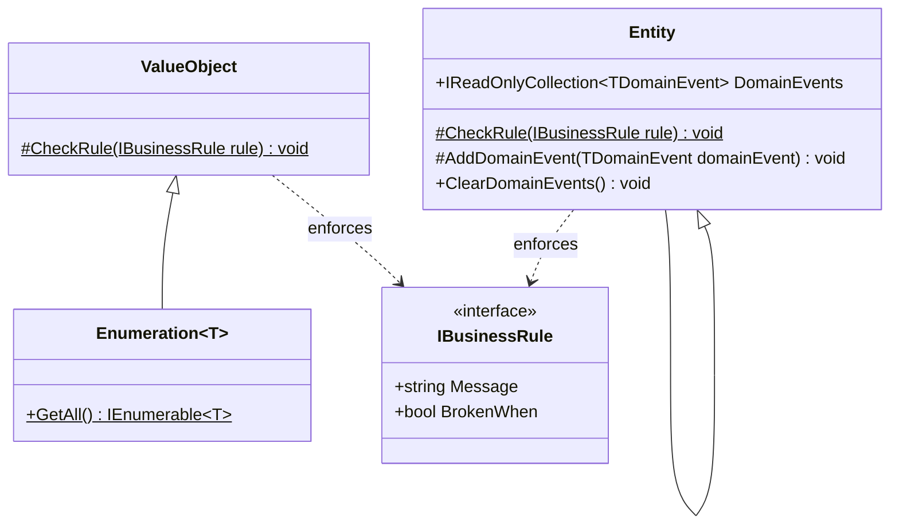
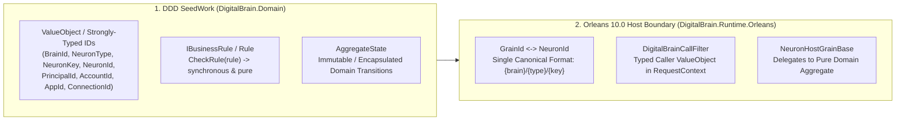

# Domain-Driven Design & Primitive Obsession Audit (`digitalbrain`)

IntoChat OS and `digitalbrain` aim for a clean, testable, behavior-rich domain model running natively on **Microsoft Orleans 10.0**. This specification synthesizes the core teachings from **Zoran Horvat** ([`@zoran-horvat`](https://www.youtube.com/@zoran-horvat) — *Zoran on C#* / *Coding Helmet*) on **C# OOP, SOLID, Tactical DDD, and Primitive Obsession**, combines them with the reference patterns in **`eShopOnWinUI.Domain`** and **`eShopOnWinUI.Application`**, adapts them to **Orleans 10.0 Virtual Actors**, and ruthlessly audits **`e:\intochat\digitalbrain`** against those standards.

---

## Part 1: Zoran Horvat's C# OOP, SOLID & DDD Principles

Across Zoran Horvat's core series on [`@zoran-horvat`](https://www.youtube.com/@zoran-horvat), six foundational principles govern clean C# domain modeling:

### 1. The Anemic Domain Model & Primitive Obsession Series
- **Videos**:
  - *This Is How the Anemic Domain Model Turns Bad* (Parts 1–6: *Fat Services Layer*, *Combinatorial Explosion of Methods*, *Eliminating Data Clumps*, *Adding Polymorphism*, *Make Your Object Model More Object-Oriented*, *How Far is Your Object-Oriented Code From Functional Programming?*)
  - *Stop Using Primitive Types in Your Minimal API Endpoints*
  - *Master the Design of Classes*
- **Core Thesis**:
  1. **Primitive Obsession Is the Root Cause of Anemic Models**: When a domain uses `string`, `int`, `Guid`, or raw tuples (`(string, string, string)`) to represent domain concepts (`BrainId`, `PrincipalId`, `AccountId`, `NeuronType`, `ConnectionKey`, `SemanticScope`), validation and parsing logic cannot live on `string`. It therefore leaks out into **static utility classes** (`BrainKey`, `ConnectionKeys`, `AppPrincipal`, `PolicyGrammar`) and **fat procedural services**.
  2. **Eliminate Data Clumps**: Whenever 2–4 primitives travel together repeatedly or are concatenated/split with `'/'` or `':'` (e.g., `"{brain}/connection/{connector}/{id}"` or `(string PrincipalId, string AccountId, string BrainId)`), they are a **Data Clump** crying out to be a cohesive **Value Object** with behavior.
  3. **Parse, Don't Validate (Smart Constructors)**: A Value Object validates its invariant once in its constructor or factory method (`Create` / `Parse`). Once constructed, no downstream method ever needs `ArgumentException.ThrowIfNullOrWhiteSpace(...)` or `IndexOf('/')` checks again.
  4. **No Implicit Conversions Back to Primitives at Internal Boundaries**: Adding `implicit operator string(AppKey key)` defeats the entire point of a Value Object by silently decaying rich types back into raw `string`s.

### 2. Behavioral Domain Models vs. Procedural Static Helpers
- **Videos**:
  - *This Is How Domain-Driven Design Makes Object-Oriented Design More Powerful*
  - *Advanced C# Tutorial: Not the OOP You Know*
  - *Your DDD Abstractions Are a Waste of Code*
  - *Avoid This Common Mistake in DDD Modeling*
- **Core Thesis**:
  1. **Tell, Don't Ask**: Instead of a neuron or service pulling properties out of a state bag (`if (State.Pending.FirstOrDefault(...) is { } pending)`), mutating arrays via LINQ, and writing 5-line comments explaining why, the **Domain State / Aggregate** itself exposes intention-revealing domain methods (`Propose(rule)`, `Approve(planId, now)`, `Reserve(action, amount, now)`).
  2. **Polymorphism Over `switch` / String-Prefix Branching**: Branching on magic strings (`if (appKey is "platform" or "scheduler" or "assistant")`, `if (key.StartsWith("principal:"))`, `if (value[0] == '@')`) is procedural code disguised as C#. Replace string-tag inspection with polymorphic types, smart enumerations, or discriminated value objects.
  3. **Comments Explaining Complex Plumbing Are a Design Smell**: When code requires paragraph-long comments to explain subtle ordering, phase numbers (`// 06-08`, `// R146: pre-Phase F shape`), or why a string has 1 vs. 2 slashes, the code is fighting a broken abstraction. In clean DDD, **the types and method names state the invariant**.

---

## Part 2: Reference Patterns from `eShopOnWinUI.Domain` & `Application`

Inspecting `E:\projects\eShopOnWinUI\src\eShopOnWinUI.Domain` and `eShopOnWinUI.Application` highlights how clean Tactical DDD is structured in C#:



1. **Strongly-Typed Identity Value Objects (`OrderId`, `ProductId`, `CustomerId`, `DocumentId`, `ShipmentId`)**:
   - Every entity identity is a dedicated `sealed record` (`OrderId(Guid Value)`), never a raw `string` or `Guid`.
   - You cannot accidentally pass a `DocumentId` where a `ProductId` is expected (`Warehouse.ReceiveProducts(int count, DocumentId documentId)`).
2. **Self-Validating Value Objects & Smart Enumerations (`Country : Enumeration<Country>`, `ValueObject`)**:
   - `Country.Create(string name, string iso)` checks 5 explicit `IBusinessRule`s (`CountryNameMustNotBeEmpty`, `CountryISOMustNotBeEmpty`, `CountryISOMustHaveTwoSigns`, `CountryISOMustContainsOnlyLetters`, `CountryISOMustBeInUppercase`) before constructing the record.
3. **Encapsulated Aggregates with Factory Methods & Domain Behaviors (`Order`, `Warehouse`, `Shipment`)**:
   - Private constructors force creation through `Order.Create(...)` or `Warehouse.Create(ProductId)`.
   - State collections are encapsulated (`private readonly List<OrderItem> _orderItems = []; public IReadOnlyCollection<OrderItem> OrderItems => _orderItems.AsReadOnly();`).
   - State transitions happen exclusively through domain methods (`Warehouse.ShipProducts`, `ReceiveProducts`, `DeclareMissedProducts`, `DeactivateProduct`) that check `IBusinessRule`s and record typed `WarehouseEventBase` domain events.
4. **Event-Sourced / Projection Domain Logic (`ActualProductQuantityProjection`)**:
   - Projections fold typed domain events (`WarehouseCreatedEvent`, `ProductsReceivedEvent`, `ProductsShippedEvent`, `ProductsMissedEvent`) via pattern matching without exposing mutable state bags.
5. **Thin Application Command Handlers (`DeleteProductsCommandHandler`, `UnitOfWorkCommandHandlerDecorator`)**:
   - Application handlers convert boundary primitives into domain IDs at the very first line (`new ProductId(productModel.Id)`), orchestrate domain objects, and let cross-cutting decorators handle logging, validation, domain event dispatching, and persistence commits.

### Adapting DDD to Microsoft Orleans 10.0
In Orleans 10.0, **a Grain / Neuron IS the Aggregate Root lifecycle host**, while **`TState` (or the Domain Model held by the Neuron) is the pure DDD Aggregate state**:
- **Grain Boundary**: Translates between wire/grain keys (`CompoundGrainKey` / `NeuronId`) and pure domain Value Objects.
- **Aggregate Root (`Neuron<TAggregate>` / `TAggregate`)**: Holds encapsulated state, enforces `Rule` invariants synchronously via `CheckRule(...)`, and returns `(TAggregate NextState, Signal[] DomainEvents)` cleanly without leaking persistence, reflection, or string-splitting into domain logic.

---

## Part 3: Ruthless DDD Grill of `e:\intochat\digitalbrain`

Below is the file-by-file audit of where `digitalbrain` violates DDD, suffers from **Primitive Obsession**, duplicates identity concepts, and hides accidental complexity behind walls of comments.

### Grill #1: The Five-Way Identity Schizophrenia (`BrainId`, `BrainKey`, `BrainScope`, `NeuronId`, `NeuronAddress`, `CompoundGrainKey`, `AppKey`)

Right now, `digitalbrain` has **seven different types/static classes** trying to represent "which brain and which neuron am I talking to?":

| Type / Static Class | File | What It Does & Why It Violates DDD |
| --- | --- | --- |
| `BrainId` | `Identity/BrainId.cs` | A `readonly record struct(string Value)` where `default(BrainId)` has `Value == null`! Every consumer has to check `if (brain.Value is null)` because C# structs have a parameterless `default`. System brains use a magic `'@'` prefix (`Value is ['@', ..]`), and `BrainId.IsValid` rejects `'@'` so `NeuronId.TryParse` silently rejects system brains! |
| `BrainKey` | `Brains/BrainKey.cs` | Static string-slicing helper (`BrainOf(string key)`, `BelongsTo(string key, string brain)`, `ScopeOf(string key)`) doing `key.IndexOf('/')` on raw `string` keys! |
| `BrainScope` | `Brains/BrainScope.cs` | `sealed record BrainScope(string Id, string Owner)` where `Create(string owner, string name)` takes `(owner, name)` in one order, constructs `new(name, owner)` in the **opposite** parameter order, and does nothing with `Owner` (`Create(caller.AccountId, caller.BrainId).Id` just returns `caller.BrainId`!). |
| `NeuronAddress` | `Neurons/NeuronAddress.cs` | Another struct `NeuronAddress(string NeuronType, string Key)` where `Key` is `"brain/key"`, `StorageKey` is `"{NeuronType}/{Brain}/{Key}"` (the **exact opposite** segment order of `NeuronId` which is `"{Brain}/{Type}/{Key}"`!), plus `INeuronResolver` taking raw `string relative` and `string fullKey`. |
| `NeuronId` | `Identity/NeuronId.cs` | `readonly record struct NeuronId(BrainId Brain, string Type, string Key)` where `Type` and `Key` are raw `string`s, `NeuronId.TryParse` rejects `compound.Brain.IsSystem` (`!compound.Brain.IsSystem`), and `default(NeuronId).ToString()` returns `""`. |
| `CompoundGrainKey` | `Identity/CompoundGrainKey.cs` | Almost identical to `NeuronId` (`BrainId Brain, string Type, string Key`), with its own **different** `IsValidBrainIdentifier` rule and its own `Key` rule (forbidding leading/trailing `'/'` and `"//"` which `NeuronId` allows!). |
| `AppKey` | `Apps/AppKey.cs` | Has `public static implicit operator string(AppKey key)` — which silently turns `AppKey` back into a raw `string` everywhere, plus `Path.Split('/')` on every `.Parts` or `.App` property access! |

> [!CAUTION]
> **Why This Causes Constant Bugs**: Because `NeuronId` (`{brain}/{type}/{key}`), `NeuronAddress.StorageKey` (`{type}/{brain}/{key}`), `SiloNeurons` (`{brain}/{key}`), and `ConnectionKeys` (`{brain}/connection/{connector}/{id}`) all pack different slash-separated strings into raw `string` parameters, methods like `InBrain(string target, string brainId)` have to guess which segment is the brain by trying first segment, then second segment after `'/'`!

---

### Grill #2: Rampant Primitive Obsession in Identity, Capabilities & Connections

Look at `DigitalBrain.Capabilities.Identity/Records.cs` and `CapabilityCaller.cs`:

1. **`CapabilityCaller` (`Capabilities/CapabilityCaller.cs`)**:
   ```csharp
   public sealed record CapabilityCaller(
       string PrincipalId,
       string AccountId,
       string BrainId,
       string? AppId = null,
       string? ConversationId = null)
   ```
   - Every single property is a raw `string`! Because all 5 parameters are `string`, a caller can easily swap `(principalId, accountId, brainId)` and the compiler will never catch it.
   - Worse: `CallerKind` is **not even stored**! Instead, `CapabilityCaller.Kind` is reverse-engineered from magic string values stuffed into `AppId` (`"platform"`, `"scheduler"`, `"assistant"`), and `CapabilityCaller.App(appKey)` constructs a half-invalid `CapabilityCaller` with `AccountId = ""` and `BrainId = ""`!
   - And `AppPrincipal` encodes app principals by prepending `"app:"` to a string (`"app:{brain}/apps/{name}"`) and slicing `principalId["app:".Length..]`.

2. **`Account`, `Member`, `Grant`, `CallRequest` (`Capabilities.Identity/Records.cs`)**:
   - `Account`: `string AccountId`, `string Name`, `string OwnerPrincipalId` — all raw `string`s, no Value Objects, no constructor invariants (`public required string AccountId { get; init; }` allows `""` or whitespace!).
   - `Grant`: `string AppId`, `string SemanticTypeId`, `string WorkspaceId`, `string? ConversationId`, `string? TargetNeuronKey` — 5 raw `string`s! Look at `Grant.Covers(string appId, string semanticTypeId, string workspaceId, string? conversationId, string? targetNeuronKey)`: 5 `string` parameters in a row!

3. **`ConnectionKeys` & `ConnectionNeuron<TState>` (`Capabilities.Connections`)**:
   - `ConnectionKeys` is a static string-manipulation class (`StripScheme`, `Split('/')`, `Uri.EscapeDataString`) returning a raw string or an unnamed 3-tuple `(string BrainId, string ConnectorId, string ConnectionId)` instead of a real `ConnectionId` Value Object!
   - `ConnectionState` is **mutable on purpose** (`// Mutable on purpose: the base mutates the generic TState in place and writes it`), forcing `ConnectionNeuron.Restore(TState before)` to use **runtime reflection** (`typeof(TState).GetProperties()... property.SetValue(...)`) to roll back state on failure!
   - Look at `ConnectionState.SharedInto`: `public string[] SharedInto { get; set; } = [];` where entries are magic strings formatted as either `"{brain}/{app}"` or `"principal:{id}"` by `ConnectionNeuron.SharingEntry(string principalId)` doing `appKey.IndexOf('/')`!

---

### Grill #3: Procedural Static Parsers Instead of Rich Value Objects (`PolicyGrammar`)

Look at `Policies/PolicyGrammar.cs` (268 lines) and `Policies/PoliciesNeuron.cs` (228 lines):
- `PolicyGrammar.Parse` takes **8 primitive parameters** (`string id, string action, string measure, string window, decimal limit, string? conditionFact, string? conditionOp, string? conditionValue, ActionDescriptor declared, TimeProvider clock`).
- Instead of `ActionName`, `PolicyWindow`, and `PolicyCondition` being self-validating Value Objects with their own `Parse` / `ToString` methods, `PolicyGrammar` is a 268-line procedural static class full of `trimmed.StartsWith("Rolling")`, `rest[1..^1]`, `HasActionShape`, and `TryParseSpan`.
- Meanwhile, `PoliciesNeuron` is an anemic host over a bag of lists (`PoliciesState(IReadOnlyList<PolicyRule> Rules, IReadOnlyList<Reservation> Reservations, IReadOnlyList<PendingProposal> Pending)`). All the domain logic for window pruning (`Pruned`, `InWindow`, `WindowTotal`, `Matches`) sits as private static helper methods inside the neuron class instead of on a cohesive `PolicyBook` / `PolicyRule` domain model!

---

### Grill #4: Split-Brain Ambient Context (`CallerAdmission` vs. `RuntimeCallerContext`)

Look at `Brains/CallerAdmission.cs` vs. `Runtime.Orleans/Capabilities/RuntimeCallerContext.cs`:
- Both define the exact same 5 magic string constants:
  ```csharp
  private const string PrincipalKey = "db.cap.principal";
  private const string AccountKey = "db.cap.account";
  private const string BrainKey = "db.cap.brain";
  private const string AppKey = "db.cap.app";
  private const string ConversationKey = "db.cap.conversation";
  ```
- Because `DigitalBrain.dll` wanted to read Orleans `RequestContext` without referencing `Orleans.Core.Abstractions`, `CallerAdmission.RequestContextGet()` scans `AppDomain.CurrentDomain.GetAssemblies()` at runtime and uses reflection (`assembly.GetType("Orleans.Runtime.RequestContext")?.GetMethod("Get")`) to read those 5 strings!
- In a clean DDD architecture, **Domain objects never read ambient `AsyncLocal` or `RequestContext` statics**! The application/grain boundary extracts the `Caller` Value Object once and passes it explicitly (or via `INeuronContext.Caller`).

---

### Grill #5: Over-Complicated God Classes & Comment Novels (`StateNeuron<TState>`, `App`, `InstallsNeuron`)

1. **`StateNeuron<TState>` (`Synapses/StateNeuron.cs` — 526 lines)**:
   - Mixes **four completely separate responsibilities** in one 526-line class:
     1. **Two-Phase Gate Provisional Queue** (`_provisional`, `_flushed`, `_flushedOrder`, `Gate`, `Committed`, `Aborted`, `FlushHead` — 180 lines of subtle state machine logic with a 20-line `<remarks>` novel explaining out-of-order commits and late re-gates).
     2. **View Projection & Node Activation** (`_view`, `_viewsPending`, `_savingView`, `RunViews`, `Activate` — inspecting `"DigitalBrain.UI.View"` by string type name `result.GetType().FullName == ViewNodes.ViewType`!).
     3. **Reflection Parameter Binding & Timeout Management** (`Invoke` building `object?[]` arrays by inspecting `parameters[i].ParameterType` on every call and reading `task.GetType().GetProperty("Result")!.GetValue(task)` via reflection!).
     4. **Dual-Format State Persistence** (`LoadState` trying `StoredState<TState>` first, then falling back to `TState`).
2. **`App` & `App<TState>` (`Apps/App.cs` & `AppOfTState.cs`)**:
   - Uses `Lock _gate` and `Lock _stateGate` around `_state`, `_error`, and `_swallowed` even though apps run on single-threaded turn schedulers.
   - Uses untyped delegate fields `Func<Type, string, object>? _neuronResolver` and `Func<Type, object>? _capabilityResolver` attached via mutator methods (`AttachNeuronResolver`, `AttachCapabilityResolver`).
3. **Historical Archaeology Comments**:
   - Throughout `digitalbrain`, comments reference dead phase numbers and historical migrations instead of domain invariants:
     - `// A plain neuron (06-08): its state is the connector's ConnectionState record (clean break, R4-24: users connect again).`
     - `// The persisted SharedInto entries keep their pre-Phase F shape...`
     - `// Transitional (06-05b, until 06-08 moves stamping to the runtime)...`
     - `// R130/R147: fills the shared copy's credential...`

---

## Part 4: Target DDD Architecture for `digitalbrain`

To make `digitalbrain` as clean, self-documenting, and testable as `eShopOnWinUI.Domain` while running idiomatically on **Orleans 10.0**:



### 1. Unify Identity into Composable, Non-Defaultable Value Objects
Eliminate `BrainKey`, `BrainScope`, `NeuronAddress`, and `CompoundGrainKey` duplication. Establish **one** canonical hierarchy of strongly-typed Value Objects:
- **`BrainId`**: Validates `1..200` chars; explicitly models system scopes (`BrainId.System("kernel")` / `BrainId.Parse("@kernel")`) so `BrainId.TryParse` and `NeuronId.TryParse` work uniformly for both user brains and system brains (`@system`, `@kernel`).
- **`NeuronType`**: Strongly-typed value object (`new NeuronType("identity.directory")`) instead of raw `string type`.
- **`NeuronKey`**: Strongly-typed relative key (`new NeuronKey("main")` or `NeuronKey.FromParts("apps", "ino")`) instead of raw `string key` and `AppKey` implicit string conversions.
- **`NeuronId(BrainId Brain, NeuronType Type, NeuronKey Key)`**: The **single** compound address across the entire codebase (`{Brain}/{Type}/{Key}`). Replaces `CompoundGrainKey`, `NeuronAddress`, and `BrainKey`.
- **`PrincipalId`, `AccountId`, `AppId`, `ConversationId`, `SemanticScope`**: Strongly-typed Value Objects replacing the 5 raw `string`s in `CapabilityCaller`, `Account`, `Member`, and `Grant`.
- **`ConnectionId(BrainId Brain, ConnectorId Connector, ConnectionName Name)`**: First-class Value Object replacing the static `ConnectionKeys` tuple/string-splitting helpers and `SharedTarget` (`AppTarget` | `PrincipalTarget`) replacing magic `"principal:"` / `"{brain}/{app}"` strings in `ConnectionState.SharedInto`.

### 2. Extract Cohesive Domain Objects from Fat Neurons
- **`ProvisionalGateQueue<TState>`**: Extract the 180-line two-phase gate commit/abort/re-gate state machine out of `StateNeuron<TState>` into a pure, unit-testable domain class.
- **`PolicyBook` & Value Objects (`ActionName`, `PolicyWindow`, `PolicyCondition`)**: Move `PolicyGrammar`'s procedural static methods into the Value Objects they belong to, and move reservation window math from `PoliciesNeuron` into `PolicyBook` (`PoliciesState`).
- **Immutable `ConnectionState`**: Make `ConnectionState` an immutable record with domain transition methods (`ConnectedWithSecret(...)`, `ConnectedWithOAuth(...)`, `SharedWith(SharedTarget)`, `Disconnected()`), deleting reflection-based `Restore(TState before)` from `ConnectionNeuron<TState>`.

### 3. Clean Up `CallerAdmission` & Historical Comment Noise
- Replace the 5-key `RequestContext` string scatter (`db.cap.principal`, etc.) and reflection assembly scanning with a single typed `Caller` Value Object on `INeuronContext.Caller`.
- Strip obsolete phase-number archaeology comments (`06-05b`, `06-08`, `pre-Phase F`, `R4-24`) so comments only express timeless domain invariants where types alone cannot.

---

## Part 5: Executed DDD Refactorings in `digitalbrain`

All high-priority DDD refactorings identified above have been implemented and verified across `e:\intochat\digitalbrain` and `e:\intochat\os`:

1. **Identity & Addressing Unification (`DigitalBrain/Identity`, `Brains`, `Neurons`, `Apps`)**:
   - `BrainId` now owns both user and `@`-prefixed system brain validation (`BrainId.IsValidUserOrSystem`, `BrainId.TryParseUserOrSystem`) using a cached `SearchValues<char>` instance.
   - `CompoundGrainKey`, `BrainScope`, and `NeuronAddress` now delegate directly to `BrainId` and `NeuronId` instead of duplicating validation rules or ad-hoc string parsing.
   - `AppKey.App` now slices up to the first `'/'` without allocating intermediate `string[]` arrays via `Path.Split('/')`.
2. **Connections Domain Encapsulation (`DigitalBrain.Capabilities.Connections`)**:
   - Introduced the `ConnectionAddress(BrainId Brain, string ConnectorId, string ConnectionId)` Value Object encapsulating `Key`, `UriString`, `ToNeuronId()`, `ToTuple()`, `Create`, `Parse`, `TryParse`, and `StripScheme`.
   - Introduced the `SharedRecipient` Value Object (`ForApp`, `ForPrincipal`) and moved credential/sharing state transitions (`IsConfigured`, `ApplySecretCredential`, `ApplyOAuthCredential`, `ClearCredentials`, `AdoptSharedMetadata`, `ImportSealedCredentials`, `TryAddSharedRecipient`, `TryRemoveSharedRecipient`, `IsSharedWith`, `CopyBaseFrom`) directly onto `ConnectionState`, eliminating reflection-based `Restore` copying in `ConnectionNeuron<TState>`.
3. **Policies Domain Encapsulation (`DigitalBrain/Policies`)**:
   - Encapsulated window containment (`PolicyWindow.Contains`), fact condition matching (`PolicyCondition.Matches`), rule applicability/increment (`PolicyRule.AppliesTo`, `PolicyRule.IncrementFor`), and aggregate state transitions (`StageProposal`, `DenyProposal`, `AdoptProposal`, `TryReserve`, `ReleaseReservation`, `RetireRule`) directly onto `PoliciesState`, shrinking `PoliciesNeuron` to a thin Orleans turn-coordination shell.
4. **Synapses & Installs Domain Encapsulation (`DigitalBrain/Synapses`)**:
   - Extracted the two-phase provisional gate state machine out of `StateNeuron<TState>` into `ProvisionalGateQueue<TState>` (`EffectiveBase`, `PruneExpiredUncommitted`, `RecordAllowance`, `WasFlushed`, `TryMarkCommitted`, `DequeueCommittedHeadRun`, `TryRemoveUncommitted`) and extracted collectible-safe task result unboxing into `TaskBoxing.ResultAsync`.
   - Encapsulated install state transitions (`FindRecord`, `FindPendingByPlan`, `HasSameBindings`, `Rebind`, `StagePending`, `RemovePendingPlan`, `CompleteInstall`, `CancelPendingForAlias`, `RemoveRecord`) directly onto `InstallsState`.
5. **Local Identity Directory & Caller Admission (`DigitalBrain.Identity.Local`, `DigitalBrain/Capabilities`)**:
   - Encapsulated account, brain, membership, grant authorization/revocation, and session validation behavior onto `DirectoryState`, reducing `DirectoryNeuron` by ~180 lines of procedural static helpers.
   - Encapsulated caller admission predicates (`IsAppCaller`, `CanTouchBrain`, `IsNonAppMemberOf`) directly onto `CapabilityCaller`.
