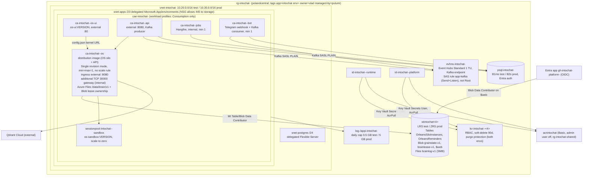

# Azure test and prod environments for IntoChat (W5 design)

**Goal:** Two reproducible Azure environments, `test` and `prod`, in `polandcentral`. Each runs the OS Orleans silo (platform's distribution image), os-ui, the C# sandbox, platform API, Jobs and Bot, and the portal. Each has durable OS storage with single-writer guarantees, Key Vault plus managed identity, and GitHub-gated deploys. `test` is created after the owner reviews this document **and re-approves its cost** (§7). `prod` is created later, behind a separate approval.

**Status:** design only, revision 2 (2026-10-18). Nothing in Azure was created or changed. Only read-only `az` was used: the W5 inventory (`clients/intochat/projects/briefs/clean-architecture/w5-azure-inventory.md`, `azure-inventory/*.json` in agentic-os) and one blob listing attempt, which was refused for lack of a data-plane role (§3.5). No `pulumi preview` or `pulumi up` was run.

**Builds on:** `plans/deploy-os-and-platform-2026-10-17.md` (D1 to D5, O1 to O6, platform PRs #1 to #5). This document supersedes its single `production` stack and its TripRadar names. Release-driven delivery (D3 to D5) is unchanged.

**Owner decisions (2026-10-18):**
- Region `polandcentral`.
- `test` was approved at about $60 to $120 per month. **The honest estimate is above that (§7). Re-approval is needed, or one of the two lean options must be chosen.**
- `prod` comes later and needs its own approval.
- Platform needs Postgres and Event Hubs.
- Retire `ca-digitalbrain-kernel` after `test` is live.
- Move `sv` and `LeedGenerator` to another subscription (commands only).
- The custom domain is configurable and not set yet.

All prices are **estimates** from public pay-as-you-go list prices in USD. Check them in the Azure pricing calculator for polandcentral before approving.

### Revision 2: review findings and where this document disagrees

The independent review (`clean-architecture/w5-design-review.md`) found the following. Each finding was checked against the code and Microsoft Learn.

| Finding | Resolution |
| --- | --- |
| C1 BrainLog lock vs Single-revision overlap | **Accepted, with a different mechanism.** The review offers "stop then start" deploys as one option. This document rejects that option as insufficient: Learn ("Set scaling rules", scale definition) states that "during platform upgrades or maintenance, you might temporarily see more replicas than expected … pre-warming new replicas". An overlap can therefore happen without any deploy, and a deploy strategy alone cannot guarantee one writer. Fix: Blob-lease ownership with fencing (os PR S5, §3.4), plus a lock spike gate (G2-L) |
| C1 "new revision never ready" | **Partly disagree.** Claims are already lazy. `BrainLogs` does not claim in its constructor (`BrainLogs.cs:16-23`). It claims per brain on first use, and a refused claim is not cached, so a later call retries (`:25-50`). `CheckStorageAsync` runs only in hosted mode (`HostedRecoveryHost.cs:40`, `HostedRuntimeEndpoints.cs:77`), which this design does not enable. Startup therefore does not deadlock. The real risks are `BrainNotOwnedException` during overlap, or two writers if `flock` is not enforced across CIFS clients. S5 resolves both |
| C1 "never form one cluster" contradiction | **Accepted.** The text is removed. Old and new revisions share the ClusterId and do join one cluster during overlap, and that is desirable (§2) |
| C2 Event Hubs Basic has no Kafka | **Accepted**, verified: `Confluent.Kafka` (`Directory.Packages.props:243`), SASL `Plain` (`ContainerAppsService.cs:391`), RootManageSharedAccessKey (`EventHubsService.cs:89-95`), custom group `app-consumer-group` (`:88`). Standard is used in both environments. Auth decision in ADR A5 |
| C3 cost understated | **Accepted.** Recomputed at active rates (§7). Test is about $160-195, above the approved range. Two lean options are given |
| H1 two DeploymentKits | **Accepted.** os uses the external package `DeploymentKit` 1.0.0-preview.3 (`os/Directory.Packages.props:54`, `DigitalBrain.Deployment.csproj:8`). Platform uses its own `TripRadar.DeploymentKit` (`IntoChat.DeploymentKit.csproj:9`). S2 is rescoped (ADR A3) |
| H2 port 11111 mapping | **Accepted.** Only 30000 is mapped. Multi-silo is stated as unproven |
| H3 prod autoscale | **Accepted.** Prod is 1 silo by default, with no scale rule. Scaling is listed under "after W1" |
| H4 Bot, MiniApp, WebUI | **Accepted.** Bot is in scope. WebUI is the portal. MiniApp is out of scope (§2) |
| M1-M9, citation table | Applied in place. M2 could not be verified: the reviewer's identity lacks a Blob data-plane role. It is now operator step O9a and a precondition of O9 |
| Jobs "consumes Kafka, check" (C3) | **Checked:** Jobs does not consume Kafka. Only `IntoChat.Bot` does (`IntoChat.Bot/Program.cs:24`, `Notifications/ScheduledQueryConsumer.cs`). Jobs is a Hangfire server (W4 map, `w4-platform-flow-map.md:48`) that polls Postgres, so it stays at min 1 and bills at the active rate |

---

## 1. Current state and what gets retired

Subscription `2a985480-6bb9-44ff-959d-edd5efe2cdb2`, tenant `16ea5f3c-…`. A phantom second subscription `b0c622ab-…` returns `SubscriptionNotFound` (inventory §1).

| Resource | What it is | Fate |
| --- | --- | --- |
| `ca-digitalbrain-kernel` (RG `intochat-rg`. **The RG metadata is in westeurope; the resources are in polandcentral**) | The only running IntoChat compute. Image `docker.io/vhorbachov/digitalbrain-kernel:v0.1.30`, 0.5 vCPU / 1 GiB, min=max=1. Orleans on Azure Table + Blob through a shared-key `storage-conn` | **Retire** after gate G3 |
| `cae-digitalbrain-dev` | Consumption ACA environment without a VNet | Retire with the app |
| `stdbraindeve2c940` | Tables `OrleansSiloInstances`, `OrleansReminders`. Containers `grainstate`, `state`, `digitalbrain-v2-journal`, `digitalbrain-v2-state` | Count and export (O9a, O9), keep 30 days, then delete |
| `intochat-ui-webapp` (SWA Free, eastus2) | Old UI, replaced by os-ui (deploy plan D1) | Retire |
| `id-digitalbrain-deploy` | Deploy identity of the deleted os `deploy.yml` | Retire (deploy plan O2) |
| `workspace-intochatrgBKe4` | Log Analytics for the old environment | Retire with the RG |
| `LeedGenerator` RG (polandcentral; its Postgres `leadpostresserver` is in **northeurope**, about $28) and `sv` RG (SWA Standard, $9) | Not IntoChat | **Move** (O7). Resources keep their location |

Pulumi in platform has never been deployed and is TripRadar-branded:
- Project `tripradar-infrastructure` (`src/IntoChat.Infrastructure/Pulumi.yaml:1`).
- Namespace `tripradar` (`Constants/TripRadarServerConstants.cs:17`).
- Hardcoded `api-dev.tripradar.io` (`:6-7`).
- Defaults `production` and `westeurope` (`:45-46`).
- An environment string switch in `Program.cs:22-47`.
- Stacks `development` and `production` (`Pulumi.development.yaml:1-3`, `Pulumi.production.yaml:1-15`).
- Event Hubs `Basic` in both builders (`TripRadarDeploymentConfiguration.cs:67,234`).
- ACR admin user on (`DeploymentKit/Services/ContainerRegistryService.cs:55`).
- `deploy-prod.yml` runs on every push to `master` **or `main`** (`.github/workflows/deploy-prod.yml:3-8`), with `PULUMI_STACK` defaulting to `production` (`:22`) and no `environment:`.

The os repo has its own Pulumi library, `src/DigitalBrain.Deployment`. It provides:
- A runtime MI (`DigitalBrainDeployment.cs:44-49`).
- A workload-profile environment on a delegated subnet (`:50-68`).
- Key Vault-referenced secrets (`:116-125`).
- RBAC for Blob, Table, Key Vault and AcrPull (`:180-187`).
- A stable `Orleans__ClusterId`/`ServiceId` (`:88-89`).
- Manifest binding values for the silo and gateway ports (`:168-169`). These are binding values, not ACA ports.

It sits on top of the **external** `DeploymentKit` package, whose `DeploymentKitFoundation.DeployAsync` creates its own RG, VNet, Key Vault, ACR and storage (`:41`, `:70-77`).

Platform PR #5 (branch `deploy/task-8-distribution-app`) adds a separate distribution app inside platform's `ContainerAppsService.cs` (`:436` scale block, `:452-502` os-ui app, line numbers on that branch only) without Orleans storage. ADR A3 decides between the two.

---

## 2. Target topology

### ADR A1. Compute: Azure Container Apps, workload-profile environment (Consumption profile only) on a VNet

A workload-profile environment is required for VNet integration, extra TCP ports and custom-container session pools. Learn confirms that custom container pools "require a workload profiles-enabled environment". Only the free Consumption profile is used, and a /23 subnet is enough (the minimum is /27). A Dedicated profile would add about $100 or more per month.

Rejected:
- **AKS.** 2 to 4 times the cost, and it has to be operated. It is revisited only if HA with more than one silo becomes mandatory and the G4 spike fails (§10).
- **The existing `cae-digitalbrain-dev`.** It has no VNet.

### ADR A1b. One OS silo per environment until W1 delivers brain-affinity placement

- Prod defaults to **min=max=1**, with no scale rule.
- Two silos on ACA are unproven (no Learn page documents replica-to-replica TCP; the Orleans-on-ACA tutorial uses a single instance), and the BrainLog single-writer model favours one silo per brain anyway.
- G4 (§3.4) is a spike that **may fail**. Prod availability therefore rests on one replica plus fast restart, not on a cluster.
- "After W1": min 2, an HTTP/CPU scale rule, and brain-affinity placement.

### Per-environment topology



### OS silo app (`ca-intochat-<env>-os`)

**Revision mode `Single`.** Learn ("Update and deploy changes", zero downtime) states that the old revision is deactivated only after the new one is ready. Overlap is guaranteed, not incidental.

During the overlap, both revisions share `ClusterId=intochat-<env>` and **join one Orleans cluster**:
- If silo-to-silo connectivity works, a brain grain already active on the old silo keeps receiving calls there. When the old silo shuts down gracefully, its brains deactivate and release ownership, and the next call activates them on the new silo.
- If connectivity does not work, the two silos are partitioned, and both could activate the same brain.
- Correctness therefore never depends on the cluster. It depends on **lease ownership with fencing (S5, §3.4)**. A silo that cannot acquire a brain's lease returns a retryable error for that brain and never writes.

**Graceful shutdown.** `terminationGracePeriodSeconds: 60`. On `SIGTERM`, Orleans shutdown deactivates grains, BrainLog flushes, and the lease is released.

**Ports.**
- HTTP ingress on 8080 (`DigitalBrainDeployment.cs:141`).
- An internal `additionalPortMappings` entry for 30000 (gateway, for `DigitalBrain.Mcp` and other clients).
- **11111 is not mapped.** An ACA port mapping sits behind the app's load-balanced internal endpoint, while silos must reach each other's advertised replica IPs directly.

**Advertised IP.** Leave `Orleans__Endpoints__AdvertisedIPAddress` unset. The `127.0.0.1` override is only for local executables (`DigitalBrainHostingExtensions.cs:89-93`).

**Sizing.** Test is 0.5 vCPU / 1 GiB, which the old kernel ran at, or 1 vCPU / 2 GiB under the "full" option in §7. Prod is 1 vCPU / 2 GiB. The os library default of 2 vCPU / 4 GiB (`DigitalBrainDeployment.cs:147`) becomes a parameter. min=max=1 (`:148-149`) stays.

**Probes.** Liveness and readiness on `/health`. The startup probe has `failureThreshold 30`, `period 10s`. Readiness does not touch any brain, consistent with lazy claims.

### Platform apps

Source: W4 map, `w4-platform-flow-map.md:48`, and `src/`.

| App | Image | Ingress | Min/max test | Min/max prod | Notes |
| --- | --- | --- | --- | --- | --- |
| os-ui | `ghcr.io/intochat/os-ui:<DigitalBrainVersion>` | external :80 | 0/1 | 1/1 | deploy plan D1/D4 |
| sandbox | session pool, `os-sandbox:<ver>` (`CSharpDeployment.cs:87`) | pool endpoint, MI | 0 ready | 1 ready | |
| api (`IntoChat.Server.API`) | ACR `intochat-api` | external :8080 | 0/1 | 1/3 | Kafka producer (`Server.Infrastructure/.../ServiceCollectionExtensions.Settings.cs:19-27`). Scale-to-zero in test needs `KafkaReadinessHealthCheck` to tolerate cold start |
| jobs (`IntoChat.Server.Jobs.API`) | ACR `intochat-jobs` | internal | 1/1 | 1/1 | Hangfire server, which needs exactly one always-on instance per queue set |
| bot (`IntoChat.Bot`) | ACR `intochat-bot` | external :8080 (Telegram webhook) | 1/1 | 1/1 | Kafka consumer (`IntoChat.Bot/Program.cs:24`) plus Telegram (`:37-38`). The kit already models it (`ContainerAppsService.cs:115`). Secret `telegram-bot-token` |
| portal = `IntoChat.WebUI` | Vite static build in `$web` | Storage static website (Front Door optional in prod) | n/a | n/a | uploaded by CI (deploy plan D5) |
| `IntoChat.MiniApp` | — | — | — | — | **Out of scope.** The deploy plan deleted its publish steps. The project only keeps building in CI |

### Data services

- **Postgres Flexible Server.**
  - Test: B1ms, 32 GB. Prod: B2s, 64 GB, 7-day PITR. No HA.
  - VNet-integrated, Entra auth on.
  - Optional in test: stop/start outside working hours (see §7).
- **Event Hubs Standard, 1 TU, in both environments.**
  - Learn: "Event Hubs for Kafka isn't supported in the basic tier". Basic also has only `$Default`, which breaks `app-consumer-group` (`EventHubsService.cs:88,107`).
  - Hubs: the topics platform uses (W4 lists them). Retention 1 day in test, 3 days in prod.
- **Front Door Standard.** Optional, prod only, off by default.

### Naming and tags

Pattern: `<abbr>-intochat-<env>[-<role>]`, using CAF abbreviations. Exceptions: `stintochat<env><4>` and `acrintochat`, which allow no hyphens. Key Vault is `kv-intochat-<env>-<4>` (21 characters, within the 24 limit).

Every resource is tagged `app=intochat`, `env`, `owner=vlad@intochat.io`, `managed-by=pulumi`, `repo=intochat/platform`. Shared resources live in `rg-intochat-shared` with `env=shared`.

---

## 3. OS storage analysis and recommendation

### 3.1 What the OS persists (from code)

| Data | Where the code puts it | Durable today? | Notes |
| --- | --- | --- | --- |
| Membership | `UseAzureStorageClustering` (`OrleansStorageHosting.cs:65`); localhost when no integration is set (`:47-52`) | Azure Table (live kernel) | Only needs to survive while silos run |
| Reminders | `UseAzureTableReminderService` (`:66`); in-memory (`:53`); hosted `HostedReminderTable` (`HostedAuthorityHosting.cs:88-89`) | Table | **Must** be durable |
| Platform grain state (identity, cookie keys, deployment identity) | Blob grain storage per store (`OrleansStorageHosting.cs:72-80`) plus the keyed `BlobServiceClient` (`:67-71`) | Blob | **Must** be durable |
| Cluster grain state = **BrainLog** (neurons, journals, user apps and their state) | `BrainGrainStorage` over `BrainLogs` replaces the cluster store (`BrainStorageHosting.cs:29-31`). Encrypted segment log under `DigitalBrain:Platform:Storage:Directory` (`BrainStoreOptions.cs:6`, `DigitalBrainNames.cs:16`). Ownership is `writer.lock` with `FileShare.None` (`BrainLog.cs:51-58`) | **No.** The ACA container disk is ephemeral | The brain itself |
| Signal journal | `BrainSignalJournal` over BrainLogs (`BrainStorageHosting.cs:27-28`) | as BrainLog | |
| Master key | Configured custody in Production requires `ConfiguredCustodyAcknowledged` (`BrainStorageHosting.cs:40-44`) | Key Vault secret | Losing it makes BrainLog unreadable. Purge protection is on in **both** environments |
| Vectors | Qdrant via `QdrantConnection.cs` (connection from `qdrant-conn`); `InMemoryQdrant.cs:5` is the fallback when no connection is composed | Qdrant Cloud | Rebuildable from BrainLog |

Format versioning:
- Segments carry `BrainLogFormat { Legacy = 0, Framed = 1 }` (`BrainLogModel.cs:6`). Writes stay `Legacy` until `WriteFormat=Framed` (`BrainStoreOptions.cs:9-10`).
- A portable `BrainExport(FormatVersion, …)` exists (`BrainLogModel.cs:8-9`).
- The hosted journal refuses to replace an existing grain-state store (`HostedAuthorityHosting.cs:80-83`).

Code constraints:
1. The Orleans integration takes connection strings only (`OrleansStorageHosting.cs:65-74`). S1 adds service-URI plus `DefaultAzureCredential` support. The reviewer confirms that `TableServiceClient(Uri, TokenCredential)` fits Orleans' options.
2. The three integration keys are all-or-none (`:33-38`). With none set, the silo uses localhost clustering and only one replica is possible.

### 3.2 Can test start in-memory?

Yes. With the three `DigitalBrain__Integrations__orleans__*` keys empty, the silo uses localhost clustering, in-memory reminders and in-memory platform stores (`OrleansStorageHosting.cs:34,47-60`). `AddBrainStorage` still runs, so the Production custody guard (`BrainStorageHosting.cs:43-44`) still needs `ConfiguredCustodyAcknowledged=true` and the `master-key` secret, even in memory mode. Everything is lost on restart.

**Decision:** memory mode only for the first bootstrap deploy (G2a), to prove the pipeline, ingress, os-ui and Key Vault. `test` is durable from G2b. Durability costs about $3-6 per month.

### 3.3 Durable options

| Option | Clustering / reminders | Platform grain state | BrainLog | Fit | Est. $/mo test | prod |
| --- | --- | --- | --- | --- | --- | --- |
| **A. Table + Blob + Azure Files, plus Blob-lease ownership** | Table | Blob | SMB share; ownership is a Blob lease (S5) | Today's code plus S1 and S5. Cheapest | **3-6** | **8-20** |
| A′. Table + Blob + Blob-native BrainLog | Table | Blob | Block/append blobs plus lease (W1) | No mount and no shared key. Runtime-agnostic. Larger os change | 3-5 | 8-15 |
| B. Postgres via Orleans ADO.NET | Postgres | Postgres | Files + lease, or a DB-backed BrainLog (W1) | Reuses the platform server (about $0-15 extra). Needs Orleans SQL scripts, a provider branch and Npgsql Entra tokens. Couples the OS to platform's database | 0-2 extra | 0-15 extra |
| C. Cosmos DB | Cosmos | Cosmos | Files or new store | Heartbeats burn RUs. A third data technology | 5-25 | 25-60 |
| D. In-memory | localhost | memory | ephemeral | G2a only | 0 | not allowed |

Why Files needs S5:
- .NET on Linux emulates `FileShare.None` with advisory `flock`. Across CIFS clients, enforcement depends on mount options.
- Microsoft's mount guidance recommends `nobrl` (Learn, "Azure Files guidance for AKS workloads": "Disable byte-range locks"), and `nobrl` makes locks local to one client.
- The earlier claim that SMB "supports the `FileShare.None` semantics" across replicas is withdrawn.
- NFS (Premium, 100 GiB minimum, about $16 per month) has the same advisory-lock question, so it does not solve this either.
- Ownership must therefore come from the service, not the filesystem: a **Blob lease**, which is enforced server-side, works under MI, and has a 15-60 s duration or is infinite.

### 3.4 Recommendation

**Option A with S5 in test and prod. A′ is the W1 target.** Infinitely-scaled storage is not needed. What matters:
- Proven code paths.
- Single-digit dollars.
- The OS stays independent of platform's Postgres, which matches W1's runtime-agnostic aim and self-hosting.
- A clean path to A′ through versioned stores.

**Clustering provider: Azure Table.** No Kubernetes API or SQL schema is needed, it is inspectable with `az storage entity query`, and `DigitalBrain.Mcp` already joins through it (`src/DigitalBrain.Mcp/DigitalBrain.Mcp/Program.cs:9`; `DigitalBrainHostingExtensions.cs:160-166`).

**Single-writer mechanism (os PR S5, required before durable test G2b):**
1. **Lease ownership.** `BrainLog.Claim` gains an `IBrainOwnership` seam.
   - The default is the existing `writer.lock`, so local and self-hosted behaviour is unchanged.
   - The Azure implementation acquires a 60-second Blob lease on `brainlease-v1/<brainId>` (MI, `BlobLeaseClient`) and renews it every 20 seconds.
   - Failure to acquire throws the existing `BrainNotOwnedException` (`BrainLog.cs:57`).
2. **Fencing.** Each append checks that the lease is held (the renewal loop records the last successful renewal). If the last renewal is older than 40 seconds, the log faults and refuses writes, so a paused or partitioned old silo cannot write after its lease expires.
   - The lease ID is also written into the segment header (Framed format), so a later reader can detect an interleaving.
3. **Lazy claim with bounded retry.** Claims stay lazy (`BrainLogs.cs:25-50`). On `BrainNotOwnedException`, the brain grain retries with backoff for up to 90 seconds, which covers the old revision's 60-second graceful drain, and then returns 503 with `Retry-After`. Readiness never claims.
4. **Release on shutdown.** `BrainLog.Dispose` releases the lease, so a graceful drain hands over in seconds rather than after the 60-second expiry.
5. **Observability.** A `brainlog.ownership` metric and log events (`acquired`, `refused`, `lost`, `released`).

Owner-visible cost of this design: during a deploy, a brain that is busy on the old revision can see up to about 60-90 seconds of retry/503 on its first call through the new revision. Other brains are unaffected, and there is no full downtime window. The rejected alternative, stop-then-start with Multiple revision mode, would cost 1-2 minutes of full downtime per deploy and still not cover platform pre-warm overlaps.

**Layout (versionable for W1):**
- Tables `OrleansSiloInstances` and `OrleansReminders`, partitioned by `ServiceId=intochat-<env>`.
- Container `grainstate-v1` (`DigitalBrain__Integrations__orleans__GrainStateContainer`, `OrleansModule.cs:18`).
- Share `brainlog-v1` mounted at `/data/brain/v1`.
- Lease container `brainlease-v1`.
- A format migration writes `-v2` beside `-v1`. Rollback points config back at `-v1`, which stays read-only until owner sign-off.

**Mount options (recorded in Pulumi `mountOptions`):** `dir_mode=0700,file_mode=0600,uid=<app uid>,gid=<app gid>,mfsymlinks,cache=strict,actimeo=30,nosharesock`. `nobrl` is deliberately **not** set: lease ownership does not depend on it, and leaving byte-range locks on keeps `writer.lock` as a second guard. The G2-L spike measures whether that guard holds across replicas, but correctness never relies on it.

**Gate G2-L: BrainLog lock spike (before G2b).** On `test`, with a throwaway image built from S5:
1. Run two replicas of a spike app mounting `brainlog-v1` with the exact options above. Record whether `writer.lock` is exclusive across replicas, for information.
2. Prove that a second lease acquire fails with `BrainNotOwnedException`.
3. Kill the owner (`az containerapp revision restart`). The survivor acquires the lease within 60 seconds and the killed side never writes again (fencing).
4. Deploy a new revision while a brain is busy. Expect no `BrainNotOwnedException` after the retry window, and the durability canary intact.
5. Benchmark: p95 append latency under 20 ms on transaction-optimized Standard storage (prod gate).

**Gate G4: 2-replica silo spike, which may fail, before raising prod above 1.**
1. Set `osMinReplicas=osMaxReplicas=2` on test.
2. Membership: `az storage entity query … --filter "Status eq 3"` returns two rows with distinct subnet IPs.
3. Cross-silo grain calls report both silo addresses.
4. With S5, the same brain never has two writers (ownership metrics).
5. Kill a replica. Its membership row goes to Dead within about 60 seconds and grains reactivate.
6. Deploy during the 2-replica run. No cross-version errors, and reminders fire exactly once.

If step 2 or 3 fails, prod stays at 1 replica and multi-silo moves to "AKS or W1 placement" (§10).

### 3.5 Migration of the live kernel's data

The live kernel's BrainLog was on ephemeral disk, so it holds no brain content. The storage account's containers, however, have not been counted:
- A read-only `az storage blob list --auth-mode login` on 2026-10-18 was refused, because the caller has no Blob data-plane role.
- Operator step O9a assigns `Storage Blob Data Reader` temporarily and records the blob count and size per container.
- If `digitalbrain-v2-journal` or `digitalbrain-v2-state` hold data, the owner decides whether it matters before O9 deletes anything.

Test starts clean: `ServiceId=intochat-test` differs from the old `digitalbrain`, so carrying grain state over would need a renaming copy, which is not planned.

---

## 4. Secrets and identity

### ADR A2. Managed identity first. Key Vault references. Documented key exceptions only

- **Identities.** User-assigned: `id-intochat-<env>-runtime` (OS, os-ui, sandbox caller) and `id-intochat-<env>-platform` (api, jobs, bot). Role grants exist before the first revision (`DependsOn = context.RuntimeGrants`, `DigitalBrainDeployment.cs:151`).
- **Runtime roles:**
  - `Storage Table Data Contributor` and `Storage Blob Data Contributor` on the account (`:184-185`). Blob covers `grainstate-v1` and `brainlease-v1`.
  - `Key Vault Secrets User` (`:183`).
  - `AcrPull` (`:186`).
  - `Azure ContainerApps Session Executor` on the pool.
- **Platform roles:** `Key Vault Secrets User`, `AcrPull`, Entra database role on Postgres.
- **CI identity** (Entra app `gh-intochat-platform-<env>`, OIDC):
  - `Storage Blob Data Contributor` scoped to the `$web` container, for the portal upload. This grant moved from the runtime MI.
  - `AcrPush` on `acrintochat`.
  - `Contributor` plus RBAC-administration conditioned to the roles above, on its own RG and `rg-intochat-shared`.
- **Key Vault.** RBAC mode, soft-delete 90 days, **purge protection on in test and prod**. Losing `master-key` loses the brain. Note: purge protection locks the vault name for 90 days after a delete.
  - Secrets are `keyVaultUrl` + identity references (`DigitalBrainDeployment.cs:124`).
  - Inventory: `openai-key`, `qdrant-conn`, `auth-username`, `auth-password`, `master-key` (Pulumi `RandomBytes`, `protect`, `ignoreChanges`), `ghcr-read-token` (until os is public), `telegram-bot-token`, `eventhubs-kafka-conn` (ADR A5), `db-admin-password` (break-glass), plus platform secrets from W4.
- **ACR.** `AdminUserEnabled=false` (today `true` at `ContainerRegistryService.cs:55`). Pull with MI only.
- **Postgres.** Entra auth for apps (Npgsql periodic password provider with `DefaultAzureCredential`). Password auth exists only for the break-glass admin (`Program.cs:16-19` `dbPassword`, kept in ESC).
- **Storage.** `allowSharedKeyAccess=true` remains, for the ACA Files mount only. The key lives in the environment storage definition and never reaches a container or GitHub. Rotate it with `az storage account keys renew` plus `pulumi up`. A′ (W1) removes it.
- **GHCR.** ACA registry credentials for `ghcr.io` with `passwordSecretRef` set to the Key Vault secret `ghcr-read-token` (fine-grained PAT, `read:packages`, 90 days, rotated by the owner). Alternative A2b: `az acr import` os-ui and os-sandbox into ACR during deploy, so apps pull only from ACR with MI.

### ADR A5. Event Hubs auth: keep Kafka SASL PLAIN with a scoped SAS connection string in Key Vault now; OAUTHBEARER with MI later

- **Decision for test and initial prod.**
  - Keep platform's current client code: SASL `Plain` (`ContainerAppsService.cs:391`) with the connection string.
  - Change the kit to create a namespace rule `app-kafka` with `Send` and `Listen` only, instead of `RootManageSharedAccessKey` (`EventHubsService.cs:89-95`).
  - Store its connection string in Key Vault as `eventhubs-kafka-conn` and reference it from api and bot.
  - `disableLocalAuth=false`.
- **Why.** It needs no client code change, and W4 has not scoped Kafka. The risk is limited: a non-Root rule, the secret only in Key Vault, rotation by regenerating the rule key plus `pulumi up`.
- **Later (platform PR P6, after W4).** Confluent.Kafka `SaslMechanism.OAuthBearer` with an `OAuthBearerTokenRefreshHandler` that gets an Entra token for `https://<ns>.servicebus.windows.net/.default` through `DefaultAzureCredential`. Then grant `Azure Event Hubs Data Sender` (api) and `Azure Event Hubs Data Receiver` (bot), set `disableLocalAuth=true`, and delete the rule.
- **Rejected for now:** MI-only, which blocks test on unscoped client work.

---

## 5. Pulumi design

### ADR A3. Platform owns the foundation; os contributes only the runtime app, with no second foundation

Today the os library calls the external `DeploymentKit` package's `DeploymentKitFoundation.DeployAsync`. That call creates its own RG, VNet 10.0.0.0/16, Key Vault, ACR and storage (`DigitalBrainDeployment.cs:41,52-77`). Called unchanged from platform, it would duplicate the foundation that platform's `TripRadar.DeploymentKit` creates.

**S2 (os) rescope:**
- Split `DigitalBrainDeployment.RunAsync` into two parts:
  - (a) `DeployFoundation(...)`, the current behaviour for standalone or self-hosted use.
  - (b) `DeployRuntime(DeploymentFoundation foundation, RuntimeOptions)`. It creates only the runtime identity grants, Key Vault secrets, the Files volume, the environment storage definition, the lease container and the OS Container App, reusing the given environment, subnet, identity, vault, registry and storage.
- Unit test: given a foundation, no `ResourceGroup`, `VirtualNetwork`, `Subnet`, `ManagedEnvironment`, `Vault`, `Registry` or `StorageAccount` resource is registered.
- **Ownership.** Platform's `TripRadar.DeploymentKit` (renamed in P3 to `IntoChat.DeploymentKit`) owns the RG, VNet, workload-profile environment, Key Vault, ACR, storage, Postgres, Event Hubs and Log Analytics. Platform maps its outputs to the os `DeploymentFoundation` record (`DeploymentFoundation.cs`).
- **Dependency note.** Platform gains a transitive dependency on the external `DeploymentKit` package through `DigitalBrain.Deployment`, unless S2 also moves `DeploymentFoundation` and `DeployRuntime` into an assembly that does not reference it. **Recommended:** S2 puts `DeployRuntime` in `DigitalBrain.Deployment.Runtime`, which depends only on `Pulumi.AzureNative`, and leaves `DeployFoundation` in the existing assembly.

### Stack config schema (`Pulumi.test.yaml`)

```yaml
config:
  azure-native:location: polandcentral
  intochat:env: test
  intochat:namingPrefix: intochat-test
  intochat:resourceGroupName: rg-intochat-test
  intochat:tags: { app: intochat, env: test, owner: vlad@intochat.io }
  intochat:network: { vnetAddressSpace: 10.20.0.0/16, appsSubnet: 10.20.0.0/23, postgresSubnet: 10.20.2.0/24 }
  intochat:os:
    image: acrintochat.azurecr.io/intochat-distribution   # tag from IMAGE_TAG
    cpu: 0.5
    memory: 1Gi
    minReplicas: 1
    maxReplicas: 1                         # >1 only after G4 and W1 placement
    storageFormat: v1                      # grainstate-v1 / brainlog-v1 / brainlease-v1
    storageMode: durable                   # durable | memory (memory only when env=test, G2a)
    ownership: blobLease                   # blobLease | fileLock (fileLock only for G2-L comparison)
  intochat:osVersion: 0.1.0                # os-ui / os-sandbox tag == DigitalBrainVersion
  intochat:api:  { minReplicas: 0, maxReplicas: 1, cpu: 0.5,  memory: 1Gi }
  intochat:jobs: { minReplicas: 1, maxReplicas: 1, cpu: 0.25, memory: 0.5Gi }
  intochat:bot:  { enabled: true, minReplicas: 1, maxReplicas: 1, cpu: 0.25, memory: 0.5Gi }
  intochat:postgres: { sku: Standard_B1ms, tier: Burstable, storageGb: 32, ha: false }
  intochat:eventHubs: { enabled: true, sku: Standard, capacity: 1, retentionDays: 1, consumerGroups: [app-consumer-group] }
  intochat:storage: { sku: Standard_LRS, brainlogQuotaGb: 20 }
  intochat:logs: { retentionDays: 30, dailyCapGb: 0.5 }
  intochat:frontDoor: { enabled: false }
  intochat:domains: { apiHost: "", osHost: "", uiHost: "", portalHost: "", botHost: "" }  # empty => generated FQDNs
  intochat:pullFromGhcr: true
```

Prod values: `env: prod`, `10.30.0.0/16`, os 1 vCPU / 2 GiB with min=max=1, api 1-3, Postgres `Standard_B2s` 64 GB, Event Hubs retention 3 days, `Standard_ZRS`, `dailyCapGb: 5`, `frontDoor.enabled` optional. `eventHubs.enabled=false` together with `bot.enabled=false` is the lean option L2 (§7). It needs platform to run with Kafka disabled (P2 adds the switch and makes `KafkaReadinessHealthCheck` conditional).

Domains: when a host is empty, no DNS resources are created and the generated FQDN is used. When it is set, the stack creates a managed certificate and a binding, and exports the TXT/CNAME values (O10). This replaces `DevelopmentCustomDomain` (`TripRadarServerConstants.cs:7`) and the token-gated block (`Program.cs:68-97`).

### ESC

- Environments `intochat/base`, `intochat/test` and `intochat/prod` replace `esc.base.yaml` and `esc.prod.yaml` (placeholders at `esc.prod.yaml:6`, `tripradar-prod-postgres` at `:18`, `*.tripradar.io` OTel at `:45-46`).
- They hold the OIDC Azure login, `pulumiConfig.intochat:*` secrets (`openaiKey`, `qdrantConn`, `ghcrReadToken`, `dbAdminPassword`, `authPassword`, `telegramBotToken`) and `AZURE_SUBSCRIPTION_ID`.
- Pulumi writes them into Key Vault. TripRadar-only entries (Stripe, Google, SERP) are dropped unless W4 confirms them. Telegram is kept for the Bot.

### Changes in `IntoChat.Infrastructure` (P2)

| File | Change |
| --- | --- |
| `Pulumi.yaml` | `name: intochat-infrastructure`, namespace `intochat` |
| `Pulumi.development.yaml`, `Pulumi.production.yaml` | Delete. Add `Pulumi.test.yaml` and `Pulumi.prod.yaml` |
| `Constants/TripRadarServerConstants.cs` | Becomes `IntoChatConstants.cs`, with config key names only. Delete `ZoneName`, `Development*` and TripRadar image prefixes. Default location `polandcentral` |
| `TripRadarDeploymentConfiguration.cs` (392 lines, two near-duplicate builders) | Becomes `IntoChatStackConfiguration.cs`, with one `Load(Config)` returning `StackSettings`. No environment branches |
| `Models/Production*.cs`, `DomainsSettings.cs`, `StaticSiteSettings.cs` | Merged into `Models/StackSettings.cs`, with nullable hosts. MiniApp is removed |
| `Program.cs` | Load settings, deploy the foundation via the kit (P3), map it to the os `DeploymentFoundation`, call `DeployRuntime` (S2), then api, jobs and bot, then domains. Outputs: `osUrl`, `uiUrl`, `apiUrl`, `botUrl`, `portalUrl`, `acrLoginServer`, `storageAccountName`, `keyVaultUri`, `dnsRecords` |
| `Helpers/EnvironmentSecretsProvider.cs` | Pulumi config (ESC) only |
| `esc.*.yaml` | Replaced with value-free templates `esc/intochat-{base,test,prod}.yaml` |

### Changes in platform's kit (P3, `TripRadar.DeploymentKit`, renamed `IntoChat.DeploymentKit`)

- Workload-profile environment (Consumption) on the delegated subnet, plus the NSG rule for 445 to storage.
- ACR in `rg-intochat-shared` with `AdminUserEnabled=false` (`ContainerRegistryService.cs:55`).
- Event Hubs Standard, a scoped `app-kafka` rule, the connection string into Key Vault, and the consumer group kept (`EventHubsService.cs:88-107`).
- Postgres Entra auth with an MI admin.
- Storage: share `brainlog-v1` and containers `grainstate-v1`, `brainlease-v1`, `$web`.
- The CI identity grant on `$web`.
- Bot app wired to Key Vault secrets.
- **PR #5's distribution block is not merged. Its os-ui app is folded into P3** (review point 5c).

### How `Orleans__*` and OS settings are supplied (by `DeployRuntime`, never by hand)

| Variable | Value | Source |
| --- | --- | --- |
| `Orleans__ClusterId`, `Orleans__ServiceId` | `intochat-<env>` | `DigitalBrainDeployment.cs:88-89` |
| `DigitalBrain__Integrations__orleans__Clustering` / `__Reminders` | `https://<st>.table.core.windows.net/` | S1 (URI selects MI) |
| `DigitalBrain__Integrations__orleans__GrainState` | `https://<st>.blob.core.windows.net/` | S1 |
| `DigitalBrain__Integrations__orleans__GrainStateContainer` | `grainstate-v1` | `OrleansModule.cs:18` |
| `DigitalBrain__Platform__Storage__Directory` | `/data/brain/v1` | `BrainStoreOptions.cs:6` |
| `DigitalBrain__Platform__Storage__Ownership__*` | `BlobLease`, the lease container URI | S5 |
| `DigitalBrain__Platform__Storage__ConfiguredCustodyAcknowledged` | `true` (also in G2a) | `BrainStorageHosting.cs:43-44` |
| master key | Key Vault ref `master-key` | `MasterKey.Provision` |
| `AZURE_CLIENT_ID`, `DigitalBrain__KeyVault__Uri` | runtime MI, vault | `DigitalBrainDeployment.cs:26-27,85-86` |
| `ASPNETCORE_ENVIRONMENT` | `Production` in both | |
| `DigitalBrain__Hosting__RuntimeId` (and the rest of `HostedRuntimeOptions`) | **must not be set** | It would make `HostedStorage` throw, because the Orleans GrainState is set (`HostedAuthorityHosting.cs:79-83`). `DeployRuntime` asserts its absence |

`Orleans__Clustering__*`, `__Reminders__*` and `__GrainStorage__*` are not used for the silo, which takes providers from the integration (`DigitalBrainHostingExtensions.cs:82-88,99-100`). Only clients use `Orleans__Clustering__ProviderType=AzureTableStorage` (`:164-165`).

---

## 6. CI/CD

### ADR A4. Platform deploys, os publishes. Test on merge, prod on release with reviewers

**Platform workflows:**

| Workflow | Trigger | Environment | Does |
| --- | --- | --- | --- |
| `ci.yml` (PR #2) | PR, push master | — | build, test, format |
| `preview.yml` | PR on infrastructure paths | `test` | `pulumi preview -s test --diff`, posted as a PR comment. Never previews prod. Drops the `production` default (`preview.yml:16`) |
| `deploy-test.yml` (new) | push `master`, dispatch with optional `sha` | `test` (branch `master`) | Build api, jobs, bot and distribution as `sha-<short>` into ACR, upload the portal, `pulumi up -s test`, smoke tests. Concurrency `deploy-test`, no cancel |
| `deploy-prod.yml` (PR #3, amended) | `release: published`, dispatch with `tag` | `production` (required reviewer = owner, tags `v*`) | **Promote:** `az acr import` the `sha-<release commit>` images to `:<tag>` with a digest check, then `pulumi preview` into the summary, `pulumi up -s prod`, smoke tests |

No per-PR environments: a silo plus Postgres per PR costs too much. "PR preview" means a Pulumi diff.

**Promotion precondition.** If `sha-<release commit>` is missing (its `deploy-test` was cancelled or superseded), `deploy-prod` fails with that message. The fix is to dispatch `deploy-test` with `sha=<release commit>`, wait for green, and re-run the release job.

**os workflows:** unchanged (`publish.yml`; `release.yml` triggers on `v*` at `:6` and pushes GHCR images at `:58-80`). There is no Azure step in os. S3 adds a final step that notifies platform to open a bump PR:
- **Preferred:** a GitHub App `intochat-release-bot` installed on `intochat/platform` with `contents:read`, `actions:write`. Its token comes from `actions/create-github-app-token`. Nothing expires.
- **Fallback:** a fine-grained PAT `PLATFORM_DISPATCH_TOKEN` with a 90-day expiry, rotated by the owner (O12).

Platform's `bump-os.yml` bumps `DigitalBrainVersion` and `intochat:osVersion` together.

**Per GitHub environment (platform):**
- `AZURE_CLIENT_ID` (per-environment app), `AZURE_TENANT_ID`, `AZURE_SUBSCRIPTION_ID`.
- `PULUMI_STACK` = `test` / `prod`. `PULUMI_ESC_ENV` = `intochat/test` / `intochat/prod`.
- `PULUMI_ACCESS_TOKEN`, scoped per environment.
- `NUGET_GITHUB_TOKEN` is shared.
- App secrets live in ESC and Key Vault, not in GitHub.

**Smoke tests** (`scripts/smoke.sh <env>`; each failure fails the job):
1. `$osUrl/health` returns 200 within 5 minutes.
2. `$uiUrl/config.json` contains the kernel URL equal to `osUrl`.
3. `$apiUrl/health` and `$botUrl/health` return 200.
4. Membership: Active rows (`Status eq 3`) **whose silo name matches the current revision** equal `minReplicas`, retried for 3 minutes, because during overlap the old revision's row is still present.
5. Durability canary (S4): the value written on the previous deploy reads back.
6. **Ownership check:** App Insights `traces | where timestamp > deployStart | where message has "BrainNotOwnedException" and customDimensions.retryExhausted == "true"` returns 0. Retried, then successful, claims are allowed.
7. Exactly one active revision after the deploy completes.

**Rollback:**
- **App regression.** Dispatch `deploy-prod` with the previous `tag` (about 5 minutes).
- **Emergency.** `az containerapp update --image …:<prev>`, logged in the ledger, then reconciled by the next `pulumi up`.
- **Storage format.** Point `intochat:os:storageFormat` at the previous `vN`.
- **Infrastructure.** `git revert`, deploy to test, then a patch release.
- Inactive revisions are kept for diagnostics only (`maxInactiveRevisions: 5`).

---

## 7. Cost per environment (estimates, USD/month, polandcentral PAYG)

Rates used: ACA Consumption active $0.000024 per vCPU-s and $0.000003 per GiB-s; idle $0.000003 per vCPU-s. A month is 2.63M s. The free grant (180k vCPU-s plus 360k GiB-s, about $5.4) applies once per subscription.

Learn (Billing) says idle needs under 0.01 vCPU and under 1,000 B/s received, with no HTTP request in progress. An Orleans silo (membership polling, reminders), Hangfire and a Kafka consumer all poll continuously, so **active rates are assumed**. Idle figures are shown only as a floor.

| Resource | SKU | Test "full" | Test L1 | Test L2 | Prod |
| --- | --- | --- | --- | --- | --- |
| OS silo | 1 vCPU/2 GiB always-on (prod, full); 0.5/1 (L1, L2) | 79 (idle floor 16) | 39 (idle 8) | 39 | 79 |
| os-ui | 0.25/0.5 | 0-3 (min 0) | 0-3 | 0-3 | 20 (min 1) |
| api | 0.5/1 | 0-8 (min 0) | 0-8 | 0-8 | 39-118 (1-3) |
| jobs (Hangfire) | 0.25/0.5, min 1 | 20 | 20 | 20 | 20 |
| bot (Kafka + Telegram) | 0.25/0.5, min 1 | 20 | 20 | **0 (disabled)** | 20 |
| sandbox pool | custom container | 0-5 | 0-5 | 0-5 | 10-20 |
| ACA free grant | | −5 | −5 | −5 | (used by test) |
| Postgres Flexible | B1ms 32 GB / B2s 64 GB | 17 | 17 (or about 9 with stop nights and weekends) | 9 (stopped off-hours) | 33-40 |
| Event Hubs | Standard 1 TU | 22 | 22 | **0 (disabled)** | 22 |
| Storage (Table, Blob, lease, Files, `$web`) | LRS / ZRS | 3-6 | 3-6 | 3-6 | 8-20 |
| Key Vault | Standard | 1 | 1 | 1 | 1-3 |
| Log Analytics + App Insights | cap 0.5 GB/day test, 5 prod | 0-10 | 0-5 | 0-5 | 15-40 |
| ACR Basic (shared) | | 5 | 5 | 5 | 0 |
| Qdrant Cloud | free tier / paid | 0 | 0 | 0 | 0-30 |
| Front Door | optional | — | — | — | 0 (35+ if on) |
| **Total** | | **about $162-195** | **about $122-146** | **about $72-96** | **about $265-430** |

**Flag for the owner: every test option except L2 is above the approved $60-120 and needs re-approval.**

- **Full:** a production-shaped silo (1 vCPU), with Kafka and Bot exercised. Best signal. About $162-195.
- **L1:** silo at 0.5 vCPU / 1 GiB (the old kernel's size) and Postgres stopped off-hours.
  - About $114-138 with the Postgres stop, still slightly above range.
  - Trade-off: slower silo cold start and less headroom for the sandbox and AI calls. Memory pressure is possible with large brains.
- **L2, inside range:** L1 plus Event Hubs and Bot **deferred** in test (`eventHubs.enabled=false`, `bot.enabled=false`) and Postgres stopped off-hours.
  - About $72-96.
  - Trade-off: the Kafka path (api producer, bot notifications) and Telegram are untested until prod, or until Event Hubs is enabled for a test window (about $0.75 per day while on, Standard is hourly).
  - Needs the P2 switch for Kafka-off. Contradicts "platform needs Event Hubs" for test only.

**Recommendation:** L2 at G2, then enable Event Hubs and Bot in test for the release-candidate window before G5. Alternatively, the owner re-approves "full" if continuous Kafka coverage matters more than about $90 per month.

Prod at 1 silo is about $265-430. The earlier $200-330 understated it in the same way.

Retirement saves about $30-45 per month. The O7 moves remove about $37 per month. **The O8 budgets ($120 test, or the re-approved figure; $450 prod) are created before G2**, not in parallel.

---

## 8. Operator steps (user-only)

- **O7. Move non-IntoChat RGs** (prepared, not run). The target subscription must be in the same tenant.
  ```bash
  az account list -o table                                    # choose TARGET_SUB
  for RG in LeedGenerator sv; do
    IDS=$(az resource list -g $RG --query '[].id' -o json)
    az group create -n $RG -l polandcentral --subscription "$TARGET_SUB"
    az resource invoke-action --action validateMoveResources \
      --ids "/subscriptions/2a985480-6bb9-44ff-959d-edd5efe2cdb2/resourceGroups/$RG" \
      --request-body "{\"resources\": $IDS, \"targetResourceGroup\": \"/subscriptions/$TARGET_SUB/resourceGroups/$RG\"}"
    az resource move --destination-subscription-id "$TARGET_SUB" --destination-group $RG \
      --ids $(az resource list -g $RG --query '[].id' -o tsv)
  done
  az group delete -n LeedGenerator --yes; az group delete -n sv --yes   # only when empty
  ```
  - `leadpostresserver` stays in northeurope after the move.
  - **Fallback if validation rejects the Flexible Server:**
    ```bash
    pg_dump -Fc -h leadpostresserver.postgres.database.azure.com -U <admin> <db> > lead.dump
    az postgres flexible-server create --subscription "$TARGET_SUB" -g LeedGenerator -n <new> -l northeurope --tier Burstable --sku-name Standard_B1ms --storage-size 32
    pg_restore -h <new>.postgres.database.azure.com -U <admin> -d <db> lead.dump
    ```
    Then delete the old server.
  - Also resolve the phantom subscription `b0c622ab-…`.
- **O1′. Entra and RGs.**
  - Create `rg-intochat-shared` and `rg-intochat-test` (prod later).
  - Create the apps `gh-intochat-platform-test` and `-prod`, with federated subjects `repo:intochat/platform:environment:test` and `…:environment:production`, and the roles from §4.
  - Register `Microsoft.App`, `Microsoft.DBforPostgreSQL`, `Microsoft.EventHub`, `Microsoft.OperationalInsights`, `Microsoft.ContainerRegistry`.
  - Check quota: `az postgres flexible-server list-skus -l polandcentral`.
- **O2′. GitHub environments.**
  - `test`: branch `master`.
  - `production`: required reviewer = owner, tags `v*`.
  - Add the variables and secrets from §6.
- **O5′. Pulumi Cloud.**
  - Create stack `test` (prod later) and ESC environments `intochat/base` and `intochat/test`.
  - Set the secrets: OpenAI, Qdrant, `ghcrReadToken`, `dbAdminPassword`, `telegramBotToken`.
  - Remove the empty `production` stack.
- **O8. Budgets** per RG with alerts at 80% and 100%. **Before G2.**
- **O9a. Count old data** (before O9).
  ```bash
  az role assignment create --assignee vlad@intochat.io --role "Storage Blob Data Reader" --scope $(az storage account show -n stdbraindeve2c940 --query id -o tsv)
  for c in grainstate state digitalbrain-v2-journal digitalbrain-v2-state; do az storage blob list --account-name stdbraindeve2c940 --auth-mode login -c $c --num-results 5000 --query "[].properties.contentLength" -o tsv | awk -v c=$c '{n++;s+=$1} END {print c, n, s}'; done
  ```
  Record the results in the ledger. The owner decides whether anything matters.
- **O9. Retire** (after G3, and only after O9a is recorded).
  - `az storage blob download-batch` each container to an archive and export the tables.
  - Delete `ca-digitalbrain-kernel`, `cae-digitalbrain-dev`, `intochat-ui-webapp`, `id-digitalbrain-deploy` and `workspace-intochatrgBKe4`.
  - Delete the storage account after 30 days, then `intochat-rg` (westeurope metadata).
- **O10. DNS (later).** Set `intochat:domains:*`, deploy, and add the `dnsRecords` output at the registrar.
- **O11. Approvals.**
  - G0: review this document and choose test option full, L1 or L2, with a budget re-approval if not L2.
  - G2: approve the first test run.
  - G5: approve prod.
- **O12. Tokens.**
  - Create the GitHub App `intochat-release-bot` (preferred) or the PAT `PLATFORM_DISPATCH_TOKEN` (90 days).
  - The GHCR PAT also expires in 90 days. Calendar both rotations until the os public flip.

---

## 9. Implementation PR sequence

**G0: the owner reviews this document and chooses the test cost option.** Nothing merges before G0.

| # | Repo | PR | Depends on |
| --- | --- | --- | --- |
| S1 | os | Orleans integration accepts service URIs with `DefaultAzureCredential` (`OrleansStorageHosting.cs:63-74`). Connection strings still work | — |
| S5 | os | BrainLog ownership seam, Blob-lease implementation, fencing, bounded claim retry, release on dispose, metrics (§3.4). `writer.lock` stays the default for local use | — |
| S2 | os | `DeployRuntime(foundation)` with no second foundation (ADR A3), in a package free of the external `DeploymentKit` dependency. Files volume, `mountOptions`, lease container, 30000 mapping, Single mode, probes, grace period, `storageFormat`, the `RuntimeId` assertion | S1, S5 config names |
| S3 | os | `release.yml` notifies platform via the GitHub App (or PAT) | O12 |
| S4 | os | Diagnostics: canary, silo identity, ownership counters (protected) | — |
| — | — | **Gate G-OS: os vX.Y released with S1, S2, S4 and S5** (NuGet plus images) | S1-S5 |
| P0 | platform | Merge #1, #4, #2 and #3 (amended: `environment: production`, promotion). **Hold #5**; its os-ui part moves into P3 | deploy plan |
| P1 | platform | `preview.yml` targets test. Add `deploy-test.yml`, `smoke.sh`, `bump-os.yml` | P0 |
| P2 | platform | `IntoChat.Infrastructure` de-TripRadar, stacks, schema, ESC templates, Kafka-off switch | P0 |
| P3 | platform | Kit: workload-profile environment, ACR admin off, Event Hubs Standard with the scoped rule, Postgres Entra, storage shares and containers, CI `$web` grant, bot, `DeployRuntime` call, os-ui from #5. Close #5 | P2, **G-OS** |
| — | — | **G1: operator O1′, O2′, O5′ and O8 done for test** | |
| — | — | **G-K: Kafka auth decision recorded** (ADR A5 accepted by the owner, or L2 chosen) | G0 |
| — | — | **G2: "test env created", after G0 review and owner approval of the run.** G2a: bootstrap with `storageMode: memory` and custody acknowledged | P1-P3, G1, G-K |
| — | — | **G2-L: BrainLog lock spike passes** (§3.4) | G2a |
| — | — | **G2b: durable test (Option A plus S5)** | G2-L |
| — | — | **G3: 7 days green** → O9a, then O9 (retire the old kernel) | G2b |
| — | — | **G4: 2-replica spike** (may fail; prod stays at 1 either way) | G2b |
| P4 | platform | `Pulumi.prod.yaml`, Front Door toggle (off), budget outputs | G2b, G2-L latency benchmark |
| — | — | **G5: prod creation, a separate owner approval** (about $265-430/mo) | P4, prod O1′/O2′/O5′/O8 |
| P5 | platform | After the os flip: remove GHCR credentials. After W1 A′: remove the Files mount and set `allowSharedKeyAccess=false`; migrate v1 to v2 | W1 |
| P6 | platform | Kafka OAUTHBEARER with MI, `disableLocalAuth=true` (ADR A5 later) | W4 |

---

## 10. Risks

| Risk | Impact | Mitigation |
| --- | --- | --- |
| **Two writers on one brain** (deploy overlap, platform pre-warm, partition) | BrainLog corruption | S5 lease plus fencing. G2-L spike. Smoke step 6. `writer.lock` kept as a second guard |
| **Silo-to-silo networking in ACA is unproven** | No multi-silo | Prod is 1 silo by design (A1b). G4 is a spike. Escalate to AKS with `UseKubernetesHosting` only if HA becomes mandatory |
| **Revision overlap** with a shared ClusterId | Incompatible grain interfaces during overlap; up to 60-90 s retry for busy brains | Startup probe. Version-tolerant serialization (`[Id]`). Bump `ClusterId` to `intochat-<env>-<major>` on breaking changes, keeping ServiceId. Graceful 60 s drain releases leases |
| **Cold start** | os-ui and api at min 0 in test (5-20 s). Silo 20-60 s | The silo is always on. Prod api and os-ui at min 1. The startup probe allows 5 minutes |
| **Azure Files latency and account key** | Write latency (`Flush(flushToDisk)`, `BrainLog.cs:287`); key surface | The G2-L p95 benchmark under 20 ms gates prod. The key exists only in the environment storage definition. A′ removes it |
| **Cost drift** | Active-rate billing for always-on apps; Event Hubs hourly; logs | Recomputed §7. O8 budgets before G2. Consumption-only asserted in a kit unit test. Log caps. Front Door off |
| **Kafka with a SAS key** | Leaked key allows send and listen | Scoped `app-kafka` rule, Key Vault only, rotation, P6 removes it |
| **Single maintainer as reviewer; expiring PATs** | Blocked prod deploys; broken pulls or dispatch | Accepted. GitHub App preferred. Rotation calendar (O12) |
| **Format migration (W1)** | Data loss | Versioned `-v1`/`-v2` stores, `BrainExport` with `FormatVersion`, the hosted journal's refusal to overwrite (`HostedAuthorityHosting.cs:80-83`), old version kept read-only |
| **Purge-protected Key Vault** | Name locked for 90 days after a delete | Naming suffix `<4>` allows recreation under a new name |

## Owner decisions (2026-10-18)

- G0: test option **L2** chosen (~$72–96/mo). Budget stays at the approved $120.
- G-K: ADR A5 accepted (Kafka SASL PLAIN with a send/listen-only key in Key Vault; OAUTHBEARER later).
- Implementation PRs may start; no Azure resource is created until the owner approves the run (G2).
- O8 must include a scheduled stop/start job for the test Postgres server (Azure restarts stopped Flexible Servers after 7 days).

### Note on S1 (2026-10-18)

os#197 accepts a service URI in the existing `Orleans__*` keys (as this section specifies) and also adds `*Uri` variants; S2 uses the existing keys. S2 must set `AZURE_CLIENT_ID` (or the module's `ManagedIdentityClientId`) to the user-assigned identity on the silo app. Token auth requires https URIs.
