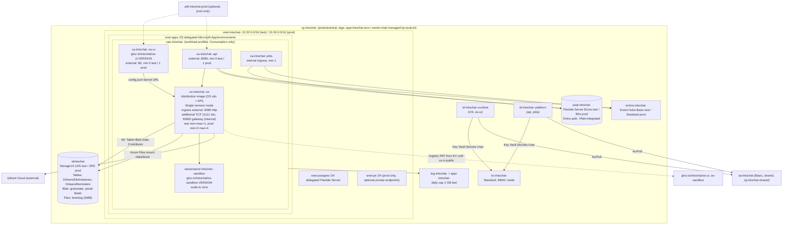

# Azure test and prod environments for IntoChat (W5 design)

**Goal:** Two reproducible Azure environments, `test` and `prod`, in `polandcentral`. Each runs the OS Orleans cluster (platform's distribution image), os-ui, the C# sandbox, platform API and Jobs, and the portal, with durable OS storage, Key Vault plus managed identity, and GitHub-gated deploys. `test` is created after the owner reviews this document. `prod` is created later, behind a separate approval.

**Status:** design only. Nothing in Azure was created or changed. Only read-only `az` calls were used, in the W5 inventory (`clients/intochat/projects/briefs/clean-architecture/w5-azure-inventory.md` and `azure-inventory/*.json` in agentic-os). No `pulumi preview` or `pulumi up` was run.

**Builds on:** `plans/deploy-os-and-platform-2026-10-17.md`. That plan covers D1 to D5, operator steps O1 to O6, and platform PRs #1 to #5. This document supersedes its single `production` stack and its TripRadar names. Release-driven delivery (D3 to D5) is unchanged.

**Owner decisions (2026-10-18):**
- Region `polandcentral`.
- `test` is approved at about $60 to $120 per month. `prod` comes later and needs its own approval.
- Platform needs Postgres and Event Hubs.
- Retire `ca-digitalbrain-kernel` after `test` is live.
- Move `sv` and `LeedGenerator` to another subscription (this document prepares the commands only).
- The custom domain is configurable and is not set yet.

All prices are **estimates** from public pay-as-you-go list prices in USD, with no reservations. Check them in the Azure pricing calculator before approving.

---

## 1. Current state and what gets retired

Subscription `2a985480-6bb9-44ff-959d-edd5efe2cdb2`, tenant `16ea5f3c-…`. A second, phantom subscription `b0c622ab-…` returns `SubscriptionNotFound` (inventory §1).

| Resource | What it is | Fate |
| --- | --- | --- |
| `ca-digitalbrain-kernel` (RG `intochat-rg`, polandcentral) | The only running IntoChat compute. Pre-split image `docker.io/vhorbachov/digitalbrain-kernel:v0.1.30`, 0.5 vCPU / 1 GiB, min=max=1. Orleans on Azure Table + Blob through one shared-key secret `storage-conn` | **Retire** once `test` passes the smoke tests (gate G3) |
| `cae-digitalbrain-dev` | Consumption ACA environment without a VNet | Retire with the app |
| `stdbraindeve2c940` | Orleans tables `OrleansSiloInstances`, `OrleansReminders`. Containers `grainstate`, `state`, `digitalbrain-v2-journal`, `digitalbrain-v2-state` | Export (O9), keep read-only for 30 days, then delete |
| `intochat-ui-webapp` (SWA Free, eastus2) | The old UI. os-ui replaces it (deploy plan D1) | Retire |
| `id-digitalbrain-deploy` | Deploy identity for the deleted os `deploy.yml` | Retire (deploy plan O2) |
| `workspace-intochatrgBKe4` | Log Analytics for the old environment | Retire with the RG |
| `LeedGenerator` RG (Postgres B1ms, about $28) and `sv` RG (SWA Standard, $9) | Not IntoChat | **Move** to another subscription (O7) |

Pulumi in platform has never been deployed. It is still TripRadar-branded:
- Project `tripradar-infrastructure` (`src/IntoChat.Infrastructure/Pulumi.yaml:1`).
- Config namespace `tripradar` (`Constants/TripRadarServerConstants.cs:17`).
- Hardcoded dev domain `api-dev.tripradar.io` (`:6-7`).
- Default region `westeurope` (`:46`) and default environment `production` (`:45`).
- Branching on the `environment` string in `Program.cs:22-47`.
- Stacks `development` (`Pulumi.development.yaml:1-3`) and `production` (`Pulumi.production.yaml:1-15`, TripRadar domains at `:8-11`).
- `deploy-prod.yml` runs on every push to master (`.github/workflows/deploy-prod.yml:3-5`), with `PULUMI_STACK` defaulting to `production` (`:22`) and no `environment:`.

The os repo already contains a Pulumi library, `src/DigitalBrain.Deployment`, that deploys the runtime correctly for this target:
- A workload-profile ACA environment on a delegated subnet (`DigitalBrainDeployment.cs:50-68`).
- A user-assigned runtime identity (`:44-49`).
- Key Vault-referenced secrets (`:116-125`).
- RBAC for Blob, Table, Key Vault and AcrPull (`:180-187`).
- A stable `Orleans__ClusterId`/`ServiceId` (`:88-89`).
- Silo and gateway ports 11111/30000 (`:168-169`).
- min=max=1 (`:148-149`).

Platform PR #5 (`deploy/task-8-distribution-app`) instead adds its own distribution app to `ContainerAppsService.cs` (`:436`, `:452-502`) without Orleans storage. **This design makes PR #5 reuse the os library's shape.** It does not keep a second, divergent runtime definition (ADR A3).

---

## 2. Target topology

### ADR A1. Compute: Azure Container Apps, workload-profile environment (Consumption profile) on a VNet

ACA keeps the cost of `test` within the approved budget, and Azure Table membership removes AKS's main advantage (Kubernetes hosting for Orleans). A workload-profile environment is needed for VNet integration, extra TCP ports and session pools. It runs only the free `Consumption` profile, as the os library already does (`DigitalBrainDeployment.cs:66`). A Dedicated profile would add about $100 or more per month and is not used.

Rejected:
- **AKS.** Always-on nodes plus a load balancer cost 2 to 4 times as much at this scale, and add work to operate.
- **The existing `cae-digitalbrain-dev`.** It has no VNet.

### Per-environment topology



### OS silo app (`ca-intochat-<env>-os`)

- **Revision mode `Single`.** A new revision replaces the old one, so two OS versions never form one cluster. Orleans membership tolerates the short overlap during the swap, because both versions use the same ClusterId only while one is draining. The 2-replica test in §3.4 verifies this.
- **Ports.** HTTP ingress on 8080 (`RuntimeHttpPort`, used at `DigitalBrainDeployment.cs:141`). TCP 11111 (silo) and 30000 (gateway) are declared as internal `additionalPortMappings`, so `DigitalBrain.Mcp` and future clients can reach the gateway. Silo-to-silo traffic uses the replica IPs inside `snet-apps`.
- **Advertised IP.** Leave `Orleans__Endpoints__AdvertisedIPAddress` unset in Azure. Orleans then picks the replica's subnet IP. The `127.0.0.1` override exists only for local executables (`DigitalBrainHostingExtensions.cs:89-93`).
- **Sizing.** Test: 1 vCPU / 2 GiB, min=max=1. Prod: 1 vCPU / 2 GiB, min 2, max 4. The os library's 2 vCPU / 4 GiB default (`DigitalBrainDeployment.cs:147`) becomes a parameter.
- **Scaling rule (prod only).** HTTP concurrency 50 per replica plus CPU above 70%. Scale-in is limited to one replica per 10 minutes (`cooldownPeriod 600`), so grain deactivation is not storm-driven. Test has no scaling rule.
- **Health.** Liveness and readiness probes on `/health`. Startup probe with `failureThreshold 30` and `period 10s`, to allow silo join and BrainLog open.

### Other apps

| App | Image | Ingress | Min/max test | Min/max prod |
| --- | --- | --- | --- | --- |
| os-ui | `ghcr.io/intochat/os-ui:<DigitalBrainVersion>` (deploy plan D4) | external :80 | 0/1 | 1/2 |
| sandbox | ACA session pool, `ghcr.io/intochat/os-sandbox:<ver>` (`CSharpDeployment.cs:87`, `sandboxImage`) | pool endpoint, MI | 0 ready sessions | 1 ready session |
| api | `acrintochat.azurecr.io/intochat-api:<tag>` | external :8080 | 0/1 | 1/3 |
| jobs | `acrintochat.azurecr.io/intochat-jobs:<tag>` | internal | 1/1 | 1/2 |
| portal | static site in the storage account `$web` (deploy plan D5 already uploads it) | Storage static website, or Front Door in prod | n/a | n/a |

### Data and platform services

- **Postgres Flexible Server.**
  - Test: B1ms, 32 GB, no HA. Prod: B2s, 64 GB, 7-day PITR, no HA at first.
  - VNet-integrated on `snet-postgres`. Entra authentication on; the platform identity is the Entra admin for the `intochat` database.
- **Event Hubs.** Basic with 1 TU in test (1 consumer group, 1-day retention). Standard with 1 TU in prod (needed for more than one consumer group and for Kafka endpoints, if platform uses Kafka clients).
- **Front Door Standard.** Optional, prod only, and off by default.

### Naming and tags

Pattern: `<abbr>-intochat-<env>[-<role>]`, using CAF abbreviations (`rg`, `vnet`, `snet`, `cae`, `ca`, `psql`, `evhns`, `kv`, `id`, `log`, `appi`, `afd`). Storage accounts and ACR do not allow hyphens, so they are `stintochat<env><4-char suffix>` and `acrintochat`. Key Vault names are global and can be at most 24 characters: `kv-intochat-test-<4>`.

Every resource gets the tags `app=intochat`, `env=test|prod`, `owner=vlad@intochat.io`, `managed-by=pulumi`, `repo=intochat/platform`. Shared resources (`acrintochat`, and the Pulumi state if self-hosted) live in `rg-intochat-shared` with `env=shared`.

---

## 3. OS storage analysis and recommendation

### 3.1 What the OS persists today (from code)

| Data | Where the code puts it | Durable today? | Notes |
| --- | --- | --- | --- |
| Cluster membership | `UseAzureStorageClustering` (`OrleansStorageHosting.cs:65`), or `UseLocalhostClustering` when no integration is set (`:50-52`) | Azure Table in the live kernel | Losing it is harmless once silos are stopped. It only needs to survive while silos run |
| Reminders | `UseAzureTableReminderService` (`:66`), or in-memory (`:53`). In hosted mode, `HostedReminderTable` (`HostedAuthorityHosting.cs:88-89`) | Azure Table | **Must** be durable. Lost reminders are silent functional loss |
| Platform grain state (identity, cookie keys, deployment identity) | `AddAzureBlobGrainStorage` per store (`OrleansStorageHosting.cs:72-80`), plus the keyed `BlobServiceClient` "GrainState" (`:67-71`) | Blob `grainstate` | **Must** be durable. Losing the cookie keys logs everyone out; losing identity loses accounts |
| Cluster grain state = **BrainLog** (neurons, journals, user apps and their state) | `AddBrainStorage` replaces the cluster grain store with `BrainGrainStorage` over `BrainLogs` (`BrainStorageHosting.cs:29-31`). This is an encrypted segment log in the local directory `DigitalBrain:Platform:Storage:Directory` (`BrainStoreOptions.cs:6`, `DigitalBrainNames.cs:16`). A single writer is enforced by `writer.lock` with `FileShare.None` (`BrainLog.cs:52-56`) | **Not durable in ACA today.** The container filesystem is ephemeral, so every revision or restart loses it | This is the brain itself. Most important finding of this review |
| Signal journal | `BrainSignalJournal` over the same BrainLogs (`BrainStorageHosting.cs:27-28`) | Same as BrainLog | |
| Master key | `MasterKeyCustody`. In production it must be TPM or `ConfiguredCustodyAcknowledged` (`BrainStorageHosting.cs:40-44`) | Configured key from Key Vault | Without this key, the BrainLog cannot be read. Back up the Key Vault secret |
| Vectors | Qdrant module (`QdrantModuleOptions.cs:8-10`), with `InMemoryQdrant.cs` as a fallback | Qdrant Cloud, outside Azure (`qdrant-conn`) | Can be rebuilt from BrainLog content. Durable but not critical |

Storage format: BrainLog segments carry a format byte, `BrainLogFormat { Legacy = 0, Framed = 1 }` (`BrainLogModel.cs:6`). New writes use `Legacy` until a release flips `WriteFormat=Framed` (`BrainStoreOptions.cs:9-10`). A portable export exists: `BrainExport(FormatVersion, BrainScope, Sequence, Records…)` (`BrainLogModel.cs:8-9`). The hosted journal refuses to start silently over an existing Orleans grain-state store (`HostedAuthorityHosting.cs:80-83`). Format migration is therefore explicit and version-tagged. The infrastructure design below keeps every store addressable by format version, so W1 can migrate without an infrastructure rewrite.

Two code facts constrain the infrastructure:
1. The Orleans integration takes **connection strings only** (`new TableServiceClient(clustering)`, `new BlobServiceClient(grainState)`, `OrleansStorageHosting.cs:65-74`). The os Pulumi library already grants the runtime MI Table and Blob roles and provides only endpoints (`DigitalBrainDeployment.cs:174-185`). To run with "no shared keys", the integration must accept a **service URI** and use `DefaultAzureCredential` when the value is a URI (os PR S1, §9).
2. All three integration keys must be set, or none of them (`OrleansStorageHosting.cs:33-38`). With none set, the silo uses localhost clustering, which works only for a **single replica**.

### 3.2 Can test start in-memory?

Yes, technically. Leave `DigitalBrain__Integrations__orleans__*` empty, and the silo runs with localhost clustering, in-memory reminders and in-memory platform stores (`OrleansStorageHosting.cs:34,47-60`). BrainLog would then write to the container's ephemeral disk.

Consequences:
- Every deploy, restart or ACA platform move wipes accounts, cookie keys (forcing re-login), reminders, and all brain content.
- Only one replica is possible.
- Nothing about durability, the 2-silo setup or migration gets tested.

**Decision:** do not run in-memory in `test` beyond the first bootstrap deploy. Gate G2a (§9) may deploy once in-memory to prove the pipeline, ingress, os-ui and Key Vault wiring before S1 lands. From G2b onwards, `test` is durable. The cost of durability in `test` is about $3 to $6 per month, so in-memory saves nothing worth the lost signal.

### 3.3 Durable options

| Option | Clustering | Reminders | Platform grain state | BrainLog | Fit | Est. $/mo test | Est. $/mo prod |
| --- | --- | --- | --- | --- | --- | --- | --- |
| **A. Azure Table + Blob + Azure Files** (live today, plus Files) | Table | Table | Blob | Azure Files SMB share mounted at `/data/brain` | Works with today's code, plus S1 for MI. Proven live. Cheapest | **3-6** (LRS; Files transaction-optimized, 5-20 GB) | **8-20** (ZRS, snapshots) |
| B. Postgres via Orleans ADO.NET (`Microsoft.Orleans.Clustering.AdoNet` / `Reminders.AdoNet` / `Persistence.AdoNet`) | Postgres | Postgres | Postgres | Still Azure Files, or a new Postgres-backed BrainLog store (W1) | Reuses the server platform already needs, so close to $0 extra. Needs Orleans SQL scripts run as migrations, a new provider branch in `OrleansStorageHosting`, and Entra-token auth for Npgsql. Membership polling adds load to a B1ms | **0-2** extra on the platform server (still about 2 for Files) | **0-15** extra (a larger SKU may be needed) |
| C. Cosmos DB (`Orleans.Clustering.Cosmos`, `Persistence.Cosmos`, `Reminders.Cosmos`) | Cosmos | Cosmos | Cosmos | Files, or a new Cosmos store | Global distribution, which is not needed. Serverless is cheap when idle, but membership heartbeats cost RUs all the time. Provisioned has a 400 RU/s minimum, about $24 per container or per shared-throughput database. Adds a third data technology | **5-25** serverless | **25-60** provisioned (autoscale 1000 RU/s shared) |
| D. In-memory | localhost | memory | memory | ephemeral | Bootstrap only | 0 | not allowed |

BrainLog options compared:
- **Azure Files SMB (recommended now).** Supports the `FileShare.None` lock semantics that `BrainLog.Claim` relies on. Survives revisions. Snapshots provide backup.
  - Caveat: ACA mounts Azure Files with the **storage account key**, configured as an environment storage definition. This is the single documented exception to "no shared keys". The key lives only in the ACA environment storage resource, which Pulumi sets from `listStorageAccountKeys` and which never reaches a container or GitHub. Rotate it with `az storage account keys renew` plus `pulumi up`.
  - Rejected NFS (Premium FileStorage, 100 GiB minimum, about $16 per month): no key, but its lock semantics differ from SMB.
- **Blob-native BrainLog (W1 target).** Append blobs or block blobs for segments, with a blob **lease** replacing `writer.lock`. This is MI-only and has no mount, and it is the natural backend for a runtime-agnostic store. When W1 ships it, migration is: `BrainExport` from the Files store, then import into the Blob store under a new `FormatVersion`, then switch config (§3.5).

### 3.4 Recommendation

**Option A for both test and prod:**
- Azure Table for clustering and reminders.
- Blob for platform grain state.
- Azure Files (SMB) for BrainLog.
- One StorageV2 account per environment (LRS in test, ZRS in prod), accessed by the runtime MI with `Storage Table Data Contributor` and `Storage Blob Data Contributor`. The Files mount is the one key-based exception.

Rationale:
- It is the code path that runs live today.
- It costs single-digit dollars.
- It keeps the OS independent of the platform's Postgres, so a self-hoster's OS deployment does not need a SQL server, which matches W1's runtime-agnostic aim.
- It isolates OS blast radius from platform database incidents.

Option B is the documented next step if we want fewer moving parts, and it becomes attractive only once W1 offers a database-backed BrainLog. Cosmos is rejected at this scale.

**Orleans clustering provider: Azure Table.** It needs no Kubernetes API or SQL schema. Membership is visible with `az storage entity query`. It works the same for one silo or many, and `DigitalBrain.Mcp` already joins as a client through it (`src/DigitalBrain.Mcp/DigitalBrain.Mcp/Program.cs:9`; `DigitalBrainHostingExtensions.cs:160-166`).

Layout, made versionable for W1:
- Table names: `OrleansSiloInstances` and `OrleansReminders` (Orleans defaults). Partitioned by `ServiceId=intochat-<env>`, so test and prod could share an account but do not.
- Blob container: `grainstate-v1`, via `DigitalBrain__Integrations__orleans__GrainStateContainer` (`OrleansModule.cs:18`).
- File share: `brainlog-v1`, mounted at `/data/brain/v1`, with `DigitalBrain__Platform__Storage__Directory=/data/brain/v1`.
- A format migration writes into `-v2` beside `-v1`. Rollback means pointing config back at `-v1`, which stays read-only until the owner deletes it.

**2-replica silo test before prod (gate G4):**
1. On `test`, set `osMaxReplicas=2` and `osMinReplicas=2` through stack config. Keep `Single` revision mode.
2. Verify membership: `az storage entity query --table-name OrleansSiloInstances --account-name <st> --auth-mode login --filter "Status eq 3"` returns two rows with different subnet IPs. Status 3 is Active.
3. Verify cross-silo calls: an os smoke endpoint that activates 100 grains reports both silo addresses, and the smoke script asserts that both appear.
4. **BrainLog ownership.** Both replicas mount the same share. A brain's `writer.lock` must be held by exactly one silo. A second activation elsewhere must fail fast or route, never write. Expected today: the claim fails on the second silo (`BrainLog.cs:55-56`).
   - If grain placement can activate the same brain on both silos, the OS needs brain-affinity placement, such as a placement director keyed by brain ID or a single brain-host grain per brain. That is a W1 code item, and **prod stays at min=max=1 until it is fixed**.
   - The design permits prod with one replica, at about $35 per month less.
5. Kill one replica (`az containerapp replica list` plus a revision restart). Verify that the membership row goes to Dead within about 60 seconds and that grains reactivate on the survivor.
6. Deploy a new revision while two replicas run. Verify that there are no cross-version join errors in App Insights (`traces | where message has "incompatible"`), and that reminders fire exactly once (a test reminder writes a counter).
7. Record the results in the ledger. Raise prod `minReplicas` to 2 only if all steps pass.

### 3.5 Migration of the live kernel's data

`stdbraindeve2c940` holds Orleans tables and blobs, but the live kernel's BrainLog was on ephemeral disk, so there is no brain content to carry. Migrating platform grain state (identity, cookie keys) from the old account is **not planned**: test starts clean.
- O9 exports the containers with `az storage blob download-batch` to a local archive for 30 days, before the old resources are deleted.
- If the owner wants accounts carried over, it is a separate task: copy `grainstate` blobs with `azcopy` into `grainstate-v1`, keeping the same ServiceId-derived blob names. That requires `ServiceId=digitalbrain`, which conflicts with the `intochat-test` naming, so it is not recommended.

---

## 4. Secrets and identity

### ADR A2. Managed identity everywhere; Key Vault references; no shared keys except the Files mount

- **Identities.** Two user-assigned identities per environment:
  - `id-intochat-<env>-runtime`, used by the OS app, os-ui and the sandbox pool caller.
  - `id-intochat-<env>-platform`, used by api and jobs.
  - User-assigned rather than system-assigned, so that role assignments exist before the first revision starts. This is the pattern of `DependsOn = context.RuntimeGrants` (`DigitalBrainDeployment.cs:151`).
- **Role assignments, scoped to the resource and not the RG:**
  - runtime: `Storage Table Data Contributor` and `Storage Blob Data Contributor` on the storage account (`DigitalBrainDeployment.cs:184-185`), `Key Vault Secrets User` on the vault (`:183`), `AcrPull` on `acrintochat` (`:186`), and `Azure ContainerApps Session Executor` on the sandbox pool.
  - platform: `Key Vault Secrets User`, `AcrPull`, `Azure Event Hubs Data Owner` on the namespace (Sender + Receiver if we split), Entra database role on Postgres, and `Storage Blob Data Contributor` on `$web` for portal upload from CI.
- **Key Vault.** RBAC mode, soft-delete with 90-day retention, purge protection on in prod. Container App secrets are `keyVaultUrl` + `identity` references (`DigitalBrainDeployment.cs:124`). No inline secret values are stored in ACA.
- **Secret inventory per environment:**
  - `openai-key` and `qdrant-conn`.
  - `auth-username` and `auth-password` (only while basic auth posture remains).
  - `master-key`, the BrainLog configured custody. Generated by Pulumi `RandomBytes` once, `protect: true`, `ignoreChanges`.
  - `cookie-protection`, if not already blob-backed.
  - `ghcr-read-token`, until os is public (deploy plan O5).
  - Platform app secrets, which W4 lists.
- **Postgres.** Entra-only authentication in prod. In test, password auth stays enabled only for the initial admin bootstrap, and the password is generated into Key Vault. Apps connect with the MI token (Npgsql `UsePeriodicPasswordProvider` with `DefaultAzureCredential`). The existing `dbPassword` config (`Program.cs:16-19`) becomes the break-glass admin password, stored in ESC as a secret.
- **Event Hubs.** MI only. `disableLocalAuth=true`, so no SAS connection strings.
- **Storage.** `allowSharedKeyAccess=true` is still required for the ACA Files mount (§3.3). Everything else uses MI. When W1 moves BrainLog to Blob, set `allowSharedKeyAccess=false` and delete the environment storage definition.
- **GHCR pull.** os-ui and os-sandbox are private until the public flip.
  - ACA registry credentials for `ghcr.io`: username `intochat-bot` and `passwordSecretRef` set to the Key Vault secret `ghcr-read-token` (a fine-grained PAT with `read:packages` only, 90-day expiry).
  - After the flip, remove the registry entry and the secret. The deploy plan's `ghcrReadToken` check (`DistributionFixTests.cs:29` on PR #5) stays.
- **Pull alternative (A2b).** Mirror os-ui and os-sandbox into `acrintochat` during deploy (`az acr import --source ghcr.io/intochat/os-ui:<v>`). The apps then pull only from ACR with MI, and the PAT lives only in GitHub. This is preferred if PAT rotation is a concern. It costs nothing extra on ACR Basic (10 GB included).
- **CI identity.** One Entra app per environment, with federated credentials:
  - `repo:intochat/platform:environment:test` for the test app.
  - `repo:intochat/platform:environment:production` for the prod app.
  - The test app has `Contributor` + `User Access Administrator` (conditioned to the roles above) on `rg-intochat-test` and `rg-intochat-shared`. The prod app has the same on `rg-intochat-prod`. Neither can touch the other's environment.

---

## 5. Pulumi design

### ADR A3. One platform Pulumi program, two stacks, OS runtime defined once

- Project `intochat-infrastructure`, config namespace `intochat`, stacks `test` and `prod` in Pulumi Cloud (org `intochat`).
- The OS runtime resources come from the os `DigitalBrain.Deployment` library's shape. The platform program calls it, or a DeploymentKit equivalent extracted from it, instead of PR #5's hand-written `ContainerAppsService` distribution block. This keeps one definition of the silo's ports, identity, storage grants and `Orleans__*` env.
  - Today the os library builds its own environment and subnet, and depends on the `DeploymentKit` package (`DigitalBrain.Deployment.csproj:8`).
  - The change: let it accept an existing environment, subnet and identity as inputs, so platform owns the shared foundation (os PR S2).

### Stack config schema (`Pulumi.test.yaml` / `Pulumi.prod.yaml`)

```yaml
config:
  azure-native:location: polandcentral
  intochat:env: test                      # test | prod; replaces tripradar:environment string switch
  intochat:namingPrefix: intochat-test
  intochat:resourceGroupName: rg-intochat-test
  intochat:tags: { app: intochat, env: test, owner: vlad@intochat.io }
  intochat:network:vnetAddressSpace: 10.20.0.0/16
  intochat:network:appsSubnet: 10.20.0.0/23
  intochat:network:postgresSubnet: 10.20.2.0/24
  intochat:os:image: acrintochat.azurecr.io/intochat-distribution   # tag from IMAGE_TAG
  intochat:os:cpu: 1.0
  intochat:os:memory: 2Gi
  intochat:os:minReplicas: 1
  intochat:os:maxReplicas: 1
  intochat:os:storageFormat: v1           # selects grainstate-v1 / brainlog-v1
  intochat:os:storageMode: durable        # durable | memory (memory only allowed when env=test)
  intochat:osVersion: 0.1.0               # os-ui / os-sandbox tag == DigitalBrainVersion
  intochat:api: { minReplicas: 0, maxReplicas: 1, cpu: 0.5, memory: 1Gi }
  intochat:jobs: { minReplicas: 1, maxReplicas: 1, cpu: 0.25, memory: 0.5Gi }
  intochat:postgres: { sku: Standard_B1ms, tier: Burstable, storageGb: 32, ha: false }
  intochat:eventHubs: { sku: Basic, capacity: 1, hubs: [platform-events] }
  intochat:storage: { sku: Standard_LRS, brainlogQuotaGb: 20 }
  intochat:logs: { retentionDays: 30, dailyCapGb: 1 }
  intochat:frontDoor: { enabled: false }
  intochat:domains:                       # all optional; empty => *.azurecontainerapps.io FQDNs
    apiHost: ""
    osHost: ""
    uiHost: ""
    portalHost: ""
  intochat:pullFromGhcr: true             # false after os public flip or with A2b mirroring
```

Prod differs in these values: `env: prod`, `10.30.0.0/16`, os min 2 and max 4 (after G4), api 1 to 3, Postgres `Standard_B2s` with 64 GB, Event Hubs `Standard`, storage `Standard_ZRS`, `dailyCapGb: 5`, and optionally `frontDoor.enabled`.

Domain handling: when a host value is empty, nothing DNS-related is created, and the stack outputs the generated FQDN. When it is set, the stack creates an ACA `ManagedCertificate` and a custom-domain binding. The TXT and CNAME values are exported as outputs for the operator to add at the registrar (O10), and no Azure DNS zone is assumed. This replaces the hardcoded `DevelopmentCustomDomain` (`TripRadarServerConstants.cs:7`) and the token-gated block (`Program.cs:68-97`).

### ESC

- Environments `intochat/base`, `intochat/test` and `intochat/prod`. The `test` and `prod` environments import `base`.
- They replace `esc.base.yaml` and `esc.prod.yaml`, which hold TripRadar placeholders: `subscriptionId: prod-subscription-id` at `esc.prod.yaml:6`, the `tripradar-prod-postgres` FQDN at `:18`, and OTel at `*.tripradar.io` at `:45-46`.
- What ESC holds:
  - `azure.login` uses `fn::open::azure-login` with OIDC, per environment.
  - `pulumiConfig.intochat:*` holds the secrets: `openaiKey`, `qdrantConn`, `ghcrReadToken`, `dbAdminPassword`, `authPassword`.
  - `environmentVariables`: `AZURE_SUBSCRIPTION_ID`.
- Pulumi writes the secrets into Key Vault. Apps read only from Key Vault. Stripe, Telegram, Google, Kafka and SERP entries are dropped unless W4 confirms that platform uses them.

### Changes in `IntoChat.Infrastructure` (platform PR P2)

| File | Change |
| --- | --- |
| `Pulumi.yaml` | `name: intochat-infrastructure`, description, default `config: intochat:...` schema |
| `Pulumi.development.yaml`, `Pulumi.production.yaml` | Delete. Add `Pulumi.test.yaml` and `Pulumi.prod.yaml` (above) |
| `Constants/TripRadarServerConstants.cs` | Rename to `IntoChatConstants.cs`. Delete `ZoneName`, `Development*`, `DbContextTypeName "TripRadar…"`, `ApiImagePrefix "tripradar-api"` and similar. Keep only config key names. `DefaultLocation` becomes `polandcentral` |
| `TripRadarDeploymentConfiguration.cs` (392 lines, two near-duplicate builders) | Replace with `IntoChatStackConfiguration.cs`: one `Load(Config)` that returns a typed `StackSettings`, and one `ToInfrastructureSettings()`. No dev/prod branches; differences are config values only |
| `Models/ProductionDeploymentConfig.cs`, `ProductionApiSettings.cs`, `ProductionNetworkSettings.cs`, `DomainsSettings.cs`, `StaticSiteSettings.cs` | Merge into `Models/StackSettings.cs` (records: `NetworkSettings`, `OsSettings`, `AppSettings`, `PostgresSettings`, `EventHubsSettings`, `DomainSettings` with nullable hosts). Delete `MiniAppHost` |
| `Program.cs` | Load settings once. `InfrastructureDeployer.DeployAsync` creates the shared foundation (RG, VNet, Log Analytics, App Insights, Key Vault, storage, Postgres, Event Hubs, identities, the ACA workload-profile environment). Then call `OsRuntime.Deploy(foundation, settings.Os)` (the os library, S2), then api and jobs, then `Domains.Bind(...)` if any host is set. Outputs: `resourceGroupName`, `acrLoginServer`, `osUrl`, `uiUrl`, `apiUrl`, `portalUrl`, `storageAccountName`, `keyVaultUri`, plus `dnsRecords` when domains are set |
| `Helpers/EnvironmentSecretsProvider.cs` | Read secrets from Pulumi config (ESC-fed) only. Remove the env-var fallbacks for TripRadar keys |
| `esc.base.yaml`, `esc.prod.yaml` | Replace with `esc/intochat-base.yaml`, `esc/intochat-test.yaml`, `esc/intochat-prod.yaml` (templates with no values, applied by the operator, O5) |

Changes in `IntoChat.DeploymentKit` (PR P3):
- `ContainerRegistryService.cs:56-58` moves ACR to `rg-intochat-shared`, or looks it up when it already exists.
- The environment must be a workload-profile environment on the delegated subnet (today the kit is consumption-only, per the comment at `DigitalBrainDeployment.cs:50-51`).
- `EventHubsService.cs` sets `disableLocalAuth` and the RBAC grants.
- The Postgres builder (`InfrastructureBuilder.Data.cs`) sets Entra auth and the MI admin.
- The storage builder adds the share `brainlog-v1` and the container `grainstate-v1`.
- PR #5's distribution block in `ContainerAppsService.cs` is replaced by the os library call (A3). Its os-ui app (`:452-502`) is kept and parameterised.
- `GreenBlue*` services stay unused for the OS, because Single revision mode is used.

### How `Orleans__*` and OS settings are supplied

They are set by the OS runtime deployment, never typed into the portal:

| Variable | Value | Source |
| --- | --- | --- |
| `Orleans__ClusterId`, `Orleans__ServiceId` | `intochat-<env>` (stable across deploys) | `DigitalBrainDeployment.cs:88-89` (`options.Name`) |
| `DigitalBrain__Integrations__orleans__Clustering` | `https://<st>.table.core.windows.net/` | after S1, a URI selects MI. Before S1, a Key Vault-referenced connection string (test G2b only) |
| `DigitalBrain__Integrations__orleans__Reminders` | same table URI | as above |
| `DigitalBrain__Integrations__orleans__GrainState` | `https://<st>.blob.core.windows.net/` | as above |
| `DigitalBrain__Integrations__orleans__GrainStateContainer` | `grainstate-v1` | `OrleansModule.cs:18` |
| `DigitalBrain__Platform__Storage__Directory` | `/data/brain/v1` (Azure Files volume `brainlog`) | `BrainStoreOptions.cs:6` |
| `DigitalBrain__Platform__Storage__ConfiguredCustodyAcknowledged` | `true` | required in Production (`BrainStorageHosting.cs:43-44`) |
| master key | Key Vault reference `master-key` | `MasterKey.Provision` in the manifest |
| `AZURE_CLIENT_ID` | runtime MI client ID | `DigitalBrainDeployment.cs:85` |
| `DigitalBrain__KeyVault__Uri` | vault URI | `:26-27,86` |
| `ASPNETCORE_ENVIRONMENT` | `Production` in both environments. `test` is a production-shaped environment, so it gets the same startup guards | |
| `APPLICATIONINSIGHTS_CONNECTION_STRING` / `OTEL_*` | App Insights | foundation output |

Note: `Orleans__Clustering__*`, `Orleans__Reminders__*` and `Orleans__GrainStorage__*` are deliberately **not** used for the silo. The silo takes providers only from the integration (`DigitalBrainHostingExtensions.cs:82-88,99-100`). Only clients such as `DigitalBrain.Mcp` use `Orleans__Clustering__ProviderType=AzureTableStorage` (`:164-165`).

---

## 6. CI/CD

### ADR A4. Platform deploys. Os only publishes. Test on merge, prod on release with reviewers

**platform/.github/workflows:**

| Workflow | Trigger | Environment | Does |
| --- | --- | --- | --- |
| `ci.yml` (PR #2) | PR, push master | none | build, test, format |
| `preview.yml` | PR touching `src/IntoChat.Infrastructure/**`, `src/IntoChat.DeploymentKit/**`, `Directory.Packages.props` | `test` (read-only role suffices; uses the test OIDC app) | `pulumi preview -s test --diff` and posts the summary as a PR comment. **Never previews prod from a PR.** Removes the `production` default (`preview.yml:16`) |
| `deploy-test.yml` (new) | push to `master`, `workflow_dispatch` | `test` (no reviewers; branch policy `master` only) | Build api, jobs and distribution images, tagged `sha-<short>`, and push to ACR. Mirror os-ui and os-sandbox if A2b. Upload the portal. Run `pulumi up -s test --yes` with `IMAGE_TAG=sha-<short>`, then smoke tests. Concurrency group `deploy-test`, `cancel-in-progress: false` |
| `deploy-prod.yml` (PR #3, amended) | `release: published`, `workflow_dispatch` with `tag` input | `production` (**required reviewers: owner**, deployment branch/tag policy `v*`, wait timer 0) | **Promote, do not rebuild.** `az acr import` the `sha-<short>` images that `test` already ran to `:<release tag>`, verifying the digest matches. Then `pulumi preview -s prod` (output in the job summary), then `pulumi up -s prod --yes`, then smoke tests. Concurrency `deploy-prod` |
| `destroy-preview.yml` | not created | n/a | No per-PR environments. An Orleans cluster plus Postgres per PR is too costly. "PR preview" means a Pulumi diff only |

Promotion needs the release commit to have been deployed to `test`. `deploy-prod` fails if `acrintochat.azurecr.io/intochat-distribution:sha-<release commit>` is missing.

**os/.github/workflows:** unchanged from the deploy plan. `publish.yml` (prerelease NuGet) and `release.yml` (tag, stable NuGet plus `ghcr.io/intochat/os`, `os-ui` and `os-sandbox`, `release.yml:6,58-80`). There is no Azure step in os. One addition (os PR S3): `release.yml` ends with `gh workflow run bump-os.yml -R intochat/platform -f version=<VERSION>`, using a fine-grained token `PLATFORM_DISPATCH_TOKEN` (actions:write on platform only). Platform's `bump-os.yml` opens a PR that bumps `DigitalBrainVersion` and `intochat:osVersion` together (deploy plan D4). Merging that PR deploys to `test`.

**Secrets and variables per GitHub environment (platform):**

| Name | `test` | `production` |
| --- | --- | --- |
| `AZURE_CLIENT_ID` (var) | test OIDC app | prod OIDC app |
| `AZURE_TENANT_ID`, `AZURE_SUBSCRIPTION_ID` (var) | same | same |
| `PULUMI_STACK` (var) | `test` | `prod` |
| `PULUMI_ESC_ENV` (var) | `intochat/test` | `intochat/prod` |
| `PULUMI_ACCESS_TOKEN` (secret) | team token, test-scoped | team token, prod-scoped |
| `NUGET_GITHUB_TOKEN` (repo secret) | shared | shared |

App secrets (OpenAI, Qdrant and others) are **not** GitHub secrets. They live in ESC and then Key Vault.

**Smoke tests** (`scripts/smoke.sh <env>`, run in both deploy workflows, failing the job):
1. `curl -fsS $osUrl/health` returns 200 within 5 minutes (retry every 10 s).
2. `curl -fsS $uiUrl/config.json`: the kernel URL equals `osUrl` (deploy plan Review Focus 3).
3. `curl -fsS $apiUrl/health` returns 200.
4. Orleans membership: `az storage entity query … --filter "Status eq 3"` returns `minReplicas` rows.
5. Durability canary: the smoke endpoint writes a canary grain (`/api/diagnostics/canary`, os PR S4). On the next deploy, the read must return the previous value. The first deploy is exempt.
6. `az containerapp revision list -n ca-intochat-<env>-os --query "[?properties.active]|length(@)"` equals 1 (Single mode).

**Rollback:**
- **App-only regression.** Re-run `deploy-prod.yml` via `workflow_dispatch` with the previous release `tag`. This is the same promotion path, so Pulumi sets the old image tag. It takes about 5 minutes and is the preferred path.
- **Emergency, Pulumi unavailable.** `az containerapp update -n ca-intochat-prod-os -g rg-intochat-prod --image acrintochat.azurecr.io/intochat-distribution:<prev>`. This creates drift, which the next `pulumi up` reconciles. Record it in the ledger.
- **Storage format regression.** Point `intochat:os:storageFormat` back at the previous `vN` and deploy. The old share and container are kept read-only until the owner signs off (§3.4).
- **Infrastructure change regression.** `git revert` the Pulumi PR, merge, deploy to `test`, then cut a patch release.
- Revisions are not used for rollback in Single mode. Inactive revisions are kept (`maxInactiveRevisions: 5`) only for diagnostics.

---

## 7. Cost per environment (estimates, USD/month, polandcentral PAYG)

| Resource | SKU | Test | Prod |
| --- | --- | --- | --- |
| ACA: os silo | Consumption, 1 vCPU / 2 GiB, always-on | 1 replica, about 35-40 (after the monthly free grant, about 30) | 2 replicas, about 75 (1 replica until G4: about 38) |
| ACA: os-ui | Consumption 0.25 vCPU / 0.5 GiB | min 0, about 0-3 | min 1, about 9 |
| ACA: api | Consumption 0.5 vCPU / 1 GiB | min 0, about 0-8 | min 1-3, about 20-55 |
| ACA: jobs | Consumption 0.25 vCPU / 0.5 GiB | min 1, about 9 | min 1-2, about 9-18 |
| ACA: sandbox session pool | custom container pool | 0 ready, about 0-5 | 1 ready, about 10-20 |
| ACA environment + VNet | workload profiles, Consumption only | 0 | 0 |
| Postgres Flexible | B1ms + 32 GB / B2s + 64 GB, 7-day backup | about 17 | about 33-40 |
| Event Hubs | Basic 1 TU / Standard 1 TU | about 11 | about 22 |
| Storage (Table, Blob, Files, `$web`) | LRS / ZRS | about 3-6 | about 8-20 |
| Key Vault | Standard | about 1 | about 1-3 |
| Log Analytics + App Insights | PerGB, 1 GB/day cap / 5 GB/day cap | about 0-10 | about 15-40 |
| ACR | Basic, shared (`rg-intochat-shared`) | 5 (shared, counted once here) | 0 |
| Qdrant | Qdrant Cloud free tier (1 GB) / paid tier | 0 | about 0-30 |
| Front Door Standard | optional | none | off (0); about 35 + traffic if enabled |
| Defender / private endpoints | not enabled | 0 | 0 (about 7.3 each if added later) |
| **Total** | | **about $81-115** (inside the approved $60-120) | **about $200-330** (no Front Door, 1-2 silos) |

Notes:
- The Consumption free grant (180k vCPU-s and 360k GiB-s per subscription per month) applies once across both environments.
- Retiring the old deployment saves about $30-45 per month. Moving `sv` and `LeedGenerator` removes about $37 from this subscription's bill.
- Net subscription run-rate with `test` live and the old resources retired: about $85-120 per month.
- Cost drift guard (O8): an Azure budget on each RG with alerts at 80% and 100% of $120 (test) and $350 (prod).

---

## 8. Operator steps (user-only)

- **O7. Move non-IntoChat resource groups** (prepared, not run). Moves need a target subscription in the same tenant. Static Web Apps and Flexible Server both support moves between subscriptions.
  ```bash
  az account list -o table                                   # pick TARGET_SUB
  az resource invoke-action --action validateMoveResources \
    --ids "/subscriptions/2a985480-6bb9-44ff-959d-edd5efe2cdb2/resourceGroups/LeedGenerator" \
    --request-body "{\"resources\": $(az resource list -g LeedGenerator --query '[].id' -o json), \"targetResourceGroup\": \"/subscriptions/$TARGET_SUB/resourceGroups/LeedGenerator\"}"
  az group create -n LeedGenerator -l polandcentral --subscription "$TARGET_SUB"
  az resource move --destination-subscription-id "$TARGET_SUB" --destination-group LeedGenerator \
    --ids $(az resource list -g LeedGenerator --query '[].id' -o tsv)
  # repeat for sv:
  az group create -n sv -l polandcentral --subscription "$TARGET_SUB"
  az resource move --destination-subscription-id "$TARGET_SUB" --destination-group sv \
    --ids $(az resource list -g sv --query '[].id' -o tsv)
  az group delete -n LeedGenerator --yes; az group delete -n sv --yes   # only after both are empty
  ```
  Also resolve the phantom subscription `b0c622ab-…` (`az account clear`, then `az login`, or ask whoever owns that directory).
- **O1′ (replaces deploy plan O1).**
  - Create two Entra apps, `gh-intochat-platform-test` and `gh-intochat-platform-prod`. Add federated credentials for the subjects `repo:intochat/platform:environment:test` and `…:environment:production`.
  - Assign the roles on the RGs listed in §4. Create `rg-intochat-shared`, `rg-intochat-test` and later `rg-intochat-prod` first, so the role scopes exist.
  - Register the providers `Microsoft.App`, `Microsoft.DBforPostgreSQL`, `Microsoft.EventHub`, `Microsoft.OperationalInsights` and `Microsoft.ContainerRegistry`.
- **O2′. GitHub environments in `intochat/platform`.**
  - `test`: deployment branch `master` only.
  - `production`: required reviewer = owner, deployment tags `v*`, "prevent self-review" off (single maintainer).
  - Add the variables and secrets from the §6 table.
- **O5′. Pulumi Cloud.**
  - Create stacks `intochat/intochat-infrastructure/test` (and `prod` later).
  - Create the ESC environments `intochat/base`, `intochat/test` and `intochat/prod`. Set the secret values: OpenAI key, Qdrant URL and key, `ghcrReadToken` (fine-grained PAT, `read:packages`, 90 days), `dbAdminPassword`.
  - Remove the old `production` stack, which has no resources (inventory §3).
- **O8.** Create budgets and alerts per RG (§7).
- **O9. Before retiring the old kernel** (after G3):
  - Run `az storage blob download-batch --account-name stdbraindeve2c940 --auth-mode login -s grainstate -d ./archive/grainstate`, and the same for the other three containers. Export the tables with `az storage entity query`.
  - Then delete `ca-digitalbrain-kernel`, `cae-digitalbrain-dev`, `intochat-ui-webapp` (SWA), `id-digitalbrain-deploy` and `workspace-intochatrgBKe4`.
  - Delete `stdbraindeve2c940` after 30 days, then `intochat-rg` once it is empty.
- **O10. DNS (later).** When a domain is chosen, set `intochat:domains:*` in the stack, deploy, read the `dnsRecords` output, and add the CNAME and `asuid` TXT records at the registrar. The next deploy binds the managed certificates.
- **O11. Approvals.**
  - G2: owner approves the `test` creation run (first `deploy-test` dispatch).
  - G5: owner approves `prod` creation separately, after G4. The `production` reviewer gate then applies to every prod deploy.

---

## 9. Implementation PR sequence

**Gate G0: owner reviews this document.** No infrastructure PR merges before G0.

| # | Repo | PR | Depends on | Notes |
| --- | --- | --- | --- | --- |
| S1 | os | Orleans integration accepts service URIs. A value starting with `https://` builds `TableServiceClient(Uri, DefaultAzureCredential)` / `BlobServiceClient(Uri, …)` in `OrleansStorageHosting.cs:63-74`. Connection strings stay supported for self-hosters. Includes unit tests | — | Removes the need for `storage-conn` |
| S2 | os | `DigitalBrain.Deployment` accepts an existing environment, subnet, identity and storage (`DigitalBrainDeployment.cs:44-68`). Adds the Azure Files volume and mount, cpu/memory/replica parameters (`:147-149`), `additionalPortMappings` 11111/30000, Single revision mode, probes, and the `storageFormat` suffix | S1 | Ships in the next os release as a NuGet package |
| S3 | os | `release.yml` dispatches `bump-os` to platform | — | Needs `PLATFORM_DISPATCH_TOKEN` (operator) |
| S4 | os | Diagnostics canary and silo-identity endpoint for smoke tests and the G4 test (protected, `diagnostics` scope) | — | |
| P0 | platform | Merge PRs #1, #4, #2, #3 and #5 per the deploy plan merge order. #3 is amended: `environment: production`, promotion instead of rebuild | deploy plan | #5 is rebased by P3 |
| P1 | platform | `preview.yml` targets `test`. Add `deploy-test.yml`, `scripts/smoke.sh`, `bump-os.yml` | P0 | |
| P2 | platform | `IntoChat.Infrastructure` de-TripRadar, stacks `test` and `prod`, config schema, ESC templates (§5 table) | P0 | |
| P3 | platform | DeploymentKit: workload-profile environment, Postgres Entra, Event Hubs MI, storage shares, shared ACR, and the OS runtime via the S2 library (replacing PR #5's distribution block) | P2, os release with S1 and S2 | |
| — | — | **Gate G1: operator steps O1′, O2′, O5′, O8 done for `test`** | | |
| — | — | **Gate G2: "test env created". Explicitly after the owner reviews this doc (G0) and approves the first run.** G2a: first `deploy-test` with `storageMode: memory` (allowed only before S1 is released). G2b: durable Option A | P1-P3, G1 | Budget about $81-115/mo starts here |
| — | — | **Gate G3: test live and green on smoke tests for 7 days.** Then O9 retires `ca-digitalbrain-kernel` and the old resources | G2b | |
| — | — | **Gate G4: 2-replica silo test (§3.4) passes**, or prod is fixed at one replica, with the brain-affinity item filed for W1 | G2b | |
| P4 | platform | `Pulumi.prod.yaml` values, Front Door toggle (off), budget outputs | G4 | |
| — | — | **Gate G5: prod creation, a separate owner approval** (cost about $200-330/mo). First `deploy-prod` from a published release, approved in the `production` environment | P4, O1′/O2′/O5′ for prod | Later |
| P5 | platform | After the os public flip: remove GHCR credentials and `ghcrReadToken`. After W1 Blob-BrainLog: remove the Files mount, set `allowSharedKeyAccess=false`, migrate `v1` to `v2` | W1 | |

---

## 10. Risks

| Risk | Impact | Mitigation |
| --- | --- | --- |
| **Silo-to-silo networking in ACA.** Orleans needs direct replica-IP TCP on 11111. `additionalPortMappings` exposes ports through the app's internal endpoint, not per replica. Direct replica-to-replica traffic depends on the VNet-integrated workload-profile environment | A multi-silo cluster cannot form. Membership shows silos as Dead or flapping | Test 1 replica first. G4 verifies two replicas explicitly. Fallback: prod at one replica (the BrainLog single-writer model already favours it). Escalation path: AKS with `UseKubernetesHosting` if more than one silo becomes mandatory |
| **BrainLog on a shared Files share with more than one silo.** Two silos activate grains of the same brain, and the second fails on `writer.lock` (`BrainLog.cs:55-56`) | Errors for that brain on one silo | G4 step 4. Brain-affinity placement is a W1 item. Prod stays at one replica until it is fixed |
| **Revision switching.** In Single mode, the old and new revisions overlap for a short time with the same ClusterId. An incompatible grain interface change can break calls during the overlap. A failed new revision leaves the old one serving, which is good, but Pulumi then reports a failure | Short errors during deploy | Startup probe. Orleans version-tolerant serialization (`[Id]` attributes are already used). For breaking changes, bump `ClusterId` to `intochat-<env>-<major>` (ServiceId unchanged, so state is kept). The smoke test checks one active revision |
| **Cold start.** os-ui and api at min 0 in test (5-20 s). The silo with BrainLog open on SMB: 20-60 s | Slow first request in test, and slow deploys | The silo is always min 1. Prod api and os-ui are min 1. The startup probe allows 5 minutes |
| **Azure Files performance and key.** SMB latency (single-digit ms) on BrainLog `Flush(flushToDisk)` (`BrainLog.cs:287`). The account key exists for the mount | Write latency, and a key-leak surface | Transaction-optimized tier. The key exists only in the ACA environment storage definition. Rotation is documented. The W1 Blob store removes both issues |
| **Cost drift.** Always-on replicas, Log Analytics ingestion, Event Hubs Standard, an accidental Dedicated workload profile or Front Door | Bill above approval | O8 budgets. Daily log cap. `Consumption`-only profile asserted in a DeploymentKit unit test. Front Door off by default. Monthly cost check in the ledger |
| **Single maintainer as required reviewer** | Prod deploys are blocked while the owner is away | Accepted. `workflow_dispatch` with the same gate |
| **Pulumi state and resources drift from `az` hotfixes** | Surprise diffs | The rollback procedure logs every manual change. `pulumi refresh` in preview |
| **Format migration (W1)** | Data loss if done in place | Versioned containers and shares (`-v1`/`-v2`), `BrainExport` with `FormatVersion`, and the hosted journal's refusal to overwrite (`HostedAuthorityHosting.cs:80-83`). The old version stays read-only until sign-off |
| **Phantom subscription and mixed regions** | Operator confusion | O7 cleanup. Everything new is in polandcentral with tags |
