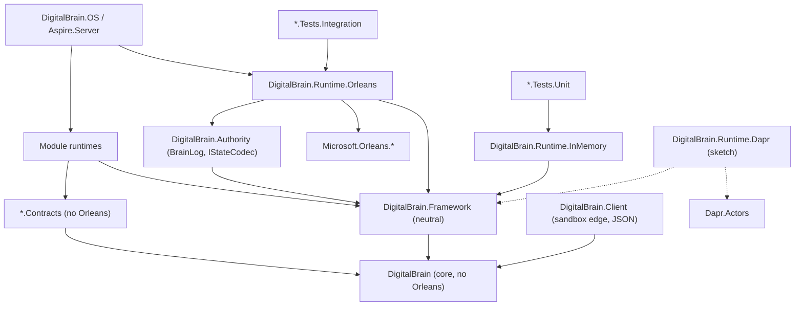

# Clean core (W1): a runtime-agnostic DigitalBrain with Orleans as a provider

Written 2026-10-18 on the `plan/clean-core-w1` branch of `intochat/digitalbrain.docs`. This is the W1 design document of the clean-architecture programme. The executable plan with checkbox tasks follows as a separate file. Updated the same day with the codegen spike result (section 2.6): GO.

Evidence class: source reading of `intochat/os` at master `bdb79fc21`, plus the W1 recon findings and the W1 spike result (`clients/intochat/projects/briefs/clean-architecture/w1-recon-findings.md` and `w1-spike-result.md` in the agentic-os workspace; spike code in `E:/intochat/worktrees/w1-spike/spike/w1-codegen/`, commit `330350392`). Nothing was built or run, and no files in `os` were changed. Paths are relative to `E:/intochat/os/src` unless stated. Counts come from greps that exclude `obj/`, so treat them as approximate.

Owner decisions this document is built on (2026-10-18):

- **D1.** Grains stay, but only as the implementation inside a new `DigitalBrain.Runtime.Orleans` provider. Grain interfaces and Orleans attributes leave core and every `.Contracts` project.
- **D2.** Hosted brain state written by v0.1.0 and v0.2.0 must survive. Every format change needs dual-read and a startup migration, as set out in decisions 11–13 of `plans/codebase-simplification-2026-10-18.md`.
- **D3.** A codegen spike decides how Orleans-free contracts get grain code and serializers. **Result (2026-10-18): GO.** A source generator in the Orleans provider emits codecs, copiers and alias registrations from neutral attributes, with byte-identical output. Section 2.6 records the result and its limits.

## 1. Problem statement

**The main source of complexity is that the neuron model is not an abstraction over Orleans: it is Orleans.** Every concept the product names (neuron, observer, brain, signal identity, module, state, timer, caller) is defined by an Orleans type or attribute. Every project above the vocabulary therefore inherits Orleans hosting, Orleans codegen and the Orleans binary format.

The evidence:

- The root contract is a grain interface: `INeuron : IGrainWithStringKey` (`DigitalBrain/Neurons/INeuron.cs:15`), with Orleans scheduling attributes on every method (`:28`, `:31`, `:37`, `:47`). The observer is `INeuronObserver : IGrainObserver` with `[OneWay] Nudge` (`DigitalBrain/Neurons/INeuronObserver.cs:9,15`). `IBrain` names its grain type through `Orleans.Metadata.DefaultGrainType("brain")` (`DigitalBrain/Kernel/IBrain.cs:11`). The vocabulary project references `Microsoft.Orleans.Core.Abstractions` and the Orleans SDK (`DigitalBrain/DigitalBrain.csproj:8-9`).
- The authoring base class is a grain: `Neuron : Grain, INeuron` (`DigitalBrain.Framework/DigitalBrain.Framework/Runtime/Neuron.cs:12`). It holds an Orleans `ObserverManager` (`:16`), its identity is the Orleans `GrainId` (`:24`, commented "Transitional"), it keeps state in `IPersistentState<TState>` (`:131`), and its publish path depends on the `GrainContext` (`:109`).
- Modules compose only through Orleans: `Module.Configure(ISiloBuilder silo)` (`DigitalBrain.Framework/DigitalBrain.Framework/Modules/Module.cs:16`), with 72 `ISiloBuilder` mentions in production and test code.
- Signal identity is the Orleans alias. `SignalId` is documented as "its `AliasAttribute` value" (`DigitalBrain/Signals/SignalId.cs:4`), and the kernel reads `AliasAttribute` by reflection (`DigitalBrain.Framework/DigitalBrain.Framework/Runtime/Kernel/CompiledTypes.cs:29,85`).
- The persisted format is the Orleans binary serializer. `BrainGrainStorage` stores `serializer.SerializeToArray(grainState.State)` under the key `grainId.ToString()` (`DigitalBrain.Authority/DigitalBrain.Authority/Storage/BrainGrainStorage.cs:12,20`). `BrainLog` serializes entries and snapshots with the Orleans `Serializer` (`.../Storage/BrainLog.cs:132,187`). Azure blob grain storage uses `OrleansGrainStorageSerializer` (`DigitalBrain.Modules/Microsoft/Orleans/DigitalBrain.Modules.Microsoft.Orleans/Storage/OrleansStorageHosting.cs:75-76`). The roughly 686 `[GenerateSerializer]`, 854 `[Alias]` and 545 `[Id]` attributes are a storage schema, not just wire annotations.
- Addressing bypasses the brain. `NeuronId` says "the brain alone maps an id to a grain" (`DigitalBrain/Neurons/NeuronId.cs:10-11`). In practice there are 375 `GetGrain<` call sites, 97 of them in non-test files.

**Consequences.**

1. No neuron logic can be tested without a silo. All of the roughly 1,890 integration-tier test attributes start a real in-process Orleans host, and there is no runtime-free unit tier for neurons (recon section 6).
2. All 25 `*.Contracts` projects reference `Microsoft.Orleans.Sdk`, so the Orleans source generator runs in about 75 projects. Consumers that never host a grain, such as the sandbox client and the Dart mirrors, still compile against grain interfaces.
3. Every product invariant is implemented as an Orleans mechanism:
   - provenance is an `IIncomingGrainCallFilter` over `RequestContext` (`DigitalBrain.Framework/DigitalBrain.Framework/Callers/NeuronCallFilter.cs:9,31-33`, `Callers/CallerContextStamper.cs:27,38`);
   - brain affinity is a custom `PlacementStrategy` (`Runtime/Placement/BrainAffinePlacement.cs:8-23`);
   - publish is coupled to storage through an `AsyncLocal` keyed by `GrainId` (`Runtime/Signalling/SignalJournal.cs:8,31-61`).
4. Replacing Orleans is impossible, and so is evaluating Dapr or running a brain in a test process without Orleans.

**What this is not.** It is not mainly a package-reference exercise. Moving `PackageReference` lines leaves core depending on `Orleans.Core.Abstractions` through `INeuron`. The work has three parts:

- a runtime-neutral neuron contract;
- a runtime-neutral authoring and composition API (state, timers, caller, activation, modules);
- a persisted-format path under D2 that keeps today's bytes readable for ever.

## 2. Target architecture

### 2.1 Layers and dependencies

| Assembly | Role | May reference |
|---|---|---|
| `DigitalBrain` (core) | The vocabulary and its abstractions: neuron contract, `NeuronId`, signals, synapses, `IDigitalBrain`, neutral contract attributes, and the runtime SPI interfaces | BCL, `Microsoft.Extensions.*.Abstractions` |
| `DigitalBrain.Framework` | Runtime-neutral authoring: the `Neuron` and `Neuron<TState>` base classes, `Module`, kernel logic, callers policy, compiled-type catalog | core |
| `*.Contracts` (25) | Module contracts and signals | core, other Contracts |
| Module runtimes | Neuron implementations | Framework, Contracts |
| `DigitalBrain.Runtime.Orleans` | Provider: generated or adapter grains, brain-affine placement, grain storage over BrainLog, reminders and timers, observers and nudge fan-out, call filter for caller context, kernel grains, serializer codegen, `IClusterClient` brain client | Framework, Authority, Orleans packages |
| `DigitalBrain.Runtime.InMemory` | Provider for tests and local tools: single-threaded turn scheduler per neuron, in-memory state and journal, `TimeProvider`-driven timers | Framework |
| `DigitalBrain.Runtime.Dapr` | Sketch only (section 2.7); not built in W1 | Framework, Dapr.Actors |
| `DigitalBrain.Authority` | BrainLog, identity, storage, connections; stays Orleans-free behind the `IStateCodec` seam (2.3) | Framework, Authority.Contracts |

The Orleans provider absorbs today's `Modules.Microsoft.Orleans` (storage, clustering, reminders, `ClusterNeuron`) and `Client.Orleans`, and takes `UseOrleans` out of `Aspire.Server` (`ServerHostingExtensions.cs:43`, per recon).



The rule is that arrows into `Microsoft.Orleans.*` start only at `DigitalBrain.Runtime.Orleans` and at the host and test projects that compose it. Section 6 enforces this.

### 2.2 The neuron contract and signals (core)

Core gains the neutral attribute set that the spike proved (`w1-spike-result.md`, "Neutral attribute set required"). Each attribute has the same meaning as the Orleans attribute it replaces, and the provider's generator translates it (2.6).

```csharp
namespace DigitalBrain;

// Schema: the stable names and field numbers that persisted bytes depend on (proven by the spike).
[AttributeUsage(AttributeTargets.Class)]
public sealed class NeuronContractAttribute : Attribute;                                                     // was [GenerateSerializer]
[AttributeUsage(AttributeTargets.Class | AttributeTargets.Interface)]
public sealed class NeuronAliasAttribute(string alias) : Attribute { public string Alias { get; } = alias; }  // was [Alias]; same strings
[AttributeUsage(AttributeTargets.Property | AttributeTargets.Field)]
public sealed class FieldAttribute(uint id) : Attribute { public uint Id { get; } = id; }                    // was [Id]; same numbers
[AttributeUsage(AttributeTargets.Interface)]
public sealed class DefaultNeuronTypeAttribute(string type) : Attribute { public string Type { get; } = type; } // was Orleans.Metadata.DefaultGrainType

// Scheduling semantics, declared by the contract and honoured by every runtime (defined by the spike; mapping not yet exercised).
[AttributeUsage(AttributeTargets.Method)] public sealed class InterleavesAttribute : Attribute;   // was [AlwaysInterleave]
[AttributeUsage(AttributeTargets.Method)] public sealed class ReadOnlyCallAttribute : Attribute;  // was Orleans.Concurrency.ReadOnly
[AttributeUsage(AttributeTargets.Method)] public sealed class OneWayCallAttribute : Attribute;    // was Orleans.Concurrency.OneWay

// Not covered by the spike; to be defined with the generator extensions in PR 5 and PR 9 (section 2.6, limits):
// neutral equivalents of [Immutable] and of [GenerateSerializer] on structs and enums, plus an implementation-side
// type name for the 130 [GrainType("...")] neuron classes (called [NeuronType] in this document).
```

The contract keeps today's operations and comments (`INeuron.cs:15-48`) and drops only the grain base:

```csharp
public interface INeuron
{
    [Interleaves] Task<Guid> Watch(INeuronObserver observer);
    [Interleaves] Task<Guid> Watch(INeuronObserver observer, string[] signals);
    [Interleaves] Task Unwatch(INeuronObserver observer);
    [Interleaves, ReadOnlyCall] Task<SignalPage> Read(long since, int limit);
}

// Plain interface; a runtime decides how a nudge reaches it (Orleans: a generated IGrainObserver).
public interface INeuronObserver
{
    [OneWayCall] Task Nudge(SignalNudge nudge);
}

[NeuronAlias("brain"), DefaultNeuronType("brain")]   // was [Alias("brain"), Orleans.Metadata.DefaultGrainType("brain")] (IBrain.cs:11)
public interface IBrain : INeuron { Task Create(Owner owner); Task<State> Read(); }
```

`SignalId` stays a value with the same string. Only its source attribute changes:

```csharp
[NeuronContract, NeuronAlias("signal.id")]   // a struct: needs generator struct support (2.6, limit 1); [Immutable] equivalent to be defined
public readonly record struct SignalId
{
    [Field(0)] public string Alias { get; }
    public static SignalId Of(Type signal) => new(NeuronAliases.Of(signal));   // reads NeuronAliasAttribute
    // constructor and ToString unchanged (SignalId.cs:17-24)
}
```

`CompiledTypes.cs:29,85` switches from `AliasAttribute` to `NeuronAliases.Of` (the spike names both call sites as required changes). The strings are identical, so every stored `Synapse` (`DigitalBrain/Synapses/Synapse.cs:14-15`) still resolves.

### 2.3 Runtime SPI (core, namespace `DigitalBrain.Runtime`)

These are the only interfaces a runtime implements. They are kept small because Dapr and an in-memory host must be able to implement them.

```csharp
namespace DigitalBrain.Runtime;

// Identity and addressing. The brain is the only place an id becomes a reference.
public readonly record struct BrainId(string Value);
public readonly record struct NeuronAddress(BrainId Brain, string NeuronType, string Key)
{
    // The storage key and the observable NeuronId string: today's GrainId.ToString() ("{type}/{key}").
    public string StorageKey => $"{NeuronType}/{Key}";
}

public interface INeuronResolver                         // implemented by each runtime
{
    T Resolve<T>(BrainId brain, NeuronId id) where T : INeuron;
    T ResolveSystem<T>(string key) where T : INeuron;    // non-brain neurons (platform, cluster); Framework/Authority resolvers only
}

// Activation lifecycle.
public interface INeuronContext
{
    NeuronAddress Address { get; }
    IDigitalBrain Brain { get; }
    ICallerContext Caller { get; }
    INeuronTimers Timers { get; }
    ISignalJournal Journal { get; }
    ISignalFanout Fanout { get; }
    IServiceProvider Services { get; }
    TimeProvider Time { get; }
    void KeepAlive(TimeSpan? duration);                  // was DelayDeactivation (Modules/Time/.../Timers/TimerNeuron.cs:36,45)
}
// IActivationHandler<T> exists today but is bound to Neuron : Grain (Framework/Runtime/IActivationHandler.cs:5); it keeps its shape.

// Messaging and signals. The journal is keyed by address, not GrainId (SignalJournal.cs:8,15).
public interface ISignalJournal
{
    Task<long> Append(NeuronAddress publisher, Signal[] signals);
    Task<JournaledSignal[]> ReadSince(BrainId brain, long since, int limit);
    Task<PartSignals?> SignalsOf(NeuronAddress publisher, long since);
}
public interface ISignalFanout                           // Orleans: ObserverManager + indexed LocalSignalHub
{
    Guid Watch(NeuronAddress source, INeuronObserver observer, IReadOnlySet<string>? signals);
    void Unwatch(NeuronAddress source, INeuronObserver observer);
    Task Nudge(NeuronAddress source, SignalNudge nudge, IReadOnlyList<Signal> appended);
}

// State persistence. Signals ride in the same write; no AsyncLocal side channel.
public interface INeuronState<TState> where TState : class
{
    TState Snapshot { get; }
    bool Exists { get; }
    Task<long?> Write(TState next, IReadOnlyList<Signal> signals);   // last journal sequence, or null when the store journals nothing
    Task<long?> Clear(IReadOnlyList<Signal> signals);
}
public interface INeuronStateStore                       // BrainLog implements it; the memory store implements it
{
    Task<StoredRecord?> Read(NeuronAddress address, string stateName);
    Task<WriteResult> Write(NeuronAddress address, string stateName, long? expectedETag, ReadOnlyMemory<byte> record, IReadOnlyList<Signal> signals);
    Task<WriteResult> Clear(NeuronAddress address, string stateName, long? expectedETag, IReadOnlyList<Signal> signals);
}
public interface IStateCodec                             // the seam that keeps Authority Orleans-free; the Orleans provider supplies the (unchanged) Orleans binary codec
{
    byte CodecId { get; }
    byte[] Serialize<T>(T value);
    T Deserialize<T>(ReadOnlySpan<byte> bytes);
}

// Timers and reminders.
public interface INeuronTimers
{
    IDisposable Start(string name, TimeSpan due, TimeSpan? period, Func<CancellationToken, Task> tick, bool interleave = false);
    Task Remind(string name, TimeSpan due, TimeSpan period);   // durable
    Task Forget(string name);
}
public interface IRemindedNeuron { Task OnReminder(string name, CancellationToken cancellationToken); }  // was IRemindable

// Caller context: kernel-stamped provenance, carried by the runtime.
public interface ICallerContext { CallerContext? Current { get; } }
public interface ICallerContextCarrier { IDisposable Enter(CallerContext caller); }  // Orleans: RequestContext
public interface INeuronCallFilter { Task Invoke(NeuronCall call, Func<Task> next); } // Orleans: IIncomingGrainCallFilter adapter

// Module composition without ISiloBuilder.
public interface IRuntimeBuilder
{
    IServiceCollection Services { get; }
    IConfiguration Configuration { get; }
    IRuntimeBuilder AddNeuron<TImplementation>() where TImplementation : class, INeuron;   // reads [NeuronType]
    IRuntimeBuilder AddStateStore(string name, Func<IServiceProvider, INeuronStateStore> store);
    IRuntimeBuilder AddCallFilter<TFilter>() where TFilter : class, INeuronCallFilter;
    bool TryGetProvider<TBuilder>(out TBuilder? builder) where TBuilder : class;  // escape hatch; ISiloBuilder reachable only inside the provider
}
```

`CallerContext` currently lives in Framework (`Callers/CallerContextStamper.cs`). It moves to core with the SPI. The stamping policy stays in Framework.

### 2.4 What the Framework types become

`Neuron` stops being a `Grain`. It is a plain class that a runtime hosts and gives a context at activation. The public surface used by about 110 neuron classes is kept, so the source migration is mechanical: `Id`, `PublishAsync`, `Save`, `SaveQuietly`, `Clear`, `Snapshot`, `Exists`, `OnCommitted`.

```csharp
namespace DigitalBrain.Framework;

public abstract class Neuron : INeuron
{
    private readonly Guid _activation = Guid.NewGuid();
    private INeuronContext? _context;
    protected INeuronContext Context => _context ?? throw new InvalidOperationException("The neuron is not activated.");
    internal void Attach(INeuronContext context) => _context = context;   // by the runtime, before activation handlers run

    public NeuronId Id => new(Context.Address.StorageKey);   // same string as GrainId.ToString() today (Neuron.cs:24)
    protected IServiceProvider ServiceProvider => Context.Services;
    protected INeuronTimers Timers => Context.Timers;

    public virtual Task<Guid> Watch(INeuronObserver observer) { Context.Fanout.Watch(Context.Address, observer, null); return Task.FromResult(_activation); }
    public virtual Task<Guid> Watch(INeuronObserver observer, string[] signals);
    public virtual Task Unwatch(INeuronObserver observer);
    public virtual Task<SignalPage> Read(long since, int limit) => SignalPages.Read(Context.Journal, Context.Address, since, limit);

    protected Task PublishAsync(Signal signal);                          // stamp, journal append, nudge; semantics unchanged (Neuron.cs:60-81)
    protected Task PublishAsync((Signal Signal, Trace? Trace)[] signals);
}

public abstract class Neuron<TState>(INeuronState<TState> store) : Neuron where TState : class
{
    protected TState Snapshot => store.Snapshot;
    protected bool Exists => store.Exists;
    protected Task Save(TState next, Signal changed, Signal? acted = null);   // stamp, store.Write(next, stamped), nudge
    protected Task Save(TState next, (Signal Signal, Trace? Trace)[] signals);
    protected Task SaveQuietly(TState next);
    protected virtual void OnCommitted() { }
    protected Task Clear(Signal changed);
}

// Constructor injection keeps working: [State("timer")] INeuronState<TimerState> replaces
// [PersistentState("timer", DigitalBrainNames.ClusterGrainStorage)] IPersistentState<TimerState> (98 files).
[AttributeUsage(AttributeTargets.Parameter)]
public sealed class StateAttribute(string name, string? store = null) : Attribute;

public abstract class Module
{
    protected Module(ModuleId id) => Id = id;
    public ModuleId Id { get; }
    public virtual Assembly? Contracts => null;
    public abstract void Configure(IRuntimeBuilder runtime);           // was Configure(ISiloBuilder) (Module.cs:16)
}
```

Today `Neuron.Announce` attaches signals to an `AsyncLocal`, runs the storage write and then asks whether storage "took" them (`Neuron.cs:105-126`, `SignalJournal.cs:24-71`). This becomes one explicit `INeuronState<T>.Write(next, signals)` call that returns the sequence. That closes ledger Task 1.8 and removes the coupling between `BrainGrainStorage.Append` and `SignalJournal.TakePending` (`BrainGrainStorage.cs:39`).

**Observer and watch contract.** `INeuronObserver` stays the receiving end, and `Watch`, `Unwatch` and `Read` keep their signatures and pull-on-nudge semantics (#188; simplification decision 14). What changes is who owns delivery:

- `ISignalFanout` replaces the two in-process paths in `Neuron.Notify` (`Neuron.cs:88-97`: `LocalSignalHub` publish plus `ObserverManager.Notify`).
- In the Orleans provider it wraps `ObserverManager` and `LocalSignalHub`, which becomes indexed by source.
- In the in-memory provider it is a dictionary of observers.
- Watch leases (`ObserverRenewal`, `Neuron.cs:21`; the client renewal loop, `DigitalBrain.Client/DigitalBrain.Client.Orleans/SignalSubscription.cs:63,93-99`) become a provider detail and leave the contract. The `Guid` returned by `Watch` stays, because watchers use it to detect a fresh activation (`INeuron.cs:20-23`).
- `WatchStream` exists twice, in `DigitalBrain.Client/DigitalBrain.Client/Watching/WatchStream.cs` and `DigitalBrain.Client/DigitalBrain.Client.Orleans/Watching/WatchStream.cs`. The copies are near-identical; a diff shows only two extra cancellation tokens and a required versus optional `onSubscribed`. One `internal` copy moves to core, taking the superset signature.

### 2.5 The providers

**`DigitalBrain.Runtime.Orleans`.**

| Concern | Implementation | Moved from |
|---|---|---|
| Hosting a neuron | One grain per neuron class. Its grain interface `I{X}Grain : I{X}, INeuronGrain` is ordinary provider source (2.6), and Orleans generates the proxy and invoker. The grain constructs the `Neuron` through DI, calls `Attach`, runs `IActivationHandler`s from `OnActivateAsync`, and forwards calls | `Neuron.cs:12,26-35` |
| Grain type names | Taken from `[NeuronType]`, identical to today's `[GrainType]`, so `GrainId.ToString()` and storage keys do not change | 130 `[GrainType(...)]` in production code |
| Placement | `BrainAffinePlacement`, unchanged (FNV-1a of the brain id over sorted silos) | `Runtime/Placement/BrainAffinePlacement.cs:8-32` |
| Storage | `IGrainStorage` adapter over `INeuronStateStore`; `BrainGrainStorage` and `HostedPlatformGrainStorage` become thin adapters | `BrainGrainStorage.cs:8`, `HostedPlatformGrainStorage.cs:15-20` |
| Reminders and timers | `INeuronTimers` over `RegisterGrainTimer` and `IRemindable` | `TimerNeuron.cs:22-31`; `ReminderNeuron`, `BrainRuntimeNeuron`, `DeploymentNeuron`, `ComposerNeuron`, `ChatBinding` |
| Streams and observers | `ISignalFanout` over `ObserverManager` and the indexed `LocalSignalHub` | `Neuron.cs:16-19,88-97` |
| Caller context | `ICallerContextCarrier` over `RequestContext`; `NeuronCallFilter` adapts `INeuronCallFilter` | `Callers/NeuronCallFilter.cs`, `Callers/CallerContextStamper.cs` |
| Kernel | Kernel grains and the `IManagementGrain` scan | `Runtime/Kernel/KernelGrains.cs`, `Runtime/Kernel/Kernel.cs:43` |
| Composition | `OrleansRuntimeBuilder : IRuntimeBuilder` wraps `ISiloBuilder`; `BrainHosting.AddDigitalBrain(ISiloBuilder, modules)` | `Runtime/Hosting/BrainHosting.cs:14-17` |
| Client | `IClusterClient` brain client | `Client.Orleans` |
| Serializer codegen | `DigitalBrain.Runtime.Orleans.Generator` (2.6) emits codecs, copiers and alias registrations | Orleans SDK in every Contracts project |

**`DigitalBrain.Runtime.InMemory`.**

- One `NeuronHost` per address, holding a `SemaphoreSlim(1)` turn lock. Calls marked `[Interleaves]` or `[ReadOnlyCall]` bypass the lock; `[OneWayCall]` calls are queued and not awaited.
- State comes from a dictionary of `(address, stateName) → (bytes, etag)` through the same `IStateCodec`, so serialization mistakes fail in unit tests.
- The journal is in memory and follows the same sequence rules as `ISignalJournal`.
- Timers and reminders are driven by the injected `TimeProvider`. Under `FakeTimeProvider`, `Advance` fires ticks deterministically.
- The caller context is carried in an `AsyncLocal`.
- Contract proxies are built with `DispatchProxy`, the same technique as the sandbox `NeuronProxy` (`DigitalBrain.Client/DigitalBrain.Client/Edge/NeuronProxy.cs:11`) but without JSON, so a call goes straight to the host.
- `InMemoryRuntime.Create(time, modules)` returns a runtime. `CreateBrain()` returns an `IDigitalBrain`.
- Out of scope: placement, multiple processes and durability.

### 2.6 Grain code and serializers for Orleans-free contracts (spike result: GO)

> **SPIKE RESOLVED, 2026-10-18.** The spike's approach B is the design: a source generator in the Orleans provider. The coordinator re-ran the tests: 7/7 baseline and 10/10 spike tests pass. Evidence: `w1-spike-result.md` and `E:/intochat/worktrees/w1-spike/spike/w1-codegen/`. The spike's approach A (Orleans codegen over the contract assembly plus surrogates) is out: the Orleans 10.4 generator ignores neutral attributes, and surrogates cannot write the `Signal` base layer. Its approach C (runtime `DispatchProxy` plus reflection codecs) works but is worse on every axis except build setup. This document's earlier fallback design (JSON envelope, schema-driven legacy reader, frozen legacy assembly) is dropped.

**The design.**

- **Contracts carry only neutral attributes** (2.2) and reference no Orleans assembly. The spike checks this with an AssemblyRef fact.
- **`DigitalBrain.Runtime.Orleans.Generator`** is an incremental generator (netstandard2.0, Roslyn 4.14) that runs in the provider. For every `[NeuronContract]` type in a referenced assembly it emits:
  - an Orleans codec, with `[Field(n)]` as the field ids;
  - a copier;
  - an alias registration from `[NeuronAlias]`.
- Layout mistakes are build errors (`DBRT001`).
- **Grain interfaces are ordinary source in the provider**, one line per contract:

  ```csharp
  [GrainInterfaceType("timer"), DefaultGrainType("timer")] public interface ITimerGrain : ITimer, INeuronGrain;
  // INeuronGrain : INeuron, IGrainWithStringKey once PR 9 makes INeuron neutral
  ```

  Orleans generates proxies and invokers for the methods inherited from the non-grain contract interface. Callers hold `ITimer`; the provider resolves `ITimerGrain` behind `IDigitalBrain.Get<T>`.
- **What the spike proved identical:**
  - persisted bytes, for the exact type, polymorphic as `Signal` (alias written) and a `Signal[]` with a shared reference; the golden files have identical SHA-256;
  - type manifest names (`time.timer-tick`, `timer`);
  - grain type and interface type (`timer`);
  - RPC method ids (`0F066472` Start, `F5ED4808` Stop).
- **Consequence for storage and wire.** Stored bytes and wire bytes do not change, and mixed-version silos stay compatible. **No codec or envelope migration is needed** (4.3).
- **Cost.** Serialize and deserialize times are within noise of today's. The generator took about 30 ms per provider build, and the Orleans generator leaves all 25 Contracts projects.

**Limits, carried into the PR sequence.**

1. **Shape coverage.** The generator so far handles only:
   - sealed records and classes;
   - explicit-id members.

   Not yet covered:
   - non-sealed bases (`Signal` itself needs an `IBaseCodec<T>`);
   - structs (`SignalId`, `NeuronId`) and enums;
   - generics;
   - `[Immutable]` shallow copy;
   - implicit-id positional parameters.

   PR 5 extends coverage for the pilot. Each PR 9 batch extends it for its own shapes, verified by the manifest and golden-bytes facts.
2. **Concurrency marker mapping is untested.** `ITimer` has no interleaving methods. An inherited method cannot carry an Orleans attribute on the derived grain interface, and redeclaring it with `new` changes the invokable id. The candidate is to map `[Interleaves]`, `[ReadOnlyCall]` and `[OneWayCall]` through `[MayInterleave]` or Orleans' interleaving-attribute discovery on the grain class. **This is resolved in PR 4**, with one provider fact per marker plus AI `InterleavingFacts` and CSharp `HangingWatchFacts`.
3. **`I{X}Grain` declarations are provider source, never generator output.** Roslyn generators do not see each other's output, so a generated grain interface would get no Orleans proxy. The declarations are hand-written one-liners, or written by a pre-compile MSBuild step. Architecture fact R-B6 (section 6) checks that every contract has exactly one.
4. **The layout is coupled to Orleans' generator output.** Any change Orleans makes to record or base-layer framing must be mirrored. The golden-bytes facts (section 6) catch this on every Orleans upgrade.
5. **Generator scope at scale.** At about 140 assemblies the generator must first filter to assemblies that reference the core attribute assembly.
6. **Reentrant and stateless.** `[Reentrant]` and `[StatelessWorker]` (2 uses each) are class-level, so they stay as Orleans attributes on the provider's grain classes.

### 2.7 Dapr sketch (not built)

Fits:

- Dapr actors are turn-based, single-activation and string-keyed, which matches `INeuronResolver.Resolve` with `ActorId = NeuronAddress.StorageKey`.
- Actor reminders and timers map onto `INeuronTimers`.
- Actor state maps onto `INeuronStateStore`, with `IStateCodec` bytes stored as values.
- Reentrancy is configurable per actor type, which covers `[Reentrant]`.
- `IActivationHandler` maps to actor `OnActivateAsync`.

Does not fit, or needs work:

- Per-method interleaving (`[Interleaves]`, `[ReadOnlyCall]`) has no equivalent. Dapr reentrancy is per call chain, so `Read` and `Watch` need a side path, such as a non-actor read endpoint over the journal.
- `[OneWayCall]` is not native and would be emulated with pub/sub.
- Placement is hash-based and not controllable. Today's assumption that one silo owns a brain's writer lock and journal (`BrainAffinePlacement.cs:6`) needs a per-brain owner actor or an external lease.
- BrainLog's single-writer file log does not map onto a Dapr state store. A Dapr provider either stores state directly and loses the part-log journal, or keeps the journal behind a brain-owner actor.
- Observers become per-brain pub/sub topics.
- Caller context travels as actor call headers.

Verdict: the SPI is shaped so that a Dapr provider is possible. Building one is not a W1 goal.

## 3. Addressing

**Today.**

- `IDigitalBrain.Get<T>(NeuronId)` is the documented entry point (`DigitalBrain/Kernel/IDigitalBrain.cs:8-21`).
- On the silo it resolves the raw key (`DigitalBrain.Framework/DigitalBrain.Framework/Runtime/Brain/CurrentBrain.cs:4-8`, "Transitional").
- `IDigitalBrains.Grain<T>(string key)` is the host and harness seam (`Runtime/Brain/IDigitalBrains.cs:8-9`).
- There are 375 `GetGrain<` call sites, 97 of them in non-test files. The largest non-test clusters by file count are Flutter (14), Apps (12), CSharp (7), Circles (6) and Authority Identity (6).
- Keys follow `{brain}` or `{brain}/…` (`Callers/BrainKey.cs:3`), and that convention drives placement (`BrainAffinePlacement.cs:22`).

**Target.**

1. Brain-scoped neurons are reached only through `IDigitalBrain.Get<T>(NeuronId)`. `CurrentBrain` composes `{brain}/{id}` itself, so modules stop composing keys.
2. Neurons outside any brain (platform, cluster, ledger, management) are reached through typed resolvers on the owning module, for example `IPlatformNeurons.Ledger()`, implemented on `INeuronResolver.ResolveSystem<T>`.
3. `IGrainFactory`, `IClusterClient` and `GetGrain` appear only in `DigitalBrain.Runtime.Orleans`.

**How the call sites move.** The work is done one PR per module cluster (PR 2a–2e), and every change is mechanical:

| Call-site shape | Becomes |
|---|---|
| `grains.GetGrain<IFoo>($"{brain}/foo/{x}")` inside a neuron or behaviour of that brain | `brain.Get<IFoo>($"foo/{x}")` (`IDigitalBrain` injected, or `Context.Brain`) |
| `GetGrain<IFoo>(key)` with a full key from storage or a request | `brains.Open(BrainKey.BrainOf(key)).Get<IFoo>(rest)`; `BrainKey` moves into the provider once these sites are gone |
| `GetGrain<IPlatformThing>(0 or "singleton")` | typed resolver on the owning module |
| test code | harness helpers (`TestBrain.Get<T>`) backed by the runtime's resolver |

Key strings do not change, so there is no persisted impact. No `NeuronId` value changes either (4.1).

**Rules enforced by architecture tests** (section 6):

- **R-A1:** no type outside `DigitalBrain.Runtime.Orleans` depends on `Orleans.IGrainFactory`, `Orleans.IClusterClient` or `Orleans.GrainFactoryExtensions`.
- **R-A2:** only Framework and the providers use `IDigitalBrains.Grain<T>`.
- **R-A3:** modules do not reference `BrainKey`.

Until PR 2e lands, R-A1 runs against a shrinking `GrainFactoryBaseline.json`, the same pattern as `ConfigurationKeyOwners.json`. A new call site fails the build. Removing one requires deleting its baseline entry.

## 4. Storage compatibility

### 4.1 What is persisted today, and what must not change

| Identity | Where it is persisted | Source today | Target source (same value) |
|---|---|---|---|
| State record key | BrainLog record key `grainId.ToString()` = `"{grainType}/{key}"` (`BrainGrainStorage.cs:12`) | `[GrainType]` plus grain key | `NeuronAddress.StorageKey` from `[NeuronType]`; the `I{X}Grain` grain type keeps the same string |
| State name | BrainLog record, from `[PersistentState(name, …)]` | 98 files | `[State(name)]` |
| Type aliases | Inside Orleans binary payloads, and as `SignalId` strings in `Synapse` | 854 `[Alias]` | `[NeuronAlias]` (generated alias registration) |
| Field ids | Orleans binary payloads | 545 `[Id]` | `[Field]` |
| `NeuronId` value | `Signal.Publisher` (`Signal.cs:21`), `Synapse.Publisher` (`Synapse.cs:15`), `SignalNudge.Publisher` (`SignalNudge.cs:12`), Dart `JournalSignal.publisher` | `GrainId.ToString()` (`Neuron.cs:24`) | `NeuronAddress.StorageKey`, same string |
| BrainLog segment | `"DBLG"` magic plus a format byte (`BrainLog.cs:13-14,142,248-263`); `BrainLogFormat { Legacy = 0, Framed = 1 }` (`BrainLogModel.cs:6`) | Orleans `Serializer` for entries and snapshots (`BrainLog.cs:132,187`) | unchanged; the generator emits byte-identical codecs |
| Blob grain state | Azure blob through `OrleansGrainStorageSerializer` (`OrleansStorageHosting.cs:74-76`) | Orleans binary | same codec through `IStateCodec` |
| Export | `BrainExport(FormatVersion, …)` as JSON (`BrainLogModel.cs:8`, `BrainLog.cs:81`) | — | unchanged; stays the manual escape hatch |

Normalising `NeuronId` to brain-relative names, so that `Publisher` equals what `Get` accepts, is desirable but is a persisted-format change of its own. It is **out of scope for W1** (open question 1).

### 4.2 Contract manifest

`ContractManifest.json` is a generated baseline in `Architecture.Tests.Unit`. It records:

- for every type with `[NeuronContract]` or `[GenerateSerializer]`: its full name, its alias (`[NeuronAlias]` or `[Alias]`), and its `(member, field id)` pairs;
- every `(neuron class, grain type or NeuronType)` pair;
- every state name.

Rules:

- PR 1 captures the manifest from today's Orleans attributes.
- Every later PR must reproduce it exactly from whichever attributes are present.
- Additions are allowed, as additive state already is (`AdditiveStateFacts.cs:9-23`). Renames and renumbering fail.

### 4.3 Dual-read, migration and rollback: only for identity changes

The spike removes the codec migration. Stored bytes do not change, so W1 has **no envelope, no codec tag and no writer flip**. The dual-read machinery is kept on file only for the two identity changes that would alter stored data. Neither is in W1 scope:

- **Storage keys.** A record key changes if a grain type name changes, for example when a `[GrainType]` is renamed or a generic host grain is introduced. W1 forbids this through the manifest. If it is ever needed:
  - the reader looks up the new key and falls back to the old one;
  - the writer writes the new key one release later;
  - a startup migration copies records per brain and writes a marker.
- **`NeuronId` values** (open question 1). Normalising `Publisher` to brain-relative names changes `Signal.Publisher`, `Synapse.Publisher`, `SignalNudge` and the Dart `publisher` values. If it is ever done:
  - readers accept both forms;
  - writers flip one release later;
  - a startup migration rewrites `Synapse` sets per brain.

The release discipline for either change follows simplification decisions 11–13:

- **Release N:** dual-read; the writer is unchanged.
- **Release N+1:** the writer flips by configuration. A background, idempotent per-brain migration runs at startup and deletes nothing.
- **Rollback:** N+1 → N is safe. N+1 → N-1 is unsupported, and the release notes say so.
- **Escape hatch:** the export endpoint (`BrainLogModel.cs:8`).

The BrainLog format byte (`BrainLog.cs:13-14,142,248-263`) is not touched by W1.

**Evidence required in W1 anyway, as guards:**

- the manifest fact (4.2);
- the golden-bytes facts (section 6);
- an integration fact that opens fixture brain logs captured from the v0.1.0 and v0.2.0 tags with the new build and reads every record.

## 5. Client, sandbox and Dart mirrors

- **`DigitalBrain.Client` (sandbox edge).**
  - Its wire is already JSON. `NeuronProxy : DispatchProxy` serializes arguments with `RuntimeProtocol.Json` (`DigitalBrain.Client/DigitalBrain.Client/Edge/NeuronProxy.cs:11,54,70`). `DigitalBrainConnection : IDigitalBrain` builds proxies from `NeuronId` (`DigitalBrainConnection.cs:8,35`).
  - Its only Orleans tie is the SDK reference kept because "the runtime protocol records also cross grain calls inside the silo" (`DigitalBrain.Client.csproj:13-14`).
  - Impact: the protocol records take `[NeuronContract]`/`[NeuronAlias]`/`[Field]`, the SDK reference goes, and the provider generator emits their codecs.
  - `NeuronProxy` does not change. It already treats contracts as plain interfaces, which is existing proof that the neutral contract works for consumers.
- **`Client.Orleans`** moves into the provider. Its lease-renewal loop (`SignalSubscription.cs:63,93-99`) becomes internal to the Orleans `ISignalFanout`, and its `WatchStream` copy is deleted (2.4).
- **Flutter and Dart.**
  - The shell talks HTTP/JSON and gRPC with JSON payloads. The proto names contracts by full type name and neurons by key, and states "the C# contracts are the schema" (`DigitalBrain.Authority/DigitalBrain.Authority/Neurons/neurons.proto:5-6,15-17,26-28`).
  - Journal signals carry `type` and `publisher` strings (`DigitalBrain.Modules/Google/Flutter/app/core/lib/src/signals_client.dart:3-15`), and `app/core/lib/src/node_contracts.dart` mirrors the contract records.
  - W1 keeps contract type names, keys, signal type names and `publisher` values unchanged (4.1), so **no Dart change is required**.
  - The gate is the wire-level contract check (simplification decision 3) plus `app/core/test/node_contracts_test.dart`. A PR that renames a contract namespace updates the Dart mirrors in the same PR (`E:/intochat/os/CLAUDE.md:16`).
- **MCP.** `DigitalBrain.Mcp/DigitalBrain.Mcp/Tools/NeuronTools.cs:55-62` detects Orleans exceptions by type-name prefix. It switches to a neutral `NeuronCallException` that the provider throws, wrapping the Orleans exception.

## 6. Testing standard

| Tier | Runtime | Rules |
|---|---|---|
| `*.Tests.Unit` | `DigitalBrain.Runtime.InMemory`, or no runtime at all | No silo, Kestrel or network. No `Task.Delay` for synchronisation. Time from `FakeTimeProvider` (`Microsoft.Extensions.TimeProvider.Testing`, already pinned at `E:/intochat/os/Directory.Packages.props:60`). One brain per fact. |
| `*.Tests.Integration` | One shared in-process Orleans silo per assembly: the existing xunit v3 assembly fixture over `InProcessTarget` (`Testing/DigitalBrain.Testing/Fixtures/BrainHostFixture.cs`, `Testing/DigitalBrain.Testing/Targets/InProcessTarget.cs`) | A fresh person and brain per fact (#189). Covers provider behaviour: placement, storage, reminders, call filter, codegen, and the v0.1.0/v0.2.0 fixture reads. |
| `*.Tests.E2E` / `*.Tests.Browser` | Aspire target, nightly | Unchanged (simplification decisions 1, 6a). |

**Migration rule.** A fact that does not test Orleans behaviour must not need Orleans.

- Neuron-logic facts in Apps, CSharp, AI, Flutter and Circles (about 1,000 integration attributes between them, per recon section 6) move to Unit wherever they need no provider behaviour.
- Each move is listed in the plan with its reason, following the anti-goal of no silent coverage loss.
- W1 sets no target count.

**Architecture tests.** The repo already uses ArchUnitNET:

- package `TngTech.ArchUnitNET.xUnitV3` 0.13.4 (`E:/intochat/os/Directory.Packages.props:98`);
- `Testing/DigitalBrain.Architecture.Tests.Unit/BoundaryFacts.cs:1-2`;
- the graph loader in `ProductionArchitecture.cs:19-20`.

W1 keeps ArchUnitNET and does not add NetArchTest. New facts go in `RuntimeBoundaryFacts.cs`. Package-reference rules reuse the existing csproj reader (`Repository.References`, used at `BoundaryFacts.cs:51`).

| Rule | Check |
|---|---|
| R-B1 core has no Orleans refs | types in `DigitalBrain` depend on no type in an `Orleans*` namespace; the csproj has no `Microsoft.Orleans.*` package |
| R-B2 Contracts have no Orleans refs | the same check, for every assembly whose name ends in `.Contracts` |
| R-B3 only the provider references Orleans packages | no production csproj except `DigitalBrain.Runtime.Orleans` and the allow-listed host projects (`Aspire.Server`, `Aspire.Client`, `Aspire.Hosting`, `AppHost`, `Testing`, `Testing.Aspire`) references `Microsoft.Orleans.*` |
| R-A1 no `GetGrain` outside the provider | no dependency on `Orleans.IGrainFactory`, `Orleans.IClusterClient` or `Orleans.GrainFactoryExtensions` outside `DigitalBrain.Runtime.Orleans` (baseline until PR 2e) |
| R-B6 one grain face per contract | every `INeuron` contract in the composition has exactly one `I{X}Grain` in the provider, whose `GrainInterfaceType`/`DefaultGrainType` equal the contract's `[NeuronAlias]`/`[DefaultNeuronType]` |
| R-B4 manifest unchanged | `ContractManifest.json` regenerated from the attributes equals the checked-in file |
| R-B5 Framework is neutral | `DigitalBrain.Framework` has no Orleans dependency (strict from PR 9) |

Sample:

```csharp
using ArchUnitNET.Fluent;
using ArchUnitNET.xUnitV3;
using static ArchUnitNET.Fluent.ArchRuleDefinition;

namespace DigitalBrain.Architecture.Tests.Unit;

public sealed class RuntimeBoundaryFacts
{
    private static System.Reflection.Assembly Named(string name)
        => ProductionArchitecture.Assemblies.Single(assembly => assembly.GetName().Name == name);

    private static readonly System.Reflection.Assembly[] Neutral = ProductionArchitecture.Assemblies
        .Where(assembly => assembly.GetName().Name is "DigitalBrain" or "DigitalBrain.Framework"
            || assembly.GetName().Name!.EndsWith(".Contracts", StringComparison.Ordinal))
        .ToArray();

    [Fact]
    public void CoreAndContractsDoNotDependOnOrleans()
        => Types().That().ResideInAssembly(Neutral[0], Neutral[1..])
            .Should().NotDependOnAny(Types().That().ResideInNamespaceMatching(@"^Orleans(\..*)?$"))
            .Because("Orleans is a runtime provider (D1); core and contracts are runtime-agnostic")
            .Check(ProductionArchitecture.Graph.Value);

    [Fact]
    public void OnlyTheOrleansProviderAddressesGrains()
        => Types().That().DoNotResideInAssembly(Named("DigitalBrain.Runtime.Orleans"))
            .Should().NotDependOnAny(Types().That().HaveFullName("Orleans.IGrainFactory")
                .Or().HaveFullName("Orleans.IClusterClient").Or().HaveFullName("Orleans.GrainFactoryExtensions"))
            .Because("neurons are reached through IDigitalBrain.Get<T>; the brain owns addressing")
            .Check(ProductionArchitecture.Graph.Value);
}
```

`ProductionArchitecture.Types` already filters out `OrleansCodeGen` namespaces (`ProductionArchitecture.cs:15-17`). Generated codecs and the `I{X}Grain` interfaces live in the provider assembly, so R-B1 and R-B2 are not triggered by generated code.

**Golden-bytes facts.** These guard the coupling between the generator and Orleans' layout (2.6, limit 4). The template is the spike's `Shared/TimerTickLayoutFacts.cs` and `Shared/Golden.cs`:

- One sample per contract shape: sealed record, sealed class, polymorphic `Signal` subtype, shared-reference array, and later struct, enum and generic as the generator gains them.
- Each sample's bytes are checked in as hex, captured from today's Orleans-attributed build before that shape migrates.
- The facts live in `Architecture.Tests.Unit` and need no silo.
- Until PR 9 completes, the same fact file is also compiled into a baseline project that uses today's codecs, so both sides assert the same hex.

```csharp
public sealed class GoldenBytesFacts
{
    private static readonly Serializer Serializer = new ServiceCollection()
        .AddSerializer(builder => builder.AddAssembly(typeof(TimerTick).Assembly)).BuildServiceProvider()
        .GetRequiredService<Serializer>();

    [Fact]
    public void APolymorphicSignalWritesTheSameBytesAsTodaysBuild()
    {
        Signal tick = Golden.SampleTimerTick();   // fixed field values, as in the spike's Golden.cs

        var bytes = Serializer.SerializeToArray(tick);

        Assert.Equal(Golden.PolymorphicTimerTickHex, Convert.ToHexString(bytes));   // carries the alias "time.timer-tick"
        Assert.Equal(tick, Serializer.Deserialize<Signal>(Convert.FromHexString(Golden.PolymorphicTimerTickHex)));
    }
}
```

**Sample unit fact on the in-memory runtime** (this is the target shape; `InMemoryRuntime` and `SignalRecorder` are new):

```csharp
public sealed class TimerFacts
{
    [Fact]
    public async Task APeriodicTimerTicksOncePerPeriod()
    {
        var time = new FakeTimeProvider();
        await using var runtime = InMemoryRuntime.Create(time, new TimeModule());
        var brain = runtime.CreateBrain();
        var timer = brain.Get<ITimer>("t");
        await using var ticks = SignalRecorder.Of<TimerTick>(brain, timer);

        await timer.Start(TimeSpan.FromSeconds(1), TimeSpan.FromSeconds(1));
        time.Advance(TimeSpan.FromSeconds(3));

        Assert.Equal(3, ticks.Count);
    }
}
```

## 7. Cleanup list

| Item | Evidence | Justification | In W1? |
|---|---|---|---|
| 4 unused Orleans package versions: `BroadcastChannel`, `Dashboard.Abstractions`, `Runtime`, `TestingHost` | `E:/intochat/os/Directory.Packages.props:79,83,86,102`; no csproj references them (recon, high confidence) | Dead pins blur the "only the provider references Orleans" rule | Yes, PR 1 |
| Duplicate `WatchStream` | the two files in 2.4; near-identical by diff | One stream owned by core; the Orleans copy disappears with `Client.Orleans` anyway | Yes, PR 1 |
| `AsyncLocal` signal side channel | `SignalJournal.cs:24-71`, `Neuron.cs:101-126`, `BrainGrainStorage.cs:39` | Blocks a neutral state API (2.4) | Yes, PR 6 |
| Stale `src/DigitalBrain.Platform/` directory | present in `src/`; no tracked files after the rename to Authority (recon) | Local leftovers; nothing to commit | Delete locally; note in PR 1 |
| Oversized neurons: `BrainRuntimeNeuron` (1,195 lines), `AppNeuron` (893 lines) | `wc -l` on `Modules/Microsoft/CSharp/.../Runtime/BrainRuntimeNeuron.cs` and `Modules/DigitalBrain/Apps/.../Apps/AppNeuron.cs` | Main timer and JSON-in-state users; splitting them is product work on persisted state (ledger 1.6) | **No.** PR 7 ports their timer calls only; splitting is a follow-up |
| Near-empty projects: `Mcp.Contracts`, `ArtCraft.Contracts`, `Tools.Contracts`, `Twilio.Contracts`, `Monnet.Contracts`, `Microsoft.Aspire.Aspire.Hosting`, `ArtCraft.Aspire.Hosting` | 1–2 files each (recon section 4) | Fewer Contracts projects to de-Orleans in PR 9; simplification decision 8 already folds them | Only where PR 9 touches them; otherwise the simplification workstream owns them |
| Thin test projects: `Modules.Tools.Tests.Unit` (1), `Aspire.Hosting.Tests.E2E` (1), `Microsoft.GitHub.Tests.Hosting` (1), `Supabase.Tests.Hosting` (2), `ArtCraft.Tests.Integration` (3) | recon section 4 | Each adds a build and a test process | **No.** The simplification workstream's taxonomy (decision 1) owns them |
| MCP Orleans exception sniffing | `Mcp/Tools/NeuronTools.cs:55-62` | Incidental leak | Yes, PR 8 |
| Kernel `IManagementGrain` scan | `Kernel.cs:43` | Cluster-global and Orleans-only | Moved into the provider as is, not redesigned |

## 8. PR sequence

Each PR is one branch in `intochat/os`, built and tested on CI. Warnings stay errors. Agents never push master or tags. The spike has resolved, so no PR waits on it any more. The one remaining unknown is the concurrency-marker mapping, which PR 4 settles before PR 5.

| # | PR | Scope | Risk | Test evidence required | Rollback |
|---|---|---|---|---|---|
| 1 | Hygiene and guards | Drop the 4 unused package versions; one `WatchStream` in core; capture `ContractManifest.json` and golden bytes per shape; add R-B1..R-B3 and R-A1 as baseline facts (current violations listed, no new ones allowed); add v0.1.0/v0.2.0 brain-log fixtures and a read fact | Low | Full CI green; manifest and golden facts green; fixture fact reads both versions | Revert |
| 2a–2e | Addressing through the brain (**hard prerequisite for PR 5**) | Move the 97 non-test files' `GetGrain` sites to `IDigitalBrain.Get<T>` or typed resolvers, one cluster per PR (a Authority; b Flutter + Circles; c Apps; d CSharp + AI + Aspire; e remaining modules, OS, tests); shrink `GrainFactoryBaseline.json` to zero outside the provider | Medium (wrong brain scope) | The module's integration facts green; baseline shrinks; review confirms no key-string changes | Revert per PR |
| 3 | Neutral attributes in core | Add the 2.2 attribute set; `SignalId` and `CompiledTypes` read `[NeuronAlias]` first, then `[Alias]`; apply neutral attributes alongside the Orleans ones in core | Low | Manifest unchanged; `CompiledTypes` facts; integration green | Revert |
| 4 | Runtime SPI, in-memory provider, concurrency mapping | Add the 2.3 interfaces; `DigitalBrain.Runtime.InMemory`; `Neuron` gains `Context` while still a `Grain`; **decide and prove the `[Interleaves]`/`[ReadOnlyCall]`/`[OneWayCall]` mapping** for inherited grain methods (2.6, limit 2) on a contract that has such methods | Medium | Unit facts for `Modules.Time` on the in-memory runtime; one provider fact per marker; method ids unchanged; integration green | Revert; nothing persisted |
| 5 | Provider, generator and Time pilot | Create `DigitalBrain.Runtime.Orleans` with the generator (spike code productionised, assembly filter added); `ITimerGrain` and others as provider source; `Modules.Time.Contracts` without Orleans; R-B6. Needs PR 2e (no `GetGrain` left outside the provider) and PR 4 | Medium | Golden bytes and manifest identical for Time; Time integration green; R-B2 strict for `Time.Contracts` | Revert; Time.Contracts gets its Orleans attributes back |
| 6 | Neutral state and publish | `INeuronState<T>`, explicit write with signals, delete the `AsyncLocal` attach; `[State]` replaces `[PersistentState]` (98 files, codemod); `ISignalJournal` keyed by `NeuronAddress` | High (persisted path) | Authority storage facts; Framework `WatchCycleFacts`, `PublishManyFacts`, `SignalDeliveryContextFacts`; fixture fact; record keys unchanged | Revert; format untouched |
| 7 | Timers and caller context | Port the 6 timer and reminder users to `INeuronTimers`; `ICallerContextCarrier` and `INeuronCallFilter`; `NeuronCallFilter` becomes the provider adapter | Medium | Time facts, CSharp `BrainRuntimeNeuronFacts`, Flutter composer facts, Framework caller-stamping facts; unit timer facts on `FakeTimeProvider` | Revert |
| 8 | Composition SPI | `Module.Configure(IRuntimeBuilder)`; `OrleansRuntimeBuilder`; move `BrainHosting`, placement, kernel grains, `Modules.Microsoft.Orleans` and `Client.Orleans` into the provider; neutral MCP exception | Medium (wide but mechanical) | Full CI; one green nightly AppHost E2E run; `OsCatalog` composes | Revert |
| 9 | Contracts drop Orleans | In batches of about 5 Contracts projects: extend the generator for the batch's shapes (non-sealed bases, structs, enums, generics, `[Immutable]`), add golden samples, swap attributes, remove `Microsoft.Orleans.Sdk`, add the `I{X}Grain` lines. The last batch drops Orleans from core, and `INeuron`/`INeuronObserver` lose their grain bases. R-B1, R-B2 and R-B5 become strict | High (shape coverage, manifest drift) | Manifest and golden bytes identical after each batch; Dart contract check; full CI | Revert the batch |
| 10 | Unit-tier adoption | Move neuron-logic facts to `*.Tests.Unit` on the in-memory runtime, one module per PR, each with its list of moved facts | Low | Same assertions pass; per-shard CI time reported | Revert per module |

The earlier persisted-envelope PR (release N) and the writer-flip and migration PR (release N+1) are **removed**, because the bytes do not change.

Blocking map:

- PRs 1, 2a–2e, 3 and 4 can start now, in parallel.
- PR 5 needs all of PR 2 and PR 4.
- PRs 6, 7 and 8 need PR 4.
- PR 9 needs PRs 5 and 8.
- PR 10 can follow PR 4, one module at a time.

## 9. Risks and open questions

**Risks.**

- **Concurrency-marker mapping (2.6, limit 2).** If neither `[MayInterleave]` nor attribute discovery on the grain class keeps per-method semantics with unchanged method ids, interleaving contracts need a different grain-face shape. Mitigation: PR 4 settles it before PR 5. The fallback is the spike's approach C for the affected contracts only.
- **Generator shape coverage and Orleans layout coupling (2.6, limits 1 and 4).** Mitigation: golden-bytes facts per shape, extended before each PR 9 batch and rerun on every Orleans upgrade.
- **Manifest drift during the roughly 460-file attribute rewrite.** Mitigation: the manifest fact gates every PR from PR 1, and the rewrite is a codemod, not hand-edited.
- **Scheduling semantics change.** Interleaving that moves into `MayInterleave` (B) or generated attributes (A) could reintroduce the A→B→A deadlock. Mitigation: AI `InterleavingFacts` and CSharp `HangingWatchFacts` stay green on the Orleans provider, and the in-memory provider honours the same flags.
- **The in-memory runtime gives false confidence.** It does not model placement, reactivation or storage failure. Mitigation: those stay integration facts by rule (section 6).
- **Wide mechanical PRs (3, 8, 9) conflict with W4, W5 and the simplification workstream.** Mitigation: short merge windows announced in the programme ledger.
- **Build time.** One generator in the composing host (A) instead of about 75 SDK generator runs should help, but this is unmeasured. CI must report it; the plan must not claim it.

**Open questions.**

1. Normalise `NeuronId` to brain-relative names, so that `Signal.Publisher` equals what `Get` accepts? This would be a persisted change to `Synapse`, `Signal` and the Dart `publisher` values. Recommendation: a later, separate proposal with dual-read.
2. Are the `I{X}Grain` one-liners hand-written in the provider or written by a pre-compile MSBuild step? The answer also decides how third-party module packages get their grain faces.
3. Should the SPI live in core or in a sibling `DigitalBrain.Runtime.Abstractions`? Recommendation: core, namespace `DigitalBrain.Runtime`, so a contract needs one reference only.
4. `ReadOnly` has no Dapr equivalent. Should it stay a contract attribute or become a provider hint?
5. Is the `IManagementGrain` scan (`Kernel.cs:43`) still needed once instance registration is explicit (PR 6)?
6. Do platform-repo consumers (`IntoChat.Distribution.Tests` through `DigitalBrain.Testing`) need changes? None are expected, because they compose through the harness.

## Sources

- W1 recon findings and spike result: `clients/intochat/projects/briefs/clean-architecture/w1-recon-findings.md` and `w1-spike-result.md` (agentic-os workspace); spike code in `E:/intochat/worktrees/w1-spike/spike/w1-codegen/`.
- `plans/codebase-simplification-2026-10-18.md`, decisions 1, 3, 6a, 8 and 11–14.
- `intochat/os` at `bdb79fc21`: files cited inline.
- Orleans observers, placement, reminders and serialization on Microsoft Learn (learn.microsoft.com/dotnet/orleans); Dapr actors documentation (docs.dapr.io).
