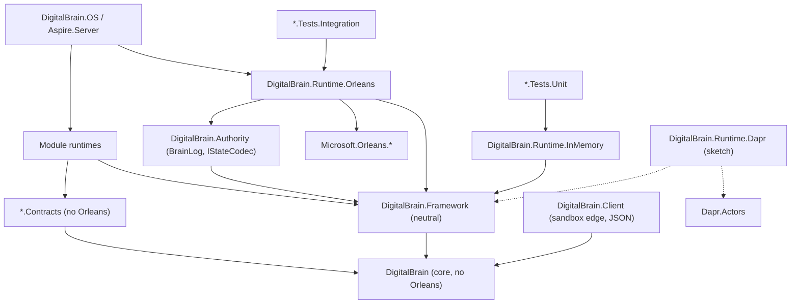

# Clean core (W1): a runtime-agnostic DigitalBrain with Orleans as a provider

Written 2026-10-18 on the `plan/clean-core-w1` branch of `intochat/digitalbrain.docs`. This is the W1 design document of the clean-architecture programme. The executable plan with checkbox tasks follows as a separate file. Updated the same day with the codegen spike result (section 2.6): GO.

Evidence class: source reading of `intochat/os` at master `bdb79fc21`, plus the W1 recon findings and the W1 spike result (`clients/intochat/projects/briefs/clean-architecture/w1-recon-findings.md` and `w1-spike-result.md` in the agentic-os workspace; spike code in `E:/intochat/worktrees/w1-spike/spike/w1-codegen/`, commit `330350392`). Nothing was built or run, and no files in `os` were changed. Paths are relative to `E:/intochat/os/src` unless stated. Counts come from greps that exclude `obj/`, so treat them as approximate.

Owner decisions this document is built on (2026-10-18):

- **D1.** Grains stay, but only as the implementation inside a new `DigitalBrain.Runtime.Orleans` provider. Grain interfaces and Orleans attributes leave core and every `.Contracts` project.
- **D2.** Hosted brain state written by v0.1.0 and v0.2.0 must survive. Every format change needs dual-read and a startup migration, as set out in decisions 11–13 of `plans/codebase-simplification-2026-10-18.md`.
- **D3.** A codegen spike decides how Orleans-free contracts get grain code and serializers. **Result (2026-10-18): GO.** A source generator in the Orleans provider emits codecs, copiers and alias registrations from neutral attributes, with byte-identical output. Section 2.6 records the result and its limits.

## Review resolution (independent review `w1-design-review.md`, 2026-10-18)

The review covered the version written before the spike result. Findings that concern the dropped fallback design (JSON invocation and envelope) are marked moot. Each finding was re-checked against `os` at `bdb79fc21`.

| Finding | Resolution | Where |
|---|---|---|
| C1 outcome B cannot carry observer references | Moot for the fallback, which is dropped. The underlying need stays: observer references must cross a neutral contract. Defined as spike item 2 | 2.4, 2.6 |
| C2 storage covers state records only | Accepted. Envelopes (`BrainEntry`, `BrainSnapshot`) and journalled `Signal[]` are added to the byte-identical scope and to the golden facts. The "force a snapshot in the new codec" migration is removed: no codec changes, and a key migration copies opaque bytes | 4.1, 4.3, 6 |
| C3 SPI misses neuron-facing Orleans features | Accepted. Each feature has a decision table with file counts, and "mechanical" is dropped | 2.4a |
| H1 no `v0.2.0` tag; `v0.1.0` predates the split | Accepted (72 tags, newest v0.1.x; `c7cf32c4d` set VERSION 0.2.0). Fixtures come from a reproducible build of `bdb79fc21` with a test seal key | 4.4 |
| H2 architecture sample and baseline do not work | Accepted. ArchUnitNET 0.13.4 has no freeze and does not see test code. R-A1 becomes a source-scan ratchet like `ConfigurationKeyFacts`. The sample compiles at PR 1. Orleans is 10.4 | 3, 6 |
| H3 `CurrentBrain.Get` changes mid-migration | Accepted: adapter first, callers next, switch last, with an equivalence fact | 3 |
| H4 `NeuronAddress` brain prefix ambiguous | Accepted. `Key` is the full grain key; `Brain` is derived and null for brain-less neurons | 2.3, 3 |
| H5 implicit grain names | Accepted. The manifest records the effective grain type, and PR 5 pins implicit names | 4.2 |
| H6 rollback incomplete | Accepted, stated honestly with mitigations | 4.3 |
| H7 spike shape differs from A and B | Resolved by the spike update. `FooProxy` dropped, spike attribute names adopted, invokable ids proven unchanged. The neutral `Signal` base and observer argument are spike item 2 | 2.2, 2.6 |
| M1 counts | Fixed: about 2,175 field ids (545 `[Id(n)]` + 1,630 `[property: Id(n)]`); 96–97 non-test `GetGrain` files | 1, 4.1 |
| M2 Watch selection uses CLR short names | Accepted; added to 4.1 | 4.1 |
| M3 in-memory fidelity | Accepted: response timeout, queued self-calls, one-way calls behind the lock | 2.5 |
| M4 Dapr gaps | Accepted | 2.7 |
| M5 PR sizing | Accepted. PRs 6, 8 and 9 are split, and the core flip is its own PR | 8 |
| M6 `Id` before PR 5 | Accepted: `Id` keeps reading `GrainId` until PR 5, with an equivalence fact | 8 (PR 4) |
| M7 performance | The fallback cost is moot. PR 5 reports benchmarks | 8 (PR 5) |
| M8 per-host generation | Kept as open question 2, decided before PR 5 | 9 |
| L1–L4 | Accepted. `IBrain.Read` naming noted; the Platform directory removed from PR 1; `publisher` format added to the wire check; `TypeLoadException` mapping kept | 2.2, 5, 7 |

## 1. Problem statement

**The main source of complexity is that the neuron model is not an abstraction over Orleans: it is Orleans.** Every concept the product names (neuron, observer, brain, signal identity, module, state, timer, caller) is defined by an Orleans type or attribute. Every project above the vocabulary therefore inherits Orleans hosting, Orleans codegen and the Orleans binary format.

The evidence:

- The root contract is a grain interface: `INeuron : IGrainWithStringKey` (`DigitalBrain/Neurons/INeuron.cs:15`), with Orleans scheduling attributes on every method (`:28`, `:31`, `:37`, `:47`). The observer is `INeuronObserver : IGrainObserver` with `[OneWay] Nudge` (`DigitalBrain/Neurons/INeuronObserver.cs:9,15`). `IBrain` names its grain type through `Orleans.Metadata.DefaultGrainType("brain")` (`DigitalBrain/Kernel/IBrain.cs:11`). The vocabulary project references `Microsoft.Orleans.Core.Abstractions` and the Orleans SDK (`DigitalBrain/DigitalBrain.csproj:8-9`).
- The authoring base class is a grain: `Neuron : Grain, INeuron` (`DigitalBrain.Framework/DigitalBrain.Framework/Runtime/Neuron.cs:12`). It holds an Orleans `ObserverManager` (`:16`), its identity is the Orleans `GrainId` (`:24`, commented "Transitional"), it keeps state in `IPersistentState<TState>` (`:131`), and its publish path depends on the `GrainContext` (`:109`).
- Modules compose only through Orleans: `Module.Configure(ISiloBuilder silo)` (`DigitalBrain.Framework/DigitalBrain.Framework/Modules/Module.cs:16`), with 72 `ISiloBuilder` mentions in production and test code.
- Signal identity is the Orleans alias. `SignalId` is documented as "its `AliasAttribute` value" (`DigitalBrain/Signals/SignalId.cs:4`), and the kernel reads `AliasAttribute` by reflection (`DigitalBrain.Framework/DigitalBrain.Framework/Runtime/Kernel/CompiledTypes.cs:29,85`).
- The persisted format is the Orleans binary serializer. `BrainGrainStorage` stores `serializer.SerializeToArray(grainState.State)` under the key `grainId.ToString()` (`DigitalBrain.Authority/DigitalBrain.Authority/Storage/BrainGrainStorage.cs:12,20`). `BrainLog` serializes entries and snapshots with the Orleans `Serializer` (`.../Storage/BrainLog.cs:132,187`). Azure blob grain storage uses `OrleansGrainStorageSerializer` (`DigitalBrain.Modules/Microsoft/Orleans/DigitalBrain.Modules.Microsoft.Orleans/Storage/OrleansStorageHosting.cs:75-76`). The roughly 686 `[GenerateSerializer]`, 854 `[Alias]` and about 2,175 field ids (545 `[Id(n)]` plus 1,630 `[property: Id(n)]` on positional records) are a storage schema, not just wire annotations.
- Addressing bypasses the brain. `NeuronId` says "the brain alone maps an id to a grain" (`DigitalBrain/Neurons/NeuronId.cs:10-11`). In practice there are 375 `GetGrain<` call sites, 97 of them in non-test files.

**Consequences.**

1. No neuron logic can be tested without a silo. All of the roughly 1,890 integration-tier test attributes start a real in-process Orleans host, and there is no runtime-free unit tier for neurons (recon section 6).
2. All 25 `*.Contracts` projects reference `Microsoft.Orleans.Sdk`, so the Orleans source generator runs in about 75 projects. Consumers that never host a grain, such as the sandbox client and the Dart mirrors, still compile against grain interfaces.
3. Every product invariant is implemented as an Orleans mechanism:
   - provenance is an `IIncomingGrainCallFilter` over `RequestContext` (`DigitalBrain.Framework/DigitalBrain.Framework/Callers/NeuronCallFilter.cs:9,31-33`, `Callers/CallerContextStamper.cs:27,38`);
   - brain affinity is a custom `PlacementStrategy` (`Runtime/Placement/BrainAffinePlacement.cs:8-23`);
   - publish is coupled to storage through an `AsyncLocal` keyed by `GrainId` (`Runtime/Signalling/SignalJournal.cs:8,31-61`).
4. Replacing Orleans is impossible, and so is evaluating Dapr or running a brain in a test process without Orleans.

**What this is not.** It is not mainly a package-reference exercise. Moving `PackageReference` lines leaves core depending on `Orleans.Core.Abstractions` through `INeuron`. The work has three parts:

- a runtime-neutral neuron contract;
- a runtime-neutral authoring and composition API (state, timers, caller, activation, modules);
- a persisted-format path under D2 that keeps today's bytes readable for ever.

## 2. Target architecture

### 2.1 Layers and dependencies

| Assembly | Role | May reference |
|---|---|---|
| `DigitalBrain` (core) | The vocabulary and its abstractions: neuron contract, `NeuronId`, signals, synapses, `IDigitalBrain`, neutral contract attributes, and the runtime SPI interfaces | BCL, `Microsoft.Extensions.*.Abstractions` |
| `DigitalBrain.Framework` | Runtime-neutral authoring: the `Neuron` and `Neuron<TState>` base classes, `Module`, kernel logic, callers policy, compiled-type catalog | core |
| `*.Contracts` (25) | Module contracts and signals | core, other Contracts |
| Module runtimes | Neuron implementations | Framework, Contracts |
| `DigitalBrain.Runtime.Orleans` | Provider: generated or adapter grains, brain-affine placement, grain storage over BrainLog, reminders and timers, observers and nudge fan-out, call filter for caller context, kernel grains, serializer codegen, `IClusterClient` brain client | Framework, Authority, Orleans packages |
| `DigitalBrain.Runtime.InMemory` | Provider for tests and local tools: single-threaded turn scheduler per neuron, in-memory state and journal, `TimeProvider`-driven timers | Framework |
| `DigitalBrain.Runtime.Dapr` | Sketch only (section 2.7); not built in W1 | Framework, Dapr.Actors |
| `DigitalBrain.Authority` | BrainLog, identity, storage, connections; stays Orleans-free behind the `IStateCodec` seam (2.3) | Framework, Authority.Contracts |

The Orleans provider absorbs today's `Modules.Microsoft.Orleans` (storage, clustering, reminders, `ClusterNeuron`) and `Client.Orleans`, and takes `UseOrleans` out of `Aspire.Server` (`ServerHostingExtensions.cs:43`, per recon).



The rule is that arrows into `Microsoft.Orleans.*` start only at `DigitalBrain.Runtime.Orleans` and at the host and test projects that compose it. Section 6 enforces this.

### 2.2 The neuron contract and signals (core)

Core gains the neutral attribute set that the spike proved (`w1-spike-result.md`, "Neutral attribute set required"). Each attribute has the same meaning as the Orleans attribute it replaces, and the provider's generator translates it (2.6).

```csharp
namespace DigitalBrain;

// Schema: the stable names and field numbers that persisted bytes depend on (proven by the spike).
[AttributeUsage(AttributeTargets.Class)]
public sealed class NeuronContractAttribute : Attribute;                                                     // was [GenerateSerializer]
[AttributeUsage(AttributeTargets.Class | AttributeTargets.Interface)]
public sealed class NeuronAliasAttribute(string alias) : Attribute { public string Alias { get; } = alias; }  // was [Alias]; same strings
[AttributeUsage(AttributeTargets.Property | AttributeTargets.Field)]
public sealed class FieldAttribute(uint id) : Attribute { public uint Id { get; } = id; }                    // was [Id]; same numbers
[AttributeUsage(AttributeTargets.Interface)]
public sealed class DefaultNeuronTypeAttribute(string type) : Attribute { public string Type { get; } = type; } // was Orleans.Metadata.DefaultGrainType

// Scheduling semantics, declared by the contract and honoured by every runtime (defined by the spike; mapping not yet exercised).
[AttributeUsage(AttributeTargets.Method)] public sealed class InterleavesAttribute : Attribute;   // was [AlwaysInterleave]
[AttributeUsage(AttributeTargets.Method)] public sealed class ReadOnlyCallAttribute : Attribute;  // was Orleans.Concurrency.ReadOnly
[AttributeUsage(AttributeTargets.Method)] public sealed class OneWayCallAttribute : Attribute;    // was Orleans.Concurrency.OneWay

// Further scheduling attributes, not in the spike set but required by contracts that must become Orleans-free (2.4a):
[AttributeUsage(AttributeTargets.Class)]  public sealed class InterleavesWhenAttribute(string predicate) : Attribute;  // was [MayInterleave] (1 use, LlmNeuron.cs:13)
[AttributeUsage(AttributeTargets.Method)] public sealed class CallTimeoutAttribute(string timeout) : Attribute;       // was [ResponseTimeout] (26 uses in 12 files, most on Contracts)

// Not covered by the spike; to be defined with the generator extensions in PR 5 and PR 9 (section 2.6, limits):
// neutral equivalents of [Immutable] and of [GenerateSerializer] on structs and enums, plus an implementation-side
// type name for the 130 [GrainType("...")] neuron classes (called [NeuronType] in this document).
```

The contract keeps today's operations and comments (`INeuron.cs:15-48`) and drops only the grain base:

```csharp
public interface INeuron
{
    [Interleaves] Task<Guid> Watch(INeuronObserver observer);
    [Interleaves] Task<Guid> Watch(INeuronObserver observer, string[] signals);
    [Interleaves] Task Unwatch(INeuronObserver observer);
    [Interleaves, ReadOnlyCall] Task<SignalPage> Read(long since, int limit);
}

// Plain interface; a runtime decides how a nudge reaches it (Orleans: a generated IGrainObserver).
public interface INeuronObserver
{
    [OneWayCall] Task Nudge(SignalNudge nudge);
}

[NeuronAlias("brain"), DefaultNeuronType("brain")]   // was [Alias("brain"), Orleans.Metadata.DefaultGrainType("brain")] (IBrain.cs:11)
public interface IBrain : INeuron
{
    Task Create(Owner owner);
    Task<State> Read();   // overloads INeuron.Read(long, int), as today's IBrain.cs:22 does
}
```

`SignalId` stays a value with the same string. Only its source attribute changes:

```csharp
[NeuronContract, NeuronAlias("signal.id")]   // a struct: needs generator struct support (2.6, limit 1); [Immutable] equivalent to be defined
public readonly record struct SignalId
{
    [Field(0)] public string Alias { get; }
    public static SignalId Of(Type signal) => new(NeuronAliases.Of(signal));   // reads NeuronAliasAttribute
    // constructor and ToString unchanged (SignalId.cs:17-24)
}
```

`CompiledTypes.cs:29,85` switches from `AliasAttribute` to `NeuronAliases.Of` (the spike names both call sites as required changes). The strings are identical, so every stored `Synapse` (`DigitalBrain/Synapses/Synapse.cs:14-15`) still resolves.

### 2.3 Runtime SPI (core, namespace `DigitalBrain.Runtime`)

These are the only interfaces a runtime implements. They are kept small because Dapr and an in-memory host must be able to implement them.

```csharp
namespace DigitalBrain.Runtime;

// Identity and addressing. The brain is the only place an id becomes a reference.
public readonly record struct BrainId(string Value);

// Key is the FULL grain key, including any "{brain}/" prefix (BrainKey.cs:3). Brain is derived from it and is
// null for brain-less neurons (platform, cluster, ledger), which BrainGrainStorage serves through fixedBrainScope today
// (BrainGrainStorage.cs:8,34). StorageKey equals today's GrainId.ToString().
public readonly record struct NeuronAddress(string NeuronType, string Key)
{
    public BrainId? Brain => BrainKey.ScopeOf(Key) is { } brain ? new BrainId(brain) : null;
    public string StorageKey => $"{NeuronType}/{Key}";
}

// Marker for runtime endpoints that are not neurons: the ~58 grain interfaces that do not derive from INeuron (2.4a).
public interface IRuntimeEndpoint;

public interface INeuronResolver                         // implemented by each runtime
{
    T Resolve<T>(BrainId brain, NeuronId relative) where T : class;   // INeuron or IRuntimeEndpoint; composes "{brain}/{relative}"
    T ResolveKey<T>(string fullKey) where T : class;                  // brain-less neurons and the transitional raw-key path; Framework/Authority only
}

// Activation lifecycle.
public interface INeuronContext
{
    NeuronAddress Address { get; }
    string Key { get; }                                  // = Address.Key; replaces GetPrimaryKeyString() (96 production files)
    IDigitalBrain Brain { get; }
    ICallerContext Caller { get; }
    INeuronTimers Timers { get; }
    ISignalJournal Journal { get; }
    ISignalFanout Fanout { get; }
    IServiceProvider Services { get; }
    TimeProvider Time { get; }
    T Self<T>() where T : class;                         // replaces this.AsReference<T>() (13 files); the call goes through the scheduler and never re-enters the turn
    void KeepAlive(TimeSpan? duration);                  // was DelayDeactivation (3 files; TimerNeuron.cs:36,45)
    void Deactivate();                                   // was DeactivateOnIdle (3 files)
}
public interface IDeactivatingNeuron { Task OnDeactivating(DeactivationReason reason, CancellationToken cancellationToken); }  // was OnDeactivateAsync (10 overrides)
// IActivationHandler<T> exists today but is bound to Neuron : Grain (Framework/Runtime/IActivationHandler.cs:5); it keeps its shape.

// Messaging and signals. The journal is keyed by address, not GrainId (SignalJournal.cs:8,15).
public interface ISignalJournal
{
    Task<long> Append(NeuronAddress publisher, Signal[] signals);
    Task<JournaledSignal[]> ReadSince(BrainId brain, long since, int limit);
    Task<PartSignals?> SignalsOf(NeuronAddress publisher, long since);
}
public interface ISignalFanout                           // Orleans: ObserverManager + indexed LocalSignalHub
{
    Guid Watch(NeuronAddress source, INeuronObserver observer, IReadOnlySet<string>? signals);
    void Unwatch(NeuronAddress source, INeuronObserver observer);
    Task Nudge(NeuronAddress source, SignalNudge nudge, IReadOnlyList<Signal> appended);
}

// State persistence. Signals ride in the same write; no AsyncLocal side channel.
public interface INeuronState<TState> where TState : class
{
    TState Snapshot { get; }
    bool Exists { get; }
    Task<long?> Write(TState next, IReadOnlyList<Signal> signals);   // last journal sequence, or null when the store journals nothing
    Task<long?> Clear(IReadOnlyList<Signal> signals);
}
public interface INeuronStateStore                       // BrainLog implements it; the memory store implements it
{
    Task<StoredRecord?> Read(NeuronAddress address, string stateName);
    Task<WriteResult> Write(NeuronAddress address, string stateName, long? expectedETag, ReadOnlyMemory<byte> record, IReadOnlyList<Signal> signals);
    Task<WriteResult> Clear(NeuronAddress address, string stateName, long? expectedETag, IReadOnlyList<Signal> signals);
}
public interface IStateCodec                             // the seam that keeps Authority Orleans-free; the Orleans provider supplies the (unchanged) Orleans binary codec
{
    byte CodecId { get; }
    byte[] Serialize<T>(T value);
    T Deserialize<T>(ReadOnlySpan<byte> bytes);
}

// Timers and reminders.
public interface INeuronTimers
{
    IDisposable Start(string name, TimeSpan due, TimeSpan? period, Func<CancellationToken, Task> tick, bool interleave = false);
    Task Remind(string name, TimeSpan due, TimeSpan period);   // durable
    Task Forget(string name);
}
public interface IRemindedNeuron { Task OnReminder(string name, CancellationToken cancellationToken); }  // was IRemindable

// Caller context: kernel-stamped provenance, carried by the runtime.
public interface ICallerContext { CallerContext? Current { get; } }
public interface ICallerContextCarrier                   // Orleans: RequestContext
{
    IDisposable Enter(CallerContext caller);
    IDisposable Suppress();                              // run as internal: replaces get/remove/restore of the caller key (11 files)
}
public interface ITraceCarrier { Trace? Current { get; } IDisposable Enter(Trace trace); }   // replaces TraceContext over RequestContext + TraceOutgoingFilter

// What a call filter sees. Source is the calling neuron, if any: the nudge provenance check reads it (NeuronCallFilter.cs:24-34).
public sealed record NeuronCall(NeuronAddress Target, NeuronAddress? Source, Type Contract, MethodInfo Method, object?[] Arguments, CallerContext? Caller);
public interface INeuronCallFilter { Task Invoke(NeuronCall call, Func<Task> next); } // Orleans: IIncomingGrainCallFilter adapter

// Module composition without ISiloBuilder.
public interface IRuntimeBuilder
{
    IServiceCollection Services { get; }
    IConfiguration Configuration { get; }
    IRuntimeBuilder AddNeuron<TImplementation>() where TImplementation : class;   // INeuron or IRuntimeEndpoint; reads [NeuronType]
    IRuntimeBuilder AddStateStore(string name, Func<IServiceProvider, INeuronStateStore> store);
    IRuntimeBuilder AddCallFilter<TFilter>() where TFilter : class, INeuronCallFilter;
    bool TryGetProvider<TBuilder>(out TBuilder? builder) where TBuilder : class;  // escape hatch; ISiloBuilder reachable only inside the provider
}
```

`CallerContext` currently lives in Framework (`Callers/CallerContextStamper.cs`). It moves to core with the SPI. The stamping policy stays in Framework.

### 2.4 What the Framework types become

`Neuron` stops being a `Grain`. It is a plain class that a runtime hosts and gives a context at activation. The public surface used by about 110 neuron classes is kept, so most call sites keep compiling; section 2.4a lists the Orleans features that do need rewriting. The kept surface is `Id`, `PublishAsync`, `Save`, `SaveQuietly`, `Clear`, `Snapshot`, `Exists`, `OnCommitted`.

```csharp
namespace DigitalBrain.Framework;

public abstract class Neuron : INeuron
{
    private readonly Guid _activation = Guid.NewGuid();
    private INeuronContext? _context;
    protected INeuronContext Context => _context ?? throw new InvalidOperationException("The neuron is not activated.");
    internal void Attach(INeuronContext context) => _context = context;   // by the runtime, before activation handlers run

    public NeuronId Id => new(Context.Address.StorageKey);   // same string as GrainId.ToString() today (Neuron.cs:24)
    protected IServiceProvider ServiceProvider => Context.Services;
    protected INeuronTimers Timers => Context.Timers;

    public virtual Task<Guid> Watch(INeuronObserver observer) { Context.Fanout.Watch(Context.Address, observer, null); return Task.FromResult(_activation); }
    public virtual Task<Guid> Watch(INeuronObserver observer, string[] signals);
    public virtual Task Unwatch(INeuronObserver observer);
    public virtual Task<SignalPage> Read(long since, int limit) => SignalPages.Read(Context.Journal, Context.Address, since, limit);

    protected Task PublishAsync(Signal signal);                          // stamp, journal append, nudge; semantics unchanged (Neuron.cs:60-81)
    protected Task PublishAsync((Signal Signal, Trace? Trace)[] signals);
}

public abstract class Neuron<TState>(INeuronState<TState> store) : Neuron where TState : class
{
    protected TState Snapshot => store.Snapshot;
    protected bool Exists => store.Exists;
    protected Task Save(TState next, Signal changed, Signal? acted = null);   // stamp, store.Write(next, stamped), nudge
    protected Task Save(TState next, (Signal Signal, Trace? Trace)[] signals);
    protected Task SaveQuietly(TState next);
    protected virtual void OnCommitted() { }
    protected Task Clear(Signal changed);
}

// Constructor injection keeps working: [State("timer")] INeuronState<TimerState> replaces
// [PersistentState("timer", DigitalBrainNames.ClusterGrainStorage)] IPersistentState<TimerState> (98 files).
[AttributeUsage(AttributeTargets.Parameter)]
public sealed class StateAttribute(string name, string? store = null) : Attribute;

public abstract class Module
{
    protected Module(ModuleId id) => Id = id;
    public ModuleId Id { get; }
    public virtual Assembly? Contracts => null;
    public abstract void Configure(IRuntimeBuilder runtime);           // was Configure(ISiloBuilder) (Module.cs:16)
}
```

Today `Neuron.Announce` attaches signals to an `AsyncLocal`, runs the storage write and then asks whether storage "took" them (`Neuron.cs:105-126`, `SignalJournal.cs:24-71`). This becomes one explicit `INeuronState<T>.Write(next, signals)` call that returns the sequence. That closes ledger Task 1.8 and removes the coupling between `BrainGrainStorage.Append` and `SignalJournal.TakePending` (`BrainGrainStorage.cs:39`).

**Observer and watch contract.** `INeuronObserver` stays the receiving end, and `Watch`, `Unwatch` and `Read` keep their signatures and pull-on-nudge semantics (#188; simplification decision 14). What changes is who owns delivery:

- `ISignalFanout` replaces the two in-process paths in `Neuron.Notify` (`Neuron.cs:88-97`: `LocalSignalHub` publish plus `ObserverManager.Notify`).
- In the Orleans provider it wraps `ObserverManager` and `LocalSignalHub`, which becomes indexed by source.
- In the in-memory provider it is a dictionary of observers.
- Watch leases (`ObserverRenewal`, `Neuron.cs:21`; the client renewal loop, `DigitalBrain.Client/DigitalBrain.Client.Orleans/SignalSubscription.cs:63,93-99`) become a provider detail and leave the contract. The `Guid` returned by `Watch` stays, because watchers use it to detect a fresh activation (`INeuron.cs:20-23`).
- `WatchStream` exists twice, in `DigitalBrain.Client/DigitalBrain.Client/Watching/WatchStream.cs` and `DigitalBrain.Client/DigitalBrain.Client.Orleans/Watching/WatchStream.cs`. The copies are near-identical; a diff shows only two extra cancellation tokens and a required versus optional `onSubscribed`. One `internal` copy moves to core, taking the superset signature.

### 2.4a Orleans features neurons use directly: one decision each

The migration is wide, and it is **not** a pure rename. Every Orleans feature that neuron code touches gets a neutral equivalent or an explicit decision. Production file counts exclude tests (grep on `bdb79fc21`).

| Feature in use today | Prod files | Decision |
|---|---|---|
| `GetPrimaryKeyString()` | 96 | Neutral: `Context.Key` (full grain key) |
| `GrainFactory` / `GetGrain` | ~97 | Neutral: `IDigitalBrain.Get<T>` or typed resolvers (section 3) |
| `this.AsReference<T>()` self-calls, often to leave the current turn with a one-way call (Apps, AI, Circles, Flutter; e.g. `ChatBinding.cs:140,167`) | 13 | Neutral: `Context.Self<T>()`, which is scheduler-routed and queues behind the current turn |
| `this.AsReference<INeuronObserver>()` passed to `Watch`/`Unwatch` (`ChatBinding.cs:111,114,175,191`); `CreateObjectReference<INeuronObserver>` (`SignalSubscription.cs:54`) | 2 | Neutral: `Context.Self<INeuronObserver>()` for neurons, `IObserverFactory.Create(INeuronObserver)` for process-side observers. The provider turns both into Orleans references. **Spike item 2** (2.6) |
| `OnDeactivateAsync` overrides | 10 | Neutral: `IDeactivatingNeuron.OnDeactivating` |
| `DeactivateOnIdle` (e.g. `AgentNeuron.cs:446`, `CSharpFileNeuron.cs:84`) | 3 | Neutral: `Context.Deactivate()` |
| `DelayDeactivation` | 3 | Neutral: `Context.KeepAlive` |
| `RequestContext` get/remove/restore of the caller, to run as internal (`AppNeuron`, `SynapseWriter`, `SpaceNeuron`, `BrainRuntimeNeuron`, `KernelGrains`, `ConnectionBindings`) | 11 | Neutral: `ICallerContextCarrier.Suppress()` |
| `TraceContext` over `RequestContext` plus `TraceOutgoingFilter` | ~10 mention it; 3 carry it | Neutral: `ITraceCarrier`; the provider keeps the outgoing filter |
| Nudge provenance from the calling grain id (`NeuronCallFilter.cs:24-34`) | 1 | Neutral: `NeuronCall.Source` |
| Grain interfaces that are not `INeuron`: public Framework ones (`ISecrets`, `IIntegration`, `IConnectionIndex`, `IConnectionInbound`, `IBrainSignalReader`), Contracts ones (`ICircleStateReader`, `ICirclePostReader`, `IBrainPrograms`, `IUiEventHandler`), Authority compute grains, secondary faces on neurons (`IGmailInbound`, `IChatReconciliation`) | ~58 (regex count 59) | Neutral: they derive from `IRuntimeEndpoint` and get an `I{X}Grain` face like neurons. Grains used only inside Authority or the provider (compute, ledger, kernel) **stay provider-only** and are not given a neutral face. PR 5 classifies each in a table |
| `[MayInterleave(predicate)]` (`LlmNeuron.cs:13`) | 1 | Neutral: `[InterleavesWhen(nameof(predicate))]`; the provider maps it back |
| `[ResponseTimeout]` (`IAgent.cs:13`, `ILLM.cs:12`, `IGroupChat`, `MediaContracts`, `IApp`, `ICircle`, `IDeployment` and others) | 12 (26 uses) | Neutral: `[CallTimeout("hh:mm:ss")]`. This needs the same inherited-method mapping as the concurrency markers (2.6, limit 2) |
| `IAsyncEnumerable<T>` grain methods (`IAgent.Run`, `ILLM.GenerateStreaming`) | 2 | Allowed in contracts. Supported by the Orleans and in-memory providers, which must declare the support; a provider that cannot stream (Dapr) refuses the contract at composition |
| `CancellationToken` parameters | many | Allowed. Orleans propagates them; in-memory passes them through; other providers must state their support |
| `[StatelessWorker]`, `[Reentrant]` | 2 + 3 (`CreatorModelWorker.cs:19` has both) | **Stay provider-only**, as Orleans attributes on the provider's grain classes, because both are class-level |
| `IPersistentState<T>` / `[PersistentState]` | 108 / 98 | Neutral: `INeuronState<T>` / `[State]` (2.4) |
| `IRemindable`, `RegisterGrainTimer` | 6 | Neutral: `INeuronTimers`, `IRemindedNeuron` |
| `IManagementGrain`, `IClusterClient`, `IGrainFactory`, placement, `ISiloBuilder` | provider code | **Stay provider-only** |

### 2.5 The providers

**`DigitalBrain.Runtime.Orleans`.**

| Concern | Implementation | Moved from |
|---|---|---|
| Hosting a neuron | One grain per neuron class. Its grain interface `I{X}Grain : I{X}, INeuronGrain` is ordinary provider source (2.6), and Orleans generates the proxy and invoker. The grain constructs the `Neuron` through DI, calls `Attach`, runs `IActivationHandler`s from `OnActivateAsync`, and forwards calls | `Neuron.cs:12,26-35` |
| Grain type names | Taken from `[NeuronType]`, identical to today's `[GrainType]`, so `GrainId.ToString()` and storage keys do not change | 130 `[GrainType(...)]` in production code |
| Placement | `BrainAffinePlacement`, unchanged (FNV-1a of the brain id over sorted silos) | `Runtime/Placement/BrainAffinePlacement.cs:8-32` |
| Storage | `IGrainStorage` adapter over `INeuronStateStore`; `BrainGrainStorage` and `HostedPlatformGrainStorage` become thin adapters | `BrainGrainStorage.cs:8`, `HostedPlatformGrainStorage.cs:15-20` |
| Reminders and timers | `INeuronTimers` over `RegisterGrainTimer` and `IRemindable` | `TimerNeuron.cs:22-31`; `ReminderNeuron`, `BrainRuntimeNeuron`, `DeploymentNeuron`, `ComposerNeuron`, `ChatBinding` |
| Streams and observers | `ISignalFanout` over `ObserverManager` and the indexed `LocalSignalHub` | `Neuron.cs:16-19,88-97` |
| Caller context | `ICallerContextCarrier` over `RequestContext`; `NeuronCallFilter` adapts `INeuronCallFilter` | `Callers/NeuronCallFilter.cs`, `Callers/CallerContextStamper.cs` |
| Kernel | Kernel grains and the `IManagementGrain` scan | `Runtime/Kernel/KernelGrains.cs`, `Runtime/Kernel/Kernel.cs:43` |
| Composition | `OrleansRuntimeBuilder : IRuntimeBuilder` wraps `ISiloBuilder`; `BrainHosting.AddDigitalBrain(ISiloBuilder, modules)` | `Runtime/Hosting/BrainHosting.cs:14-17` |
| Client | `IClusterClient` brain client | `Client.Orleans` |
| Serializer codegen | `DigitalBrain.Runtime.Orleans.Generator` (2.6) emits codecs, copiers and alias registrations | Orleans SDK in every Contracts project |

**`DigitalBrain.Runtime.InMemory`.**

- One `NeuronHost` per address, holding a turn lock. Calls marked `[Interleaves]` or `[ReadOnlyCall]` bypass the lock. `[OneWayCall]` calls are queued behind the lock and are not awaited by the caller.
- Every call has a response timeout (default 30 s, overridable by `[CallTimeout]`), so an A→B→A cycle fails as it does in Orleans instead of hanging. `HangingWatchFacts` must behave the same on both runtimes.
- `Context.Self<T>()` calls queue behind the current turn and never re-enter it.
- State comes from a dictionary of `(address, stateName) → (bytes, etag)` through the same `IStateCodec`, so serialization mistakes fail in unit tests.
- The journal is in memory and follows the same sequence rules as `ISignalJournal`.
- Timers and reminders are driven by the injected `TimeProvider`. Under `FakeTimeProvider`, `Advance` fires ticks deterministically.
- The caller context is carried in an `AsyncLocal`.
- Contract proxies are built with `DispatchProxy`, the same technique as the sandbox `NeuronProxy` (`DigitalBrain.Client/DigitalBrain.Client/Edge/NeuronProxy.cs:11`) but without JSON, so a call goes straight to the host.
- `InMemoryRuntime.Create(time, modules)` returns a runtime. `CreateBrain()` returns an `IDigitalBrain`.
- Out of scope: placement, multiple processes and durability.

### 2.6 Grain code and serializers for Orleans-free contracts (spike result: GO)

> **SPIKE RESOLVED, 2026-10-18.** The spike's approach B is the design: a source generator in the Orleans provider. The coordinator re-ran the tests: 7/7 baseline and 10/10 spike tests pass. Evidence: `w1-spike-result.md` and `E:/intochat/worktrees/w1-spike/spike/w1-codegen/`. The spike's approach A (Orleans codegen over the contract assembly plus surrogates) is out: the Orleans 10.4 generator ignores neutral attributes, and surrogates cannot write the `Signal` base layer. Its approach C (runtime `DispatchProxy` plus reflection codecs) works but is worse on every axis except build setup. This document's earlier fallback design (JSON envelope, schema-driven legacy reader, frozen legacy assembly) is dropped.

**The design.**

- **Contracts carry only neutral attributes** (2.2) and reference no Orleans assembly. The spike checks this with an AssemblyRef fact.
- **`DigitalBrain.Runtime.Orleans.Generator`** is an incremental generator (netstandard2.0, Roslyn 4.14) that runs in the provider. For every `[NeuronContract]` type in a referenced assembly it emits:
  - an Orleans codec, with `[Field(n)]` as the field ids;
  - a copier;
  - an alias registration from `[NeuronAlias]`.
- Layout mistakes are build errors (`DBRT001`).
- **Grain interfaces are ordinary source in the provider**, one line per contract:

  ```csharp
  [GrainInterfaceType("timer"), DefaultGrainType("timer")] public interface ITimerGrain : ITimer, INeuronGrain;
  // INeuronGrain : INeuron, IGrainWithStringKey once PR 9z makes INeuron neutral
  ```

  Orleans generates proxies and invokers for the methods inherited from the non-grain contract interface. Callers hold `ITimer`; the provider resolves `ITimerGrain` behind `IDigitalBrain.Get<T>`.
- **What the spike proved identical:**
  - persisted bytes, for the exact type, polymorphic as `Signal` (alias written) and a `Signal[]` with a shared reference; the golden files have identical SHA-256;
  - type manifest names (`time.timer-tick`, `timer`);
  - grain type and interface type (`timer`);
  - RPC method ids (`0F066472` Start, `F5ED4808` Stop).
- **Consequence for storage and wire.** Stored bytes and wire bytes do not change, and mixed-version silos stay compatible. **No codec or envelope migration is needed** (4.3).
- **Cost.** Serialize and deserialize times are within noise of today's. The generator took about 30 ms per provider build, and the Orleans generator leaves all 25 Contracts projects.

> **SPIKE ITEM 2 (pending, coordinator extending the spike).** The spike kept `Signal`, `Trace` and `NeuronId` on Orleans-attributed core. Item 2 tests:
> - a neutral `Signal` base in core, with derived signals in another assembly (an `IBaseCodec<Signal>` from the generator, byte-identical for polymorphic and `Signal[]` cases);
> - an observer-typed argument: `Watch(INeuronObserver)` with neutral `INeuronObserver`, passed as a reference from a neuron (`Context.Self<INeuronObserver>()`) and from a client (`IObserverFactory`), with the provider declaring `INeuronObserverGrain : INeuronObserver, IGrainObserver`.
>
> PR 9's core flip (PR 9z) is blocked on item 2. PRs 5–8 are not.

**Limits, carried into the PR sequence.**

1. **Shape coverage.** The generator so far handles only:
   - sealed records and classes;
   - explicit-id members.

   Not yet covered:
   - non-sealed bases (`Signal` itself needs an `IBaseCodec<T>`);
   - structs (`SignalId`, `NeuronId`) and enums;
   - generics;
   - `[Immutable]` shallow copy;
   - implicit-id positional parameters.

   PR 5 extends coverage for the pilot. Each PR 9 batch extends it for its own shapes, verified by the manifest and golden-bytes facts.
2. **Concurrency marker mapping is untested.** `ITimer` has no interleaving methods. An inherited method cannot carry an Orleans attribute on the derived grain interface, and redeclaring it with `new` changes the invokable id. The candidate is to map `[Interleaves]`, `[ReadOnlyCall]` and `[OneWayCall]` through `[MayInterleave]` or Orleans' interleaving-attribute discovery on the grain class. **This is resolved in PR 4**, with one provider fact per marker plus AI `InterleavingFacts` and CSharp `HangingWatchFacts`.
3. **`I{X}Grain` declarations are provider source, never generator output.** Roslyn generators do not see each other's output, so a generated grain interface would get no Orleans proxy. The declarations are hand-written one-liners, or written by a pre-compile MSBuild step. Architecture fact R-B6 (section 6) checks that every contract has exactly one.
4. **The layout is coupled to Orleans' generator output.** Any change Orleans makes to record or base-layer framing must be mirrored. The golden-bytes facts (section 6) catch this on every Orleans upgrade.
5. **Generator scope at scale.** At about 140 assemblies the generator must first filter to assemblies that reference the core attribute assembly.
6. **Reentrant and stateless.** `[Reentrant]` and `[StatelessWorker]` (2 uses each) are class-level, so they stay as Orleans attributes on the provider's grain classes.

### 2.7 Dapr sketch (not built)

Fits:

- Dapr actors are turn-based, single-activation and string-keyed, which matches `INeuronResolver.Resolve` with `ActorId = NeuronAddress.StorageKey`.
- Actor reminders and timers map onto `INeuronTimers`.
- Actor state maps onto `INeuronStateStore`, with `IStateCodec` bytes stored as values.
- Reentrancy is configurable per actor type, which covers `[Reentrant]`.
- `IActivationHandler` maps to actor `OnActivateAsync`.

Does not fit, or needs work:

- Per-method interleaving (`[Interleaves]`, `[ReadOnlyCall]`) has no equivalent. Dapr reentrancy is per call chain, so `Read` and `Watch` need a side path, such as a non-actor read endpoint over the journal.
- `[OneWayCall]` is not native and would be emulated with pub/sub.
- Placement is hash-based and not controllable. Today's assumption that one silo owns a brain's writer lock and journal (`BrainAffinePlacement.cs:6`) needs a per-brain owner actor or an external lease.
- BrainLog's single-writer file log does not map onto a Dapr state store. A Dapr provider either stores state directly and loses the part-log journal, or keeps the journal behind a brain-owner actor.
- There are no object or observer references at all, so `Watch(INeuronObserver)` needs a pub/sub rewrite. That is a contract change, not a mapping.
- There is no `IAsyncEnumerable` streaming and no `CancellationToken` propagation over actor calls.
- The .NET actor proxy has no ambient `RequestContext`-style headers. Caller and trace must become explicit parameters or middleware.
- Actor ids that contain `/` travel in HTTP paths and may need encoding (low confidence; verify).
- Actor timer registration is async, while `INeuronTimers.Start` returns a synchronous `IDisposable`.

Verdict: the SPI is shaped so that a Dapr provider is possible. Building one is not a W1 goal.

## 3. Addressing

**Today.**

- `IDigitalBrain.Get<T>(NeuronId)` is the documented entry point (`DigitalBrain/Kernel/IDigitalBrain.cs:8-21`).
- On the silo it resolves the raw key (`DigitalBrain.Framework/DigitalBrain.Framework/Runtime/Brain/CurrentBrain.cs:4-8`, "Transitional").
- `IDigitalBrains.Grain<T>(string key)` is the host and harness seam (`Runtime/Brain/IDigitalBrains.cs:8-9`).
- There are 375 `GetGrain<` call sites, 97 of them in non-test files. The largest non-test clusters by file count are Flutter (14), Apps (12), CSharp (7), Circles (6) and Authority Identity (6).
- Keys follow `{brain}` or `{brain}/…` (`Callers/BrainKey.cs:3`), and that convention drives placement (`BrainAffinePlacement.cs:22`).

**Target.**

1. Brain-scoped neurons are reached only through `IDigitalBrain.Get<T>(NeuronId)`, with a **brain-relative** id. `CurrentBrain` composes `{brain}/{id}`, so modules stop composing keys.
2. Brain-less neurons (platform, cluster, ledger, management) are reached through typed resolvers on the owning module, for example `IPlatformNeurons.Ledger()`, implemented on `INeuronResolver.ResolveKey<T>`.
3. `IGrainFactory`, `IClusterClient` and `GetGrain` appear only in `DigitalBrain.Runtime.Orleans`.

**Ordering: adapter first, callers next, switch last.** Today `CurrentBrain.Get` resolves the raw key (`CurrentBrain.cs:8`), and callers pass full keys. Changing it while some modules are migrated would double-prefix the rest and route to the wrong grain. So:

- **PR 2a (adapter).**
  - Adds `IDigitalBrain.Neuron<T>(NeuronId relative)`, which composes the prefix, beside the unchanged `Get`.
  - Adds an equivalence fact: for every neuron class in the manifest, `Neuron<T>("x")` and the raw-key path `Get<T>("{brain}/x")` resolve the same `GrainId`.
  - Checks the sandbox edge. `DigitalBrainConnection.Get` sends `id.Name` as the key (`DigitalBrainConnection.cs:35`), so the server side must be traced and covered by a fact before the switch.
- **PRs 2b–2e (callers).** These move call sites, one module cluster per PR, to `Neuron<T>` or to typed resolvers.
- **PR 2f (switch).**
  - Once no raw-key caller of `Get` remains (ratchet at zero), `Get` takes the relative semantics.
  - `Neuron<T>` becomes an alias, and is then removed.
  - The raw path survives only as `IDigitalBrains.Grain<T>`/`ResolveKey` for hosts and harnesses.

| Call-site shape | Becomes |
|---|---|
| `grains.GetGrain<IFoo>($"{brain}/foo/{x}")` inside a neuron or behaviour of that brain | `brain.Neuron<IFoo>($"foo/{x}")` (then `Get` after 2f) |
| `GetGrain<IFoo>(key)` with a full key from storage or a request | `brains.Open(BrainKey.BrainOf(key)).Neuron<IFoo>(rest)`, or `ResolveKey` when the key may be brain-less |
| `GetGrain<IPlatformThing>(0 or "singleton")` | typed resolver on the owning module |
| test code | harness helpers (`TestBrain.Get<T>`) backed by the runtime's resolver |

Key strings do not change, so there is no persisted impact. No `NeuronId` value changes either (4.1).

**Rules** (section 6):

- **R-A1, ratchet:** a source-text scan for `GetGrain<`, `GetGrain(`, `IGrainFactory` and `IClusterClient` across all `.cs` files, **including tests**. It compares against `GrainFactoryOwners.json` (`{file: count}`), using the pattern of `ConfigurationKeyFacts.cs:18-38`. A file whose count rises fails, and so does a new file. A file whose count falls must shrink the baseline. At PR 2f the baseline holds only provider and harness files.
- **R-A2:** only Framework, the providers and the harness use `IDigitalBrains.Grain<T>`/`ResolveKey`.
- **R-A3:** modules do not reference `BrainKey`.

## 4. Storage compatibility

### 4.1 What is persisted today, and what must remain byte-identical

The generator makes stored bytes identical, but only for what the golden facts cover. W1's contract is that **every row below stays byte-identical or string-identical**:

| Identity | Where it is persisted | Source today | Target source (same value) |
|---|---|---|---|
| State record key | BrainLog record key `grainId.ToString()` = `"{grainType}/{key}"` (`BrainGrainStorage.cs:12`) | `[GrainType]` plus grain key | `NeuronAddress.StorageKey`; the `I{X}Grain` grain type keeps the same string |
| Effective implicit grain types | as above, for neuron classes with **no** `[GrainType]`, whose name Orleans derives from the class (e.g. `ImageGeneratorNeuron`, `EmbeddingNeuron`, `SpeechRecognizerNeuron`, `SpeechSynthesizerNeuron` in `Modules/AI/.../Media/MediaNeurons.cs:45-106`) | Orleans default naming | pinned explicitly with `[NeuronType]` in PR 5, recorded in the manifest |
| State name | BrainLog record, from `[PersistentState(name, …)]` | 98 files | `[State(name)]` |
| State payloads | `BrainRecord.Record` bytes (`BrainLogModel.cs:11-12`) | Orleans binary | generated codecs, byte-identical |
| Log entry envelope | `BrainEntry` (`storage.brain-entry`), with `Sequence`, `GrainId`, `StateName`, `Change`, `Record` and **`Signal[] Signals`** (`BrainLogModel.cs:14-22`) | Orleans `Serializer` (`BrainLog.cs:132`) | unchanged; it stays in Authority with its Orleans attributes until PR 9 extends the generator to it |
| Snapshot envelope | `BrainSnapshot` (`storage.brain-snapshot`): records dictionary plus `BrainEntry[] Signals` plus `Format` (`BrainLogModel.cs:24-30`) | Orleans `Serializer` (`BrainLog.cs:187`) | as above |
| Journalled signals | polymorphic `Signal` subtypes inside entries and snapshots; the alias string is on the wire (spike golden: `time.timer-tick`) | `[Alias]` + `[Id]` | `[NeuronAlias]` + `[Field]`, byte-identical (spike-proven for `TimerTick`; the base is spike item 2) |
| Type aliases | inside payloads, and as `SignalId` strings in `Synapse` | 854 `[Alias]` | `[NeuronAlias]` |
| Field ids | Orleans binary payloads | ~2,175 (`[Id(n)]` + `[property: Id(n)]`) | `[Field]` |
| `NeuronId` / `publisher` value | `Signal.Publisher` (`Signal.cs:21`), `Synapse.Publisher` (`Synapse.cs:15`), `SignalNudge.Publisher` (`SignalNudge.cs:12`), Dart `JournalSignal.publisher`; format `"{grainType}/{key}"` | `GrainId.ToString()` (`Neuron.cs:24`) | `NeuronAddress.StorageKey`, same string |
| Watch selection names | the CLR short type name, `signal.GetType().Name` (`Neuron.cs:96`); the proto `signal_types` accepts short or full | class names | unchanged. A class rename silently drops watchers, so the manifest records short names |
| Segment format | `"DBLG"` magic plus a format byte (`BrainLog.cs:13-14,142,248-263`); `BrainLogFormat { Legacy = 0, Framed = 1 }` (`BrainLogModel.cs:6`); sealed with the custody key (`BrainLog.cs:134,187`) | — | **not touched by W1** |
| Blob grain state | Azure blob through `OrleansGrainStorageSerializer` (`OrleansStorageHosting.cs:74-76`) | Orleans binary | same codec, byte-identical |

Normalising `NeuronId` to brain-relative names is a persisted-format change of its own. It is **out of scope for W1** (open question 1).

### 4.2 Contract manifest

`ContractManifest.json` is a generated baseline in `Architecture.Tests.Unit`. It records:

- for every type with `[NeuronContract]` or `[GenerateSerializer]`: its full name, its alias (`[NeuronAlias]` or `[Alias]`), and its `(member, field id)` pairs, including `[property: …]` targets;
- for every grain or neuron class: its **effective** grain type, taken from the Orleans grain-type resolver at runtime and not from attributes alone, so implicit names (H5) are pinned;
- every state name;
- the short type name of every signal (Watch selection).

Rules:

- PR 1 captures the manifest from today's build.
- Every later PR must reproduce it exactly.
- Additions are allowed, as additive state already is (`AdditiveStateFacts.cs:9-23`). Renames and renumbering fail.

### 4.3 Dual-read, migration and rollback

**W1 changes no stored byte, no record key and no segment format.** There is therefore no codec migration, and the earlier "force a snapshot in the new codec" step is removed. It was not workable anyway: `BrainLog` holds opaque bytes per `(grainId, stateName)` and does not know `TState`.

The dual-read machinery is kept on file only for two identity changes, neither of which is in W1:

- **Storage-key change** (a grain type rename).
  - The reader looks up the new key and falls back to the old one.
  - The writer writes new keys one release later.
  - A startup migration copies records under the new key per brain. This **is** workable, because it copies opaque bytes and needs no CLR type. It writes a per-brain marker and deletes nothing.
- **`NeuronId` normalisation** (open question 1).
  - Readers accept both forms, and writers flip one release later.
  - Rewriting `Synapse` sets inside state does need the CLR type. It needs a manifest-driven `(grainType, stateName) → Type` registry, and that registry must also cover orphaned records whose neuron class is gone, which are left untouched and logged.

The release discipline for either change follows simplification decisions 11–13: release N dual-reads, release N+1 flips the writer by configuration, and the migration runs at startup.

**Rollback, stated honestly.**

- **An old release crashes on a newer segment format.** `DetectFormat` throws `InvalidDataException("Unknown brain log format version …")` on any format byte other than Legacy or Framed (`BrainLog.cs:262-263`). This is a hard crash, not a degraded read. W1 never writes a new format byte. A future format change must first ship a release that reads it.
- **The export endpoint is not a complete escape hatch.** It omits the `vault`, `credential`, `registration`, `access`, `account`, `principal` and `reminders` states, every Authority-assembly type, and `ConnectionState` (`BrainLog.cs:76-80`). Mitigation for any future format change: before the writer-flip release, operators take a file-level copy of the part-log directory (an Azure Files share snapshot). Rollback restores that copy.
- **Blob grain storage has no rollback.** Writes overwrite in place. Mitigation: enable blob versioning or soft delete on the grain-state container before any change to blob payloads. W1 does not change blob payloads, so for W1 this is accepted.

### 4.4 Fixtures

There is no `v0.2.0` tag (72 tags, v0.0.x and v0.1.0–v0.1.30). `c7cf32c4d` set VERSION 0.2.0, and `v0.1.0` refers to a pre-split build. So fixtures come from a **reproducible build**, not a tag:

- **Source.** Master at `bdb79fc21` (VERSION 0.2.0, after #188–#190), built with the repo's pinned SDK.
- **Producer.** A fixture tool in `DigitalBrain.Testing` composes the OS catalog in process. It writes a brain through representative scenarios (timers, apps, chat, connections, circles, the AI media neurons with implicit grain names) and seals segments with a **checked-in test seal key**, never a custody key.
- **Coverage.**
  - Both `Legacy` and `Framed` segment formats.
  - At least one snapshot.
  - Entries carrying journalled `Signal[]`.
  - Blob grain-state payloads written through `OrleansGrainStorageSerializer`.
- **Use.** The fixtures are checked into the integration tier. Every later PR opens them and reads every record with its CLR type. Hosted images, if the deployment workstream can identify the exact hosted builds, add fixtures from those images later; PR 1 does not wait on them.

## 5. Client, sandbox and Dart mirrors

- **`DigitalBrain.Client` (sandbox edge).**
  - Its wire is already JSON. `NeuronProxy : DispatchProxy` serializes arguments with `RuntimeProtocol.Json` (`DigitalBrain.Client/DigitalBrain.Client/Edge/NeuronProxy.cs:11,54,70`). `DigitalBrainConnection : IDigitalBrain` builds proxies from `NeuronId` (`DigitalBrainConnection.cs:8,35`).
  - Its only Orleans tie is the SDK reference kept because "the runtime protocol records also cross grain calls inside the silo" (`DigitalBrain.Client.csproj:13-14`).
  - Impact: the protocol records take `[NeuronContract]`/`[NeuronAlias]`/`[Field]`, the SDK reference goes, and the provider generator emits their codecs.
  - `NeuronProxy` does not change. It proves only data-argument calls: it JSON-serializes every argument (`NeuronProxy.cs:54`) and throws on any return type other than `Task` or `Task<T>` (`:64`). Observer arguments and streaming are not reachable from sandboxed scripts, today or after W1.
- **`Client.Orleans`** moves into the provider. Its lease-renewal loop (`SignalSubscription.cs:63,93-99`) becomes internal to the Orleans `ISignalFanout`, and its `WatchStream` copy is deleted (2.4).
- **Flutter and Dart.**
  - The shell talks HTTP/JSON and gRPC with JSON payloads. The proto names contracts by full type name and neurons by key, and states "the C# contracts are the schema" (`DigitalBrain.Authority/DigitalBrain.Authority/Neurons/neurons.proto:5-6,15-17,26-28`).
  - Journal signals carry `type` and `publisher` strings (`DigitalBrain.Modules/Google/Flutter/app/core/lib/src/signals_client.dart:3-15`), and `app/core/lib/src/node_contracts.dart` mirrors the contract records.
  - W1 keeps contract type names, keys, signal type names and `publisher` values unchanged (4.1), so **no Dart change is required**. The wire contract check gains an assertion that `publisher` has the format `{grainType}/{key}`, so no provider change can silently alter it.
  - The gate is the wire-level contract check (simplification decision 3) plus `app/core/test/node_contracts_test.dart`. A PR that renames a contract namespace updates the Dart mirrors in the same PR (`E:/intochat/os/CLAUDE.md:16`).
- **MCP.** `DigitalBrain.Mcp/DigitalBrain.Mcp/Tools/NeuronTools.cs:55-62` detects Orleans exceptions by type-name prefix. It switches to a neutral `NeuronCallException` that the provider throws, wrapping the Orleans exception. The existing mapping for `TypeLoadException` and the other BCL exceptions (`NeuronTools.cs:60`) stays.

## 6. Testing standard

| Tier | Runtime | Rules |
|---|---|---|
| `*.Tests.Unit` | `DigitalBrain.Runtime.InMemory`, or no runtime at all | No silo, Kestrel or network. No `Task.Delay` for synchronisation. Time from `FakeTimeProvider` (`Microsoft.Extensions.TimeProvider.Testing`, already pinned at `E:/intochat/os/Directory.Packages.props:60`). One brain per fact. |
| `*.Tests.Integration` | One shared in-process Orleans silo per assembly: the existing xunit v3 assembly fixture over `InProcessTarget` (`Testing/DigitalBrain.Testing/Fixtures/BrainHostFixture.cs`, `Testing/DigitalBrain.Testing/Targets/InProcessTarget.cs`) | A fresh person and brain per fact (#189). Covers provider behaviour: placement, storage, reminders, call filter, codegen, and the v0.1.0/v0.2.0 fixture reads. |
| `*.Tests.E2E` / `*.Tests.Browser` | Aspire target, nightly | Unchanged (simplification decisions 1, 6a). |

**Migration rule.** A fact that does not test Orleans behaviour must not need Orleans.

- Neuron-logic facts in Apps, CSharp, AI, Flutter and Circles (about 1,000 integration attributes between them, per recon section 6) move to Unit wherever they need no provider behaviour.
- Each move is listed in the plan with its reason, following the anti-goal of no silent coverage loss.
- W1 sets no target count.

**Architecture tests.** The repo already uses ArchUnitNET:

- package `TngTech.ArchUnitNET.xUnitV3` 0.13.4 (`E:/intochat/os/Directory.Packages.props:98`);
- `Testing/DigitalBrain.Architecture.Tests.Unit/BoundaryFacts.cs:1-2`;
- the graph loader in `ProductionArchitecture.cs:19-20`.

W1 keeps ArchUnitNET and does not add NetArchTest. Its limits shape the rules:

- 0.13.4 has no freeze or baseline feature, and it reports violations per type, not per call site.
- The graph loads production assemblies only, from `ArchitectureAssemblies.txt`, so test code is invisible to it.
- A rule against types from an assembly that is not loaded can pass vacuously.

So:

- **Ratchets are source-text scans** with a JSON baseline, like the existing `ConfigurationKeyFacts.cs:18-38` and `TestTierFacts`. They cover test projects too.
- **Strict type rules use ArchUnitNET**, and only against assemblies that exist when the rule lands. The Orleans abstractions assembly is loaded into the graph explicitly, so dependencies on it resolve.
- Each rule is proven red once with a deliberate violation in its PR.
- The repo is on Orleans **10.4.0** (`Directory.Packages.props:79-102`), and the facts are written against 10.x.

| Rule | Mechanism | Lands |
|---|---|---|
| R-A1 no grain factory outside provider and harness | source-scan ratchet, `GrainFactoryOwners.json` `{file: count}`, includes tests | PR 1 (baseline = today), zero outside provider and harness at PR 2f |
| R-O1 Orleans package references | csproj scan (`Repository.References`, used at `BoundaryFacts.cs:51`) with an allow-list ratchet `OrleansReferenceOwners.json`; it shrinks to `DigitalBrain.Runtime.Orleans` plus host and test projects (`Aspire.Server`, `Aspire.Client`, `Aspire.Hosting`, `AppHost`, `Testing`, `Testing.Aspire`) | PR 1 |
| R-B1 core has no Orleans types | ArchUnitNET, Orleans assembly loaded | strict at PR 9z |
| R-B2 Contracts have no Orleans types | ArchUnitNET, per Contracts assembly; an allow-list of not-yet-migrated projects that only shrinks | PR 5 (Time), then each PR 9 batch |
| R-B4 manifest unchanged | regenerate and compare `ContractManifest.json` | PR 1 |
| R-B5 Framework is neutral | ArchUnitNET | strict at PR 9z |
| R-B6 one grain face per contract | reflection over the provider assembly: every `INeuron`/`IRuntimeEndpoint` contract has exactly one `I{X}Grain` with matching `GrainInterfaceType`/`DefaultGrainType` | PR 5, once the provider exists |

Sample. These rules compile and run at PR 1: they reference only existing assemblies, the existing `Repository` helpers and the Orleans abstractions assembly, which the test project already references through `AdditiveStateFacts`.

```csharp
using System.Text.Json;
using System.Text.RegularExpressions;
using ArchUnitNET.Loader;
using ArchUnitNET.xUnitV3;
using static ArchUnitNET.Fluent.ArchRuleDefinition;

namespace DigitalBrain.Architecture.Tests.Unit;

public sealed partial class RuntimeBoundaryFacts
{
    [GeneratedRegex(@"\bGetGrain\s*[<(]|\bIGrainFactory\b|\bIClusterClient\b")]
    private static partial Regex GrainFactoryUse();

    // R-A1: a ratchet over all source, tests included; ArchUnitNET cannot see tests or count call sites.
    [Fact]
    public void GrainFactoryUseOnlyShrinks()
    {
        var baselinePath = Path.Combine(Repository.ProjectNamed("DigitalBrain.Architecture.Tests.Unit").Directory, "GrainFactoryOwners.json");
        var baseline = JsonSerializer.Deserialize<Dictionary<string, int>>(File.ReadAllText(baselinePath))!;
        var current = Repository.ProjectFiles("*.cs", _ => true)
            .Select(path => (Key: Repository.ProjectKey(path), Count: GrainFactoryUse().Matches(File.ReadAllText(path)).Count))
            .Where(file => file.Count > 0)
            .ToDictionary(file => file.Key, file => file.Count, StringComparer.Ordinal);

        var grown = current.Where(file => file.Value > baseline.GetValueOrDefault(file.Key)).Select(file => $"{file.Key}: {file.Value}").Order().ToArray();
        Assert.True(grown.Length == 0, "New grain-factory use; reach neurons through IDigitalBrain:\n" + string.Join('\n', grown));

        var shrunk = baseline.Where(file => current.GetValueOrDefault(file.Key) < file.Value).Select(file => file.Key).Order().ToArray();
        Assert.True(shrunk.Length == 0, "Grain-factory use went down; shrink GrainFactoryOwners.json so the ratchet holds:\n" + string.Join('\n', shrunk));
    }

    // R-B1 (strict at PR 9z; until then a [Fact(Skip)] proven red once). The Orleans abstractions assembly is loaded
    // explicitly so the dependency target exists in the graph and the rule cannot pass vacuously.
    private static readonly ArchUnitNET.Domain.Architecture WithOrleans = new ArchLoader()
        .LoadAssemblies([.. ProductionArchitecture.Assemblies, typeof(Orleans.IGrainFactory).Assembly]).Build();

    [Fact(Skip = "Strict from PR 9z")]
    public void CoreDoesNotDependOnOrleans()
        => Types().That().ResideInAssembly(ProductionArchitecture.Assemblies.Single(a => a.GetName().Name == "DigitalBrain"))
            .Should().NotDependOnAny(Types().That().ResideInAssembly(typeof(Orleans.IGrainFactory).Assembly))
            .Because("Orleans is a runtime provider (D1)")
            .Check(WithOrleans);
}
```

The exact ArchUnitNET 0.13.4 overloads (`ResideInAssembly(Assembly)`, `LoadAssemblies(params Assembly[])`) are already used by `BoundaryFacts.cs` and `ProductionArchitecture.cs`. Generated codecs and the `I{X}Grain` interfaces live in the provider assembly, so R-B1 and R-B2 are not triggered by generated code.

**Golden-bytes facts.** These guard the coupling between the generator and Orleans' layout (2.6, limit 4). The template is the spike's `Shared/TimerTickLayoutFacts.cs` and `Shared/Golden.cs`:

- One sample per contract shape: sealed record, sealed class, polymorphic `Signal` subtype, shared-reference array, and later struct, enum and generic as the generator gains them.
- The storage envelopes: a `BrainEntry` carrying a `Signal[]`, a `BrainSnapshot`, and a `BrainRecord`.
- One **sealed segment** per format (`Legacy`, `Framed`), written with the checked-in test seal key, so encryption and framing are pinned too.
- Each sample's bytes are checked in as hex, captured from today's Orleans-attributed build before that shape migrates.
- The facts live in `Architecture.Tests.Unit` and need no silo.
- Until PR 9 completes, the same fact file is also compiled into a baseline project that uses today's codecs, so both sides assert the same hex.

```csharp
public sealed class GoldenBytesFacts
{
    private static readonly Serializer Serializer = new ServiceCollection()
        .AddSerializer(builder => builder.AddAssembly(typeof(TimerTick).Assembly)).BuildServiceProvider()
        .GetRequiredService<Serializer>();

    [Fact]
    public void APolymorphicSignalWritesTheSameBytesAsTodaysBuild()
    {
        Signal tick = Golden.SampleTimerTick();   // fixed field values, as in the spike's Golden.cs

        var bytes = Serializer.SerializeToArray(tick);

        Assert.Equal(Golden.PolymorphicTimerTickHex, Convert.ToHexString(bytes));   // carries the alias "time.timer-tick"
        Assert.Equal(tick, Serializer.Deserialize<Signal>(Convert.FromHexString(Golden.PolymorphicTimerTickHex)));
    }
}
```

**Sample unit fact on the in-memory runtime** (this is the target shape; `InMemoryRuntime` and `SignalRecorder` are new):

```csharp
public sealed class TimerFacts
{
    [Fact]
    public async Task APeriodicTimerTicksOncePerPeriod()
    {
        var time = new FakeTimeProvider();
        await using var runtime = InMemoryRuntime.Create(time, new TimeModule());
        var brain = runtime.CreateBrain();
        var timer = brain.Get<ITimer>("t");
        await using var ticks = SignalRecorder.Of<TimerTick>(brain, timer);

        await timer.Start(TimeSpan.FromSeconds(1), TimeSpan.FromSeconds(1));
        time.Advance(TimeSpan.FromSeconds(3));

        Assert.Equal(3, ticks.Count);
    }
}
```

## 7. Cleanup list

| Item | Evidence | Justification | In W1? |
|---|---|---|---|
| 4 unused Orleans package versions: `BroadcastChannel`, `Dashboard.Abstractions`, `Runtime`, `TestingHost` | `E:/intochat/os/Directory.Packages.props:79,83,86,102`; no csproj references them (recon, high confidence) | Dead pins blur the "only the provider references Orleans" rule | Yes, PR 1 |
| Duplicate `WatchStream` | the two files in 2.4; near-identical by diff | One stream owned by core; the Orleans copy disappears with `Client.Orleans` anyway | Yes, PR 1 |
| `AsyncLocal` signal side channel | `SignalJournal.cs:24-71`, `Neuron.cs:101-126`, `BrainGrainStorage.cs:39` | Blocks a neutral state API (2.4) | Yes, PR 6a |
| Stale `src/DigitalBrain.Platform/` directory | present in `src/`; no tracked files after the rename to Authority (recon) | Local leftovers; nothing to commit | Not a PR item; delete locally |
| Oversized neurons: `BrainRuntimeNeuron` (1,195 lines), `AppNeuron` (893 lines) | `wc -l` on `Modules/Microsoft/CSharp/.../Runtime/BrainRuntimeNeuron.cs` and `Modules/DigitalBrain/Apps/.../Apps/AppNeuron.cs` | Main timer and JSON-in-state users; splitting them is product work on persisted state (ledger 1.6) | **No.** PR 7 ports their timer calls only; splitting is a follow-up |
| Near-empty projects: `Mcp.Contracts`, `ArtCraft.Contracts`, `Tools.Contracts`, `Twilio.Contracts`, `Monnet.Contracts`, `Microsoft.Aspire.Aspire.Hosting`, `ArtCraft.Aspire.Hosting` | 1–2 files each (recon section 4) | Fewer Contracts projects to de-Orleans in PR 9; simplification decision 8 already folds them | Only where PR 9 touches them; otherwise the simplification workstream owns them |
| Thin test projects: `Modules.Tools.Tests.Unit` (1), `Aspire.Hosting.Tests.E2E` (1), `Microsoft.GitHub.Tests.Hosting` (1), `Supabase.Tests.Hosting` (2), `ArtCraft.Tests.Integration` (3) | recon section 4 | Each adds a build and a test process | **No.** The simplification workstream's taxonomy (decision 1) owns them |
| MCP Orleans exception sniffing | `Mcp/Tools/NeuronTools.cs:55-62` | Incidental leak | Yes, PR 8b |
| Kernel `IManagementGrain` scan | `Kernel.cs:43` | Cluster-global and Orleans-only | Moved into the provider as is, not redesigned |

## 8. PR sequence

Each PR is one branch in `intochat/os`, built and tested on CI. Warnings stay errors. Agents never push master or tags. Blocking: spike item 2 blocks PR 9z only. The concurrency and timeout mapping is settled in PR 4 before PR 5.

| # | PR | Scope | Risk | Test evidence required | Rollback |
|---|---|---|---|---|---|
| 1 | Hygiene and guards | Drop the 4 unused package versions; one `WatchStream` in core; capture `ContractManifest.json` (effective grain types, short names); golden bytes per shape and envelope; ratchets R-A1 and R-O1 at today's baseline; the fixture tool and fixtures from `bdb79fc21` with the test seal key (4.4) | Low | Full CI green; each ratchet proven red once; fixture fact reads every record | Revert |
| 2a | Addressing adapter | `IDigitalBrain.Neuron<T>(relative)`; equivalence fact over all manifest neuron classes; sandbox-edge key path traced and covered | Low | Equivalence fact; edge fact | Revert |
| 2b–2e | Addressing callers | Move call sites to `Neuron<T>` or typed resolvers, one cluster per PR (b Authority; c Flutter + Circles + Apps; d CSharp + AI + Aspire; e remaining modules, OS, tests); R-A1 shrinks | Medium (wrong brain scope) | The module's integration facts; ratchet shrinks; review confirms no key-string changes | Revert per PR |
| 2f | Addressing switch | `Get` becomes relative; `Neuron<T>` aliased, then removed; R-A1 at zero outside provider and harness. **Hard prerequisite for PR 5** | Medium | Full CI; equivalence fact | Revert |
| 3 | Neutral attributes in core | 2.2 attributes; `SignalId`/`CompiledTypes` read `[NeuronAlias]` first, then `[Alias]`; neutral attributes alongside the Orleans ones in core | Low | Manifest unchanged; `CompiledTypes` facts | Revert |
| 4 | Runtime SPI, in-memory provider, mappings | 2.3 interfaces and 2.4a equivalents; `DigitalBrain.Runtime.InMemory`; `Neuron` gains `Context` while still a `Grain`, and `Id` keeps reading `GrainId`; **prove the `[Interleaves]`/`[ReadOnlyCall]`/`[OneWayCall]`/`[CallTimeout]`/`[InterleavesWhen]` mapping on inherited grain methods** | Medium | A fact asserting `Context.Address.StorageKey == GetGrainId().ToString()` for every manifest neuron class; one provider fact per marker with method ids unchanged; Time unit facts on in-memory; `HangingWatchFacts` on both runtimes | Revert; nothing persisted |
| 5 | Provider, generator, Time pilot | `DigitalBrain.Runtime.Orleans` with the productionised generator and assembly filter; `ITimerGrain` and others as provider source; pin implicit grain names; classify the ~58 non-neuron interfaces; R-B6; `Time.Contracts` without Orleans. Needs 2f and 4 | Medium | Golden bytes and manifest identical; Time integration green; **benchmarks reported**: call round-trip and `Save` micro-benchmarks, plus Time and Framework test durations, before and after | Revert |
| 6a | Explicit journal write | `Write(next, signals)` behind the existing `IPersistentState`; remove the `AsyncLocal` attach; `ISignalJournal` keyed by `NeuronAddress` | High (persisted path) | Authority storage facts; `WatchCycleFacts`, `PublishManyFacts`, `SignalDeliveryContextFacts`; fixture fact; record keys unchanged | Revert |
| 6b | `[State]` codemod | `INeuronState<T>`/`[State]` replace `IPersistentState`/`[PersistentState]` (98 files), in two or three module batches | Medium | Manifest state names unchanged; full CI | Revert per batch |
| 7 | Timers, caller and trace | 6 timer and reminder users to `INeuronTimers`; `Suppress()` at the 11 caller sites; `ITraceCarrier`; `NeuronCall` and the provider call filter; `Self<T>`, `Deactivate` and `OnDeactivating` adopted | Medium | Time, CSharp `BrainRuntimeNeuronFacts`, Flutter composer, Framework caller-stamping and trace facts; `FakeTimeProvider` unit facts | Revert |
| 8a | Composition SPI | `Module.Configure(IRuntimeBuilder)` with `OrleansRuntimeBuilder` inside today's assemblies | Medium (wide) | Full CI; `OsCatalog` composes | Revert |
| 8b | Provider moves | Move `BrainHosting`, placement, kernel grains, `Modules.Microsoft.Orleans` and `Client.Orleans` into the provider; neutral MCP exception | Medium | Full CI; one green nightly AppHost E2E | Revert |
| 9a–9n | Contracts drop Orleans | Batches of about 5 Contracts projects: extend the generator for the batch's shapes, add golden samples, swap attributes, remove `Microsoft.Orleans.Sdk`, add `I{X}Grain` lines; R-B2 allow-list shrinks | High (shape coverage) | Manifest and golden bytes identical per batch; Dart contract check; full CI | Revert the batch |
| 9z | Core drops Orleans | `Signal`, `Trace`, `NeuronId`, `SignalId` and the storage envelopes on generated codecs; `INeuron`/`INeuronObserver` lose their grain bases; core and Framework drop Orleans packages; R-B1/R-B5 strict. **Blocked on spike item 2** | High | Golden bytes for envelopes and sealed segments; fixture fact; full CI | Revert (no batch depends on it) |
| 10 | Unit-tier adoption | Move neuron-logic facts to `*.Tests.Unit` on the in-memory runtime, one module per PR, each with its moved-fact list | Low | Same assertions pass; per-shard CI time | Revert per module |

Blocking map:

- PRs 1, 2a, 3 and 4 can start now.
- PRs 2b–2e follow 2a, and 2f follows them.
- PR 5 needs 2f and 4.
- PRs 6a, 7 and 8a need 4. PR 6b needs 6a, and 8b needs 8a.
- PRs 9a–9n need 5 and 8b. PR 9z needs all of 9a–9n and spike item 2.
- PR 10 can follow 4, one module at a time.

## 9. Risks and open questions

**Risks.**

- **Concurrency-marker mapping (2.6, limit 2).** If neither `[MayInterleave]` nor attribute discovery on the grain class keeps per-method semantics with unchanged method ids, interleaving contracts need a different grain-face shape. Mitigation: PR 4 settles it before PR 5. The fallback is the spike's approach C for the affected contracts only.
- **Generator shape coverage and Orleans layout coupling (2.6, limits 1 and 4).** Mitigation: golden-bytes facts per shape, extended before each PR 9 batch and rerun on every Orleans upgrade.
- **Manifest drift during the roughly 460-file attribute rewrite (about 2,175 field ids).** Mitigation: the manifest fact gates every PR from PR 1, and the rewrite is a codemod that handles `[property: Id(n)]` targets.
- **Spike item 2 fails** (neutral `Signal` base or observer argument). Then `Signal`, `Trace`, `NeuronId` and `INeuronObserver` keep Orleans attributes in core. D1 would be met only for module Contracts, and PR 9z would not land; the owner would decide.
- **Scheduling semantics change.** Interleaving that moves into `MayInterleave` (B) or generated attributes (A) could reintroduce the A→B→A deadlock. Mitigation: AI `InterleavingFacts` and CSharp `HangingWatchFacts` stay green on the Orleans provider, and the in-memory provider honours the same flags.
- **The in-memory runtime gives false confidence.** It does not model placement, reactivation or storage failure. Mitigation: those stay integration facts by rule (section 6).
- **Wide PRs (2b–2e, 6b, 8a/8b, 9a–9n) conflict with W4, W5 and the simplification workstream.** Mitigation: short merge windows announced in the programme ledger.
- **Build time.** One generator in the composing host (A) instead of about 75 SDK generator runs should help, but this is unmeasured. CI must report it; the plan must not claim it.

**Open questions.**

1. Normalise `NeuronId` to brain-relative names, so that `Signal.Publisher` equals what `Get` accepts? This would be a persisted change to `Synapse`, `Signal` and the Dart `publisher` values. Recommendation: a later, separate proposal with dual-read.
2. Are the `I{X}Grain` one-liners and codecs produced per host or in per-module provider shim packages, and are they hand-written or written by a pre-compile step? Per-host generation regenerates every module's codecs in every host. **Decide before PR 5.**
3. Should the SPI live in core or in a sibling `DigitalBrain.Runtime.Abstractions`? Recommendation: core, namespace `DigitalBrain.Runtime`, so a contract needs one reference only.
4. `ReadOnlyCall` has no Dapr equivalent. Should it stay a contract attribute or become a provider hint?
5. Is the `IManagementGrain` scan (`Kernel.cs:43`) still needed once instance registration is explicit (PR 6a)?
6. Do platform-repo consumers (`IntoChat.Distribution.Tests` through `DigitalBrain.Testing`) need changes? None are expected, because they compose through the harness.

## Sources

- W1 recon findings and spike result: `clients/intochat/projects/briefs/clean-architecture/w1-recon-findings.md` and `w1-spike-result.md` (agentic-os workspace); spike code in `E:/intochat/worktrees/w1-spike/spike/w1-codegen/`.
- `plans/codebase-simplification-2026-10-18.md`, decisions 1, 3, 6a, 8 and 11–14.
- `intochat/os` at `bdb79fc21`: files cited inline.
- Orleans observers, placement, reminders and serialization on Microsoft Learn (learn.microsoft.com/dotnet/orleans); Dapr actors documentation (docs.dapr.io).

## Spike status (2026-10-18, lead)

Spike item 2 passed (commit `0ff085728` on `spike/orleans-codegen-contracts`): neutral `Signal`, `NeuronId`, `Trace`, `SignalNudge` copies with the same aliases and field ids produce byte-identical output for base, exact, polymorphic, shared-reference and `BrainLogModel`-shaped envelopes; a neutral `INeuronObserver` is adapted at the call boundary by a provider-declared `INeuronObserverGrain`, with method ids unchanged and no measurable overhead. Consequences: PR 9z is unblocked in principle; one-way semantics must be redeclared on the provider face (`[OneWay]`), and the `[Interleaves]` → `MayInterleave` mapping stays the open item for PR 4; a golden test is required per contract shape (record structs needed special detection in the generator). Lead re-ran: baseline 10/10, spike 16/16.

## Owner decisions (2026-10-18)

- Design approved. PRs 1, 2a and 3 start in parallel; W2 gRPC audit starts.
- Fixtures come from a reproducible build of `bdb79fc21` with the checked-in test seal key only; no export from the live hosted kernel.
