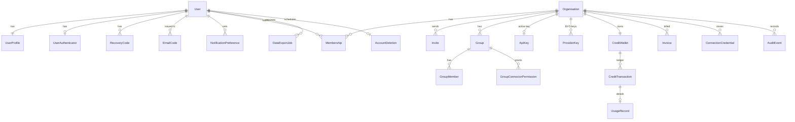
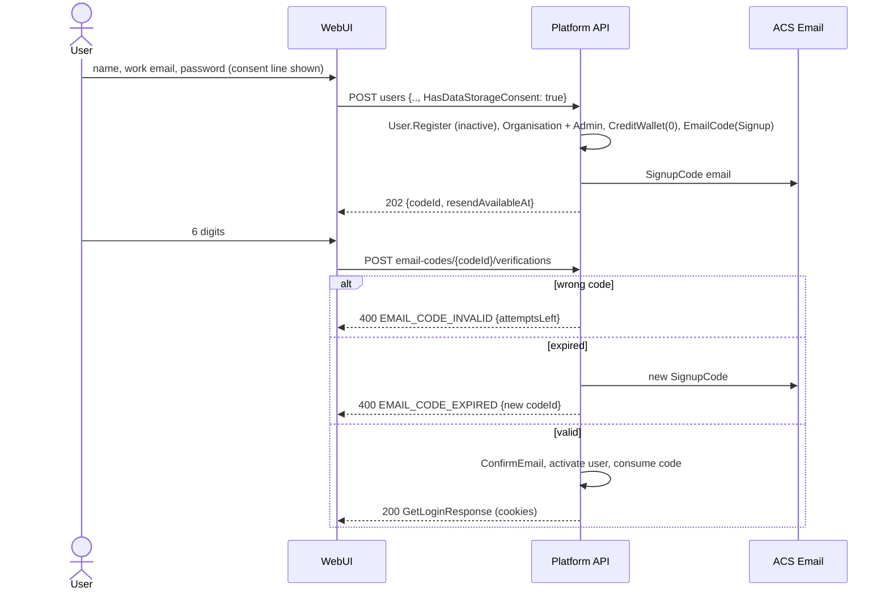
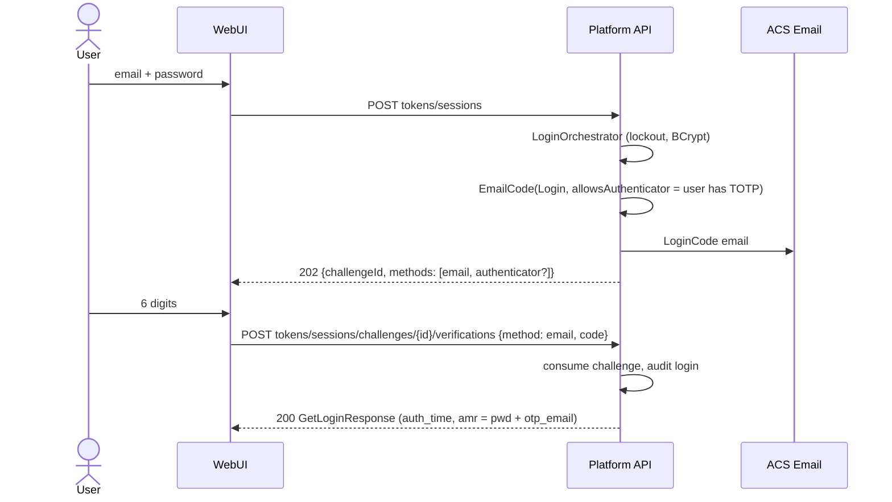
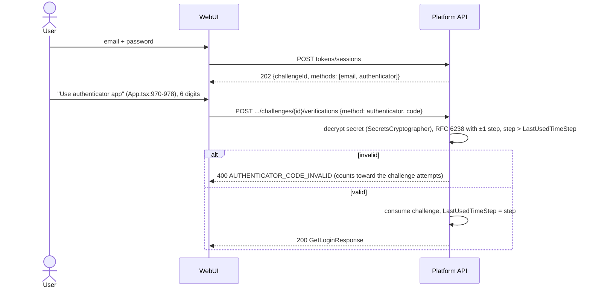
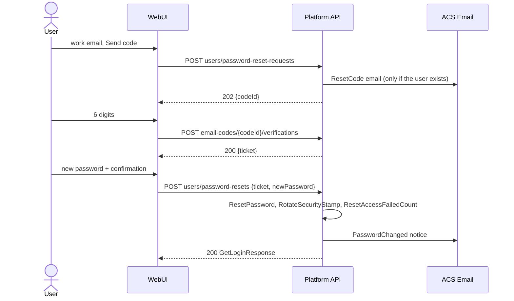
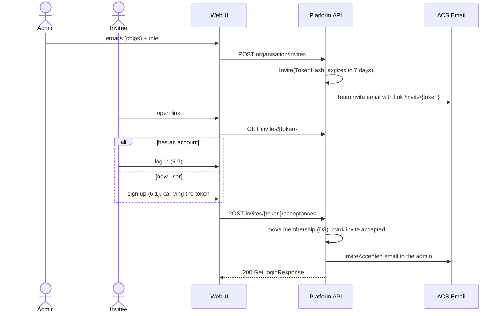
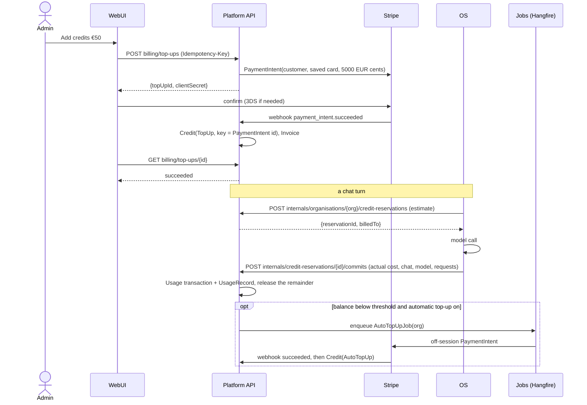
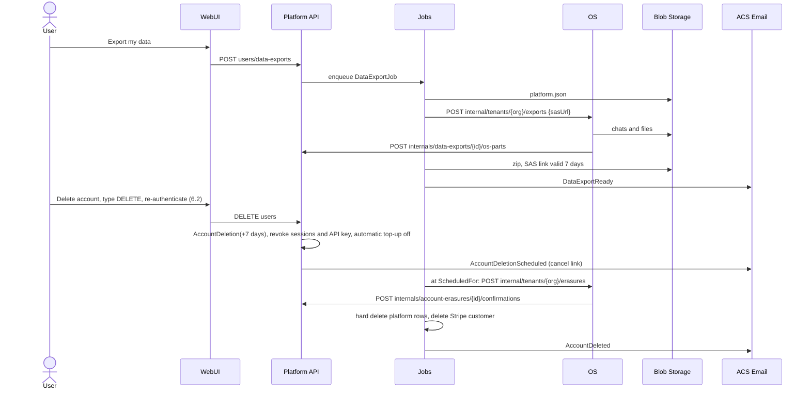

# Platform product flows (W4): Design

**Goal:** The platform (`intochat/platform`) gets the identity, team, key, credit and account-lifecycle APIs that the IntoChat prototype needs. The OS (DigitalBrain) keeps everything that runs a chat. Each flow ships as its own reviewable PR, and each PR unblocks named W3 screens.

**Architecture:** This design keeps the platform's existing shape: MVC controllers on `BaseController`, MediatR commands in `UseCases/<Area>`, wire DTOs in `IntoChat.Server.API.Contracts`, EF Core on Postgres, migrations in `IntoChat.Server.Db`, Hangfire in `IntoChat.Server.Jobs.API`, Azure Communication Services (ACS) for email and Stripe for money. The OS calls the platform through an internal, service-authenticated surface (`api/v1/internals/...`) to reserve and commit credits and to fetch decrypted provider and connection credentials.

**Inputs:** `clients/intochat/projects/briefs/clean-architecture/w4-platform-flow-map.md` (recon) and `figma-source/src/App.tsx` (the prototype, cited as `App.tsx:line`). Platform paths are relative to `E:/intochat/platform/src/`. The branch is `deploy/task-6-distribution`; its API, Application and Domain code is the same as `master`.

**Owner decisions taken as given (2026-10-18):**
- CRM Connections are owned by the OS (DigitalBrain modules). The platform stores only credentials and consent, and exposes them to the OS.
- Billing is prepaid credits, exactly as in the prototype: a balance, top-ups of 20/50/100/custom, automatic top-up, a per-request usage table and invoices, all through Stripe. The existing subscriptions and travel tiers are retired.
- Sign-up gets a consent line, so `HasDataStorageConsent` stays required.

## 1. Scope and non-goals

**In scope (platform):**
- Sign-up, login, password reset and change of email by 6-digit email code.
- Authenticator app (TOTP) with recovery codes.
- Profile extras: avatar, theme, UI settings, notification preferences, and log out of other devices.
- Organisations, memberships, roles, invites and groups.
- One IntoChat API key per organisation, plus bring-your-own (BYO) provider keys.
- Credit wallet: top-ups, automatic top-up, usage ledger and invoices.
- Connection credential storage.
- Data export and account deletion orchestration.
- Email templates and Hangfire jobs for all of the above.

**Non-goals (stay in the OS):**
- Chats, chat history, search, attachments, approval cards and work steps (`App.tsx:3646` AppShell).
- Archived chats, unarchive and delete permanently (`App.tsx:3512-3541`). The OS owns the chat store.
- The model picker, model catalogue, routing and cost tiers (`App.tsx:1126-1155`, `:1223`). The platform stores only three organisation settings: the team default model, the allow-list and the monthly spend limit.
- Local models and the local server probe (`App.tsx:1395-1446`, `:3069-3128`). The client or desktop probes `localhost`; the server never does.
- Connection execution: the Salesforce OAuth dance, API calls, per-permission enforcement and the "ask before changing more than N" threshold (`App.tsx:1507-1586`, `:2820`, `:2851`). These run in OS modules. The platform stores the resulting token blob, the granted scopes and the consent record.
- The in-app notification feed. The platform stores preferences and sends email. In-app delivery is an OS or UI concern and is outside W4 (see Q4).

**Retired by this design:**
- Stripe subscriptions, tiers, overage and metered billing (`IntoChat.Server.API/Controllers/PaymentController.cs:42`, `:79`, `:91`, `:167`, `:178`, `:198`, `:257`).
- Monthly token counts (`IntoChat.Server.Domain/Aggregates/User.cs:38`).
- `TokenDeductionJob` and `DeferredDowngradeJob` (`IntoChat.Server.Jobs.API/Jobs/`).
- The Telegram login gate (`IntoChat.Server.API/Controllers/TokenController.cs:36-43`).
- The travel aggregates (`User.cs:40-50`), removed in the cleanup PR 10.

## 2. State on 2026-10-18 (evidence)

- **Controllers and routes.** Controllers inherit `BaseController` with `[Authorize]`, `[ApiController]` and `[ApiVersion("1.0")]` (`IntoChat.Server.API/Controllers/BaseController.cs:10-14`). Routes follow `api/v{version:apiVersion}/<plural-kebab>` (`IntoChat.Server.API/Controllers/UserController.cs:33`). Actions are modelled as nouns: `password-reset-requests` (`:97`), `email-confirmations` (`:76`).
- **Error mapping.** `HandleError` maps:
  - `*_NOT_FOUND` to 404;
  - `UNAUTHORIZED` to 401;
  - `UNAUTHORIZED_ACCESS` and `*_UNAUTHORIZED_ACCESS` to 403;
  - `FEEDBACK_RATE_LIMIT_EXCEEDED` to 429;
  - everything else to 400.

  The error body is `{ ErrorCode, ErrorReason }` (`BaseController.cs:18-36`).
- **Error catalogue.** `IntoChat.Server.Application/ApplicationErrors/Errors.cs` uses UPPER_SNAKE codes, for example `EMAIL_NOT_CONFIRMED` (`:75`), `INVALID_TOKEN` (`:211`) and `UNAUTHORIZED_ACCESS` (`:221`), with the helpers `CreateNotFoundError` and `CreateExistsError` (`:259`, `:261`).
- **Sign-up.** Sign-up requires consent and an IP address (`IntoChat.Server.Application/UseCases/Users/Commands/CreateNewUser/CreateNewUserCommandHandler.cs:24-38`; domain guard `User.cs:65-68`). It issues a link token valid for one day (`CreateNewUserCommandHandler.cs:41-43`) and creates monthly token counts (`:49`).
- **Email confirmation.** A wrong token and an expired token produce the same error (`IntoChat.Server.Application/UseCases/Users/Commands/ConfirmEmail/ConfirmEmailCommandHandler.cs:24-29`).
- **Login.** Login returns tokens straight away (`TokenController.cs:30-32`). `EMAIL_NOT_CONFIRMED` and `TELEGRAM_REQUIRED` both return 403 (`:34-43`). Password lockout already exists through `AccessFailedCount` and `LockoutEnd` (`IntoChat.Server.Domain/Entities/UserProfile.cs:114-118`; `IntoChat.Server.Application/Services/Authentication/LoginOrchestrator.cs:32-55`).
- **Sessions.** Each user has one refresh token, stored on the profile (`UserProfile.cs:96-98`). A security stamp exists (`UserProfile.cs:100`, `User.cs:113-117`), but no endpoint rotates it.
- **Hashing and encryption.**
  - Passwords are hashed with BCrypt (`User.cs:134`, `:318`).
  - Recovery tokens are hashed with HMAC-SHA256 under a key derived for that purpose (`IntoChat.Server.Infrastructure/Services/RecoveryTokenHasher.cs:12-57`).
  - PII is encrypted with AES-GCM under the `encv1:` prefix (`IntoChat.Server.Comms.Core/Extensions/EncryptionExtensions.cs:8-40`), using a single `UserDataKey` cryptographer (`IntoChat.Server.Infrastructure/Factories/EncryptionFactory.cs:29-34`).
- **Service auth.**
  - An `[Internal]` attribute guards `api/v1/internals` (`IntoChat.Server.API/Controllers/InternalController.cs:21-22`). That surface already holds a per-user token deduction (`:25-30`) and user deletion (`:103`).
  - The `X-Internal-Auth` header is checked against a set of configured keys (`IntoChat.Server.API/Security/InternalAccessValidator.cs:9-15`).
  - A separate single-key `X-API-Key` scheme also exists (`IntoChat.Server.API/Security/ApiKeyAuthenticationHandler.cs:16-33`, `ApiKeyValidator.cs:15-16`).
- **Rate limiting.** AspNetCoreRateLimit IP policies (`IntoChat.Server.API/Extensions/ServiceCollectionExtensions.cs:660-664`, `ApplicationBuilderExtensions.cs:72`).
- **Email.** Email goes through the ACS `EmailClient` (`IntoChat.Server.Infrastructure/Services/Emails/EmailService.cs:20`, `:370`). Today it has confirmation, reset and subscription templates (`:22`, `:52`, `:76-180`).
- **Jobs.** Hangfire is registered in the API (`IntoChat.Server.API/Extensions/ServiceCollectionExtensions.cs:598`). Recurring jobs are registered in `IntoChat.Server.Jobs.API/Extensions/ApplicationBuilderExtensions.cs:28-43`.
- **Stripe.** Webhook at `PaymentController.cs:115-139`, setup intents at `:103`, payment methods at `:217`, `:235` and `:298`, invoices at `:279`.
- **Migrations.** Migrations have timestamp names in `IntoChat.Server.Db/Migrations/`; the latest is `20260405215236_AddAirportSearchAliases.cs`. The DbContext is still `IntoChat.Server.Infrastructure/Database/TripRadarDbContext.cs`.
- **Tests and configuration.** Tests use xUnit v3, FluentAssertions and Moq (`E:/intochat/platform/AGENTS.md:26`). Existing test names read `Method_Condition_Result` (`IntoChat.Server.Tests/Users/InternalUsersControllerTests.cs:22-91`). New W4 tests use `Method_Result_WhenCondition`, as the brief asks. Configuration goes only through Aspire parameters and `IOptions<T>` (`E:/intochat/platform/CLAUDE.md:75`, `:110`).

## 3. Decisions (ADR style)

### D1. One code engine for every email purpose

A single `EmailCode` entity serves every purpose: `Purpose ∈ {Login, Signup, Reset, ChangeEmail}`.

**Rules:**
- A code is 6 digits and is valid for 10 minutes.
- A code allows 3 attempts (`App.tsx:928-929`).
- Resending has a 42 s cooldown (`App.tsx:833`).
- Issuing a code invalidates the previous active code for the same `(Subject, Purpose)`.

**Errors:**
- A wrong code returns `EMAIL_CODE_INVALID` with `attemptsLeft`.
- An expired code returns `EMAIL_CODE_EXPIRED` and issues a new code in the same transaction. This matches the UI copy "This code expired. We sent a new one." (`App.tsx:931-933`).
- The third wrong attempt returns `EMAIL_CODE_LOCKED`, and the user must request a new code.

PR 1 removes the link-token columns on `UserProfile` (`UserProfile.cs:80-86`) and the link endpoints (`UserController.cs:61-112`) once the WebUI no longer calls them.

**Rejected:**
- Keeping link tokens next to codes: two engines and two sets of templates.
- TOTP-style codes derived from a secret: they cannot carry attempt state per purpose.

### D2. Login is a two-step challenge

1. `POST tokens/sessions` with a valid password no longer returns tokens. It returns `202` with `{ challengeId, methods: ["email", "authenticator"?], expiresAt }` and sends a login code.
2. `POST tokens/sessions/challenges/{challengeId}/verifications` with `{ method, code }` returns the existing `GetLoginResponse`, built by `authResponseBuilder.BuildLoginResponse` (`TokenController.cs:32`).

The challenge is an `EmailCode` row with purpose `Login`, plus a flag saying whether the authenticator is allowed.

- **Google login** (`TokenController.cs:47`) goes through the challenge when the user has TOTP enabled. Otherwise it stays one step, because Google has already verified the email.
- **`EMAIL_NOT_CONFIRMED` disappears.** An unconfirmed sign-up simply resumes at the code screen.
- **Every login asks for a code**, as in the prototype (`App.tsx:5389-5391`). A trusted-device cookie is open question Q1.

### D3. Every user belongs to exactly one organisation in v1

- **Sign-up** creates a personal `Organisation` with the user as `Admin`.
- **Accepting an invite** moves the user into the inviting organisation when their personal organisation has no other members and a zero balance. Otherwise the API returns `MEMBERSHIP_CONFLICT` (Q2).
- **Roles** are `Admin` and `Member` (`App.tsx:3376`).
- **Groups** hold named connector permissions (`App.tsx:3449`). The platform stores them as opaque `{connectorId, scopes[]}` that the OS interprets (D6).
- **Ownership.** The wallet, the API key, provider keys and connection credentials all belong to the organisation.

### D4. Prepaid credits: a wallet plus an append-only ledger in micro-euros

- **Wallet.** One `CreditWallet` per organisation.
- **Amounts.** Balances and amounts are `long` micro-euros (1 € = 1 000 000), so per-request costs such as €0.0187 do not round.
- **Ledger.** Every change is a `CreditTransaction` with a unique `IdempotencyKey`. Types: TopUp, AutoTopUp, Reservation, ReservationRelease, Usage, Adjustment, Refund.
- **Balance.** The balance is a column, updated in the same transaction as the ledger row, with optimistic concurrency (`xmin`).

**Top-ups and invoices:**
- Top-ups are Stripe PaymentIntents on the saved customer. Setup intents and payment methods are reused from `PaymentController.cs:103` and `:217`.
- Credits are posted only from the `payment_intent.succeeded` webhook (`PaymentController.cs:115`), never from the client.
- Automatic top-up adds €50 when the balance drops below €10 (`App.tsx:3248-3251`); both values are configurable. When a commit crosses the threshold, a Hangfire job creates an off-session PaymentIntent.
- Invoices are Stripe invoices, one per top-up; `GET invoices` lists them.

**Usage takes two calls:**
1. Before a model call the OS asks for a **reservation** of the estimated cost.
2. Afterwards the OS **commits** the actual cost with `{chatId, chatTitle, model, requests}`, and the platform releases the unused part.

Reservations expire after 15 minutes and a Hangfire sweep releases them. The reservation keeps the balance from going negative when chats run concurrently. The commits feed the usage table (`App.tsx:3279-3300`). The monthly spend limit (`App.tsx:3149`) is checked at reservation time.

**BYO provider key.** A request served with the organisation's own provider key is committed with `cost = 0` and `billedTo = ProviderKey`, so it still appears in usage (Q3).

**Rejected:**
- Posting usage through Kafka without a reservation: the balance can overdraw.
- Keeping `UserMonthlyTokenCount`: it counts per user and per month, while the wallet belongs to the organisation and has no period.

### D5. Service-to-service auth: internal key plus user context

- **Service identity.** The OS calls `api/v1/internals/...` with `X-Internal-Auth: <key>`, checked by the existing validator (`InternalAccessValidator.cs:9-15`). Each OS deployment gets its own key, so one can be revoked alone.
- **User context.** The OS forwards the signed-in user's platform access token in `X-On-Behalf-Of`. The platform validates it with the normal JWT settings.
- **Which endpoints need what.** Internal endpoints that act for a user require both headers. Endpoints that run without a user (the reservation sweep, the deletion fan-out callback) take the organisation id in the route.
- **`X-API-Key` is not reused.** The existing scheme (`ApiKeyValidator.cs:15`) has one global key.

The IntoChat API key `ic_live_…` (`App.tsx:2894`) is a customer credential. To use it, the OS sends the key to `POST internals/api-keys/introspections`, gets back `{organisationId, keyId}` and caches the result for 60 s.

### D6. Connections: the OS executes, the platform stores credentials and consent

`ConnectionCredential` is keyed by `(OrganisationId, ConnectorId)`. It holds:
- the token blob, encrypted as opaque bytes;
- `Scopes`;
- `ExternalAccountLabel`, for example "Org: Nordlys AS" (`App.tsx:1507-1586`);
- `ConsentedByUserId` and `ConsentedOn`;
- `Status` and `LastErrorOn`.

**Who calls what:**
- The OS writes the credential after its OAuth callback: `PUT internals/organisations/{orgId}/connection-credentials/{connectorId}`.
- The OS reads it decrypted when it uses the connection (`GET` on the same route).
- The UI reads only metadata (`GET connections`) and can disconnect (`DELETE connections/{connectorId}`).
- Disconnect deletes the blob and emits `ConnectionRevoked`. The OS consumes that event and revokes the grant at the provider.

Per-permission toggles and the approval threshold live in the OS module configuration. The platform does not interpret them.

### D7. Secrets are encrypted with a separate key, behind a cryptographer name

- **What it covers.** Provider keys, connection credentials and TOTP secrets.
- **How.** They use a new cryptographer, `SecretsCryptographer`, in `EncryptionFactory` (`EncryptionFactory.cs:27-35`). It has its own key, `Encryption:SecretsKey`, an Aspire parameter backed by Key Vault.
- **Rotation.** Ciphertext carries a key version prefix (`sec1:`), so the key can be rotated by re-encrypting in a job.
- **What stays as is.** PII stays on `UserDataKey`. Values that only need a hash (codes, recovery codes, the API key secret) use `RecoveryTokenHasher` (`RecoveryTokenHasher.cs:27-37`).
- **Purpose string.** The hasher's purpose string changes from `TripRadar:recovery-token:v1` (`:13`) to a new value. During a transition window both values are accepted on verify.

### D8. Account deletion: 7-day grace, the platform orchestrates, the OS confirms

`DELETE users` (`UserController.cs:131`) no longer deletes immediately. The sequence:

1. The request needs a typed confirmation and a recent re-authentication. The access token's `auth_time` claim must come from a login challenge completed in the last 10 minutes. No new code purpose is added for this.
2. The platform creates an `AccountDeletion` with `ScheduledFor = now + 7 days`, revokes sessions, revokes the API key and turns off automatic top-up.
3. At `ScheduledFor`, a Hangfire job calls the OS: `POST {os}/internal/tenants/{orgId}/erasures`.
4. When the OS calls back, the job hard-deletes the platform rows and the Stripe customer.

Edge cases:
- If the user is the last admin of a team that has other members, the request fails with `LAST_ADMIN_CANNOT_DELETE`.
- Credits are not refunded (`App.tsx:3556`).
- Logging in during the grace period offers to cancel the deletion (Q5).

### D9. Export: the platform collects its own part, the OS adds the chats

`POST users/data-exports` creates a `DataExportJob`. A Hangfire job then:

1. Writes the platform JSON: profile, settings, membership, ledger and the list of invoices.
2. Asks the OS to add chats and files: `POST {os}/internal/tenants/{orgId}/exports`, with a SAS upload URL into the same blob folder.
3. Zips the result in Azure Blob Storage.
4. Emails a download link valid for 7 days (`App.tsx:3552`).

Each user can have one active export at a time; a second request returns `DATA_EXPORT_IN_PROGRESS`.

## 4. Domain model

### 4.1 Entities and relationships



### 4.2 EF Core sketches

New aggregates go in `IntoChat.Server.Domain/Aggregates` and child entities in `Domain/Entities`. Their configurations go in `IntoChat.Server.Infrastructure/Database/EntityFrameworkConfigurations`, which is the existing pattern (for example `AirlinesConfiguration.cs`). Entities use private setters and behaviour methods, as `User.cs` does. The child entities below use field shorthand for brevity; real code uses private setters.

```csharp
// User additions (Domain/Aggregates/User.cs, Entities/UserProfile.cs)
public Theme Theme { get; private set; } = Theme.System;          // light | dark | system (App.tsx:19)
public UserUiSettings UiSettings { get; private set; } = new();    // owned jsonb: DateFormat, SendWithEnter, ShowSteps (App.tsx:2627-2760)
public string? AvatarBlobPath { get; private set; }                // replaces URL-only ProfilePictureUrl (UserProfile.cs:108)
public UserAuthenticator? Authenticator { get; private set; }
private ICollection<RecoveryCode> RecoveryCodes { get; set; } = new List<RecoveryCode>();
private ICollection<NotificationPreference> NotificationPreferences { get; set; } = new List<NotificationPreference>();
public void ChangeEmail(string newEmail) { Profile.UpdateEmail(newEmail); RotateSecurityStamp(); }
public void LogOutOtherDevices() { RotateSecurityStamp(); ClearRefreshToken(); }

public sealed class UserAuthenticator                                // TOTP
{
    public long UserId { get; private set; }
    public string SecretCiphertext { get; private set; } = null!;   // SecretsCryptographer
    public DateTime? ConfirmedOn { get; private set; }              // null = setup pending
    public long LastUsedTimeStep { get; private set; }              // replay guard
}

public sealed class RecoveryCode { long Id; long UserId; string CodeHash; DateTime? UsedOn; }

public sealed class NotificationPreference
{
    public long UserId { get; private set; }
    public NotificationEvent Event { get; private set; }     // ApprovalNeeded, JobFinished, ConnectionFailed, CreditsLow, WeeklySummary (App.tsx:3470-3480)
    public NotificationChannel Channel { get; private set; } // Email, InApp (App.tsx:3485)
    public bool Enabled { get; private set; }
}

public sealed class EmailCode : AggregateRoot<Guid>
{
    public string SubjectEmailHash { get; private set; } = null!;  // blind index, works before a User exists
    public long? UserId { get; private set; }
    public EmailCodePurpose Purpose { get; private set; }          // Login, Signup, Reset, ChangeEmail
    public string CodeHash { get; private set; } = null!;          // RecoveryTokenHasher
    public string? PendingEmailCiphertext { get; private set; }    // ChangeEmail target
    public string? ResetTicketHash { get; private set; }           // Reset only, set on success
    public int AttemptsLeft { get; private set; } = 3;
    public DateTime ExpiresOn { get; private set; }                // +10 min
    public DateTime LastSentOn { get; private set; }               // 42 s cooldown
    public int SendCount { get; private set; }                     // cap: 5 per hour
    public DateTime? ConsumedOn { get; private set; }
    public bool AllowsAuthenticator { get; private set; }          // Login challenge only
    public EmailCodeCheck Verify(string code, IRecoveryTokenHasher hasher, DateTime now); // Ok | Wrong(attemptsLeft) | Expired | Locked
}

public sealed class Organisation : AggregateRoot<Guid>
{
    public string Name { get; private set; } = null!;
    public string? DefaultModelId { get; private set; }             // App.tsx:3020
    public List<string> AllowedModelIds { get; private set; } = []; // jsonb
    public long? MonthlySpendLimitMicros { get; private set; }      // App.tsx:3149
    public DateTime CreatedOn { get; private set; }
    private readonly List<Membership> _memberships = [];
}
public sealed class Membership { Guid OrganisationId; long UserId; OrganisationRole Role; DateTime JoinedOn; }   // Admin | Member
public sealed class Invite { Guid Id; Guid OrganisationId; string EmailCiphertext; string EmailHash; OrganisationRole Role;
    string TokenHash; InviteStatus Status; DateTime ExpiresOn; DateTime LastSentOn; long InvitedByUserId; }
public sealed class Group { Guid Id; Guid OrganisationId; string Name; }
public sealed class GroupMember { Guid GroupId; long UserId; }
public sealed class GroupConnectorPermission { Guid GroupId; string ConnectorId; List<string> Scopes; }         // opaque to the platform

public sealed class ApiKey : AggregateRoot<Guid>
{
    public Guid OrganisationId { get; private set; }
    public string Prefix { get; private set; } = null!;            // "ic_live_" + 8 chars, shown in the list
    public string SecretHash { get; private set; } = null!;        // HMAC; plaintext returned once
    public long CreatedByUserId { get; private set; }
    public DateTime CreatedOn { get; private set; }
    public DateTime? LastUsedOn { get; private set; }
    public DateTime? RevokedOn { get; private set; }
}
public sealed class ProviderKey { Guid OrganisationId; ModelProvider Provider;   // OpenAI, Anthropic, Google, XAI (App.tsx:2938-2951)
    string SecretCiphertext; string Last4; DateTime UpdatedOn; long UpdatedByUserId; }

public sealed class CreditWallet : AggregateRoot<Guid>
{
    public Guid OrganisationId { get; private set; }
    public long BalanceMicros { get; private set; }
    public long ReservedMicros { get; private set; }
    public bool AutoTopUpEnabled { get; private set; }
    public long AutoTopUpThresholdMicros { get; private set; } = 10_000_000;
    public long AutoTopUpAmountMicros { get; private set; } = 50_000_000;
    public string? StripeCustomerId { get; private set; }
    public uint Version { get; private set; }                      // xmin concurrency token
    public Result<CreditTransaction> Reserve(long micros, string idempotencyKey);
    public Result<CreditTransaction> Commit(Guid reservationId, long actualMicros, UsageRecord usage);
    public CreditTransaction Credit(long micros, CreditTransactionType type, string idempotencyKey, string? stripePaymentIntentId);
}
public sealed class CreditTransaction { Guid Id; Guid WalletId; CreditTransactionType Type; long AmountMicros; string IdempotencyKey;
    Guid? ReservationId; string? StripePaymentIntentId; DateTime CreatedOn; DateTime? ExpiresOn; }
public sealed class UsageRecord { Guid TransactionId; string ChatId; string ChatTitle; string Model; int Requests;
    long CostMicros; UsageBilledTo BilledTo; long? UserId; }                                                      // App.tsx:3279-3300
public sealed class Invoice { Guid Id; Guid OrganisationId; string StripeInvoiceId; long AmountMicros; string Currency; string? HostedUrl; DateTime IssuedOn; }

public sealed class ConnectionCredential { Guid OrganisationId; string ConnectorId; byte[] TokenCiphertext; List<string> Scopes;
    string? ExternalAccountLabel; long ConsentedByUserId; DateTime ConsentedOn; ConnectionStatus Status; DateTime? LastErrorOn; }

public sealed class DataExportJob { Guid Id; long UserId; DataExportStatus Status; string? BlobPath; DateTime RequestedOn; DateTime? ReadyOn; DateTime? LinkExpiresOn; }
public sealed class AccountDeletion { Guid Id; long UserId; DateTime RequestedOn; DateTime ScheduledFor; AccountDeletionStatus Status; DateTime? OsErasureConfirmedOn; }
public sealed class AuditEvent { long Id; Guid? OrganisationId; long? ActorUserId; string? ActorService; string Action; string TargetType; string TargetId; string? Ip; DateTime CreatedOn; JsonDocument Metadata; }
```

### 4.3 Migrations (in `IntoChat.Server.Db/Migrations`)

| PR | Migration | Contents |
| --- | --- | --- |
| 1 | `20261020090000_AddEmailCodesAndAuditEvents` | `EmailCodes`, `AuditEvents` |
| 1b | `20261020090100_DropLinkTokens` | drops `EmailConfirmationToken*` and `PasswordResetToken*` from `UserProfiles`. Ships in a follow-up PR after the WebUI deploy. |
| 2 | `20261021090000_AddUserSettingsAndNotificationPreferences` | `Theme`, `UiSettings` (jsonb), `AvatarBlobPath`, `NotificationPreferences` |
| 3 | `20261022090000_AddUserAuthenticatorAndRecoveryCodes` | `UserAuthenticators`, `RecoveryCodes` |
| 4 | `20261023090000_AddOrganisationsMembershipsInvites` | also backfills a personal organisation for every existing user |
| 5 | `20261024090000_AddGroups` | `Groups`, `GroupMembers`, `GroupConnectorPermissions` |
| 6 | `20261025090000_AddApiKeysProviderKeysIdempotency` | `ApiKeys` (unique `Prefix`; filtered unique index on the active key per organisation), `ProviderKeys`, `IdempotencyRecords` |
| 7 | `20261026090000_AddCreditWalletLedger` | `CreditWallets`, `CreditTransactions` (unique `IdempotencyKey`), `UsageRecords`, `Invoices` |
| 7b | `20261026090100_RetireSubscriptionsAndTiers` | drops `UserSubscriptions`, `OverageBillingRecords`, `OveragePricings`, `UserMonthlyTokenCounts` and the `Tier` FK. Ships one release after the wallet goes live. |
| 8 | `20261027090000_AddConnectionCredentials` | `ConnectionCredentials` |
| 9 | `20261028090000_AddDataExportsAndAccountDeletions` | `DataExportJobs`, `AccountDeletions` |

## 5. API surface

**Conventions:**
- All routes are `api/v{version:apiVersion}/...` (v1) on `BaseController`. Auth is the user JWT unless the table says otherwise.
- Requests go in `IntoChat.Server.API.Contracts/Requests/{Create,Update,Delete,Get}` and responses in `Responses/{...}`. Each action maps to one MediatR command or query, with a FluentValidation validator next to it.
- New error codes go in `Errors.cs` and follow the suffix rules of `HandleError`.

**New `HandleError` mappings** (`BaseController.cs:22-31`):
- `*_RATE_LIMITED` → 429
- `*_CONFLICT` → 409
- `CREDITS_INSUFFICIENT` and `SPEND_LIMIT_REACHED` → 402
- `REAUTHENTICATION_REQUIRED` and `API_KEY_INVALID` → 401

### 5.1 Sign-up, codes, login and reset (PR 1; the TOTP parts land in PR 3)

| Verb | Route | Auth | Request → Response | Errors |
| --- | --- | --- | --- | --- |
| POST | `users` | anonymous | `CreateUserRequest { FirstName, LastName, Email, Password, HasDataStorageConsent }` → `202 CreateEmailCodeResponse { CodeId, ResendAvailableAt, ExpiresAt }` | existing (`CreateNewUserCommandHandler.cs:24-38`): `USER_EXISTS`, `USER_CONSENT_NOT_GRANTED`, `USER_IP_NOT_VALID_OR_NOT_PROVIDED` |
| POST | `email-codes` | anonymous | Resend. `CreateEmailCodeRequest { Email, Purpose }` → `202 CreateEmailCodeResponse`. Unknown emails also get 202, so the response does not reveal which emails exist. | `EMAIL_CODE_RATE_LIMITED` (cooldown, or more than 5 sends per hour) |
| POST | `email-codes/{codeId}/verifications` | anonymous | `CreateEmailCodeVerificationRequest { Code }` → for Signup: `GetLoginResponse` (auto-login, `App.tsx:880-883`); for Reset: `CreatePasswordResetTicketResponse { Ticket, ExpiresAt }` | `EMAIL_CODE_INVALID` (the body adds `AttemptsLeft`), `EMAIL_CODE_EXPIRED` (the body adds the new `CodeId`), `EMAIL_CODE_LOCKED`, `EMAIL_CODE_NOT_FOUND` |
| POST | `tokens/sessions` | anonymous | `CreateLoginRequest` (existing) → `202 CreateLoginChallengeResponse { ChallengeId, Methods[], ExpiresAt, ResendAvailableAt }` | existing: `USERNAME_OR_PASSWORD_NOT_VALID`, `ACCOUNT_LOCKED` |
| POST | `tokens/sessions/challenges/{challengeId}/verifications` | anonymous | `CreateLoginChallengeVerificationRequest { Method: email \| authenticator \| recovery, Code }` → `GetLoginResponse` | the `EMAIL_CODE_*` errors above, plus `AUTHENTICATOR_CODE_INVALID`, `RECOVERY_CODE_INVALID`, `AUTHENTICATOR_NOT_ENABLED` |
| POST | `tokens/sessions/challenges/{challengeId}/resends` | anonymous | → `202 CreateEmailCodeResponse` | `EMAIL_CODE_RATE_LIMITED` |
| POST | `tokens/sessions/google` | anonymous | existing → `GetLoginResponse`, or `202 CreateLoginChallengeResponse` when TOTP is on | existing |
| POST | `users/password-reset-requests` | anonymous | `ForgotPasswordRequest { Email }` → `202 CreateEmailCodeResponse` (purpose Reset) | `EMAIL_CODE_RATE_LIMITED` |
| POST | `users/password-resets` | anonymous | `ResetPasswordRequest { Ticket, NewPassword }` → `GetLoginResponse`, matching "Password changed. You are logged in." (`App.tsx:1037-1105`). Rotates the security stamp. | `PASSWORD_RESET_TICKET_INVALID`, password rule errors (existing validator) |
| POST | `tokens/refresh-tokens` | anonymous | existing (`TokenController.cs:105`) | existing |
| POST | `users/logout` | user | existing (`UserController.cs:222`) | |

The reset ticket is a random 32-byte value. It is stored hashed on the consumed `EmailCode` (`ResetTicketHash`), works once, and is valid for 10 minutes.

### 5.2 Profile and settings (PR 2; authenticator in PR 3)

| Verb | Route | Request → Response | Errors |
| --- | --- | --- | --- |
| GET, PUT | `users/profile` | existing (`UserController.cs:144`, `:156`). The response gains `Theme` and `AvatarUrl` (a short-lived SAS URL). | |
| PUT | `users/avatar` | `multipart/form-data`, JPG or PNG up to 5 MB (`App.tsx:2111`) → `GetAvatarResponse { AvatarUrl }` | `AVATAR_TOO_LARGE`, `AVATAR_TYPE_NOT_SUPPORTED` |
| DELETE | `users/avatar` | → 204 | |
| GET, PUT | `users/settings` | `UpdateUserSettingsRequest { Theme, DateFormat, SendWithEnter, ShowSteps, LanguageCode, TimezoneId }` → `GetUserSettingsResponse` | `TIMEZONE_NOT_FOUND`, `LANGUAGE_NOT_FOUND` |
| GET, PUT | `users/notification-preferences` | `UpdateNotificationPreferencesRequest { Items: [{ Event, Channel, Enabled }] }` → same shape | |
| POST | `users/email-change-requests` | `CreateEmailChangeRequest { NewEmail }` → `202 CreateEmailCodeResponse`. The code goes to the new address; a notice goes to the old one. | `USER_EXISTS`, `EMAIL_CODE_RATE_LIMITED` |
| POST | `users/email-changes` | `CreateEmailChangeConfirmationRequest { CodeId, Code }` → `GetLoginResponse`. The stamp rotates, so new tokens are issued. | `EMAIL_CODE_*` |
| POST | `users/session-revocations` | → `GetLoginResponse` for this device. Every other refresh token and access token becomes invalid ("Log out other devices?", `App.tsx:2428`). | |
| PUT | `users/password` | existing (`UserController.cs:119`); now also rotates the stamp | |
| POST | `users/authenticator` | → `CreateAuthenticatorResponse { Secret, OtpAuthUri }`. The client draws the QR code (`App.tsx:2360-2395`). | `AUTHENTICATOR_ALREADY_ENABLED` |
| POST | `users/authenticator/confirmations` | `{ Code }` → `CreateAuthenticatorConfirmationResponse { RecoveryCodes[10] }`, shown once | `AUTHENTICATOR_CODE_INVALID` |
| DELETE | `users/authenticator` | `{ Code }` (TOTP or recovery code) → 204 (`App.tsx:2417`) | `AUTHENTICATOR_CODE_INVALID` |
| POST | `users/authenticator/recovery-codes` | `{ Code }` → a new set of 10; the old set stops working | `AUTHENTICATOR_CODE_INVALID` |

For stamp rotation to actually log out other devices, the access token needs to carry the stamp. It gets an `sstamp` claim. JWT validation (`IntoChat.Server.API/Extensions/ServiceCollectionExtensions.cs:440-470`) compares that claim in `OnTokenValidated` against the user's stamp, cached for 60 s per user.

### 5.3 Team (PR 4 and PR 5)

In v1 the organisation comes from the caller's single membership, so routes use the singular `organisation`, meaning the caller's own. Admin-only actions return `ORGANISATION_UNAUTHORIZED_ACCESS`, which maps to 403 through the suffix rule.

| Verb | Route | Request → Response | Errors |
| --- | --- | --- | --- |
| GET, PUT | `organisation` | `UpdateOrganisationRequest { Name, DefaultModelId, AllowedModelIds[], MonthlySpendLimit }` → `GetOrganisationResponse` | `ORGANISATION_UNAUTHORIZED_ACCESS` |
| GET | `organisation/members` | → `PaginatedResponse<GetMemberResponse { UserId, Name, Email, Role, AvatarUrl }>` | |
| PATCH | `organisation/members/{userId}` | `{ Role }` → 204 | `LAST_ADMIN_CANNOT_DEMOTE`, `MEMBER_NOT_FOUND` |
| DELETE | `organisation/members/{userId}` | → 204. The removed member moves to a new personal organisation. | `LAST_ADMIN_CANNOT_DEMOTE`, `MEMBER_NOT_FOUND` |
| POST | `organisation/invites` | `CreateInvitesRequest { Emails[], Role }` (email chips, `App.tsx:3422-3441`) → `CreateInvitesResponse { Invites[] }`. Re-inviting a pending email resends the invite. | `INVITE_ALREADY_MEMBER`, `INVITE_RATE_LIMITED` |
| GET | `organisation/invites` | → list of pending invites ("Invite pending") | |
| POST | `organisation/invites/{inviteId}/resends` | → 202 ("Resend invite"); 60 s cooldown | `INVITE_RATE_LIMITED`, `INVITE_NOT_FOUND` |
| DELETE | `organisation/invites/{inviteId}` | → 204 | `INVITE_NOT_FOUND` |
| GET | `invites/{token}` | anonymous → `GetInvitePreviewResponse { OrganisationName, InvitedBy, Role, Email, HasAccount }` | `INVITE_NOT_FOUND`, `INVITE_EXPIRED` |
| POST | `invites/{token}/acceptances` | user, signed in with the invited email → `GetLoginResponse` with the new organisation claim | `INVITE_EMAIL_MISMATCH`, `MEMBERSHIP_CONFLICT` (409) |
| GET, POST | `organisation/groups` | `CreateGroupRequest { Name, MemberUserIds[], Permissions: [{ ConnectorId, Scopes[] }] }` → `GetGroupResponse` | `GROUP_EXISTS` |
| PUT, DELETE | `organisation/groups/{groupId}` | same shape → 204 | `GROUP_NOT_FOUND` |

An invite for an unknown email lands on the sign-up page with the token. When the sign-up code is verified, the invite is accepted in the same step.

### 5.4 Keys (PR 6)

| Verb | Route | Request → Response | Errors |
| --- | --- | --- | --- |
| GET | `organisation/api-key` | → `GetApiKeyResponse { Prefix, CreatedOn, LastUsedOn }` | `API_KEY_NOT_FOUND` |
| POST | `organisation/api-key` | `Idempotency-Key` header → `CreateApiKeyResponse { Key }`, shown once (`App.tsx:2894`) | `API_KEY_EXISTS` |
| POST | `organisation/api-key/rotations` | `Idempotency-Key` → `CreateApiKeyResponse` (`App.tsx:3579`). The old key stops working at once by default; a grace period is configurable. | `API_KEY_NOT_FOUND` |
| DELETE | `organisation/api-key` | → 204 (`App.tsx:3590`) | `API_KEY_NOT_FOUND` |
| GET | `organisation/provider-keys` | → `[{ Provider, Last4, UpdatedOn }]` | |
| PUT | `organisation/provider-keys/{provider}` | admin. `{ Key }` → `{ Provider, Last4 }` | `PROVIDER_NOT_SUPPORTED`, `ORGANISATION_UNAUTHORIZED_ACCESS` |
| DELETE | `organisation/provider-keys/{provider}` | admin → 204 | `PROVIDER_KEY_NOT_FOUND` |

### 5.5 Billing (PR 7; replaces `payments/subscription*`, `overage-usages`, `metered-events` and `prices`)

| Verb | Route | Request → Response | Errors |
| --- | --- | --- | --- |
| GET | `billing/wallet` | → `GetWalletResponse { Balance, Reserved, Currency, AutoTopUp { Enabled, Threshold, Amount }, EstimatedRequestsLeft }` (`App.tsx:3227`) | |
| POST | `billing/top-ups` | `Idempotency-Key` + `CreateTopUpRequest { Amount }` (20, 50, 100, or a custom amount from 5 to 1000) → `CreateTopUpResponse { TopUpId, ClientSecret, Status }`. This creates a PaymentIntent; the client handles 3DS. | `TOP_UP_AMOUNT_INVALID`, `PAYMENT_METHOD_NOT_FOUND` |
| GET | `billing/top-ups/{topUpId}` | → `{ Status: pending \| succeeded \| failed }`. The UI polls this after confirming. | `TOP_UP_NOT_FOUND` |
| PUT | `billing/auto-top-up` | `{ Enabled, Threshold, Amount }` → `GetWalletResponse` | `PAYMENT_METHOD_NOT_FOUND` when enabling without a card |
| GET | `billing/usage` | `?page&pageSize&from&to` → `PaginatedResponse<GetUsageRowResponse { Date, ChatTitle, Model, Requests, Cost }>`, grouped per chat per day (`App.tsx:3279-3300`) | |
| GET | `billing/invoices` | → `[{ Number, Date, Amount, HostedUrl, PdfUrl }]`. Moved from `payments/invoices` (`PaymentController.cs:279`). | |
| GET, PATCH, DELETE, POST | `payments/payment-methods`, `payments/setup-intents` | Kept as they are (`PaymentController.cs:103`, `:217`, `:235`, `:298`), now attached to the organisation's Stripe customer. | existing |
| POST | `payments/webhook` | Kept (`PaymentController.cs:115`). New handlers: `payment_intent.succeeded` posts the credit, keyed by the PaymentIntent id. `payment_intent.payment_failed` emails the admin, and turns off automatic top-up after 2 failures. | |

### 5.6 Connections (PR 8; the UI side)

| Verb | Route | Request → Response | Errors |
| --- | --- | --- | --- |
| GET | `organisation/connections` | → `[{ ConnectorId, Status, ExternalAccountLabel, Scopes[], ConsentedBy, ConsentedOn }]` | |
| DELETE | `organisation/connections/{connectorId}` | admin → 204 (`App.tsx:3566`). Emits `ConnectionRevoked`. | `CONNECTION_NOT_FOUND` |

### 5.7 Account lifecycle (PR 9)

| Verb | Route | Request → Response | Errors |
| --- | --- | --- | --- |
| POST | `users/data-exports` | → `202 { ExportId, Status }` | `DATA_EXPORT_IN_PROGRESS` |
| GET | `users/data-exports/{exportId}` | → `{ Status, DownloadUrl?, LinkExpiresOn? }` | `DATA_EXPORT_NOT_FOUND` |
| DELETE | `users` | `DeleteUserRequest { Confirmation: "DELETE" }`. Requires `auth_time` within the last 10 minutes (D8). → `202 { ScheduledFor }` | `REAUTHENTICATION_REQUIRED`, `LAST_ADMIN_CANNOT_DELETE` |
| DELETE | `users/deletion` | Cancels during the grace period → 204 | `ACCOUNT_DELETION_NOT_FOUND` |

### 5.8 Internal surface for the OS (`[Internal]`, `X-Internal-Auth`; see D5)

| Verb | Route | Purpose | Contract |
| --- | --- | --- | --- |
| POST | `internals/api-keys/introspections` | Resolve an `ic_live_…` key. | `{ Key }` → `{ OrganisationId, KeyId }`, or `API_KEY_INVALID` |
| POST | `internals/organisations/{orgId}/credit-reservations` | Before a model call. | `Idempotency-Key` + `{ EstimatedCost, Model, ChatId, UserId }` → `{ ReservationId, ExpiresAt, BilledTo: credits \| providerKey }`. Errors: `CREDITS_INSUFFICIENT`, `SPEND_LIMIT_REACHED`, `MODEL_NOT_ALLOWED`. |
| POST | `internals/credit-reservations/{reservationId}/commits` | After the call. | `Idempotency-Key` + `{ ActualCost, Requests, ChatId, ChatTitle, Model }` → `{ BalanceAfter }`. A replay returns the first result. |
| DELETE | `internals/credit-reservations/{reservationId}` | The model call failed. | → 204 (releases the reservation) |
| GET | `internals/organisations/{orgId}/provider-keys/{provider}` | Look up a BYO key. | → `{ Key }` or 404. Audited. |
| GET, PUT, DELETE | `internals/organisations/{orgId}/connection-credentials/{connectorId}` | The OS connector store. | PUT `{ Token (opaque base64), Scopes[], ExternalAccountLabel, ConsentedByUserId }`. GET returns the decrypted token. Audited. |
| GET | `internals/organisations/{orgId}/permissions?userId=` | Group scopes for one user. | → `{ Role, Permissions: [{ ConnectorId, Scopes[] }] }` |
| POST | `internals/users/{userId}/notifications` | OS events that may send email (approval needed, job finished, connection failed). | `{ Event, Payload }`. The platform applies the user's preferences and sends. |
| POST | `internals/account-erasures/{deletionId}/confirmations`, `internals/data-exports/{exportId}/os-parts` | OS callbacks for D8 and D9. | → 204 |

PR 7 removes `InternalController.DeductTokens` (`InternalController.cs:25-30`).

**Idempotency:**
- The `Idempotency-Key` header (a client-generated UUID) is required on top-ups, API key creation and rotation, reservations and commits.
- Ledger rows enforce it through the unique `IdempotencyKey` column.
- Top-up and key endpoints store `(Caller, Route, Key) → response` for 24 h in the `IdempotencyRecords` table. PR 6 adds the table and PR 7 reuses it.

## 6. Flows

### 6.1 Sign-up with email code



### 6.2 Login with email code



### 6.3 Login with authenticator



### 6.4 Reset by code



For an unknown email the platform still returns 202, with a random `codeId`. Every verification against that `codeId` fails with `EMAIL_CODE_INVALID` and then `EMAIL_CODE_LOCKED`, so the flow does not reveal whether an account exists.

### 6.5 Invite to team



### 6.6 Top-up and usage deduction



### 6.7 Account deletion with export



## 7. Email and jobs

### 7.1 Email templates (ACS through `EmailService`; English and Russian, as `AGENTS.md` requires)

| Template | Trigger | Replaces |
| --- | --- | --- |
| `SignupCode`, `LoginCode`, `ResetCode`, `ChangeEmailCode` | An `EmailCode` is issued. One layout, with subject and copy per purpose. | `SendEmailConfirmationAsync` (`EmailService.cs:22`), `SendPasswordResetAsync` (`:52`) |
| `EmailChangedNotice` | Email changed; sent to the old address | new |
| `PasswordChanged` | Password reset or changed | new |
| `AuthenticatorEnabled`, `AuthenticatorRemoved`, `RecoveryCodeUsed` | Security events | new |
| `TeamInvite`, `InviteAccepted` | Invites | new |
| `TopUpReceipt`, `AutoTopUpSucceeded`, `AutoTopUpFailed`, `CreditsLow` | Billing. `CreditsLow` follows the user's preference (`App.tsx:3470-3480`). | the subscription templates (`EmailService.cs:76-180`), which are deleted |
| `ApprovalNeeded`, `JobFinished`, `ConnectionFailed`, `WeeklyUsageSummary` | OS events through `internals/users/{id}/notifications`, or the weekly job | new |
| `DataExportReady`, `AccountDeletionScheduled`, `AccountDeleted` | Account lifecycle | new |

The ACS sender and the `EmailSettings.RedirectUrl` base keep their current configuration. Security emails are always sent, whatever the notification preferences say.

### 7.2 Hangfire jobs (registered in `IntoChat.Server.Jobs.API/Extensions/ApplicationBuilderExtensions.cs:28`)

| Job | Schedule | Work |
| --- | --- | --- |
| `EmailCodeCleanupJob` | hourly | Delete consumed or expired codes older than 24 h. |
| `InviteExpiryJob` | daily | Mark pending invites past `ExpiresOn` as expired. |
| `CreditReservationSweepJob` | every 5 min | Release reservations past `ExpiresOn`. |
| `AutoTopUpJob` | fire-and-forget, one at a time per organisation (`DisableConcurrentExecution`) | Off-session PaymentIntent. |
| `CreditsLowNotificationJob` | fire-and-forget when the balance crosses the threshold; at most once per 24 h | Email. |
| `WeeklyUsageSummaryJob` | weekly, Monday 08:00 in each user's time zone | Email. |
| `DataExportJob` | fire-and-forget | See flow 6.7. |
| `DataExportExpiryJob` | daily | Delete export blobs past `LinkExpiresOn`. |
| `AccountDeletionJob` | scheduled at `ScheduledFor`; keeps retrying for 24 h while waiting for the OS callback, then raises an alert | See flow 6.7. |
| `SecretsReencryptionJob` | manual trigger | Key rotation for D7. |

Removed: `IResetTokensJob` and `IMetterBillingJobs` (`ApplicationBuilderExtensions.cs:34-43`), `TokenDeductionJob` and `DeferredDowngradeJob`.

## 8. Security

- **Hashing.**
  - Passwords keep BCrypt (`User.cs:318`).
  - Email codes, reset tickets, invite tokens, recovery codes and API key secrets use HMAC-SHA256 through `IRecoveryTokenHasher` (`RecoveryTokenHasher.cs:34-36`) and are compared in constant time (`ComparerHelper.Compare`, `:48`).
  - An API key has the form `ic_live_<8-char prefix>_<32 base62>`. Only the prefix is stored in clear, and keys are looked up by prefix.
- **Encryption at rest.**
  - Provider keys, connection tokens and TOTP secrets use AES-GCM under `SecretsCryptographer`, which has its own key (D7).
  - Invite emails and pending emails use the existing `UserDataKey` PII encryption plus a blind index (`IntoChat.Server.Infrastructure/Database/Interceptors/BlindIndexSaveChangesInterceptor.cs`).
  - Plaintext secrets appear in only two places: the show-once API key response and the internal GET endpoints.
- **Attempt limits.**
  - 3 attempts per code, a 42 s resend cooldown, and at most 5 sends per hour per email and purpose.
  - At most 20 code verifications per IP per 10 minutes, through an `IpRateLimitPolicies` rule (`ServiceCollectionExtensions.cs:660-664`).
  - Failed login challenges (email, TOTP or recovery code) share the code's attempt counter.
  - Password lockout is unchanged (`LoginOrchestrator.cs:32-55`).
  - TOTP rejects a time step that was already used.
- **Sessions.** Every token validation checks the security stamp (section 5.2). The stamp rotates on password reset or change, email change, "log out other devices", authenticator removal and deletion.
- **Service calls.**
  - One internal key per OS deployment, rotatable.
  - Internal endpoints that return secrets check that the organisation in the route matches the `X-On-Behalf-Of` token, or are called only by platform jobs. Every call is audited.
- **Audit.**
  - A new `AuditEvent` table, written by a MediatR post-processor for commands that implement `IAuditedCommand`.
  - Audited actions:
    - Authentication: login success and failure, code lockout, authenticator changes, email change, session revocation.
    - Team: role changes, invites.
    - Keys and secrets: API key creation, rotation and revocation; provider key set and delete; internal secret reads; connection credential writes.
    - Billing: top-ups, automatic top-ups.
    - Account: deletion requested, cancelled and completed.
  - Audit events are kept for 1 year. PR 1 adds the table and each later PR adds its actions.
- **Stripe.** Credits are posted only from verified webhooks; the signature check stays as it is (`PaymentController.cs:130`). Ledger idempotency is keyed on the PaymentIntent id.

## 9. Tests per PR (`Method_Result_WhenCondition`)

New tests go in feature folders of `IntoChat.Server.Tests`. `Users/`, `Authentication/` and `Payments/` already exist; add `Organisations/`, `Keys/`, `Billing/`, `Connections/` and `Lifecycle/`. Each PR also adds one Aspire integration test in `IntoChat.Aspire.Tests` for its main happy path.

| PR | Representative tests |
| --- | --- |
| 1 | `Verify_ReturnsInvalidWithAttemptsLeft_WhenCodeIsWrong`; `Verify_ReturnsExpiredAndIssuesNewCode_WhenCodeIsPastExpiry`; `Verify_ReturnsLocked_WhenThirdAttemptFails`; `Issue_ReturnsRateLimited_WhenWithinCooldown`; `Issue_InvalidatesPreviousCode_WhenResent`; `CreateUser_ReturnsConsentNotGranted_WhenConsentIsFalse`; `GetTokenAsync_ReturnsChallenge_WhenPasswordIsValid`; `VerifyChallenge_ReturnsTokens_WhenEmailCodeIsValid`; `ForgotPassword_ReturnsAccepted_WhenEmailIsUnknown`; `ResetPassword_ReturnsSessionAndRotatesStamp_WhenTicketIsValid`; `ResetPassword_ReturnsTicketInvalid_WhenTicketIsReused`; `HandleError_Returns429_WhenCodeEndsWithRateLimited` |
| 2 | `UploadAvatar_ReturnsTooLarge_WhenFileExceedsFiveMegabytes`; `UpdateSettings_PersistsTheme_WhenThemeIsDark`; `ConfirmEmailChange_RotatesStamp_WhenCodeIsValid`; `RevokeSessions_RejectsOldAccessToken_WhenStampRotated`; `UpdateNotificationPreferences_ReturnsMatrix_WhenAllEventsProvided` |
| 3 | `ConfirmAuthenticator_ReturnsTenRecoveryCodes_WhenCodeIsValid`; `VerifyChallenge_ReturnsInvalid_WhenTotpStepIsReused`; `VerifyChallenge_ConsumesRecoveryCode_WhenRecoveryCodeIsValid`; `RemoveAuthenticator_ReturnsInvalid_WhenCodeIsWrong`; `GoogleLogin_ReturnsChallenge_WhenAuthenticatorIsEnabled` |
| 4 | `CreateUser_CreatesPersonalOrganisationAsAdmin_WhenSignupSucceeds`; `CreateInvites_ReturnsUnauthorizedAccess_WhenCallerIsMember`; `AcceptInvite_ReturnsEmailMismatch_WhenSignedInEmailDiffers`; `AcceptInvite_ReturnsMembershipConflict_WhenPersonalOrganisationHasBalance`; `ChangeRole_ReturnsLastAdminCannotDemote_WhenOnlyAdmin`; `ResendInvite_ReturnsRateLimited_WhenWithinCooldown`; `BackfillMigration_CreatesOneOrganisationPerUser_WhenRunTwice` |
| 5 | `CreateGroup_StoresOpaqueScopes_WhenConnectorUnknown`; `GetPermissions_ReturnsUnionOfGroupScopes_WhenUserInTwoGroups` |
| 6 | `CreateApiKey_ReturnsPlaintextOnce_WhenNoActiveKey`; `GetApiKey_ReturnsPrefixOnly_WhenKeyExists`; `RotateApiKey_InvalidatesOldKey_WhenGraceIsZero`; `Introspect_ReturnsInvalid_WhenKeyRevoked`; `SetProviderKey_StoresCiphertextAndLast4_WhenKeyProvided`; `GetProviderKeyInternal_ReturnsUnauthorized_WhenInternalKeyMissing`; `CreateApiKey_ReturnsStoredResponse_WhenIdempotencyKeyReplayed` |
| 7 | `Reserve_ReturnsCreditsInsufficient_WhenAvailableBelowEstimate`; `Reserve_ReturnsSpendLimitReached_WhenMonthlyLimitExceeded`; `Commit_ReturnsFirstResult_WhenIdempotencyKeyReplayed`; `Commit_ReleasesRemainder_WhenActualBelowReserved`; `Commit_EnqueuesAutoTopUp_WhenBalanceCrossesThreshold`; `Reserve_ReturnsBilledToProviderKey_WhenOrganisationHasProviderKey`; `HandleWebhook_CreditsWalletOnce_WhenPaymentIntentSucceededTwice`; `SweepReservations_ReleasesHold_WhenReservationExpired`; `CreateTopUp_ReturnsAmountInvalid_WhenCustomBelowMinimum`; `GetUsage_GroupsByChatAndDay_WhenManyCommits`; `Reserve_ReturnsConcurrencyRetry_WhenWalletVersionChanged` |
| 8 | `PutConnectionCredential_EncryptsToken_WhenOsWrites`; `DeleteConnection_RaisesConnectionRevoked_WhenAdminDisconnects`; `GetConnections_ReturnsMetadataWithoutToken_WhenCalledByUser`; `SendNotification_SkipsEmail_WhenPreferenceDisabled` |
| 9 | `DeleteUser_ReturnsReauthenticationRequired_WhenAuthTimeOlderThanTenMinutes`; `DeleteUser_SchedulesDeletionAndRevokesSessions_WhenConfirmed`; `DeleteUser_ReturnsLastAdminCannotDelete_WhenTeamHasMembers`; `CancelDeletion_RestoresAccount_WhenWithinGrace`; `AccountDeletionJob_HardDeletes_WhenOsConfirms`; `AccountDeletionJob_KeepsRows_WhenOsHasNotConfirmed`; `RequestExport_ReturnsInProgress_WhenActiveExportExists` |
| 10 | `GetTokenAsync_ReturnsChallengeOrTokens_WhenUserHasNoTelegram`; the solution builds and the Aspire smoke test passes after the Telegram gate is removed |

## 10. PR sequence

All PRs target `intochat/platform` `master`. Each PR has at most one schema migration; the destructive drops (1b, 7b) ship as separate follow-up PRs. There are no feature flags unless a row says so. W3 screen names are the prototype screens (`App.tsx:11-18`) and settings sections (`App.tsx:1772-1805`).

Wire order: **10, 1, 2, 3, 4, 6, 7, 5, 8, 9**, plus the follow-ups 1b and 7b. The flow map had groups at position 5. They move after billing: their only dependency is the OS connector scopes, while billing is on the launch path. The flow map's notifications item is split: preferences ship in PR 2 and OS event intake ships in PR 8.

| # | PR | Scope | Depends on | Risk | Rollback | Unblocks W3 |
| --- | --- | --- | --- | --- | --- | --- |
| 10 | `chore: remove telegram login gate` (goes first) | Delete the `TELEGRAM_REQUIRED` branch (`TokenController.cs:36-43`) and the Telegram activation and sync endpoints in the WebUI flow (`UserController.cs:179-207`). Keep `internal/users/by-telegram-id` for the bot (`InternalUsersController.cs:16`). The travel types stay until 7b. | none | low | revert | Log in (no dead 403 branch) |
| 1 | `feat(auth): email code engine for signup, login and reset` | `EmailCode`, the code endpoints, the login challenge, the reset ticket, code templates, `EmailCodeCleanupJob`, `AuditEvent`, new `HandleError` mappings | 10 | **High**: every login changes. Ship together with the W3 code screen. | Revert the API and the WebUI together. The link-token drop is the separate follow-up 1b, so a revert loses no data. | Sign up, Log in, Code screen (all five states), Reset password, New password |
| 2 | `feat(users): profile extras, ui settings, notification preferences, session revocation` | Avatar blob, settings, change of email, `sstamp` validation, notification preferences | 1 | medium: a stamp check on every request (cached) | revert; the columns are additive | Profile (name, photo, email, log out other devices), Settings > General, Settings > Notifications (stored) |
| 3 | `feat(auth): authenticator app and recovery codes` | TOTP, recovery codes, Google challenge | 1 | medium: users can lock themselves out if TOTP fails; recovery codes mitigate this | revert; users with TOTP fall back to email codes | Profile > Authenticator app, Code screen "Use authenticator app" |
| 4 | `feat(organisations): organisations, members and invites` | Organisation, membership, invites, invite emails, backfill | 1 | medium: the backfill touches every user | the down migration drops the tables; the backfill is idempotent | Settings > Team (members, roles, invites) |
| 6 | `feat(keys): intochat api key and provider keys` | `ApiKey`, `ProviderKey`, `SecretsCryptographer`, introspection, `IdempotencyRecords` | 4; operator steps O1, O2 | medium: new key material | revert; no other table depends on these | Settings > API keys (key, rotate, revoke, provider keys) |
| 7 | `feat(billing): prepaid credit wallet, top-ups, usage ledger` | Wallet, ledger, reservations, webhook handlers, automatic top-up, invoices, internal credit endpoints, billing emails. Removes the subscription endpoints and `DeductTokens`. Follow-up 7b drops the old tables one release later. | 4, 6 (BYO key billing); O3 | **High**: money. Run end to end in Stripe test mode first. | Feature flag `Billing:CreditsEnabled`. The old tables are dropped only in 7b. | Settings > Billing (balance, top-up, automatic top-up, payment method, usage, invoices), Settings > Models (spend limit, allowed models) |
| 5 | `feat(organisations): groups and connector permissions` | Groups, internal permissions read | 4 | low | revert | Settings > Team > Groups |
| 8 | `feat(connections): credential and consent store, os notification intake` | `ConnectionCredential`, UI metadata and disconnect, internal store, `ConnectionRevoked`, `internals/users/{id}/notifications`, `WeeklyUsageSummaryJob`, `CreditsLowNotificationJob` | 4, 6 (secrets cryptographer), 2 (preferences) | medium: cross-repo; the OS module must switch to this store | revert; the OS keeps its local store until it switches | Settings > Connections, ConnectionModal (connected state), Settings > Notifications (delivery) |
| 9 | `feat(users): data export and account deletion with grace` | Export and deletion jobs, OS callbacks, `auth_time` re-authentication, lifecycle emails | 4, 7, 8; OS erasure and export endpoints; O5 | **High**: deletes cannot be undone | the job can be paused in Hangfire during the grace period; nothing is hard-deleted before the OS confirms | Settings > Danger zone (export, delete account modal) |

## 11. Operator steps (not agent work)

- **O1** Before PR 6 deploys, create the Aspire parameter `Encryption:SecretsKey` (32 random bytes, base64): in Key Vault for production and in `~/.aspire/secrets.json` locally.
- **O2** Before PR 6, generate one `X-Internal-Auth` key per OS deployment. Add it to the platform's internal key set (`InternalAccessValidator.cs:10`) and to the OS configuration.
- **O3** Stripe, before PR 7:
  - Subscribe the webhook endpoint to `payment_intent.succeeded`, `payment_intent.payment_failed` and `invoice.finalized`.
  - After the flag is on, archive the subscription products and prices.
  - Cancel any live subscriptions.
- **O4** ACS: confirm the sender address, and approve the English and Russian copy for the code emails.
- **O5** Azure Blob, on the platform storage account:
  - Before PR 2: a private container `avatars`.
  - Before PR 9: a private container `exports` with an 8-day lifecycle rule.
- **O6** Add the consent line to the sign-up page (W3), and record which Terms and Privacy versions the consent refers to.

## 12. Open questions for the owner

1. **Should every login ask for a code?** The prototype asks every time (`App.tsx:5389-5391`), and this design does the same. Should a 30-day trusted-device cookie skip the code?
2. **Can a user belong to more than one organisation?** v1 allows one, and accepting an invite moves the user (D3). Is that acceptable? What happens to a personal balance when the user moves: refund, transfer or block?
3. **How are BYO provider keys billed?** This design charges €0 for requests that use the organisation's own key and still shows them in usage. Should IntoChat add a platform fee per BYO-key request?
4. **Who renders in-app notifications?** The choice is an OS feed or a platform feed. W4 stores only the preference.
5. **How long is the deletion grace period?** The prototype implies deletion is immediate (`App.tsx:3556`, `:3624`). This design uses 7 days with a cancel option. Confirm 7 days, or choose immediate deletion.
6. **What does the API key grant?** There is one key per organisation (D5). Does it cover only the OS chat API, or management endpoints too?
7. **Top-up bounds, currency and VAT.** Are €5 to €1000, in EUR only, the right bounds? Is VAT handled through Stripe Tax?
