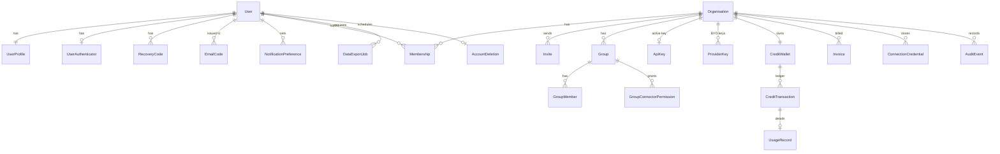
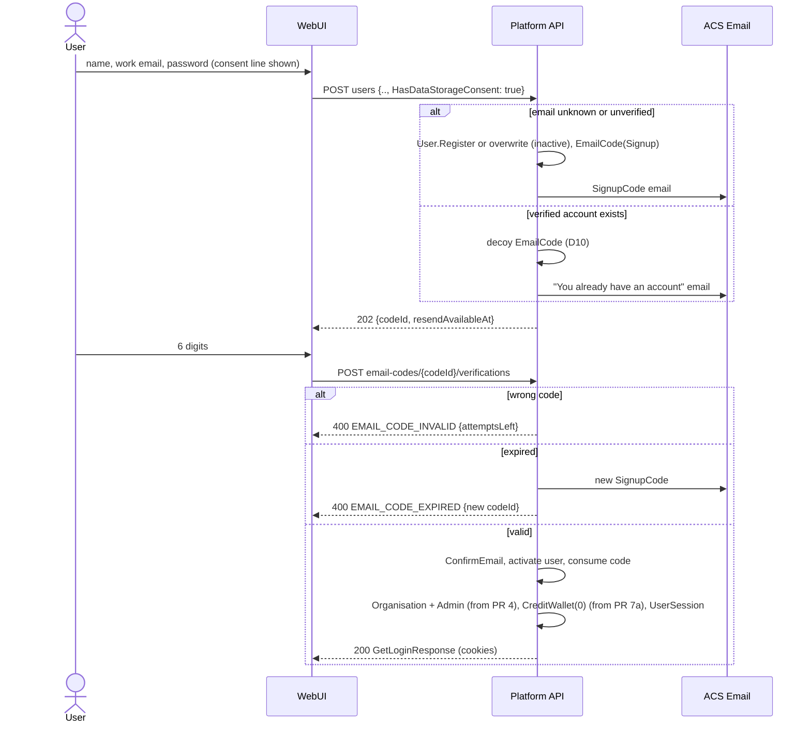
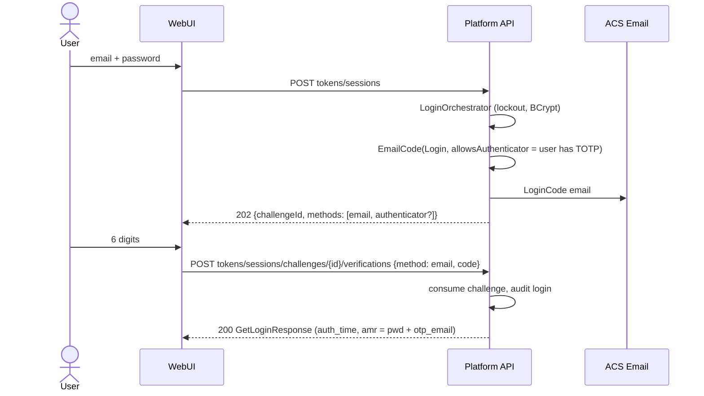
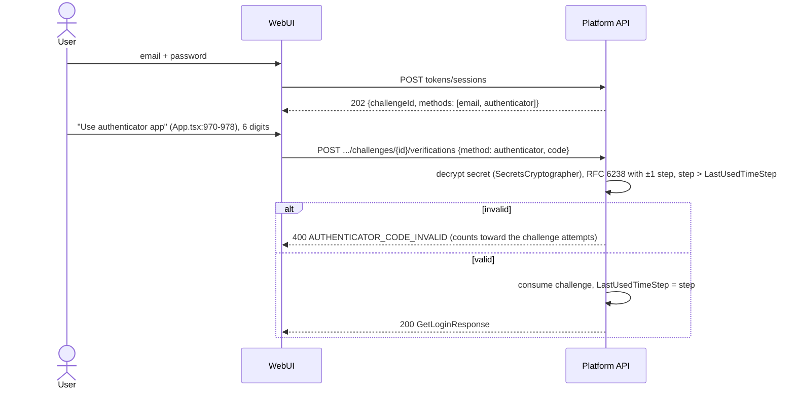
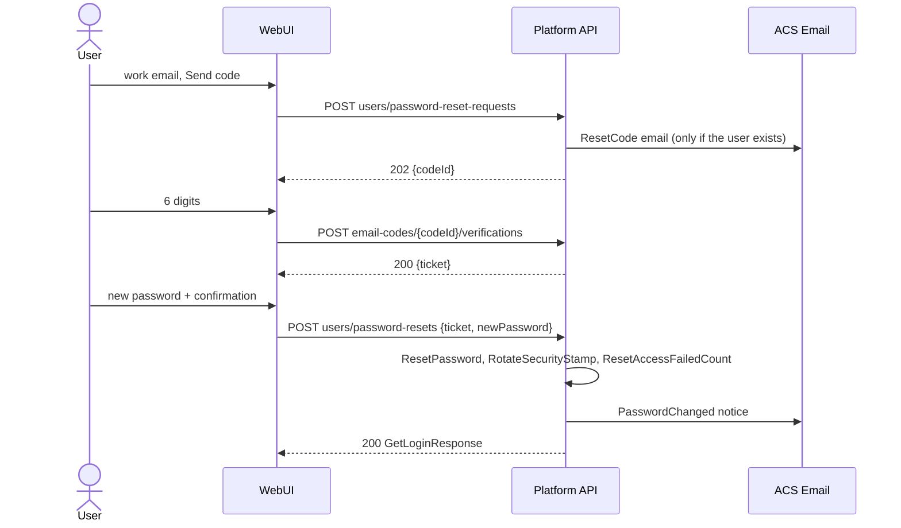
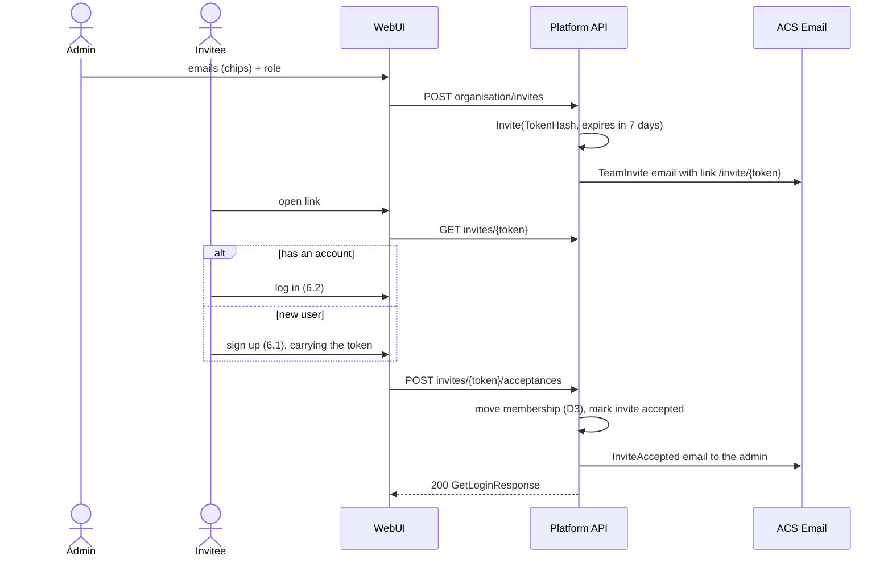
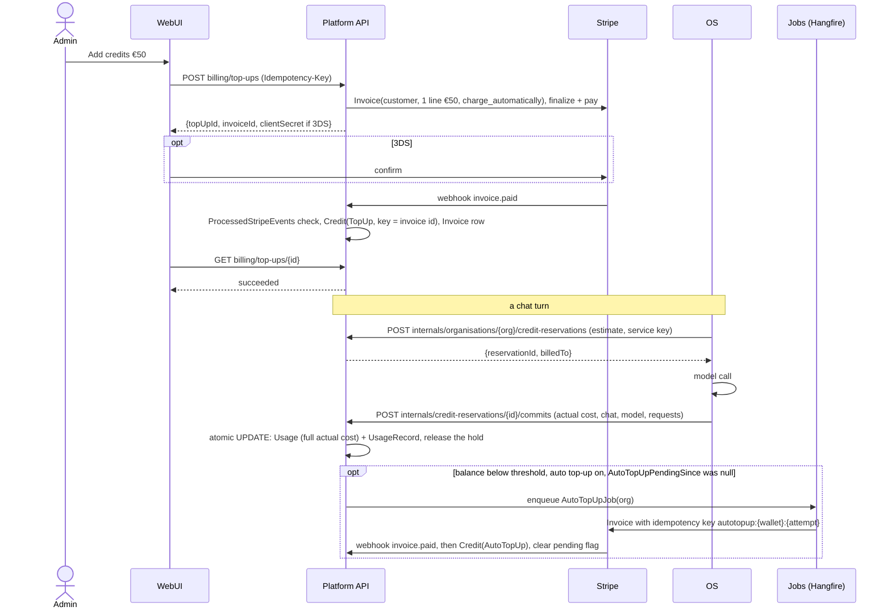
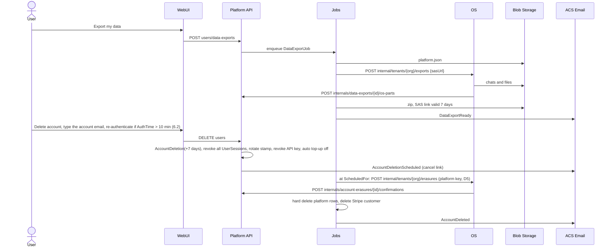

# Platform product flows (W4): Design

**Goal:** The platform (`intochat/platform`) gets the identity, team, key, credit and account-lifecycle APIs that the IntoChat prototype needs. The OS (DigitalBrain) keeps everything that runs a chat. Each flow ships as its own reviewable PR, and each PR unblocks named W3 screens.

**Architecture:** This design keeps the platform's existing shape: MVC controllers on `BaseController`, MediatR commands in `UseCases/<Area>`, wire DTOs in `IntoChat.Server.API.Contracts`, EF Core on Postgres, migrations in `IntoChat.Server.Db`, Hangfire in `IntoChat.Server.Jobs.API`, Azure Communication Services (ACS) for email and Stripe for money. The OS calls the platform through an internal, service-authenticated surface (`api/v1/internals/...`) to reserve and commit credits and to fetch decrypted provider and connection credentials.

**Inputs:** `clients/intochat/projects/briefs/clean-architecture/w4-platform-flow-map.md` (recon) and `figma-source/src/App.tsx` (the prototype, cited as `App.tsx:line`). Platform paths are relative to `E:/intochat/platform/src/`. The branch is `deploy/task-6-distribution`; its API, Application and Domain code is the same as `master`.

**Owner decisions taken as given (2026-10-18):**
- CRM Connections are owned by the OS (DigitalBrain modules). The platform stores only credentials and consent, and exposes them to the OS.
- Billing is prepaid credits, exactly as in the prototype: a balance, top-ups of 20/50/100/custom, automatic top-up, a per-request usage table and invoices, all through Stripe. The existing subscriptions and travel tiers are retired.
- Sign-up gets a consent line, so `HasDataStorageConsent` stays required.

## 1. Scope and non-goals

**In scope (platform):**
- Sign-up, login, password reset and change of email by 6-digit email code.
- Authenticator app (TOTP) with recovery codes.
- Profile extras: avatar, theme, UI settings, notification preferences, and log out of other devices.
- Organisations, memberships, roles, invites and groups.
- One IntoChat API key per organisation, plus bring-your-own (BYO) provider keys.
- Credit wallet: top-ups, automatic top-up, usage ledger and invoices.
- Connection credential storage.
- Data export and account deletion orchestration.
- Email templates and Hangfire jobs for all of the above.

**Non-goals (stay in the OS):**
- Chats, chat history, search, attachments, approval cards and work steps (`App.tsx:3646` AppShell).
- Archived chats, unarchive and delete permanently (`App.tsx:3512-3541`). The OS owns the chat store.
- The model picker, model catalogue, routing and cost tiers (`App.tsx:1126-1155`, `:1223`). The platform stores only three organisation settings: the team default model, the allow-list and the monthly spend limit.
- Local models and the local server probe (`App.tsx:1395-1446`, `:3069-3128`). The client or desktop probes `localhost`; the server never does.
- Connection execution: the Salesforce OAuth dance, API calls, per-permission enforcement and the "ask before changing more than N" threshold (`App.tsx:1507-1586`, `:2820`, `:2851`). These run in OS modules. The platform stores the resulting token blob, the granted scopes and the consent record.
- The in-app notification feed. The platform stores preferences and sends email. In-app delivery is an OS or UI concern and is outside W4 (see Q4).

**Retired by this design:**
- Stripe subscriptions, tiers, overage and metered billing (`IntoChat.Server.API/Controllers/PaymentController.cs:42`, `:79`, `:91`, `:167`, `:178`, `:198`, `:257`).
- Monthly token counts (`IntoChat.Server.Domain/Aggregates/User.cs:38`).
- `TokenDeductionJob` and `DeferredDowngradeJob` (`IntoChat.Server.Jobs.API/Jobs/`).
- The Telegram login gate (`IntoChat.Server.API/Controllers/TokenController.cs:36-43`).
- The travel aggregates (`User.cs:40-50`), dropped by the retirement migration 7d. PR 10 removes only the Telegram gate.

## 2. State on 2026-10-18 (evidence)

- **Controllers and routes.** Controllers inherit `BaseController` with `[Authorize]`, `[ApiController]` and `[ApiVersion("1.0")]` (`IntoChat.Server.API/Controllers/BaseController.cs:10-14`). Routes follow `api/v{version:apiVersion}/<plural-kebab>` (`IntoChat.Server.API/Controllers/UserController.cs:33`). Actions are modelled as nouns: `password-reset-requests` (`:97`), `email-confirmations` (`:76`).
- **Error mapping.** `HandleError` maps:
  - `*_NOT_FOUND` to 404;
  - `UNAUTHORIZED` to 401;
  - `UNAUTHORIZED_ACCESS` and `*_UNAUTHORIZED_ACCESS` to 403;
  - `FEEDBACK_RATE_LIMIT_EXCEEDED` to 429;
  - `FORBIDDEN` to a bare `Forbid()`;
  - everything else to 400.

  Many existing actions call `BadRequest(error)` directly instead of `HandleError` (for example `UserController.cs:115`, `:128`), so new actions must use `HandleError` or the new status mappings never apply. The error body is `{ ErrorCode, ErrorReason }` (`BaseController.cs:18-36`).
- **Error catalogue.** `IntoChat.Server.Application/ApplicationErrors/Errors.cs` uses UPPER_SNAKE codes, for example `EMAIL_NOT_CONFIRMED` (`:75`), `INVALID_TOKEN` (`:211`) and `UNAUTHORIZED_ACCESS` (`:221`), with the helpers `CreateNotFoundError` and `CreateExistsError` (`:259`, `:261`).
- **Sign-up.** Sign-up requires consent and an IP address (`IntoChat.Server.Application/UseCases/Users/Commands/CreateNewUser/CreateNewUserCommandHandler.cs:24-38`; domain guard `User.cs:65-68`). It issues a link token valid for one day (`CreateNewUserCommandHandler.cs:41-43`) and creates monthly token counts (`:49`).
- **Email confirmation.** A wrong token and an expired token produce the same error (`IntoChat.Server.Application/UseCases/Users/Commands/ConfirmEmail/ConfirmEmailCommandHandler.cs:24-29`).
- **Login.** Login returns tokens straight away (`TokenController.cs:30-32`). `EMAIL_NOT_CONFIRMED` and `TELEGRAM_REQUIRED` both return 403 (`:34-43`). Password lockout already exists through `AccessFailedCount` and `LockoutEnd` (`IntoChat.Server.Domain/Entities/UserProfile.cs:114-118`; `IntoChat.Server.Application/Services/Authentication/LoginOrchestrator.cs:32-55`).
- **Sessions.** Each user has one refresh token, stored on the profile (`UserProfile.cs:96-98`). A login on device B therefore overwrites device A's refresh token.
- **Security stamp.** The stamp (`UserProfile.cs:100`, `User.cs:113-117`) is already issued as the `security_stamp` claim (`IntoChat.Server.Infrastructure/Services/TokenService.cs:17`, `:47`). Every request checks it against the database, uncached, through `GetAuthSnapshotByIdAsync` (`IntoChat.Server.API/Extensions/ServiceCollectionExtensions.cs:497-537`; mismatch fails at `:533-535`). Logout rotates it (`IntoChat.Server.Application/UseCases/Users/Commands/Logout/LogoutCommandHandler.cs:19`). The only new work is rotating the stamp in the new commands.
- **Two EF models.** The runtime context is `TripRadarDbContext`, configured by `IntoChat.Server.Infrastructure/Database/EntityFrameworkConfigurations`. Migrations are generated from a separate mirror model: `IntoChat.Server.Db/SetupDbContext.cs`, with its own `Models/` (for example `Models/UserProfiles.cs:69` duplicates `SecurityStamp`) and `Mappings/`. Both must change together.
- **Access tokens** live for `Jwt:DurationInMinutes` (`TokenService.cs:50`) and carry no `auth_time` claim.
- **Stripe webhook dedup.** `IntoChat.Server.Infrastructure/Services/StripeWebhookHandler.cs` does not store processed event ids; it only logs them (`:129`).
- **Internal key validator.** Besides the key set, it holds an IP allow-list (`InternalAccessValidator.cs:11`). The keys have no names (`:10`).
- **Hashing and encryption.**
  - Passwords are hashed with BCrypt (`User.cs:134`, `:318`).
  - Recovery tokens are hashed with HMAC-SHA256 under a key derived for that purpose (`IntoChat.Server.Infrastructure/Services/RecoveryTokenHasher.cs:12-57`).
  - PII is encrypted with AES-GCM under the `encv1:` prefix (`IntoChat.Server.Comms.Core/Extensions/EncryptionExtensions.cs:8-40`), using a single `UserDataKey` cryptographer (`IntoChat.Server.Infrastructure/Factories/EncryptionFactory.cs:29-34`).
- **Service auth.**
  - An `[Internal]` attribute guards `api/v1/internals` (`IntoChat.Server.API/Controllers/InternalController.cs:21-22`). That surface already holds a per-user token deduction (`:25-30`) and user deletion (`:103`).
  - The `X-Internal-Auth` header is checked against a set of configured keys (`IntoChat.Server.API/Security/InternalAccessValidator.cs:9-15`).
  - A separate single-key `X-API-Key` scheme also exists (`IntoChat.Server.API/Security/ApiKeyAuthenticationHandler.cs:16-33`, `ApiKeyValidator.cs:15-16`).
- **Rate limiting.** AspNetCoreRateLimit IP policies (`IntoChat.Server.API/Extensions/ServiceCollectionExtensions.cs:660-664`, `ApplicationBuilderExtensions.cs:72`).
- **Email.** Email goes through the ACS `EmailClient` (`IntoChat.Server.Infrastructure/Services/Emails/EmailService.cs:20`, `:370`). Today it has confirmation, reset and subscription templates (`:22`, `:52`, `:76-180`).
- **Jobs.** Hangfire is registered in the API (`IntoChat.Server.API/Extensions/ServiceCollectionExtensions.cs:598`). Recurring jobs are registered in `IntoChat.Server.Jobs.API/Extensions/ApplicationBuilderExtensions.cs:28-43`.
- **Stripe.** Webhook at `PaymentController.cs:115-139`, setup intents at `:103`, payment methods at `:217`, `:235` and `:298`, invoices at `:279`.
- **Migrations.** Migrations have timestamp names in `IntoChat.Server.Db/Migrations/`; the latest is `20260405215236_AddAirportSearchAliases.cs`. The DbContext is still `IntoChat.Server.Infrastructure/Database/TripRadarDbContext.cs`.
- **Tests and configuration.** Tests use xUnit v3, FluentAssertions and Moq (`E:/intochat/platform/AGENTS.md:26`). Existing test names read `Method_Condition_Result` (`IntoChat.Server.Tests/Users/InternalUsersControllerTests.cs:22-91`). New W4 tests use `Method_Result_WhenCondition`, as the brief asks. Configuration goes only through Aspire parameters and `IOptions<T>` (`E:/intochat/platform/CLAUDE.md:75`, `:110`).

## 3. Decisions (ADR style)

### D1. One code engine for every email purpose

A single `EmailCode` entity serves every purpose: `Purpose ∈ {Login, Signup, Reset, ChangeEmail}`.

**Rules:**
- A code is 6 digits and is valid for 10 minutes.
- A code allows 3 attempts (`App.tsx:943`).
- Resending has a 42 s cooldown (`App.tsx:840`, reset at `:892` and `:963`).
- Issuing a code invalidates the previous active code for the same `(Subject, Purpose)`.
- Every send counts toward one `SendCount` and one hourly cap of 5 per `(email, purpose)`. This covers first issue, resend, challenge resend and the automatic reissue on expiry or lock, so letting codes expire cannot dodge the cooldown. The guess budget is therefore 3 attempts × 5 sends = 15 guesses per hour per email.

**Errors:**
- A wrong code returns `EMAIL_CODE_INVALID` with `attemptsLeft`.
- An expired code returns `EMAIL_CODE_EXPIRED` and issues a new code in the same transaction. This matches the UI copy "This code expired. We sent a new one." (`App.tsx:945-947`).
- The third wrong attempt returns `EMAIL_CODE_LOCKED` and, like the expired path, sends a new code automatically. The prototype has no locked state (`CodeState`, `App.tsx:21`), so W3 can reuse the expired screen with "Too many tries. We sent a new code." Once the hourly cap is reached, the response is `EMAIL_CODE_RATE_LIMITED` instead (see D10).
- Error details (`attemptsLeft`, the new `codeId`) travel in a new optional `Details` object on `ErrorResponse` (`BaseController.cs:36`), added in PR 1a.

PR 1c removes the link-token columns on `UserProfile` (`UserProfile.cs:80-86`) and the link endpoints (`UserController.cs:61-112`) once the WebUI no longer calls them.

**Rejected:**
- Keeping link tokens next to codes: two engines and two sets of templates.
- TOTP-style codes derived from a secret: they cannot carry attempt state per purpose.

### D2. Login is a two-step challenge

1. `POST tokens/sessions` with a valid password no longer returns tokens. It returns `202` with `{ challengeId, methods: ["email", "authenticator"?], expiresAt }` and sends a login code.
2. `POST tokens/sessions/challenges/{challengeId}/verifications` with `{ method, code }` returns the existing `GetLoginResponse`, built by `authResponseBuilder.BuildLoginResponse` (`TokenController.cs:32`).

The challenge is an `EmailCode` row with purpose `Login`, plus a flag saying whether the authenticator is allowed.

- **Google login** (`TokenController.cs:47`) goes through the challenge when the user has TOTP enabled. Otherwise it stays one step, because Google has already verified the email.
- **`EMAIL_NOT_CONFIRMED` disappears.** An unconfirmed sign-up simply resumes at the code screen.
- **Every login asks for a code**, as in the prototype (`App.tsx:5389-5391`), which has no "remember this device" control. This answers former Q1. A trusted-device cookie is a later idea, not part of v1.
- **The challenge creates a session.** A completed challenge creates a `UserSession` row (D11) whose `AuthTime` is the challenge completion time.

### D3. Every user belongs to exactly one organisation in v1

- **Personal organisation.** When the sign-up code is verified, the platform creates a personal `Organisation` with the user as `Admin`. Nothing is created at registration (D10). This starts with PR 4; PR 4 also backfills an organisation for every existing user.
- **One organisation in v1.** The prototype has no organisation or workspace switcher, so one organisation per user matches it. This answers former Q2.
- **Accepting an invite** moves the user into the inviting organisation when their personal organisation has no other members and a zero balance. Otherwise the API returns `MEMBERSHIP_CONFLICT`. A non-zero balance blocks the move. Refund or transfer is not offered in v1.
- **Roles** are `Admin` and `Member` (`App.tsx:3376`).
- **Groups** hold named connector permissions (`App.tsx:3449`). The platform stores them as opaque `{connectorId, scopes[]}` that the OS interprets (D6).
- **Ownership.** The wallet, the API key, provider keys and connection credentials all belong to the organisation.

### D4. Prepaid credits: a wallet plus an append-only ledger in micro-euros

- **Wallet.** One `CreditWallet` per organisation. PR 7a creates the table and backfills a wallet for every organisation (including those backfilled in PR 4). After that, wallets are created together with the organisation.
- **Amounts.** Balances and amounts are `long` micro-euros (1 € = 1 000 000), so per-request costs such as €0.0187 do not round.
- **Ledger.** Every change is a `CreditTransaction` with a unique `IdempotencyKey`. Types: TopUp, AutoTopUp, Reservation, ReservationRelease, Usage, Adjustment, Refund, Dispute.
- **Balance updates are atomic SQL, not optimistic retries.** No concurrency token exists in `src` today, and an `xmin` retry loop would serialise one organisation's concurrent chats through retries. Each operation is a single statement in the same transaction as its ledger row:
  - reserve: `UPDATE credit_wallets SET reserved = reserved + @x WHERE id = @w AND balance - reserved >= @x RETURNING balance, reserved`; zero rows means `CREDITS_INSUFFICIENT`;
  - commit: `UPDATE ... SET balance = balance - @actual, reserved = reserved - @held RETURNING ...`.

  The OS never sees a retry.

**Usage takes two calls:**
1. Before a model call the OS asks for a **reservation** of the estimated cost.
2. Afterwards the OS **commits** the actual cost with `{chatId, chatTitle, model, requests}`, and the unused part of the hold is released.

**Edge-case policy:**
- **Actual cost above the reservation** is normal (streaming output, tool loops). The commit always posts the full actual cost, even if the balance goes negative. New reservations are refused while `balance - reserved <= 0`.
- **A commit after the reservation was released or expired** still posts `Usage`, as a debit without a hold. It never fails. Reservations expire after 30 minutes, and a sweep releases the hold only. Long agentic turns that wait for approval (`App.tsx:4435`) can extend their hold with `POST internals/credit-reservations/{id}/extensions`.
- **Reconciliation.** After a crash the OS lists open holds with `GET internals/organisations/{orgId}/credit-reservations?status=open` and releases orphans.
- **Monthly spend limit** (`App.tsx:3149`). The month is the UTC calendar month. At reservation time the platform checks that `Usage` this month plus open reservations plus the new estimate stays within the limit.
- **BYO provider key.** "Use your own keys instead of IntoChat credits" (`App.tsx:2939`) means a request served with the organisation's own key does not consume credits. It is committed with `cost = 0` and `billedTo = ProviderKey`, so it still appears in usage. This answers former Q3, except for any platform fee, which stays a business decision.

**Top-ups, invoices and Stripe events:**
- **Every top-up is a one-line Stripe Invoice.** It is created on the saved customer with `collection_method = charge_automatically` and `auto_advance`, and finalised and paid with the default payment method. This gives a real Stripe invoice and PDF for every top-up, which the prototype lists (`App.tsx:3300-3330`).
  - The wallet is credited on `invoice.paid`, keyed by the invoice id.
  - If the invoice needs 3DS, its PaymentIntent `client_secret` goes to the client.
  - Setup intents and payment methods are reused from `PaymentController.cs:103` and `:217`.
  - Rejected: raw PaymentIntents with platform-rendered receipts, because Stripe creates no invoice for them.
- **Credits are posted only from verified webhooks**, never from the client.
- **Refunds and disputes.** `charge.refunded` posts a negative `Refund` row, and `charge.dispute.created` posts a negative `Dispute` row. Each is keyed by the Stripe object id. Either one may drive the balance negative.
- **Event dedup.** A `ProcessedStripeEvents(EventId, Type, ProcessedOn)` table is checked and inserted in the handler's transaction. A Stripe retry therefore repeats neither the ledger write nor the email or auto top-up side effects.
- **Automatic top-up** adds €50 when the balance falls below €10 (`App.tsx:3248-3251`); both values are configurable.
  - When a commit crosses the threshold it sets `AutoTopUpPendingSince` atomically (`UPDATE ... WHERE auto_top_up_pending_since IS NULL`). Only the winner enqueues `AutoTopUpJob`.
  - The job creates the invoice with the Stripe idempotency key `autotopup:{walletId}:{attempt}`.
  - `invoice.paid` or `invoice.payment_failed` clears the flag. Two consecutive failures turn automatic top-up off and email the admin.

**Rejected:**
- Posting usage through Kafka without a reservation: the balance can overdraw. Kafka in the platform today serves only the bot.
- Keeping `UserMonthlyTokenCount`: it counts per user and per month, while the wallet belongs to the organisation and has no period.

### D5. Service-to-service auth: named internal credentials, organisation binding

**OS to platform:**
- **Named keys.** `InternalAccessValidator` changes from an anonymous `HashSet<string>` (`InternalAccessValidator.cs:10`) to named keys under `Internal:Keys:{name}`. Each OS deployment gets its own key. The matched name becomes `ActorService` on every audit event, so one deployment can be revoked alone. The existing IP allow-list (`:11`) stays, and the OS egress IPs are added to it (operator step O2).
- **Organisation binding.** Each key is bound to a list of organisation ids, or to `*` for the shared cloud OS. A request whose route `orgId` (or the reservation's organisation) is outside that list returns `UNAUTHORIZED_ACCESS`.
- **Credit calls take only the service key.** Reserve, commit, extend, release and reconcile need the service key and the organisation in the route; the platform checks it against the reservation's organisation. They never depend on a user token. Commits can arrive after the user's short-lived access token has expired, and background OS jobs have no user at all.
- **User-initiated secret reads add user context.** `GET` of provider keys and connection credentials during a chat turn also needs `X-On-Behalf-Of: <platform access token>`. The user must be a member of the route organisation.
- **The one key-only secret path** is the OS connector runtime running scheduled work. It is allowed only with a key that carries the `connector-runtime` role, and every read is audited with the key name.
- **`X-API-Key` is not reused.** The existing scheme (`ApiKeyValidator.cs:15`) has one global key.

**The IntoChat API key.** `ic_live_…` (`App.tsx:2894-2915`) is a customer credential. To use it, the OS sends the key to `POST internals/api-keys/introspections`, gets back `{organisationId, keyId}` and caches the result for at most 60 s. A revoked key can therefore work for up to 60 s. To close that gap, the platform also publishes revocations on the outbox below, and the OS evicts the key on receipt.

**Platform to OS:**
- **Calls.** Platform jobs call the OS over HTTP with `X-Internal-Auth: <os-side key>`. The key is stored as the Aspire parameter `Os:InternalKey` and holds an OS-side named credential `platform`. The calls:
  - `POST {os}/internal/tenants/{orgId}/erasures`
  - `POST {os}/internal/tenants/{orgId}/exports`
- **Events, including `ConnectionRevoked`.** Events are delivered through an outbox, because the OS is HTTP-only.
  - The platform writes `PlatformEvent(Id, Type, OrganisationId, Payload, CreatedOn)` in the same transaction as the change.
  - The OS polls `GET internals/events?after={id}&limit=100` with its key, filtered to the organisations bound to that key.
  - Polling means no inbound reachability is needed for self-hosted OS deployments.
  - Event types: `ConnectionRevoked`, `ApiKeyRevoked`, `OrganisationMembershipChanged`, `GroupPermissionsChanged`.

### D6. Connections: the OS executes, the platform stores credentials and consent

`ConnectionCredential` is keyed by `(OrganisationId, ConnectorId)`. It holds:
- the token blob, encrypted as opaque bytes;
- `Scopes`;
- `ExternalAccountLabel`, for example "Org: Nordlys AS" (`App.tsx:1507-1586`);
- `ConsentedByUserId` and `ConsentedOn`;
- `Status` and `LastErrorOn`.

**Who calls what:**
- The OS writes the credential after its OAuth callback: `PUT internals/organisations/{orgId}/connection-credentials/{connectorId}`.
- The OS reads it decrypted when it uses the connection (`GET` on the same route; D5 rules apply).
- The OS reports failures with `PATCH .../status`; the platform turns them into `ConnectionFailed` emails.
- The UI reads only metadata (`GET connections`) and can disconnect (`DELETE connections/{connectorId}`).
- Disconnect deletes the blob and writes a `ConnectionRevoked` outbox event (D5). The OS revokes the grant at the provider when it receives the event.

Per-permission toggles and the approval threshold live in the OS module configuration. The platform does not interpret them.

**Provider-key validity.** The prototype shows a rejected-key state (`App.tsx:2942-2951`). The OS validates a provider key when it uses it and reports with `PATCH internals/organisations/{orgId}/provider-keys/{provider}/status`. The platform does not call providers itself.

### D7. Secrets: a separate encryption key, and purpose-specific hashers on a new root

- **Encryption.**
  - Provider keys, connection credentials and TOTP secrets use a new cryptographer, `SecretsCryptographer`, in `EncryptionFactory` (`EncryptionFactory.cs:27-35`).
  - It has its own key, `Encryption:SecretsKey`, an Aspire parameter backed by Key Vault. It ships in PR 0, before TOTP needs it.
  - Ciphertext carries a key version prefix (`sec1:`), so the key can be rotated by re-encrypting in a job.
  - PII stays on `UserDataKey`.
- **Hashing.**
  - The existing `RecoveryTokenHasher` (`RecoveryTokenHasher.cs:12-57`) stays unchanged, purpose string included (`:13`). Changing it would break every stored hash.
  - New values that only need a hash use purpose-specific instances of a new `IPurposeHasher`: `codes` (email codes, reset tickets, invite tokens, recovery codes) and `api-keys`.
  - The new hasher derives its key from a new root, `Encryption:HashingKey`, not from `UserDataKey`. A leaked PII key then does not also give the HMAC key for API keys.
  - The new hasher rejects stored values without a prefix. The old hasher falls back to plaintext comparison for them (`RecoveryTokenHasher.cs:51`).
  - Review M4 asked for this. I accepted it, with one change: the existing hasher stays as it is rather than being deleted, because the link tokens it verifies are dropped in PR 1c anyway.

### D8. Account deletion: re-authenticate, 7-day grace, the platform orchestrates, the OS confirms

`DELETE users` (`UserController.cs:131`) no longer deletes immediately. The sequence:

1. **Confirmation.** The user types the account email, as in the prototype ("Type anna.berg@nordlys.no to confirm.", `App.tsx:3626`).
2. **Re-authentication.** The session's `AuthTime` must be within the last 10 minutes (D11). Otherwise the API returns `REAUTHENTICATION_REQUIRED`, and W3 runs the login challenge inside the modal. The prototype has no such step (departure, D12).
3. **Scheduling.** The platform creates an `AccountDeletion` with `ScheduledFor = now + 7 days`, revokes all sessions, revokes the API key and turns off automatic top-up.
4. **Erasure.** At `ScheduledFor`, a Hangfire job calls the OS: `POST {os}/internal/tenants/{orgId}/erasures` (D5).
5. **Hard delete.** When the OS calls back, the job hard-deletes the platform rows and the Stripe customer.

Edge cases:
- If the user is the last admin of a team that has other members, the request fails with `LAST_ADMIN_CANNOT_DELETE`.
- Credits are not refunded (`App.tsx:3556`).
- Logging in during the grace period offers to cancel the deletion (Q5).

### D9. Export: the platform collects its own part, the OS adds the chats

`POST users/data-exports` creates a `DataExportJob`. A Hangfire job then:

1. Writes the platform JSON: profile, settings, membership, ledger and the list of invoices.
2. Asks the OS to add chats and files: `POST {os}/internal/tenants/{orgId}/exports`, with a SAS upload URL into the same blob folder.
3. Zips the result in Azure Blob Storage.
4. Emails a download link valid for 7 days (`App.tsx:3552`).

Each user can have one active export at a time; a second request returns `DATA_EXPORT_IN_PROGRESS`.

### D10. Account enumeration and email squatting

- **Sign-up.**
  - `POST users` always returns `202 CreateEmailCodeResponse`. Today it returns `USER_EXISTS` (`CreateNewUserCommandHandler.cs:29-33`), which reveals which accounts exist.
  - An email that belongs to a **verified** user gets an "You already have an account" email with a login link, and no code.
  - An email that belongs to an **unverified** user is overwritten with the new name and password, and a new code is sent. A squatter therefore cannot block the real owner.
  - The organisation and wallet are created only when the code is verified.
- **Decoy rows.** For unknown or verified emails, the reset and sign-up paths store a decoy `EmailCode` with `UserId = null` and `IsDecoy = true`. It goes through the same attempts, expiry, lock and rate limits as a real code. Its `codeId` therefore never returns `EMAIL_CODE_NOT_FOUND`, which would reveal that the account does not exist.
- **Proxies.** IP-based rules only work if the real client IP is used. The rate limiter must read the forwarded header from the Azure front end (`ServiceCollectionExtensions.cs:660-668`; `RealIpHeader` in `IpRateLimiting`).

### D11. Sessions: a table instead of one refresh token per user

- **Table.** `UserSession(Id, UserId, RefreshTokenHash, DeviceLabel, CreatedOn, LastUsedOn, ExpiresOn, AuthTime, RevokedOn)` replaces `UserProfile.RefreshToken` and `RefreshTokenExpiryTime` (`UserProfile.cs:96-98`). It ships in PR 2.
- **Login** creates a row. **Refresh** rotates the hash on the same row and copies `AuthTime` unchanged into the new access token's `auth_time` claim. A refresh is therefore never a re-authentication.
- **Access tokens** carry a `sid` claim.
- **"Log out other devices"** (`App.tsx:2428-2430`, "You'll stay logged in on this device.") revokes every other row and rotates the security stamp. The current session gets a new token, issued from its own row.
- **Logout** revokes the current row only. Today it rotates the stamp, which logs out every device; that changes to "this device only".
- **Recent re-authentication** (`AuthTime` within 10 minutes) is required for account deletion, email change and authenticator removal.
- **Existing per-request check.** The `security_stamp` check (`ServiceCollectionExtensions.cs:497-537`) stays uncached as it is. It is not duplicated. Revoked sessions also fail refresh, and their access tokens die on the stamp rotation.

### D12. Departures from the prototype (W3 must change the UI)

| Prototype | Design | Why |
| --- | --- | --- |
| Full API key visible at any time with a Show/Copy toggle (`App.tsx:2894-2915`); the key embeds an organisation slug (`ic_live_nordlys_…`) | Shown once after create or rotate; afterwards only the prefix `ic_live_<8 random>`. No slug, so the organisation name does not leak. | A hashed key cannot be shown again. |
| Code states default, verifying, wrong, expired, verified (`App.tsx:21`) | Adds a locked outcome, rendered as the expired screen with an automatic new code (D1) | Attempt limit |
| Delete confirmation by typing the email (`App.tsx:3626`) | Same (no departure) | |
| No re-authentication before delete | Login challenge inside the delete modal when `AuthTime` is older than 10 minutes | Irreversible action |
| Deletion implied to be immediate (`App.tsx:3556`) | 7-day grace with cancel (Q5) | Recovery from mistakes and account takeover |
| No organisation concept | A personal organisation per user, hidden until a team exists | Team, billing and keys need one owner |
| Test naming: existing tests use `Method_Condition_Result` (`InternalUsersControllerTests.cs:22`) | The brief asks for `Method_Result_WhenCondition` | **Disagreement with review M8:** the brief is explicit, so the design keeps it, but two styles in one project need the owner's decision (Q8). |

## 4. Domain model

### 4.1 Entities and relationships



### 4.2 EF Core sketches

New aggregates go in `IntoChat.Server.Domain/Aggregates` and child entities in `Domain/Entities`. Their configurations go in `IntoChat.Server.Infrastructure/Database/EntityFrameworkConfigurations`, which is the existing pattern (for example `AirlinesConfiguration.cs`). Entities use private setters and behaviour methods, as `User.cs` does.

**Every new or changed table is written twice.** Migrations are generated from the mirror model in `IntoChat.Server.Db` (section 2), so each PR with a migration also adds:
- the `Db/Models/<Table>.cs` class;
- its `Db/Mappings` configuration;
- the `SetupDbContext` `DbSet`.

The two contexts must agree on column names and types. Each PR row in section 10 repeats this. The child entities below use field shorthand for brevity; real code uses private setters.

```csharp
// User additions (Domain/Aggregates/User.cs, Entities/UserProfile.cs)
public Theme Theme { get; private set; } = Theme.System;          // light | dark | system (App.tsx:19)
private ICollection<UserSession> Sessions { get; set; } = new List<UserSession>();   // replaces Profile.RefreshToken (D11)
public UserUiSettings UiSettings { get; private set; } = new();    // owned jsonb: DateFormat, SendWithEnter, ShowSteps (App.tsx:2627-2760)
public string? AvatarBlobPath { get; private set; }                // replaces URL-only ProfilePictureUrl (UserProfile.cs:108)
public UserAuthenticator? Authenticator { get; private set; }
private ICollection<RecoveryCode> RecoveryCodes { get; set; } = new List<RecoveryCode>();
private ICollection<NotificationPreference> NotificationPreferences { get; set; } = new List<NotificationPreference>();
public void ChangeEmail(string newEmail) { Profile.UpdateEmail(newEmail); RotateSecurityStamp(); }
public void LogOutOtherDevices() { RotateSecurityStamp(); ClearRefreshToken(); }

public sealed class UserAuthenticator                                // TOTP
{
    public long UserId { get; private set; }
    public string SecretCiphertext { get; private set; } = null!;   // SecretsCryptographer
    public DateTime? ConfirmedOn { get; private set; }              // null = setup pending
    public long LastUsedTimeStep { get; private set; }              // replay guard
}

public sealed class RecoveryCode { long Id; long UserId; string CodeHash; DateTime? UsedOn; }

public sealed class NotificationPreference
{
    public long UserId { get; private set; }
    public NotificationEvent Event { get; private set; }     // ApprovalNeeded, JobFinished, ConnectionFailed, CreditsLow, WeeklySummary (App.tsx:3470-3480)
    public NotificationChannel Channel { get; private set; } // Email, InApp (App.tsx:3485)
    public bool Enabled { get; private set; }
}

public sealed class EmailCode : AggregateRoot<Guid>
{
    public string SubjectEmailHash { get; private set; } = null!;  // blind index, works before a User exists
    public long? UserId { get; private set; }
    public EmailCodePurpose Purpose { get; private set; }          // Login, Signup, Reset, ChangeEmail
    public string CodeHash { get; private set; } = null!;          // RecoveryTokenHasher
    public string? PendingEmailCiphertext { get; private set; }    // ChangeEmail target
    public string? ResetTicketHash { get; private set; }           // Reset only, set on success
    public int AttemptsLeft { get; private set; } = 3;
    public DateTime ExpiresOn { get; private set; }                // +10 min
    public DateTime LastSentOn { get; private set; }               // 42 s cooldown
    public int SendCount { get; private set; }                     // cap: 5 per hour
    public DateTime? ConsumedOn { get; private set; }
    public bool AllowsAuthenticator { get; private set; }          // Login challenge only
    public bool IsDecoy { get; private set; }                      // D10
    public EmailCodeCheck Verify(string code, IRecoveryTokenHasher hasher, DateTime now); // Ok | Wrong(attemptsLeft) | Expired | Locked
}

public sealed class Organisation : AggregateRoot<Guid>
{
    public string Name { get; private set; } = null!;
    public string? DefaultModelId { get; private set; }             // App.tsx:3020
    public List<string> AllowedModelIds { get; private set; } = []; // jsonb
    public long? MonthlySpendLimitMicros { get; private set; }      // App.tsx:3149
    public DateTime CreatedOn { get; private set; }
    private readonly List<Membership> _memberships = [];
}
public sealed class Membership { Guid OrganisationId; long UserId; OrganisationRole Role; DateTime JoinedOn; }   // Admin | Member
public sealed class Invite { Guid Id; Guid OrganisationId; string EmailCiphertext; string EmailHash; OrganisationRole Role;
    string TokenHash; InviteStatus Status; DateTime ExpiresOn; DateTime LastSentOn; long InvitedByUserId; }
public sealed class Group { Guid Id; Guid OrganisationId; string Name; }
public sealed class GroupMember { Guid GroupId; long UserId; }
public sealed class GroupConnectorPermission { Guid GroupId; string ConnectorId; List<string> Scopes; }         // opaque to the platform

public sealed class ApiKey : AggregateRoot<Guid>
{
    public Guid OrganisationId { get; private set; }
    public string Prefix { get; private set; } = null!;            // "ic_live_" + 8 chars, shown in the list
    public string SecretHash { get; private set; } = null!;        // HMAC; plaintext returned once
    public long CreatedByUserId { get; private set; }
    public DateTime CreatedOn { get; private set; }
    public DateTime? LastUsedOn { get; private set; }
    public DateTime? RevokedOn { get; private set; }
}
public sealed class ProviderKey { Guid OrganisationId; ModelProvider Provider;   // OpenAI, Anthropic, Google, XAI (App.tsx:2938-2951)
    string SecretCiphertext; string Last4; ProviderKeyStatus Status; DateTime UpdatedOn; long UpdatedByUserId; }

public sealed class CreditWallet : AggregateRoot<Guid>
{
    public Guid OrganisationId { get; private set; }
    public long BalanceMicros { get; private set; }
    public long ReservedMicros { get; private set; }
    public bool AutoTopUpEnabled { get; private set; }
    public long AutoTopUpThresholdMicros { get; private set; } = 10_000_000;
    public long AutoTopUpAmountMicros { get; private set; } = 50_000_000;
    public string? StripeCustomerId { get; private set; }
    public DateTime? AutoTopUpPendingSince { get; private set; }   // auto top-up single-flight guard
    // balance changes are atomic SQL updates (D4), no concurrency token
    public Result<CreditTransaction> Reserve(long micros, string idempotencyKey);
    public Result<CreditTransaction> Commit(Guid reservationId, long actualMicros, UsageRecord usage);
    public CreditTransaction Credit(long micros, CreditTransactionType type, string idempotencyKey, string? stripePaymentIntentId);
}
public sealed class CreditTransaction { Guid Id; Guid WalletId; CreditTransactionType Type; long AmountMicros; string IdempotencyKey;
    Guid? ReservationId; string? StripePaymentIntentId; DateTime CreatedOn; DateTime? ExpiresOn; }
public sealed class UsageRecord { Guid TransactionId; string ChatId; string ChatTitle; string Model; int Requests;
    long CostMicros; UsageBilledTo BilledTo; long? UserId; }                                                      // App.tsx:3279-3300
public sealed class Invoice { Guid Id; Guid OrganisationId; string StripeInvoiceId; long AmountMicros; string Currency; string? HostedUrl; DateTime IssuedOn; }

public sealed class ConnectionCredential { Guid OrganisationId; string ConnectorId; byte[] TokenCiphertext; List<string> Scopes;
    string? ExternalAccountLabel; long ConsentedByUserId; DateTime ConsentedOn; ConnectionStatus Status; DateTime? LastErrorOn; }

public sealed class DataExportJob { Guid Id; long UserId; DataExportStatus Status; string? BlobPath; DateTime RequestedOn; DateTime? ReadyOn; DateTime? LinkExpiresOn; }
public sealed class AccountDeletion { Guid Id; long UserId; DateTime RequestedOn; DateTime ScheduledFor; AccountDeletionStatus Status; DateTime? OsErasureConfirmedOn; }
public sealed class UserSession { Guid Id; long UserId; string RefreshTokenHash; string? DeviceLabel; DateTime CreatedOn; DateTime LastUsedOn; DateTime ExpiresOn; DateTime AuthTime; DateTime? RevokedOn; }   // D11
public sealed class ProcessedStripeEvent { string EventId; string Type; DateTime ProcessedOn; }   // D4
public sealed class PlatformEvent { long Id; string Type; Guid OrganisationId; JsonDocument Payload; DateTime CreatedOn; }        // outbox, D5
public sealed class InternalCredentialBinding { string KeyName; Guid? OrganisationId; string Role; }   // config-backed, D5; table only if config is outgrown
public sealed class AuditEvent { long Id; Guid? OrganisationId; long? ActorUserId; string? ActorService; string Action; string TargetType; string TargetId; string? Ip; DateTime CreatedOn; JsonDocument Metadata; }
```

### 4.3 Migrations (in `IntoChat.Server.Db/Migrations`; each also updates `Db/Models`, `Db/Mappings` and `SetupDbContext`)

| PR | Migration | Contents |
| --- | --- | --- |
| 0 | none | `SecretsCryptographer` and `IPurposeHasher` are code and configuration only |
| 1a | `20261020090000_AddEmailCodesAndAuditEvents` | `EmailCodes` (including `IsDecoy`), `AuditEvents` |
| 1c | `20261020090100_DropLinkTokens` | drops `EmailConfirmationToken*` and `PasswordResetToken*` from `UserProfiles`. Ships after the WebUI code screens are live. |
| 2 | `20261021090000_AddUserSessionsSettingsNotificationPreferences` | `UserSessions` (existing refresh tokens are migrated into one row per user), `Theme`, `UiSettings` (jsonb), `AvatarBlobPath`, `NotificationPreferences` |
| 2b | `20261021090100_DropProfileRefreshToken` | drops `RefreshToken` and `RefreshTokenExpiryTime` from `UserProfiles`, one release later |
| 3 | `20261022090000_AddUserAuthenticatorAndRecoveryCodes` | `UserAuthenticators`, `RecoveryCodes` |
| 4 | `20261023090000_AddOrganisationsMembershipsInvites` | also backfills a personal organisation for every existing user (idempotent), plus the `PlatformEvents` outbox |
| 5 | `20261024090000_AddGroups` | `Groups`, `GroupMembers`, `GroupConnectorPermissions` |
| 6 | `20261025090000_AddApiKeysProviderKeysIdempotency` | `ApiKeys` (unique `Prefix`; filtered unique index on the active key per organisation), `ProviderKeys`, `IdempotencyRecords` |
| 7a | `20261026090000_AddCreditWalletLedger` | `CreditWallets` (backfilled one per organisation), `CreditTransactions` (unique `IdempotencyKey`), `UsageRecords` |
| 7b | `20261026090100_AddInvoicesAndStripeEvents` | `Invoices`, `ProcessedStripeEvents`, Stripe customer moved to the wallet |
| 7d | `20261026090200_RetireSubscriptionsAndTiers` | drops `UserSubscriptions`, `OverageBillingRecords`, `OveragePricings`, `UserMonthlyTokenCounts`, the `Tier` FK and the travel aggregates (`User.cs:40-50`). Ships one release after 7b goes live. |
| 8 | `20261027090000_AddConnectionCredentials` | `ConnectionCredentials` |
| 9 | `20261028090000_AddDataExportsAndAccountDeletions` | `DataExportJobs`, `AccountDeletions` |

## 5. API surface

**Conventions:**
- All routes are `api/v{version:apiVersion}/...` (v1) on `BaseController`. Auth is the user JWT unless the table says otherwise.
- Requests go in `IntoChat.Server.API.Contracts/Requests/{Create,Update,Delete,Get}` and responses in `Responses/{...}`. Each action maps to one MediatR command or query, with a FluentValidation validator next to it.
- New error codes go in `Errors.cs` and follow the suffix rules of `HandleError`.
- New actions return errors through `HandleError`, never `BadRequest(error)` directly (section 2).
- `ErrorResponse` gains an optional `Details` object (PR 1a) for `AttemptsLeft`, a new `CodeId` and similar fields.

**New `HandleError` mappings** (`BaseController.cs:22-31`):
- `*_RATE_LIMITED` → 429 (the existing `FEEDBACK_RATE_LIMIT_EXCEEDED` arm stays)
- `*_CONFLICT` → 409
- `CREDITS_INSUFFICIENT` and `SPEND_LIMIT_REACHED` → 402
- `REAUTHENTICATION_REQUIRED` and `API_KEY_INVALID` → 401

### 5.1 Sign-up, codes, login and reset (PR 1a: sign-up, codes, reset; PR 1b: login challenge; TOTP parts in PR 3)

| Verb | Route | Auth | Request → Response | Errors |
| --- | --- | --- | --- | --- |
| POST | `users` | anonymous | `CreateUserRequest { FirstName, LastName, Email, Password, HasDataStorageConsent }` → always `202 CreateEmailCodeResponse { CodeId, ResendAvailableAt, ExpiresAt }`. An existing verified email gets an "already have an account" email; an existing unverified user is overwritten (D10). | `USER_CONSENT_NOT_GRANTED`, `USER_IP_NOT_VALID_OR_NOT_PROVIDED` (existing, `CreateNewUserCommandHandler.cs:24-38`). `USER_EXISTS` is no longer returned. |
| POST | `email-codes` | anonymous | Resend. `CreateEmailCodeRequest { Email, Purpose }` → `202 CreateEmailCodeResponse`. Unknown emails also get 202, so the response does not reveal which emails exist. | `EMAIL_CODE_RATE_LIMITED` (cooldown, or more than 5 sends per hour) |
| POST | `email-codes/{codeId}/verifications` | anonymous | `CreateEmailCodeVerificationRequest { Code }` → for Signup: `GetLoginResponse` (auto-login after `verify()`, `App.tsx:882-896`); creates the organisation and wallet from PR 4 and PR 7a on; for Reset: `CreatePasswordResetTicketResponse { Ticket, ExpiresAt }` | `EMAIL_CODE_INVALID` (`Details.AttemptsLeft`), `EMAIL_CODE_EXPIRED` and `EMAIL_CODE_LOCKED` (both carry `Details.CodeId` of the code sent automatically), `EMAIL_CODE_RATE_LIMITED`, `EMAIL_CODE_NOT_FOUND` (only for ids that never existed; decoys behave like real codes) |
| POST | `tokens/sessions` | anonymous | `CreateLoginRequest` (existing) → `202 CreateLoginChallengeResponse { ChallengeId, Methods[], ExpiresAt, ResendAvailableAt }` | existing: `USERNAME_OR_PASSWORD_NOT_VALID`, `ACCOUNT_LOCKED` |
| POST | `tokens/sessions/challenges/{challengeId}/verifications` | anonymous | `CreateLoginChallengeVerificationRequest { Method: email \| authenticator \| recovery, Code }` → `GetLoginResponse`; creates a `UserSession` with `AuthTime = now` | the `EMAIL_CODE_*` errors above, plus `AUTHENTICATOR_CODE_INVALID`, `RECOVERY_CODE_INVALID`, `AUTHENTICATOR_NOT_ENABLED` |
| POST | `tokens/sessions/challenges/{challengeId}/resends` | anonymous | → `202 CreateEmailCodeResponse` | `EMAIL_CODE_RATE_LIMITED` |
| POST | `tokens/sessions/google` | anonymous | existing → `GetLoginResponse`, or `202 CreateLoginChallengeResponse` when TOTP is on | existing |
| POST | `users/password-reset-requests` | anonymous | `ForgotPasswordRequest { Email }` → `202 CreateEmailCodeResponse` (purpose Reset) | `EMAIL_CODE_RATE_LIMITED` |
| POST | `users/password-resets` | anonymous | `ResetPasswordRequest { Ticket, NewPassword }` → `GetLoginResponse`, matching "Password changed. You are logged in." (`App.tsx:1037-1105`). Rotates the security stamp. | `PASSWORD_RESET_TICKET_INVALID`, password rule errors (existing validator) |
| POST | `tokens/refresh-tokens` | anonymous | existing (`TokenController.cs:105`) | existing |
| POST | `users/logout` | user | existing (`UserController.cs:222`) | |

Refresh (`tokens/refresh-tokens`) rotates the refresh token on the session row and copies the row's `AuthTime` into the new access token unchanged (D11).

The reset ticket is a random 32-byte value. It is stored hashed on the consumed `EmailCode` (`ResetTicketHash`), works once, and is valid for 10 minutes.

### 5.2 Profile and settings (PR 2; authenticator in PR 3)

| Verb | Route | Request → Response | Errors |
| --- | --- | --- | --- |
| GET, PUT | `users/profile` | existing (`UserController.cs:144`, `:156`). The response gains `Theme` and `AvatarUrl` (a short-lived SAS URL). | |
| PUT | `users/avatar` | `multipart/form-data`, JPG or PNG up to 5 MB (`App.tsx:2111`) → `GetAvatarResponse { AvatarUrl }` | `AVATAR_TOO_LARGE`, `AVATAR_TYPE_NOT_SUPPORTED` |
| DELETE | `users/avatar` | → 204 | |
| GET, PUT | `users/settings` | `UpdateUserSettingsRequest { Theme, DateFormat, SendWithEnter, ShowSteps, LanguageCode, TimezoneId }` → `GetUserSettingsResponse` | `TIMEZONE_NOT_FOUND`, `LANGUAGE_NOT_FOUND` |
| GET, PUT | `users/notification-preferences` | `UpdateNotificationPreferencesRequest { Items: [{ Event, Channel, Enabled }] }` → same shape | |
| POST | `users/email-change-requests` | `CreateEmailChangeRequest { NewEmail }` → `202 CreateEmailCodeResponse`. The code goes to the new address; a notice goes to the old one. | `USER_EXISTS`, `EMAIL_CODE_RATE_LIMITED` |
| POST | `users/email-changes` | `CreateEmailChangeConfirmationRequest { CodeId, Code }` → `GetLoginResponse`. Requires a recent `AuthTime`. The stamp rotates, so new tokens are issued. | `EMAIL_CODE_*`, `REAUTHENTICATION_REQUIRED` |
| POST | `users/session-revocations` | → `GetLoginResponse` for this device. Revokes every other `UserSession` and rotates the stamp, so other access tokens fail at once ("Log out other devices?", `App.tsx:2428-2430`). | |
| PUT | `users/password` | existing (`UserController.cs:119`); now also rotates the stamp | |
| POST | `users/authenticator` | → `CreateAuthenticatorResponse { Secret, OtpAuthUri }`. The client draws the QR code (`App.tsx:2360-2395`). | `AUTHENTICATOR_ALREADY_ENABLED` |
| POST | `users/authenticator/confirmations` | `{ Code }` → `CreateAuthenticatorConfirmationResponse { RecoveryCodes[10] }`, shown once | `AUTHENTICATOR_CODE_INVALID` |
| DELETE | `users/authenticator` | `{ Code }` (TOTP or recovery code) and a recent `AuthTime` → 204 (`App.tsx:2417`) | `AUTHENTICATOR_CODE_INVALID`, `REAUTHENTICATION_REQUIRED` |
| POST | `users/authenticator/recovery-codes` | `{ Code }` → a new set of 10; the old set stops working | `AUTHENTICATOR_CODE_INVALID` |

No new token check is needed. The existing uncached `security_stamp` check (`ServiceCollectionExtensions.cs:497-537`) already rejects old access tokens once the stamp rotates. Revoked sessions also fail refresh (D11). An earlier draft proposed a separate `sstamp` claim with a 60 s cache. It is dropped: the check already exists, and a cache would let a revoked token work for up to a minute.

### 5.3 Team (PR 4 and PR 5)

In v1 the organisation comes from the caller's single membership, so routes use the singular `organisation`, meaning the caller's own. Admin-only actions return `ORGANISATION_UNAUTHORIZED_ACCESS`, which maps to 403 through the suffix rule.

| Verb | Route | Request → Response | Errors |
| --- | --- | --- | --- |
| GET, PUT | `organisation` | `UpdateOrganisationRequest { Name, DefaultModelId, AllowedModelIds[], MonthlySpendLimit }` → `GetOrganisationResponse` | `ORGANISATION_UNAUTHORIZED_ACCESS` |
| GET | `organisation/members` | → `PaginatedResponse<GetMemberResponse { UserId, Name, Email, Role, AvatarUrl }>` | |
| PATCH | `organisation/members/{userId}` | `{ Role }` → 204 | `LAST_ADMIN_CANNOT_DEMOTE`, `MEMBER_NOT_FOUND` |
| DELETE | `organisation/members/{userId}` | → 204. The removed member moves to a new personal organisation. | `LAST_ADMIN_CANNOT_DEMOTE`, `MEMBER_NOT_FOUND` |
| POST | `organisation/invites` | `CreateInvitesRequest { Emails[], Role }` (email chips, `App.tsx:3422-3441`) → `CreateInvitesResponse { Invites[] }`. Re-inviting a pending email resends the invite. | `INVITE_ALREADY_MEMBER`, `INVITE_RATE_LIMITED` |
| GET | `organisation/invites` | → list of pending invites ("Invite pending") | |
| POST | `organisation/invites/{inviteId}/resends` | → 202 ("Resend invite"); 60 s cooldown | `INVITE_RATE_LIMITED`, `INVITE_NOT_FOUND` |
| DELETE | `organisation/invites/{inviteId}` | → 204 | `INVITE_NOT_FOUND` |
| GET | `invites/{token}` | anonymous → `GetInvitePreviewResponse { OrganisationName, InvitedBy, Role, Email, HasAccount }` | `INVITE_NOT_FOUND`, `INVITE_EXPIRED` |
| POST | `invites/{token}/acceptances` | user, signed in with the invited email → `GetLoginResponse` with the new organisation claim | `INVITE_EMAIL_MISMATCH`, `MEMBERSHIP_CONFLICT` (409) |
| GET, POST | `organisation/groups` | `CreateGroupRequest { Name, MemberUserIds[], Permissions: [{ ConnectorId, Scopes[] }] }` → `GetGroupResponse` | `GROUP_EXISTS` |
| PUT, DELETE | `organisation/groups/{groupId}` | same shape → 204 | `GROUP_NOT_FOUND` |

An invite for an unknown email lands on the sign-up page with the token. When the sign-up code is verified, the invite is accepted in the same step.

### 5.4 Keys (PR 6)

| Verb | Route | Request → Response | Errors |
| --- | --- | --- | --- |
| GET | `organisation/api-key` | → `GetApiKeyResponse { Prefix, CreatedOn, LastUsedOn }` | `API_KEY_NOT_FOUND` |
| POST | `organisation/api-key` | `Idempotency-Key` header → `CreateApiKeyResponse { Key }`, shown once. The prototype shows the key at any time (`App.tsx:2894-2915`); this is a departure (D12). | `API_KEY_EXISTS` |
| POST | `organisation/api-key/rotations` | `Idempotency-Key` → `CreateApiKeyResponse` (`App.tsx:3579`). The old key stops working at once by default; a grace period is configurable. | `API_KEY_NOT_FOUND` |
| DELETE | `organisation/api-key` | → 204 (`App.tsx:3590`) | `API_KEY_NOT_FOUND` |
| GET | `organisation/provider-keys` | → `[{ Provider, Last4, UpdatedOn }]` | |
| PUT | `organisation/provider-keys/{provider}` | admin. `{ Key }` → `{ Provider, Last4 }` | `PROVIDER_NOT_SUPPORTED`, `ORGANISATION_UNAUTHORIZED_ACCESS` |
| DELETE | `organisation/provider-keys/{provider}` | admin → 204 | `PROVIDER_KEY_NOT_FOUND` |

### 5.5 Billing (PR 7b and PR 7c; removal of the old endpoints in 7b behind the flag; replaces `payments/subscription*`, `overage-usages`, `metered-events` and `prices`)

| Verb | Route | Request → Response | Errors |
| --- | --- | --- | --- |
| GET | `billing/wallet` | → `GetWalletResponse { Balance, Reserved, Currency, AutoTopUp { Enabled, Threshold, Amount }, EstimatedRequestsLeft }` (`App.tsx:3227`) | |
| POST | `billing/top-ups` | `Idempotency-Key` + `CreateTopUpRequest { Amount }` (20, 50, 100, or a custom amount from 5 to 1000) → `CreateTopUpResponse { TopUpId, InvoiceId, ClientSecret?, Status }`. This creates a one-line Stripe Invoice charged to the saved card (D4). `ClientSecret` is present only when 3DS is needed. | `TOP_UP_AMOUNT_INVALID`, `PAYMENT_METHOD_NOT_FOUND` |
| GET | `billing/top-ups/{topUpId}` | → `{ Status: pending \| succeeded \| failed }`. The UI polls this after confirming. | `TOP_UP_NOT_FOUND` |
| PUT (PR 7c) | `billing/auto-top-up` | `{ Enabled, Threshold, Amount }` → `GetWalletResponse` | `PAYMENT_METHOD_NOT_FOUND` when enabling without a card |
| GET | `billing/usage` | `?page&pageSize&from&to` → `PaginatedResponse<GetUsageRowResponse { Date, ChatTitle, Model, Requests, Cost }>`, grouped per chat per day (`App.tsx:3279-3300`) | |
| GET | `billing/invoices` | → `[{ Number, Date, Amount, HostedUrl, PdfUrl }]`. Moved from `payments/invoices` (`PaymentController.cs:279`). | |
| GET, PATCH, DELETE, POST | `payments/payment-methods`, `payments/setup-intents` | Kept as they are (`PaymentController.cs:103`, `:217`, `:235`, `:298`), now attached to the organisation's Stripe customer. | existing |
| POST | `payments/webhook` | Kept (`PaymentController.cs:115`). Every event is first recorded in `ProcessedStripeEvents`; duplicates return 200 without side effects. New handlers: `invoice.paid` credits the wallet (keyed by invoice id); `invoice.payment_failed` clears `AutoTopUpPendingSince`, emails the admin and turns off automatic top-up after 2 failures; `charge.refunded` posts `Refund`; `charge.dispute.created` posts `Dispute`. | |

### 5.6 Connections (PR 8; the UI side)

| Verb | Route | Request → Response | Errors |
| --- | --- | --- | --- |
| GET | `organisation/connections` | → `[{ ConnectorId, Status, ExternalAccountLabel, Scopes[], ConsentedBy, ConsentedOn }]` | |
| DELETE | `organisation/connections/{connectorId}` | admin → 204 (`App.tsx:3566`). Emits `ConnectionRevoked`. | `CONNECTION_NOT_FOUND` |

### 5.7 Account lifecycle (PR 9)

| Verb | Route | Request → Response | Errors |
| --- | --- | --- | --- |
| POST | `users/data-exports` | → `202 { ExportId, Status }` | `DATA_EXPORT_IN_PROGRESS` |
| GET | `users/data-exports/{exportId}` | → `{ Status, DownloadUrl?, LinkExpiresOn? }` | `DATA_EXPORT_NOT_FOUND` |
| DELETE | `users` | `DeleteUserRequest { ConfirmationEmail }`, which must equal the account email (`App.tsx:3626`). Requires the session's `AuthTime` within the last 10 minutes (D8). → `202 { ScheduledFor }` | `DELETE_CONFIRMATION_MISMATCH`, `REAUTHENTICATION_REQUIRED`, `LAST_ADMIN_CANNOT_DELETE` |
| DELETE | `users/deletion` | Cancels during the grace period → 204 | `ACCOUNT_DELETION_NOT_FOUND` |

### 5.8 Internal surface for the OS (`[Internal]`, named `X-Internal-Auth` key bound to organisations; see D5)

"Key" means the service key alone. "Key + user" adds `X-On-Behalf-Of`.

| Verb | Route | Purpose | Contract |
| --- | --- | --- | --- |
| POST | `internals/api-keys/introspections` | Resolve an `ic_live_…` key. | `{ Key }` → `{ OrganisationId, KeyId }`, or `API_KEY_INVALID` |
| POST | `internals/organisations/{orgId}/credit-reservations` | Before a model call. Key. | `Idempotency-Key` + `{ EstimatedCost, Model, ChatId, UserId }` → `{ ReservationId, ExpiresAt, BilledTo: credits \| providerKey }`. Errors: `CREDITS_INSUFFICIENT`, `SPEND_LIMIT_REACHED`, `MODEL_NOT_ALLOWED`. |
| POST | `internals/credit-reservations/{reservationId}/commits` | After the call. Key. | `Idempotency-Key` + `{ ActualCost, Requests, ChatId, ChatTitle, Model }` → `{ BalanceAfter }`. Posts the full actual cost even above the hold or after expiry (D4). A replay returns the first result. |
| POST | `internals/credit-reservations/{reservationId}/extensions` | Long turn. Key. | `{ ExtendBy }` (at most 30 min per call) → `{ ExpiresAt }` |
| GET | `internals/organisations/{orgId}/credit-reservations?status=open` | Reconcile after a crash. Key. | → `[{ ReservationId, Amount, ChatId, ExpiresAt }]` |
| DELETE | `internals/credit-reservations/{reservationId}` | The model call failed. | → 204 (releases the reservation) |
| GET | `internals/organisations/{orgId}/provider-keys/{provider}` | Look up a BYO key. Key + user, or a `connector-runtime` key. | → `{ Key }` or 404. Audited with the key name. |
| PATCH | `internals/organisations/{orgId}/provider-keys/{provider}/status` | The OS reports a rejected key. Key. | `{ Status: valid \| rejected }` → 204 |
| GET, PUT, DELETE | `internals/organisations/{orgId}/connection-credentials/{connectorId}` | The OS connector store. Key + user, or a `connector-runtime` key. | PUT `{ Token (opaque base64), Scopes[], ExternalAccountLabel, ConsentedByUserId }`. GET returns the decrypted token. Audited. |
| GET | `internals/organisations/{orgId}/permissions?userId=` | Group scopes for one user. | → `{ Role, Permissions: [{ ConnectorId, Scopes[] }] }` |
| POST | `internals/users/{userId}/notifications` | OS events that may send email (approval needed, job finished, connection failed). | `{ Event, Payload }`. The platform applies the user's preferences and sends. |
| PATCH | `internals/organisations/{orgId}/connection-credentials/{connectorId}/status` | Connection failure. Key. | `{ Status, Error }` → 204; may send `ConnectionFailed` |
| GET | `internals/events?after={id}&limit=100` | Outbox poll (D5). Key; filtered to the key's organisations. | → `[{ Id, Type, OrganisationId, Payload, CreatedOn }]` |
| POST | `internals/account-erasures/{deletionId}/confirmations`, `internals/data-exports/{exportId}/os-parts` | OS callbacks for D8 and D9. Key. | → 204 |

PR 7b removes `InternalController.DeductTokens` (`InternalController.cs:25-30`).

**Idempotency:**
- The `Idempotency-Key` header (a client-generated UUID) is required on top-ups, API key creation and rotation, reservations and commits.
- Ledger rows enforce it through the unique `IdempotencyKey` column.
- Top-up and key endpoints store `(Caller, Route, Key) → response` for 24 h in the `IdempotencyRecords` table. PR 6 adds the table and PR 7b reuses it.

## 6. Flows

### 6.1 Sign-up with email code



### 6.2 Login with email code



### 6.3 Login with authenticator



### 6.4 Reset by code



For an unknown email the platform still returns 202 and stores a decoy `EmailCode` (D10). The decoy follows the same attempts, lock, expiry and rate limits as a real code, and every verification against it fails as `EMAIL_CODE_INVALID`. The flow therefore does not reveal whether an account exists.

### 6.5 Invite to team



### 6.6 Top-up and usage deduction



### 6.7 Account deletion with export



## 7. Email and jobs

### 7.1 Email templates (ACS through `EmailService`; English and Russian)

`DESIGN.md:297` requires en and ru for user-visible UI text. Emails follow the same rule, and `EmailService` methods already take a `languageCode` (`EmailService.cs:52`).

| Template | Trigger | Replaces |
| --- | --- | --- |
| `SignupCode`, `LoginCode`, `ResetCode`, `ChangeEmailCode` | An `EmailCode` is issued. One layout, with subject and copy per purpose. | `SendEmailConfirmationAsync` (`EmailService.cs:22`), `SendPasswordResetAsync` (`:52`) |
| `EmailChangedNotice` | Email changed; sent to the old address | new |
| `PasswordChanged` | Password reset or changed | new |
| `AuthenticatorEnabled`, `AuthenticatorRemoved`, `RecoveryCodeUsed` | Security events | new |
| `TeamInvite`, `InviteAccepted` | Invites | new |
| `AccountAlreadyExists` | Sign-up with an email that already has a verified account (D10) | new |
| `TopUpReceipt`, `AutoTopUpSucceeded`, `AutoTopUpFailed`, `CreditsLow` | Billing. `CreditsLow` follows the user's preference (`App.tsx:3470-3480`). | the subscription templates (`EmailService.cs:76-180`), which are deleted |
| `ApprovalNeeded`, `JobFinished`, `ConnectionFailed`, `WeeklyUsageSummary` | OS events through `internals/users/{id}/notifications`, or the weekly job | new |
| `DataExportReady`, `AccountDeletionScheduled`, `AccountDeleted` | Account lifecycle | new |

The ACS sender and the `EmailSettings.RedirectUrl` base keep their current configuration. Security emails are always sent, whatever the notification preferences say.

### 7.2 Hangfire jobs (registered in `IntoChat.Server.Jobs.API/Extensions/ApplicationBuilderExtensions.cs:28`)

| Job | Schedule | Work |
| --- | --- | --- |
| `EmailCodeCleanupJob` | hourly | Delete consumed or expired codes older than 24 h. |
| `InviteExpiryJob` | daily | Mark pending invites past `ExpiresOn` as expired. |
| `CreditReservationSweepJob` | every 5 min | Release the hold of reservations past `ExpiresOn` (30 min unless extended). A later commit still posts usage. |
| `UserSessionCleanupJob` | daily | Delete sessions that are revoked or past `ExpiresOn`. |
| `PlatformEventCleanupJob` | daily | Delete outbox events older than 30 days. |
| `ProcessedStripeEventCleanupJob` | weekly | Delete event ids older than 90 days. |
| `AutoTopUpJob` | fire-and-forget; enqueued only by the commit that sets `AutoTopUpPendingSince` | Stripe Invoice with idempotency key `autotopup:{walletId}:{attempt}`. A pending flag older than 1 hour is cleared and retried once. |
| `CreditsLowNotificationJob` | fire-and-forget when the balance crosses the threshold; at most once per 24 h | Email. |
| `WeeklyUsageSummaryJob` | weekly, Monday 08:00 in each user's time zone | Email. |
| `DataExportJob` | fire-and-forget | See flow 6.7. |
| `DataExportExpiryJob` | daily | Delete export blobs past `LinkExpiresOn`. |
| `AccountDeletionJob` | scheduled at `ScheduledFor`; keeps retrying for 24 h while waiting for the OS callback, then raises an alert | See flow 6.7. |
| `SecretsReencryptionJob` | manual trigger | Key rotation for D7. |

Removed: `IResetTokensJob` and `IMetterBillingJobs` (`ApplicationBuilderExtensions.cs:34-43`), `TokenDeductionJob` and `DeferredDowngradeJob`.

## 8. Security

- **Hashing.**
  - Passwords keep BCrypt (`User.cs:318`).
  - Email codes, reset tickets, invite tokens and recovery codes use the new `IPurposeHasher("codes")`; API key secrets use `IPurposeHasher("api-keys")`. Both are HMAC-SHA256 on the new root `Encryption:HashingKey`, compared in constant time (`ComparerHelper.Compare`), and they reject stored values without a prefix (D7).
  - The existing `RecoveryTokenHasher` is untouched.
  - An API key has the form `ic_live_<8-char prefix>_<32 base62>`. Only the prefix is stored in clear, and keys are looked up by prefix.
- **Encryption at rest.**
  - Provider keys, connection tokens and TOTP secrets use AES-GCM under `SecretsCryptographer`, which has its own key and ships in PR 0 (D7).
  - Invite emails and pending emails use the existing `UserDataKey` PII encryption plus a blind index (`IntoChat.Server.Infrastructure/Database/Interceptors/BlindIndexSaveChangesInterceptor.cs`).
  - Plaintext secrets appear in only two places: the show-once API key response and the internal GET endpoints.
- **Attempt limits and enumeration.**
  - 3 attempts per code, a 42 s resend cooldown, and one hourly cap of 5 sends per `(email, purpose)` across every send path (D1).
  - At most 20 code verifications per IP per 10 minutes, through an `IpRateLimitPolicies` rule (`ServiceCollectionExtensions.cs:660-668`). The real client IP header must be configured (D10).
  - Sign-up and reset never reveal whether an account exists: sign-up always returns 202, and decoy rows behave like real codes (D10).
  - Failed login challenges (email, TOTP or recovery code) share the code's attempt counter. Password lockout is unchanged (`LoginOrchestrator.cs:32-55`). TOTP rejects a time step that was already used.
- **Sessions.**
  - Per-device `UserSession` rows replace the single refresh token (D11).
  - The existing uncached `security_stamp` check (`ServiceCollectionExtensions.cs:497-537`) still runs on every request.
  - `auth_time` comes from the session and is preserved across refresh. A recent value (10 minutes) is required for deletion, email change and authenticator removal.
  - The stamp rotates on password reset or change, email change, "log out other devices", authenticator removal and deletion.
- **Service calls.**
  - Named internal keys with organisation binding and roles; the IP allow-list stays (D5).
  - Secret reads need user context unless the key has the `connector-runtime` role.
  - Platform-to-OS calls use an OS-side key, and events go through a polled outbox.
  - API key introspection results are cached for at most 60 s, and `ApiKeyRevoked` events evict them.
- **Audit.**
  - A new `AuditEvent` table, written by a MediatR post-processor for commands that implement `IAuditedCommand`. `ActorService` is the internal key name.
  - Audited actions:
    - Authentication: login success and failure, code lockout, authenticator changes, email change, session revocation.
    - Team: role changes, invites.
    - Keys and secrets: API key creation, rotation and revocation; provider key set and delete; internal secret reads; connection credential writes.
    - Billing: top-ups, automatic top-ups, refunds, disputes.
    - Account: deletion requested, cancelled and completed.
  - Audit events are kept for 1 year. PR 1a adds the table, and each later PR adds its actions.
- **Stripe.**
  - Webhook signatures are verified as today (`PaymentController.cs:130`).
  - Event ids are de-duplicated in `ProcessedStripeEvents`.
  - Ledger idempotency is keyed on the invoice, refund or dispute id.

## 9. Tests per PR (`Method_Result_WhenCondition`)

**Naming.** The brief asks for this style. Existing tests use `Method_Condition_Result` (`InternalUsersControllerTests.cs:22`, `:43`). Review M8 recommends the existing style. That disagreement is open as Q8. Renaming is mechanical if the owner chooses the existing style.

**Placement.** New tests go in feature folders of `IntoChat.Server.Tests`. `Users/`, `Authentication/` and `Payments/` already exist; add `Organisations/`, `Keys/`, `Billing/`, `Connections/` and `Lifecycle/`. Each PR also adds one Aspire integration test in `IntoChat.Aspire.Tests` for its main happy path. Each PR with a migration also checks that `SetupDbContext` and `TripRadarDbContext` agree, for example with a model diff test against the generated snapshot.

| PR | Representative tests |
| --- | --- |
| 0 | `Encrypt_ReturnsSec1Prefix_WhenSecretsCryptographerUsed`; `Verify_ReturnsFalse_WhenStoredValueHasNoPrefix`; `Hash_DiffersBetweenPurposes_WhenSameInput` |
| 1a | `Verify_ReturnsInvalidWithAttemptsLeft_WhenCodeIsWrong`; `Verify_ReturnsExpiredAndIssuesNewCode_WhenCodeIsPastExpiry`; `Verify_ReturnsLockedAndIssuesNewCode_WhenThirdAttemptFails`; `Issue_ReturnsRateLimited_WhenWithinCooldown`; `Issue_ReturnsRateLimited_WhenHourlyCapReachedThroughExpiryReissues`; `Issue_InvalidatesPreviousCode_WhenResent`; `CreateUser_ReturnsAccepted_WhenEmailAlreadyVerified`; `CreateUser_OverwritesPendingUser_WhenEmailUnverified`; `CreateUser_ReturnsConsentNotGranted_WhenConsentIsFalse`; `ForgotPassword_StoresDecoy_WhenEmailIsUnknown`; `Verify_ReturnsInvalidNotNotFound_WhenCodeIsDecoy`; `ResetPassword_ReturnsSessionAndRotatesStamp_WhenTicketIsValid`; `ResetPassword_ReturnsTicketInvalid_WhenTicketIsReused`; `HandleError_Returns429_WhenCodeEndsWithRateLimited`; `HandleError_IncludesDetails_WhenErrorHasDetails` |
| 1b | `GetTokenAsync_ReturnsChallenge_WhenPasswordIsValid`; `VerifyChallenge_ReturnsTokens_WhenEmailCodeIsValid`; `VerifyChallenge_ReturnsLocked_WhenAttemptsExhausted`; `ResendChallenge_ReturnsRateLimited_WhenWithinCooldown` |
| 2 | `Login_CreatesSessionPerDevice_WhenTwoDevicesLogIn`; `Refresh_PreservesAuthTime_WhenTokenRefreshed`; `Refresh_ReturnsInvalid_WhenSessionRevoked`; `RevokeOtherSessions_KeepsCurrentSession_WhenCalled`; `Logout_RevokesOnlyCurrentSession_WhenTwoSessionsExist`; `ConfirmEmailChange_ReturnsReauthenticationRequired_WhenAuthTimeIsOld`; `UploadAvatar_ReturnsTooLarge_WhenFileExceedsFiveMegabytes`; `UpdateSettings_PersistsTheme_WhenThemeIsDark`; `UpdateNotificationPreferences_ReturnsMatrix_WhenAllEventsProvided` |
| 3 | `ConfirmAuthenticator_ReturnsTenRecoveryCodes_WhenCodeIsValid`; `VerifyChallenge_ReturnsInvalid_WhenTotpStepIsReused`; `VerifyChallenge_ConsumesRecoveryCode_WhenRecoveryCodeIsValid`; `RemoveAuthenticator_ReturnsReauthenticationRequired_WhenAuthTimeIsOld`; `GoogleLogin_ReturnsChallenge_WhenAuthenticatorIsEnabled` |
| 4 | `VerifySignupCode_CreatesPersonalOrganisationAsAdmin_WhenCodeIsValid`; `CreateUser_CreatesNoOrganisation_WhenCodeNotYetVerified`; `CreateInvites_ReturnsUnauthorizedAccess_WhenCallerIsMember`; `AcceptInvite_ReturnsEmailMismatch_WhenSignedInEmailDiffers`; `AcceptInvite_ReturnsMembershipConflict_WhenPersonalOrganisationHasBalance`; `ChangeRole_ReturnsLastAdminCannotDemote_WhenOnlyAdmin`; `BackfillMigration_CreatesOneOrganisationPerUser_WhenRunTwice`; `GetEvents_ReturnsOnlyBoundOrganisations_WhenKeyIsScoped` |
| 5 | `CreateGroup_StoresOpaqueScopes_WhenConnectorUnknown`; `GetPermissions_ReturnsUnionOfGroupScopes_WhenUserInTwoGroups` |
| 6 | `CreateApiKey_ReturnsPlaintextOnce_WhenNoActiveKey`; `GetApiKey_ReturnsPrefixOnly_WhenKeyExists`; `RevokeApiKey_WritesApiKeyRevokedEvent_WhenRevoked`; `Introspect_ReturnsInvalid_WhenKeyRevoked`; `SetProviderKey_StoresCiphertextAndLast4_WhenKeyProvided`; `GetProviderKeyInternal_ReturnsUnauthorizedAccess_WhenOrganisationNotBoundToKey`; `GetProviderKeyInternal_ReturnsUnauthorizedAccess_WhenNoUserAndKeyLacksConnectorRuntimeRole`; `CreateApiKey_ReturnsStoredResponse_WhenIdempotencyKeyReplayed` |
| 7a | `Reserve_ReturnsCreditsInsufficient_WhenAvailableBelowEstimate`; `Reserve_ReturnsCreditsInsufficient_WhenBalanceIsNegative`; `Reserve_ReturnsSpendLimitReached_WhenMonthlyUsagePlusOpenHoldsExceedLimit`; `Reserve_NeverOverdraws_WhenFiftyConcurrentReservations`; `Commit_PostsFullCost_WhenActualExceedsReservation`; `Commit_PostsUsage_WhenReservationExpired`; `Commit_ReturnsFirstResult_WhenIdempotencyKeyReplayed`; `Commit_ReleasesRemainder_WhenActualBelowReserved`; `Reserve_ReturnsBilledToProviderKey_WhenOrganisationHasProviderKey`; `SweepReservations_ReleasesHold_WhenReservationExpired`; `ListOpenReservations_ReturnsOnlyOpen_WhenSomeCommitted`; `GetUsage_GroupsByChatAndDay_WhenManyCommits` |
| 7b | `HandleWebhook_SkipsSideEffects_WhenEventIdAlreadyProcessed`; `HandleWebhook_CreditsWalletOnce_WhenInvoicePaidDeliveredTwice`; `HandleWebhook_PostsNegativeRefund_WhenChargeRefunded`; `HandleWebhook_PostsNegativeDispute_WhenDisputeCreated`; `CreateTopUp_ReturnsAmountInvalid_WhenCustomBelowMinimum`; `CreateTopUp_CreatesInvoice_WhenAmountValid` |
| 7c | `Commit_EnqueuesOneAutoTopUp_WhenTenCommitsCrossThreshold`; `AutoTopUpJob_UsesSameStripeIdempotencyKey_WhenRetried`; `HandleWebhook_DisablesAutoTopUp_WhenSecondConsecutiveFailure` |
| 8 | `PutConnectionCredential_EncryptsToken_WhenOsWrites`; `DeleteConnection_WritesConnectionRevokedEvent_WhenAdminDisconnects`; `GetConnections_ReturnsMetadataWithoutToken_WhenCalledByUser`; `SendNotification_SkipsEmail_WhenPreferenceDisabled` |
| 9 | `DeleteUser_ReturnsReauthenticationRequired_WhenAuthTimeOlderThanTenMinutes`; `DeleteUser_ReturnsConfirmationMismatch_WhenEmailDiffers`; `DeleteUser_SchedulesDeletionAndRevokesSessions_WhenConfirmed`; `DeleteUser_ReturnsLastAdminCannotDelete_WhenTeamHasMembers`; `CancelDeletion_RestoresAccount_WhenWithinGrace`; `AccountDeletionJob_HardDeletes_WhenOsConfirms`; `AccountDeletionJob_KeepsRows_WhenOsHasNotConfirmed`; `RequestExport_ReturnsInProgress_WhenActiveExportExists` |
| 10 | `GetTokenAsync_ReturnsTokens_WhenUserHasNoTelegram`; the solution builds and the Aspire smoke test passes after the Telegram gate is removed |

## 10. PR sequence

All PRs target `intochat/platform` `master`. **Every PR with a migration also adds the matching `IntoChat.Server.Db` `Models/` class, `Mappings/` entry and `SetupDbContext` DbSet, as well as the Infrastructure configuration (B3).** The rows say "+Db mirror" as a reminder. Destructive drops ship as separate follow-up PRs. W3 screen names are the prototype screens (`App.tsx:11-18`) and settings sections (`App.tsx:1772-1805`).

Wire order: **10, 0, 1a, 1b, 2, 3, 4, 6, 7a, 7b, 7c, 5, 8, 9**. Follow-ups 1c, 2b and 7d ship one release after their parent.
- PR 10 is independent. It goes first, but nothing waits on it.
- Groups (5) move after billing: their only dependency is the OS connector scopes, while billing is on the launch path.
- Notification preferences ship in PR 2, and OS event intake ships in PR 8.

| # | PR | Scope | Depends on | Risk | Rollback | Unblocks W3 |
| --- | --- | --- | --- | --- | --- | --- |
| 10 | `chore: remove telegram login gate` | Delete the `TELEGRAM_REQUIRED` branch (`TokenController.cs:36-43`) and the Telegram activation and sync endpoints in the WebUI flow (`UserController.cs:179-207`). Keep `internal/users/by-telegram-id` for the bot (`InternalUsersController.cs:16`). | none | low | revert | Log in (no dead 403 branch) |
| 0 | `feat(security): secrets cryptographer and purpose hashers` | `SecretsCryptographer` (`sec1:`), `IPurposeHasher` on `Encryption:HashingKey`, named internal keys with organisation binding (D5). No migration. | O1, O2 | low: additive | revert | none directly; it is a prerequisite for 1a, 3, 6 and 8 |
| 1a | `feat(auth): email code engine for signup and reset` | `EmailCode` with decoys, enumeration-safe sign-up (D10), code verification, reset ticket, `ErrorResponse.Details`, new `HandleError` mappings, `AuditEvent` and its post-processor, code templates, `EmailCodeCleanupJob`. Migration +Db mirror. | 0 | medium: sign-up and reset change | revert API and WebUI together; link tokens survive until 1c | Sign up, Code screen (sign-up and reset purposes, all states), Reset password, New password |
| 1b | `feat(auth): two-step login challenge` | Login challenge, challenge resend, `EMAIL_NOT_CONFIRMED` removal. No migration (reuses `EmailCodes`). | 1a | **High**: every login changes. Ship together with the W3 login code screen. | revert API and WebUI together | Log in, Code screen (login purpose) |
| 1c | `chore(auth): drop link tokens` | Drop migration +Db mirror; delete the link endpoints (`UserController.cs:61-112`). | 1a, 1b live for one release | low | restore from the previous migration | none |
| 2 | `feat(users): sessions, profile extras, ui settings, notification preferences` | `UserSession` (D11) with `auth_time`, log out other devices, avatar blob, settings, email change, preferences. Migration +Db mirror, with existing refresh tokens migrated into sessions. | 1a (email-change codes) | medium: the refresh path changes | revert; profile refresh-token columns remain until 2b | Profile (name, photo, email, log out other devices), Settings > General, Settings > Notifications (stored) |
| 3 | `feat(auth): authenticator app and recovery codes` | TOTP, recovery codes, Google challenge. Migration +Db mirror. | 0 (secrets cryptographer), 1b, 2 (`auth_time` for removal) | medium: users can lock themselves out; recovery codes mitigate | revert; users with TOTP fall back to email codes | Profile > Authenticator app, Code screen "Use authenticator app" (`App.tsx:970`) |
| 4 | `feat(organisations): organisations, members, invites, outbox` | Organisation created at code verification, membership, invites, backfill, `PlatformEvents` outbox and `internals/events`. Migration +Db mirror. | 1a | medium: the backfill touches every user | the down migration drops the tables; the backfill is idempotent | Settings > Team (members, roles, invites) |
| 6 | `feat(keys): intochat api key and provider keys` | `ApiKey` (show-once, D12), `ProviderKey` with status, introspection, `ApiKeyRevoked` event, `IdempotencyRecords`. Migration +Db mirror. | 0, 4 | medium: new key material | revert; nothing else depends on these tables | Settings > API keys (key, rotate, revoke, provider keys) |
| 7a | `feat(billing): credit wallet, ledger, internal reserve and commit` | Wallet with backfill, ledger, atomic updates, reserve, commit, extend, release, reconcile, spend limit, usage list. No Stripe. Migration +Db mirror. | 4; 6 only for the BYO check (that check can follow if 6 slips) | **High**: money accounting; the OS integration starts here | feature flag `Billing:CreditsEnabled` (the OS skips reservations when it is off) | Settings > Billing (balance, usage), Settings > Models (spend limit, allowed models) |
| 7b | `feat(billing): top-ups through stripe invoices, webhooks, refunds` | Invoice top-ups, `ProcessedStripeEvents`, refund and dispute handlers, invoices list. Removes the subscription endpoints and `DeductTokens` behind the flag. Migration +Db mirror. | 7a; O3 | **High**: real charges. Run end to end in Stripe test mode first. | flag off restores the old endpoints; the old tables remain until 7d | Settings > Billing (add credits, payment method, invoices) |
| 7c | `feat(billing): automatic top-up and billing emails` | `AutoTopUpPendingSince` guard, `AutoTopUpJob` with idempotency key, failure handling, `CreditsLow` and receipt emails. | 7b | medium | turn automatic top-up off per wallet; revert | Settings > Billing (automatic top-up toggle) |
| 7d | `chore(billing): retire subscriptions, tiers and travel aggregates` | Retirement migration +Db mirror; remove `IResetTokensJob`, `IMetterBillingJobs`, `TokenDeductionJob`, `DeferredDowngradeJob`. | 7b live for one release | medium: destructive | restore from backup; no code path reads these tables any more | none |
| 5 | `feat(organisations): groups and connector permissions` | Groups, internal permissions read, `GroupPermissionsChanged` event. Migration +Db mirror. | 4 | low | revert | Settings > Team > Groups |
| 8 | `feat(connections): credential and consent store, os notification intake` | `ConnectionCredential`, UI metadata and disconnect, internal store and status, `ConnectionRevoked` event, `internals/users/{id}/notifications`, `WeeklyUsageSummaryJob`. Migration +Db mirror. | 0, 4, 2 (preferences) | medium: cross-repo; the OS module must switch to this store and poll the outbox | revert; the OS keeps its local store until it switches | Settings > Connections, ConnectionModal (connected state), Settings > Notifications (delivery) |
| 9 | `feat(users): data export and account deletion with grace` | Export and deletion jobs, platform-to-OS calls with the OS-side key, OS callbacks, typed-email confirmation, re-authentication. Migration +Db mirror. | 2, 4, 7b, 8; OS erasure and export endpoints; O5 | **High**: deletes cannot be undone | the job can be paused in Hangfire during the grace period; nothing is hard-deleted before the OS confirms | Settings > Danger zone (export, delete account modal with re-authentication step) |

## 11. Operator steps (not agent work)

- **O1** Before PR 0 deploys, create two Aspire parameters, `Encryption:SecretsKey` and `Encryption:HashingKey` (each 32 random bytes, base64): in Key Vault for production and in `~/.aspire/secrets.json` locally.
- **O2** Before PR 0, set up the internal keys:
  - Generate one named `Internal:Keys:{name}` key per OS deployment, with its organisation binding and roles. Add the OS egress IPs to the internal IP allow-list (`InternalAccessValidator.cs:11`).
  - Create the OS-side key that the platform uses (`Os:InternalKey`).
- **O3** Stripe, before PR 7b:
  - Subscribe the webhook endpoint to `invoice.paid`, `invoice.payment_failed`, `charge.refunded` and `charge.dispute.created`.
  - After the flag is on, archive the subscription products and prices.
  - Cancel any live subscriptions.
- **O4** ACS: confirm the sender address, and approve the English and Russian copy for the code and "account already exists" emails.
- **O5** Azure Blob, on the platform storage account:
  - Before PR 2: a private container `avatars`.
  - Before PR 9: a private container `exports` with an 8-day lifecycle rule.
- **O6** The sign-up consent line already exists in the prototype (`App.tsx:790-800`). Record the Terms and Privacy versions it refers to, and confirm that W3 sends `HasDataStorageConsent = true`.
- **O7** Configure the rate limiter's real client IP header for the Azure front end (D10).

## 12. Open questions for the owner

**Answered from the prototype (recommendations; the owner can override):**
- **Former Q1 (code on every login).** Yes, in v1. The prototype routes every password login to the code screen (`App.tsx:5389-5391`) and has no "remember this device" control. A trusted-device cookie is a later idea.
- **Former Q2 (more than one organisation).** One per user in v1. The prototype has no organisation or workspace switcher. A non-zero personal balance blocks moving to another organisation (D3).
- **Former Q3 (BYO billing).** BYO requests cost €0 in credits, because "Use your own keys instead of IntoChat credits" (`App.tsx:2939`). Whether to charge a platform fee is still a business decision. Until it is made, there is no fee.
- **Former Q7, partly.** EUR only, with presets of €20, €50 and €100 (`App.tsx:3231-3238`); automatic top-up defaults are €50 below €10 (`App.tsx:3248-3251`).

**Still open:**
4. **Who renders in-app notifications?** The prototype has In-app toggles (`App.tsx:3485`) but no feed UI. The choice is an OS feed or a platform feed.
5. **How long is the deletion grace period?** The prototype implies deletion is immediate (`App.tsx:3556`). This design uses 7 days with a cancel option. This is a legal and product call.
6. **What does the API key grant?** The OS chat API only, or management endpoints too? This also settles whether the organisation slug appears in the key (D12).
7. **Custom top-up bounds and VAT.** This design uses €5 to €1000 for custom amounts. Is VAT handled through Stripe Tax?
8. **Test naming.** The brief asks for `Method_Result_WhenCondition`; the platform uses `Method_Condition_Result`. Which style should new tests use?

## Appendix: review disposition (2026-10-18)

The review is `clients/intochat/projects/briefs/clean-architecture/w4-design-review.md`. Each finding was checked against the code before it was accepted.

| Finding | Disposition |
| --- | --- |
| B1 stamp check exists | **Accepted.** Verified at `TokenService.cs:47` and `ServiceCollectionExtensions.cs:497-537`; the `sstamp` design is removed. |
| B2 single refresh token | **Accepted.** `UserSession` added (D11). |
| B3 Db mirror model | **Accepted.** Verified `IntoChat.Server.Db/SetupDbContext.cs` and `Models/UserProfiles.cs:69`. Added to section 4.2 and every PR row. |
| B4 cryptographer order | **Accepted.** New PR 0. |
| B5 organisation and wallet timing | **Accepted.** Flow 6.1 annotated; wallet backfill in 7a. |
| H1 credit edge cases | **Accepted.** Overrun, late commit, atomic update, UTC month, reconcile. Reservation TTL raised to 30 min, with an extend endpoint. |
| H2 Stripe | **Accepted.** Chose Invoice-based top-ups (option A); added event dedup, refunds, disputes and the auto top-up guard; endpoint removal moved behind the flag in 7b. |
| H3 internal auth | **Accepted.** Named, organisation-bound keys; `connector-runtime` role; OS-side key; outbox polling for events. Kafka rejected, because platform Kafka serves only the bot. |
| H4 `auth_time` via refresh | **Accepted** (D11). |
| H5 enumeration and squatting | **Accepted** (D10). |
| H6 PR sizes | **Accepted.** PR 1 split into 1a, 1b and 1c (drop); PR 7 split into 7a, 7b, 7c and 7d (retire); the 10 → 1 dependency removed. |
| M1 to M3 departures | **Accepted.** D12, typed-email confirmation, locked state shown as an automatic new code. |
| M4 hasher | **Accepted with change.** The existing hasher is kept as is, and new purpose hashers use a new root (D7). |
| M5, M6 | **Accepted.** Decoy rows; one send cap across all paths. |
| M7 | **Accepted.** Travel removal moved to 7d; en and ru cited from `DESIGN.md:297`. |
| M8 test naming | **Disagreed in part.** The brief is explicit, so the style is kept; the owner decides (Q8). |
| L1 to L5 | **Accepted.** The `FORBIDDEN` arm is noted, the introspection cache window is stated with eviction on revoke, the OS validates provider keys, the real IP header is O7, and the consent line already exists (O6). |
| Prototype citation drift | **Fixed.** Re-verified `App.tsx:21`, `:840`, `:892`, `:943`, `:945`, `:970`, `:2430`, `:2939`, `:3020`, `:3229`, `:3231`, `:3626`, `:4435`, `:790`. |

## Owner decisions (2026-10-18)

Design approved; implementation starts with PR 10 and PR 0.

- Q4: in-app notifications are rendered by the OS feed (DigitalBrain UI). Platform stores preferences and emits events only.
- Q5: deletion grace period is 7 days with cancel (design default).
- Q6: API key scope is decided later; v1 keys grant the OS chat API only until then (narrowest option, no slug in the key).
- Q7: custom top-up bounds €5–1000; no Stripe Tax for now.
- Q8: new tests keep the platform style `Method_Condition_Result`. Section 9 examples are to be read in that style.
- Re-review low notes: PR 1b must not create `UserSession` rows before PR 2 (session creation moves to PR 2); outbox polling uses an overlap window or safety lag.
