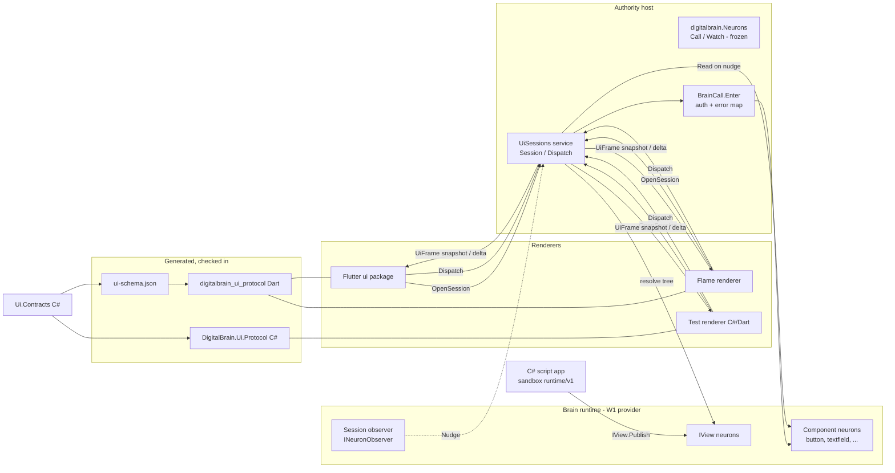

# UI contract (W2): a renderer-agnostic UI model and protocol for DigitalBrain

Written 2026-10-18 on the `plan/ui-contract-w2` branch of `intochat/digitalbrain.docs`. This is the W2 design document of the clean-architecture programme. The executable plan with checkbox tasks follows as a separate file once the owner approves this design.

Evidence class: source reading of `intochat/os` at master `bdb79fc21`, plus the W2 audit (`clients/intochat/projects/briefs/clean-architecture/w2-grpc-audit.md` in the agentic-os workspace, findings H1–H5, M1–M5, L1–L2) and the Figma prototype source (`.../clean-architecture/figma-source/src/App.tsx`, `index.css`). Nothing was built or run, and no files in `os` were changed. Paths are relative to `E:/intochat/os/src` unless stated. Abbreviations follow the audit: `FL` = `DigitalBrain.Modules/Google/Flutter`, `AUTH` = `DigitalBrain.Authority/DigitalBrain.Authority`, `CORE` = `FL/app/core/lib/src`, `FIG` = `figma-source/src`. Citations marked "(audit)" were taken from the audit and not re-read for this document; all others were re-read at `bdb79fc21`. Performance numbers in section 5 are **targets**, not measurements; PR 0 measures the baseline.

Alignment with W1 (`plans/clean-core-2026-10-18.md`, approved 2026-10-18). W2 depends on, and must not contradict, four W1 rules:

- **Neutral attributes.** Contracts move from `[GenerateSerializer]/[Alias]/[Id]` to `[NeuronContract]/[NeuronAlias]/[Field]` with the same strings and numbers (W1 2.2). W2 never introduces a new Orleans attribute and writes every new UI record with the neutral set once W1 PR 3 has landed.
- **`[NeuronAlias]` is identity.** Signal and type identity is the alias string (W1 2.2, `SignalId.Of`). W2's schema keys every kind, state and signal by its alias.
- **Observer design.** `INeuronObserver.Nudge` stays one-way with pull-on-nudge semantics (W1 2.4, simplification decision 14). Process-side observers are created through `IObserverFactory` (W1 2.4a). W2's `Session` is such an observer; it does not add a push-payload path inside the cluster.
- **Wire-name stability.** Contract full names, keys, signal type names in `SignalEnvelope.type` and the `publisher` format `{grainType}/{key}` do not change (W1 4.1, 5). W2 freezes `digitalbrain.Neurons` and adds everything new in a new package.

## Review resolution (independent review `w2-design-review.md`, 2026-10-18: approve with changes)

Each finding was re-checked against `os` at `bdb79fc21` before it was accepted.

| Finding | Verified | Resolution | Where |
|---|---|---|---|
| F1 new `UiNode` fields and records get no codec when PR 4 lands | Yes: `UiNode` is `[GenerateSerializer, Alias("ui.node")]` with `[Id(0..10)]` (`Views/IView.cs:18-30`); the Orleans generator ignores neutral attributes until W1 PR 5 and the PR 9 batch for this project | New UI records and fields carry **both** attribute sets (Orleans + neutral, same strings and numbers) until W1's batch for `Ui.Contracts`. Polymorphic `UiProps` dropped in favour of flat optional fields 11..n; no JSON discriminator needed | 2.2, 8 |
| F2 `[UiSecret]` unenforceable; passwords journalled today | Yes: `TextFieldNeuron` accepts `password`/`secret` (`TextField/TextFieldNeuron.cs:15`) and journals `TextFieldChanged(name, value)` (`:30,40`); `FormSecret` by-reference model exists (`Form/IForm.cs:21-23`) | Secret inputs are renderer-local inline nodes, never component neurons; PR 1 stops journalling `password`/`secret` values; secrets that outlive the call use `FormSecret`; new non-durable runtime/v1 `uidispatch` event kind; redaction in logs/telemetry; one-shot `reveal` for server-generated secrets; probe extended to journal, sandbox stream and logs | 1, 2.2, 2.4, 4, 6, 7.3 |
| F3 `MaxDepth` misread | Yes: the comment at `RuntimeProtocol.cs:24` is JSON nesting depth; the real limits are 512 nodes, depth 32 (`ViewNeuron.cs:80`) and 1 MiB (`:75`); `MaxDepth = 128` appears four times (`RuntimeProtocol.cs:25`, `ViewPublisher.cs:8`, `ViewNeuron.cs:62`, `AppUiEndpoints.cs:80`) | Keep depth 32; raise the node cap to 2,000; one shared `MaxDepth` constant derived from tree depth | 4, 8 |
| F4 single-host assumptions | Accepted (design text) | `DispatchReply` returns the component revision; `operation_id` passed to the neuron (composer already takes it, `AppUiEndpoints.cs:136-137`); v1 ring is explicitly per host with a byte cap and no snapshots, and a miss is the normal hosted case; user cap via a grain; `Navigate` frame body | 2.4, 5.4 |
| F5 script model needs new runtime/v1 surface | Yes: actions reach scripts only as journalled `ViewAction` for buttons (`ViewNeuron.cs:30-40`); `ReferenceKinds` lacks `surface` (`:64-65`); "Only buttons have actions" (`:86`) | `uidispatch` event kind (PR 4b); script host on `ViewPublisher`; `ViewValidation` extended in PR 4a; sketch fixed | 4, 8 |
| F6 three alias-less serializable types | Yes: `ChatRole` (`Chat/ChatEntry.cs:3-4`), `ChatRunStatus` (`Chat/IChat.cs:64-65`), `BrowserConnection` (`WebBrowser/IWebBrowser.cs:17-18`), all enums | PR 0 stored-bytes facts (declared and as `object`); PR 2 adds aliases or proves forwarder resolution; `ui.node` golden re-baselined in PR 4a; R-B2 allow-list; W1 PR 2c coordination | 2.5, 7.1, 8 |
| F7 `LiveSignalEndpoints.cs:54` holds app keys | Yes: `Channel.CreateUnbounded<string?>` named `keys` | `:54` bounded with `Wait` plus a dedup set; `:114` resync-and-close; `BrainEventsEndpoints.cs:79` capacity 1 `DropOldest` (it is a `Channel<bool>` change flag); scene/space remap kept | 6 |
| F8 error table | Yes: `JournalConflictException` is "the journal is set aside" (`JournalConflictException.cs:3-4`); `Translate` has no `InvalidOperationException` branch (`BrainCall.cs:30-38`); stale actions throw `InvalidOperationException` (`ViewNeuron.cs:38`) | Journal conflict → `FAILED_PRECONDITION`/`JOURNAL_DIVERGED`; ordering sentence dropped; `STALE_ACTION` row; status-details packages and CORS exposed headers in PR 5a | 2.4, 6, 8 |
| F9 catalogue gaps, two wrong lines | Yes | Added chip/chipinput, search, inline edit, API-key row, `TypeRole.Mono`, brand icons, connection modal, sidebar list, banner modes; `CodeState` `:21`, `auth-form` `:648` | 3.2 |
| F10 wrong citations | Yes: `node_contracts.dart` has 71 lines, table `:7-70`; `renderer_registry.dart` is under `FL/app/ui/lib/src/composition/`, mirror at `:28-29`; only scene/table/tree models are per-kind; 36 constants incl. `view` | Fixed | 1, 2.2, 2.5 |
| F11 budgets | Accepted | Device-lab absolute jank budget plus CI relative gate; shared per-component read in PR 5a scope; ring byte cap; gRPC-Web stream recycling | 2.4, 5.4, 8 |
| F12 M2/M4 partial | Accepted | REST keeps its shape until PR 7; sandbox refusals map onto the same reasons; `traceparent` in metadata and `SignalBatchEvent.TraceParent` (`RuntimeProtocol.cs:64-65`); voice stays on REST; JSON codec options pinned in goldens | 2.4, 7.1 |
| F13 PR sizing | Accepted | PR 4 → 4a/4b, PR 5 → 5a/5b; PR 4a depends on the W1 batch for its neutral half | 8 |
| Q1, Q3, Q4, Q5 | Accepted | Closed as decisions D-W2-1..4; Q2, Q6, Q7 stay open | 9 |

## 1. Problem statement

**The UI has no contract of its own.** The component model is sound in substance (a declarative node tree, a kind vocabulary, per-kind state records, typed C# commands), but it is owned by the Flutter module, carried as untyped JSON over five transports, and mirrored by hand in Dart. Every Figma screen W3 builds would inherit the latency and drift that follow. Ranked by impact on W3 and on "smooth, no jank, fast first paint":

1. **One interaction uses three transports and reads state twice (audit H1).** A click goes `POST /apps/event` (T4) → neuron → signal → nudge → `Watch` envelope (T2) → the client discards the payload (`FL/app/shell/lib/workspace/workspace_app.dart:504`, `.map((_) {})`) → `GET /apps/node` (T3). First paint is `connect` plus one `node` call per node, and every `UiChildRef` costs one more (`FL/DigitalBrain.Modules.Flutter.Contracts/Views/IView.cs:27`).
2. **The root view polls every 2 s (H2).** The root `NeuronView` is built with `load` and `onAction` but no `watch` (`workspace_app.dart:468-486`), so it falls back to `Timer.periodic(widget.refreshEvery, …)` (`FL/app/ui/lib/src/composition/neuron_view.dart:79,124`). Only the `NeuronSpace` path watches (`workspace_app.dart:502-504`).
3. **The contract is JSON inside protobuf, with hand-written Dart mirrors (H3).** `arguments`, `result` and `payload` are `bytes` of JSON (`AUTH/Neurons/neurons.proto:17,21,40`), and the proto says "the C# contracts are the schema" (`:6`). Dart mirrors are maintained by hand (`CORE/node_contracts.dart:7-70`; `FL/app/ui/lib/src/composition/renderer_registry.dart:28-29`, "Mirrors `DigitalBrain.Flutter.UIVocabulary`"). Drift shows up only at runtime.
4. **SSE paths buffer without bound (H4).** `LiveSignalEndpoints.cs:54,114` and `BrainEventsEndpoints.cs:79` (under `FL/DigitalBrain.Modules.Flutter/Workspace/`) use `Channel.CreateUnbounded`. gRPC `Watch` is bounded with `DropOldest` (`AUTH/Neurons/NeuronsService.cs:47`), which is safe only because envelopes are change hints.
5. **Wire names are a de facto public API with no pin (H5, M1).** `SignalEnvelope.type` is `signal.GetType().Name` (`NeuronsService.cs:107`); `CallRequest.contract` is the full CLR name (`neurons.proto:14`), e.g. Dart's `DigitalBrain.Flutter.Button.IButton`. The proto package is `digitalbrain` with no version and no `reserved` (`neurons.proto:2`). The same records are storage (`[Alias("ui.button-state")]`, `Button/IButton.cs:17`) and JSON wire, so a rename breaks both.
6. **Errors are coarse and split three ways (M2).** gRPC maps four exception types and sends everything else as `Internal` with a generic message (`AUTH/Neurons/BrainCall.cs:28-38`). `RevisionConflictException` derives from `InvalidOperationException` (`DigitalBrain/Neurons/RevisionConflictException.cs:6`) and `JournalConflictException` from `Exception` (`JournalConflictException.cs:6`), so both reach clients as `Internal`. REST and the sandbox use their own shapes.
7. **Weak client lifecycle (M3).** No deadline on Dart `Call` (`CORE/neuron_channel.dart:66-74` builds `CallOptions` with metadata only); one single-source `Watch` per node (`CORE/ui_client.dart:229-236`) although the server multiplexes up to 64 sources (`NeuronsService.cs:25`); no resume token, since live envelopes carry `sequence = 0` (`neurons.proto:39`).
8. **Secrets are stored and journalled today (found in review, F2).** `TextFieldNeuron` accepts kinds `password` and `secret` (`FL/DigitalBrain.Modules.Flutter/TextField/TextFieldNeuron.cs:15`), persists the value and journals it in `TextFieldChanged(name, value)` (`:30,40`), which also reaches `IUiBinding.Dispatch` (`:56`). The form path already has the right model: `FormSecret`, "held by reference only; the value lives in the platform ring" (`FL/DigitalBrain.Modules.Flutter.Contracts/Form/IForm.cs:21-23`).
9. **No renderer-neutral layer (M5).** All 35 component kinds plus `view` (36 constants) live in `DigitalBrain.Flutter.*` (`FL/DigitalBrain.Modules.Flutter.Contracts/UIVocabulary.cs:1-40`); Flame's scene is reached through the Flutter `NodeContracts` table; the six-kind `UiNodeKind` (`Views/IView.cs:16`) cannot express the Figma screens (no text input, stack, overlay, icon or token).

What is good and must be kept: `BrainCall.Enter` authorises every call with the same filter as REST (`BrainCall.cs:14-21`); server-side `Watch` cancellation and bounding are clean (`NeuronsService.cs:46-80`, audit); `server_time_ms` latency stamping exists (`neurons.proto:41`, logged at `ui_client.dart:236-239`); `FlameSchema` already mirrors a C# schema as data for Dart (`DigitalBrain.Modules/DigitalBrain/Flame/DigitalBrain.Modules.Flame.Contracts/FlameSchema.cs:14-15`).

## 2. Target architecture

### 2.1 Modules and dependencies

| Assembly | Role | May reference |
|---|---|---|
| `DigitalBrain.Ui.Contracts` (new, `DigitalBrain.Modules/DigitalBrain/Ui/`) | Component model (`UiView`, `UiNode`, `UiNodeKind`, `UiChildRef`, `UiParts`), the kind vocabulary, the 35 component contracts and their `*State` records and `*Changed` signals, `IUiBinding`, theme tokens, the schema attributes | core (`DigitalBrain`) only |
| `DigitalBrain.Modules.Ui` (new) | Neuron implementations moved from the Flutter module; viewport resolution; the `digitalbrain.ui.v1` server (`Session`, `Dispatch`); the schema generator's build task | Framework, `Ui.Contracts` |
| `DigitalBrain.Ui.Protocol` (new, generated) | C# types generated from `ui/v1/*.proto`: used by the server, the C# test renderer and any .NET renderer | `Google.Protobuf`, `Grpc.*` |
| `digitalbrain_ui_protocol` (new Dart package, generated) | Dart protobuf types, generated kind/state classes, `NodeContracts` table, kind list, theme token classes, a `UiSession` client | `protobuf`, `grpc` |
| `DigitalBrain.Modules.Flutter` (shrinks) | Shell and platform endpoints only (`WorkspaceEndpoints`, browser, voice, connections) | `Ui.Contracts` |
| `DigitalBrain.Modules.Flame` | Scene neuron; `scene` is one Ui kind; `FlameSchema` folded into the Ui schema as the `scene` kind's parameter domain | `Ui.Contracts` |

The Flutter `ui` package (`FL/app/ui`) and a Flame renderer both depend on `digitalbrain_ui_protocol` and on nothing Flutter-module-specific on the server.

### 2.2 Component model

The model stays a declarative tree of keyed nodes, extended rather than replaced. Today `UiNode` has `Kind, Key, Text, Detail, Action, Enabled, Children, Extents, Reference, Gap, FollowEnd` with field ids 0–10 (`Views/IView.cs:18-30`), and `UiView` has `Generation, Version, Root` (`:14`). Both keep their aliases (`ui.view`, `ui.node`) and field ids for ever, because they are persisted in `IView` state (W1 4.1).

Neutral schema, as data:

- **Kinds.** Two families, both listed in one schema:
  - *Inline kinds* live inside a `UiNode` (today `Text, Button, Column, Row, Card, Reference`, `IView.cs:16`). New inline kinds are appended to `UiNodeKind` with new numbers only (section 3.2).
  - *Component kinds* are neurons with their own state and commands (today 35 component constants plus `view` in `UIVocabulary.cs:5-40`). A `Reference` node points at one through `UiChildRef(Kind, Name)`.
- **Props.** New `UiNode` fields are flat and optional, with new ids from 11 upward, shared across kinds where the meaning is the same: `[Field(11)] UiStyle? Style`, `[Field(12)] string? Variant` (button variant, textfield input type, badge tone), `[Field(13)] string? Icon`, `[Field(14)] string? Label`, `[Field(15)] string? Error`, `[Field(16)] UiOption[]? Options` (menu, segmented, chips, model picker), `[Field(17)] string? Value` (non-secret only), `[Field(18)] int? Length` (code boxes), `[Field(19)] string? State` (code-box and banner states), `[Field(20)] bool Secret`, `[Field(21)] bool Reveal`. The final list is fixed in PR 4a from the catalogue (3.2); every field is reviewed because it becomes storage. A polymorphic `UiProps` was rejected: polymorphic records outside `Signal` are not yet covered by W1's generator, and Web JSON would need `[JsonDerivedType]` discriminators.
- **Attributes until W1 covers these contracts.** The Orleans 10.4 generator ignores neutral attributes; neutral-only types get codecs only from W1's provider generator (W1 PR 5, then the PR 9 batch that covers `Ui.Contracts`). A neutral-only field on today's Orleans-generated `UiNode` would be silently dropped on every `IView` save. So every new UI record and field carries **both** sets with the same strings and numbers, e.g. `[GenerateSerializer, Alias("ui.theme"), NeuronContract, NeuronAlias("ui.theme")]` and `[Id(11), Field(11)]`, until that W1 batch removes the Orleans half. Old stored `UiNode` bytes still read (absent fields default) and old silos skip unknown field ids. Whether newly written bytes for a node without new fields stay identical is not verified, so PR 4a re-baselines the `ui.node` golden with a reviewed diff and adds a rolling-deploy fact (an old silo reads a new `UiNode`).
- **Style.** `UiStyle` carries only token references (`ColorRole`, `TypeRole`, `Space`, `Radius`, `Elevation`), never raw colours, pixel fonts or platform names. `Gap` and `Extents` stay for compatibility; new layout kinds use `Space` tokens.
- **Events.** A node declares the events it raises (`Action` today). The schema records, per kind, the event names and their payload shape (e.g. `textfield: change{value}`, `submit{}`; `codeboxes: complete{code}`). `UiEvent` (T4 today) becomes the typed `Dispatch` request (2.4).
- **Secrets.** Rules, all enforced by tests (7.3):
  1. A secret-bearing input (password, code, API key) is **never a component neuron**. It is an inline node with `Secret = true`; its value lives only in the renderer and travels only in the `Dispatch` that consumes it. Event payload fields marked `[UiSecret]` are never stored in node state, never journalled and never echoed in a frame.
  2. The component path is closed. PR 1 stops `TextFieldNeuron` storing and journalling values of kinds `password` and `secret` (state keeps only whether a value is set; `TextFieldChanged` carries an empty value). PR 4b retires those kinds on the component path.
  3. A secret that must outlive the call (a stored API key) goes to the platform ring and is referenced as `FormSecret(Reference, Label, IsSet)` (`Form/IForm.cs:21-23`), the existing by-reference model.
  4. Secrets reach a script handler only through the non-durable runtime/v1 `uidispatch` event (section 4), never through a signal.
  5. The `Dispatch` handler, gRPC logging and OpenTelemetry attributes redact `[UiSecret]` fields.
  6. **Show-once for server-generated secrets** (TOTP secret `FIG/App.tsx:2368`, recovery codes `:2387`, rotated API key `:2933`): a node with `Reveal = true` is sent in exactly one frame, is excluded from the resume ring, the server view cache and the client disk cache, and is replaced by a masked node in every later frame. A lost frame means generating a new secret, not re-sending it.

Schema source of truth: the C# contracts. The generator (2.5) emits `ui-schema.json` with, per kind: alias, family, contract full name and legacy names, state record alias and fields (name, `[Field]` id, type, nullability, default), commands, change-signal alias and short type name, events and payloads, and which props are secret.

### 2.3 Theming tokens

W3 brings the Figma theme. The contract reserves a slot for it and fixes only the role names, not the values.

- `UiTheme { string Id; string Hash; UiTokenSet Light; UiTokenSet Dark; }` with `ThemeMode { Light, Dark, System }`. `System` is resolved by the renderer from the platform, as `index.css` does with `prefers-color-scheme` (`FIG/index.css:81-82`) and `:root[data-theme="dark"]` (`:44`).
- `UiTokenSet` roles mirror the Figma CSS variables one to one (`FIG/index.css:6-41` light, `:46-…` dark): colours `page, recessed, surface, strong, body, muted, subtle, hairline, inputBorder, accent, accentHover, accentTint, accentContrast, accentCopy, accentCopyHover, focus, done, doneBg, working, workingBg, error, errorBg, userBubble, userText, assistant, assistantText, assistantBorder, menuHover`; elevations `xs, sm, md, lg, xl`; fonts `sans, mono`; motion `ease` (cubic-bezier) plus durations; type scale, spacing scale and radii (to be read from the CSS classes by W3).
- Delivery: the first frame of a session carries `ThemeRef{id, hash}`; the full `UiTheme` is sent only when the client's cached hash differs (5.3). A theme switch (Figma: `FIG/App.tsx:2637-2645`, `:4140-4148`) is a client-local change of `ThemeMode` that repaints without a server round trip, followed by a fire-and-forget `Dispatch` that persists the preference.
- Renderers map roles to their own types (Flutter `ThemeData`/`ThemeExtension`, Flame paints). Unknown roles fall back to `body`/`surface`.

### 2.4 Protocol `digitalbrain.ui.v1`

A new gRPC service next to the frozen `digitalbrain.Neurons`, served on the same host and auth path, with gRPC-Web for browsers as today.

```proto
syntax = "proto3";
package digitalbrain.ui.v1;
option csharp_namespace = "DigitalBrain.Ui.Protocol.V1";

service UiSessions {
  // One stream per screen. First frame: the full resolved view; then deltas.
  rpc Session (OpenSession) returns (stream UiFrame);
  // Typed user intent. Unary, deadline-bound, idempotent by operation_id.
  rpc Dispatch (DispatchRequest) returns (DispatchReply);
}

message OpenSession {
  string brain_id = 1;
  string screen = 2;              // app root or screen alias, e.g. "intochat.login"
  string schema_version = 3;      // ui-schema.json version the renderer was built with
  repeated string kinds = 4;      // kinds this renderer implements (capability handshake)
  ResumeToken resume = 5;         // empty on first open
  string theme_hash = 6;          // cached theme, if any
  string renderer = 7;            // "flutter/1.4", "flame/0.3", "test" (diagnostics only)
  reserved 8 to 15;               // held for viewport size, locale, accessibility flags
}

message ResumeToken { string session_id = 1; uint64 sequence = 2; }

message UiFrame {
  uint64 sequence = 1;            // per session, strictly increasing, starts at 1
  string session_id = 2;
  int64 server_time_ms = 3;       // kept from neurons.proto:41 for latency measurement
  oneof body {
    ViewSnapshot snapshot = 4;    // full tree + all component states (first frame, or after Resync)
    ViewDelta delta = 5;          // changed nodes/states only
    ThemePayload theme = 6;
    Heartbeat heartbeat = 7;
    Resync resync = 8;            // server dropped deltas; a snapshot follows in the same stream
    Navigate navigate = 9;        // open a session on another screen
  }
  reserved 10 to 20;
}

message ViewSnapshot { uint64 view_version = 1; NodeTree root = 2; repeated ComponentState states = 3; ThemeRef theme = 4; }
message ViewDelta    { uint64 view_version = 1; repeated NodePatch nodes = 2; repeated ComponentState states = 3; repeated string removed = 4; repeated ListAppend appends = 5; }
message ComponentState { string kind = 1; string name = 2; int64 revision = 3; bytes state_json = 4; reserved 5; /* typed props, v1.x */ }
message NodeTree   { bytes node_json = 1; reserved 2; }   // UiNode in Web JSON, validated against ui-schema.json
message NodePatch  { string key = 1; bytes node_json = 2; }
message ListAppend { string kind = 1; string name = 2; uint64 from_index = 3; bytes items_json = 4; }

message DispatchRequest {
  string brain_id = 1;
  string session_id = 2;
  string operation_id = 3;        // client-generated; passed to the neuron, which owns idempotency
  string node = 4;                // node key or "kind/name" of a component
  string event = 5;               // event name from the schema, e.g. "submit"
  bytes payload_json = 6;         // typed by the schema for (kind, event)
  int64 expected_revision = 7;    // optimistic concurrency; 0 = none
  reserved 8 to 15;
}
message Navigate { string screen = 1; bool replace = 2; }
// Host-independent: the component revision (or IView Version) that reflects the action.
message DispatchReply { string node = 1; int64 applied_revision = 2; bytes result_json = 3; reserved 4 to 8; }
```

Decisions in this shape:

- **Payloads stay JSON in v1, inside a typed envelope (decision D-W2-2).** The JSON codec options (Web defaults, enum and null handling) are pinned in the golden files. The envelope (frames, sequence, errors, deadlines) is protobuf; node and state bodies are Web-JSON validated against the generated schema. This reuses the existing `*State` JSON shape (T3 today), keeps the generator small, and lets Dart decode into generated classes. Typed protobuf bodies are held by the `reserved` fields and adopted in a v1 minor only if the PR 6 benchmarks show JSON decode on the critical path (decision D-W2-2).
- **Session = one server-side observer per screen.** The server resolves the screen's tree, opens one multiplexed watch over every referenced component through an `INeuronObserver` created with `IObserverFactory` (W1 2.4a), and on each nudge **pulls** `Read()` on the server and pushes the resulting state. Pull-on-nudge (W1 2.4) is preserved inside the cluster; the client no longer pays the hint-then-read hop. When the tree changes (`ViewChanged`), the server re-resolves, subscribes new references, unsubscribes removed ones and sends a `ViewDelta`.
- **Resumable sequence (single host in v1).** The ring lives in the memory of the host that holds the stream: at most 256 KB of delta frames or 30 s, whichever is smaller; never snapshots (a snapshot is re-derived) and never `Reveal` nodes. On reconnect the client sends `ResumeToken`; if the sequence is in the ring the server replays from it, otherwise it sends `Resync` plus a `ViewSnapshot`. The session sequence is a UI-session counter and does not reuse `SignalEnvelope.sequence`. Across replicas a resume is expected to miss and fall back to a snapshot, and the budgets in 5.4 assume that. Path to multi-host resume (v1.x): keep the ring in brain-affine session state, consistent with W1 brain-affine placement, so a brain's sessions resume on the brain's silo.
- **Typed `Dispatch`.** Replaces the `kind`/`action` string switch in `AppUiEndpoints.cs` (audit T4). The server validates `(kind, event, payload)` against the schema before any neuron call, then calls the component's command through `BrainCall.Enter`. `Dispatch` is a separate unary call and may land on a different replica than the `Session` stream, so the reply carries no session state. It returns `applied_revision`, the component's revision (or the `IView` `Version`) after the action; the renderer retires optimistic state when a frame carries that node at a revision at least that high. `operation_id` is passed to the neuron, which deduplicates (the composer already takes one, `AppUiEndpoints.cs:136-137`), so retries that land on another replica stay idempotent. `traceparent` travels in gRPC metadata and is forwarded into `uidispatch` and `SignalBatchEvent.TraceParent` (`RuntimeProtocol.cs:64-65`).

**Error model.** Every failure is a gRPC status with `google.rpc.Status` details (`grpc-status-details-bin`, readable on gRPC-Web). `ErrorInfo.domain = "ui.digitalbrain.io"`, `reason` from a closed, versioned list:

| Condition | Status | Reason | Extra detail |
|---|---|---|---|
| Revision conflict (`RevisionConflictException`) | `ABORTED` | `REVISION_CONFLICT` | `metadata.current_revision` (carried by the exception, `RevisionConflictException.cs:6`) |
| Journal divergence (`JournalConflictException`, "the journal is set aside", `JournalConflictException.cs:3-4`); not retryable | `FAILED_PRECONDITION` | `JOURNAL_DIVERGED` | correlation id |
| Stale action (`ViewNeuron.Activate` throws `InvalidOperationException`, `ViewNeuron.cs:38`) | `FAILED_PRECONDITION` | `STALE_ACTION` | — |
| Payload fails schema validation | `INVALID_ARGUMENT` | `SCHEMA_VIOLATION` | `BadRequest.field_violations` |
| Unknown kind/event for this schema | `INVALID_ARGUMENT` | `UNKNOWN_EVENT` | — |
| Precondition in the app (e.g. wrong code, expired code) | `FAILED_PRECONDITION` | app-defined `APP_*`, e.g. `APP_CODE_EXPIRED` | `LocalizedMessage` for display |
| Not the caller's brain | `PERMISSION_DENIED` / `UNAUTHENTICATED` | `BRAIN_ACCESS` | as `BrainCall.cs:20-21` |
| Neuron or component missing | `NOT_FOUND` | `NODE_NOT_FOUND` | — |
| Server overload / session cap | `RESOURCE_EXHAUSTED` | `SESSION_LIMIT` | `RetryInfo` |
| Deadline | `DEADLINE_EXCEEDED` | — | — |
| Anything else | `INTERNAL` | `INTERNAL` | `DebugInfo` only in Development; a correlation id always |

The same mapping is applied to `digitalbrain.Neurons` in PR 1 for the conflict cases only (codes, no new fields), which W1 L4 already allows (`TypeLoadException` mapping kept). PR 5a adds `Grpc.StatusProto` and `Google.Api.CommonProtos` to `Directory.Packages.props` and exposes `grpc-status`, `grpc-message` and `grpc-status-details-bin` in CORS, so browsers can read details on trailers-only gRPC-Web responses. REST routes keep their error shape until PR 7 retires them; the sandbox refusal header (`RuntimeProtocol.cs:18`, audit) maps its codes onto the same `reason` list.

**Backpressure.** Two node classes, declared per kind in the schema:

- *State nodes* (latest wins): the session keeps a dirty set keyed by `kind/name`. At most one pending state per node; a new nudge overwrites the pending entry. The buffer is bounded by the number of nodes on screen (cap 512 per session).
- *Append nodes* (chat messages, activity feeds, the `/live` payloads `AppActivity`/`CircleSpoke`, audit H4): deltas are `ListAppend` with indexes. Up to 1,024 pending items per session; past that the server drops the pending appends for that node and sends `Resync` for it, so data is re-read from the neuron instead of being lost silently.
- Frames are coalesced into one write per 16 ms tick when the client is behind (writer not ready), and sent immediately otherwise.
- Limits: a per-host cap (default 5,000 sessions) and 64 sessions per user, counted cluster-wide by a per-user grain (`RESOURCE_EXHAUSTED` beyond). There is no per-connection cap: gRPC-Web over HTTP/1.1 makes each stream its own request and browsers allow about 6 connections per origin, which is why the design opens exactly one `Session` per screen. A session idle without client reads for 60 s is closed and resumes with a snapshot.
- **Shared reads.** When several sessions on a host watch the same component, one `Read()` per nudge is shared by all of them. This is PR 5a scope, because the throughput budget depends on it.

**Deadlines and liveness.** `Dispatch`: client deadline 10 s default, per-event override in the schema (file uploads 60 s). `Session`: no overall deadline; the first frame must arrive within 5 s or the client retries with backoff (250 ms → 4 s, jitter). The server sends `Heartbeat` every 20 s of silence; the client treats 45 s without any frame as a dead stream and resumes. The web client recycles its stream (resume on a fresh call) every 10 min or 8 MB received to bound gRPC-Web response buffers. Voice audio stays on its REST route (`AppUiEndpoints.cs:138`), because gRPC-Web has no client streaming. Server-side cancellation reuses the `Watch` pattern (`NeuronsService.cs:46-80`, audit).

**Versioning policy.**

- Package versioned in its name (`digitalbrain.ui.v1`). Within v1 only additive changes: new fields with new numbers, new messages, new enum values, new kinds. Removed fields are `reserved` by number and name. A breaking change means `v2`, served side by side for at least one release.
- `ui-schema.json` has `schemaVersion` (`major.minor`). Minor = additive kinds, props, events. The renderer declares its version and kinds in `OpenSession`; the server never sends a kind the renderer did not declare and substitutes the kind's declared fallback (every new kind must name one: e.g. `codeboxes → textfield`, `modelpicker → select`, `skeleton → progress`) or `unsupported`.
- CI enforces it: `buf breaking` against `main` for `ui/v1/*.proto`; a schema compatibility test that fails if a kind, field id, alias, event or signal short name present on `main` disappears or changes type; and the W1 contract manifest fact (W1 4.2) for the C# records.

### 2.5 Generated bindings and the drift check

```
C# contracts (Ui.Contracts, Flame.Contracts) ──► W1 ContractManifest.json (aliases, field ids, full names)
             │                                          │
             └──► UiSchemaGenerator (build task) ◄──────┘
                         │
                         ├─► ui-schema.json (checked in)
                         ├─► Dart: digitalbrain_ui_protocol/lib/src/generated/{kinds,states,events,theme,node_contracts}.g.dart
                         └─► C#: kind/event constants for the test renderer and server validation
ui/v1/*.proto ──► protoc / Grpc.Tools ──► Dart (*.pb.dart) and C# (DigitalBrain.Ui.Protocol)
```

- The generator reads compiled metadata (reflection over the built `Ui.Contracts` assembly, run as a `dotnet` tool step), not source, so it sees exactly what Orleans and W1's generator see. It reads `[NeuronAlias]` first and `[Alias]` second, like W1 PR 3's `CompiledTypes`, so it works before and after W1's batch for these contracts.
- Generated Dart replaces the hand-written mirrors: `NodeContracts` (`CORE/node_contracts.dart:7-70`), `RendererRegistry.uiKinds` (`FL/app/ui/lib/src/composition/renderer_registry.dart:28-29`), and the per-kind models among `CORE/models/*.dart` (only `scene_`, `table_` and `tree_models`; the rest are shell models and stay hand-written).
- `FL/app/core/tool/generate_proto.sh` (audit M1) moves into one script, `tool/generate-ui.sh`, which generates both `neurons.pb*.dart` and the v1 files.
- **Drift check (CI).** A job in `.github/workflows/flutter.yml` (today's workflows: `ci.yml`, `e2e.yml`, `flutter.yml`, `publish.yml`, `release.yml`) runs the generator and fails if `git diff --exit-code` shows any change in `ui-schema.json` or generated files. A second job runs `buf breaking` and the schema compatibility test (2.4).

**Keeping `DigitalBrain.Flutter.*` names identical, and how renames are avoided.** Three names are on the wire or in storage, and each is pinned differently:

| Name | Where it is load-bearing | Rule |
|---|---|---|
| `[Alias]`/`[NeuronAlias]` strings (`"button"`, `"ui.button-state"`, `"ui.view"`) | Orleans grain interface ids and persisted state (W1 4.1) | Never change. Moved files keep the attribute verbatim |
| Signal short names (`ButtonChanged`) | `SignalEnvelope.type` (`NeuronsService.cs:107`), Dart `contract.changed` | Never change. Pinned by PR 0 golden test |
| Contract full names (`DigitalBrain.Flutter.Button.IButton`) | `CallRequest.contract` / `WatchSource.contract` (`neurons.proto:14,25`), Dart `NodeContracts` | **Kept: namespaces are never renamed (decision D-W2-1).** PR 2 moves the files into the new `DigitalBrain.Ui.Contracts` assembly with namespaces unchanged and `[TypeForwardedTo]` left in `DigitalBrain.Modules.Flutter.Contracts`, so every full name, alias and assembly-qualified lookup still resolves |

New types added by W2 use the `DigitalBrain.Ui.*` namespace from the start; v1 clients address components by alias only. Moved signals still resolve because `SignalTypes` scans every loaded assembly by full name (`AUTH/Neurons/SignalTypes.cs:24-28`).

**Alias-less serializable types.** Three moved types are `[GenerateSerializer]` without `[Alias]`, all enums: `ChatRole` (`Chat/ChatEntry.cs:3-4`), `ChatRunStatus` (`Chat/IChat.cs:64-65`) and `BrowserConnection` (`WebBrowser/IWebBrowser.cs:17-18`). If one is ever written polymorphically, Orleans encodes `Namespace.Type,Assembly`, and reading old bytes after the move would depend on the type resolver following `[TypeForwardedTo]`, which is unverified. PR 0 adds a stored-bytes fact that serializes each moved serializable type both as its declared type and as `object`, then asserts identical bytes and a round trip after a simulated move. PR 2 then adds aliases to the three enums only if the fact proves they are never stored polymorphically (adding an alias changes the polymorphic encoding), otherwise it keeps them and proves forwarder resolution.

### 2.6 Diagram



## 3. Renderer contract

### 3.1 What every renderer must implement

1. **Handshake.** Send `OpenSession` with `schema_version`, the kinds it implements and its cached theme hash.
2. **Frame application.** Apply `snapshot`, `delta`, `theme`, `heartbeat` and `resync` strictly in `sequence` order; ignore duplicates (`sequence ≤ last`); on a gap, resume.
3. **Keyed reconciliation.** Node identity is `key` (UiNode) or `kind/name` (component). A delta rebuilds only the patched nodes; untouched siblings keep their render objects. Flutter: `ValueKey(key)` and per-node `ValueListenable`s, never a root `setState`.
4. **Ephemeral state stays local.** Typing, caret, focus, hover, scroll position, open menus, password visibility, code-box cursor and pressed states are renderer state. They are not round-tripped. Text fields send `change` events throttled (default 250 ms, schema-overridable) and always send the final value with `submit`.
5. **Optimistic intents.** A renderer may show a pending visual (button `loading`, toggle flipped) from the moment of `Dispatch` until a frame carries the node at a revision at least the reply's `applied_revision`, then defer to server state; on error it reverts and shows the error.
6. **Tokens.** Resolve every style through `UiTheme` roles; resolve `ThemeMode.System` from the platform; repaint on mode change without server help.
7. **Fallbacks.** Render the declared fallback for kinds it does not implement, and `unsupported` (visible, non-crashing) for anything else.
8. **Errors.** Surface `ErrorInfo.reason` and `LocalizedMessage`; on `REVISION_CONFLICT` drop optimistic state and wait for the next frame.
9. **Accessibility.** Map `label`, `role` and `liveRegion` props (toasts are `status`, `FIG/App.tsx:4571`) to platform semantics.

| Renderer | Scope | Notes |
|---|---|---|
| Flutter (`FL/app/ui`) | All kinds | Reference renderer; `RendererRegistry` keyed by generated kinds, existing widgets under `FL/app/ui/lib/src/components/**` (audit) reused |
| Flame | `scene` plus layout, text, button, toast, modal | Game-style surfaces; `scene` props are the `FlameSchema` domain; non-scene kinds may fall back |
| Test renderer (C# and Dart) | All kinds, headless | Builds an in-memory tree from frames, exposes `Find(key)`, `Dispatch(...)`, records frame timings; the conformance suite (7.3) runs against it and against Flutter |

### 3.2 Node-kind catalogue

Existing kinds are kept unchanged. "Figma" gives the `FIG/App.tsx` line where the prototype defines or first uses the element. New inline kinds append to `UiNodeKind` from 6 upward; new component kinds add a `UIVocabulary` constant and a contract.

| Kind | Family | Status | Figma | Key props / events | Fallback |
|---|---|---|---|---|---|
| `text` | inline | exists (`IView.cs:16`), extended | headings, eyebrow, copy (`:637-640`) | `TypeRole` (display, h1, eyebrow, body, caption), `ColorRole` | — |
| `button` | inline + component | exists | `Button` `:302` | `variant` primary/secondary/ghost/danger, `loading`, `icon`; `click` | — |
| `link` | inline | new | text links `:663-669`, `:680-686` | `text`; `click` | `button` |
| `column`, `row` | inline | exist | everywhere | `gap` token | — |
| `stack` | inline | new | overlays, brand panel `:519` | children layered, alignment | `column` |
| `split` | inline | new | `SplitScreen` `:572` | `ratio`, collapse breakpoint | `column` |
| `scroll` | inline | new | message column `:4300` | `followEnd` (exists on `UiNode`, `IView.cs:29`) | `column` |
| `divider` | inline | new | `Divider` `:596`, `MenuDivider` `:423` | `label` ("or") | `text` |
| `card` | inline | exists | `CenteredCard` `:819` | — | — |
| `icon` | inline | new | `Icon` `:90` (`IconName` list `:22-…`); brand set `Wordmark`, `AppIcon`, `GoogleIcon` `:264-279` | `name` from closed `ui` and `brand` icon sets in the schema, `size` | `text` |
| `image`, `avatar` | component / inline | `image` exists; `avatar` new | profile avatar `:2140-2142`, team `:3354` | `src`, `initials` | `text` |
| `badge` | inline | new | `status-badge` `:2244`, `:3021` | `tone` (done, working, error, neutral) | `text` |
| `textfield` | component | exists, extended | `TextField` `:431`, Login `:649-662` | `inputType` text/email/multiline/search, `label`, `error`, `autocomplete`; `change`, `submit`. Kinds `password`/`secret` retired on the component path (2.2) | — |
| `secretfield` | inline | new | Login password `:656-662`, `ProviderKeyRow` (API key entry) `:1944` | `Secret = true`, `revealable`, `autocomplete`; `submit{value}` `[UiSecret]`; stored keys shown as `FormSecret.IsSet` | `unsupported` (never a component textfield) |
| `search` | inline (`textfield` variant) | new | model search `:1277`, chat search `:4000` | `placeholder`, clear; `change` (throttled) | `textfield` |
| `inlinefield` | inline (`textfield` variant) | new | `InlineField` `:1878` | display/edit toggle is renderer-local; `save{value}` | `textfield` |
| `chip`, `chipinput` | inline | new | attachment chip `:1648`, amount chips `:3230`, email chips with remove `:3425`, tool chip `:4250` | `Options`, removable; `select`, `remove`, `add` | `text` / `textfield` |
| `code` (monospace text) | inline (`text` with `TypeRole.Mono`) | new | model cost `:1352`, TOTP secret `:2368` | `Reveal` for show-once secrets (2.2) | `text` |
| `passwordrules` | inline | new | `PasswordRules` `:476` | rule list (id, label); evaluated **in the renderer** against the local field value, so no secret leaves the device | `text` |
| `codeboxes` | inline | new | `CodeScreen` `:827`, `code-boxes` `:921`, `MiniCodeBoxes` `:2029`; states `CodeState` `:21` | `length`, `state` default/verifying/wrong/expired/verified, paste support; `complete{code}` `[UiSecret]` | `textfield` |
| `errormessage` | inline | new | `ErrorMessage` `:496` | `liveRegion` | `text` |
| `form` | component | exists | `auth-form` `:648` | groups fields; `submit` collects values in one `Dispatch` | — |
| `menu` (+ `menuitem`, `menulabel`, `menudivider`) | inline | new | `Menu` `:336`, `MenuItem` `:396`, `MenuLabel` `:427` | anchor key, items with `icon`, `danger`; keyboard nav is renderer-local; `select{item}` | `select` |
| `toggle` | component | exists | `Toggle` `:1855`, settings `:2738` | `on`, `label`, `detail`; `change{on}` | — |
| `select` | component | exists | `<select>` `:2662`, team role `:3356` | options; `change` | — |
| `slider` | component | exists | `type="range"` `:3204` | min/max/step | — |
| `segmented` | inline | new | theme switch `:2637-2645`, `:4140-4148` | options; `change`. Theme switch = `segmented` bound to client `ThemeMode` (2.3) | `select` |
| `modelpicker` | component | new | `ModelPicker` `:1223`, `ProviderLogo` `:1166`, auto row `:1295`, local models `:1430` | groups (auto, providers, local), provider logo id, selected; `choose{modelId}` | `select` |
| `composer` (chat composer) | component | exists (`UIVocabulary.cs:7`), extended | `ChatComposer` `:1587`, attachments `:1649`, model chip `:1724-1745` | auto-resize, attachments, `modelpicker` slot, stop/send state; `send`, `stop`, `attach` | — |
| `message` (bubble) | inline | new (rendered inside `chat` today) | `user-message-bubble` `:4301`, `message-footer`/actions `:1469-1471`, `AssistantToolbar` `:1459` | `role` user/assistant, markdown body, `answeredBy`, actions (copy, retry, approve); append-node | `card` |
| `chat` | component | exists | message list `:4300` | append node of `message`; `followEnd` | — |
| `tabs` | component | exists | settings sections `:1772-1785`, main view `:3660` | items; `change` | — |
| `table` | component | exists | `data-table usage-table` `:3280`, billing `:3329`, team `:3354-3378` | columns, rows with cell kinds (text, badge, avatar, select) | — |
| `modal` | inline | new | `Modal` `:1807`; confirmations `:2417`, `:3566-3624`; `ConnectionModal` `:1507` | `title`, `open`, `danger`, actions; `close` | `card` |
| `toast` | inline | new | `toast` `:4563`, `:4571`, auto-hide 2400 ms `:3821` | `message`, `action` (undo, `:3798`), `durationMs`; renderer-timed | `infobar` |
| `skeleton` | inline | new | `ArticleSkeleton` `:505-514`; `BrandPanel` banner modes live/static/loading (`BannerMode` `:20`, `BrandPanel` `:519`) | shape list (image, pill, title, copy; wide/short) | `progress` |
| `navlist` (sidebar chat list) | inline | new | `AppShell` sidebar `:3646`, archive/undo `:3782-3798` | items with menu, active item; `select`, `archive` | `column` of `button` |
| `progress`, `infobar` | component | exist | spinners, banners | — | — |
| `fileinput` | component | exists | profile photo `:2105-2147` | accept types, max size (5 MB, `:2108-2109`) validated in renderer and server | — |
| `scene` | component | exists (Flame) | — | `FlameSchema` domain | `unsupported` |
| remaining 18 existing kinds (`surface, layout, collection, imagecanvas, video, webbrowser, chart, graph, calendar, clock, map, person, rating, color, expander, tree, sheet, voiceinput`) | component | exist (`UIVocabulary.cs:5-40`) | not used by the Figma screens | unchanged | `unsupported` |

Screens covered by these kinds: `login`, `signup`, `code`, `reset`, `new-password`, `app` (chat, profile, settings with 9 sections) and `components` (`FIG/App.tsx:11-18`, `:1772-1785`).

## 4. C# script app authoring model

Apps are C# scripts running in the sandbox runtime and talking to the brain over `runtime/v1` (`DigitalBrain.Client/DigitalBrain.Client/Runtime/V1/RuntimeProtocol.cs:9-11`). They author against `DigitalBrain.Ui.Contracts` only: no Flutter, Flame or protobuf types are visible.

- **What exists.** Behaviours are compiled assemblies loaded into a collectible load context that shares the host's contracts (CSharp `Sandbox/BehaviorLoader.cs`). Scripts already publish views through `ViewPublisher` (generation, version, dedupe by serialized JSON; `Views/ViewPublisher.cs`). UI actions reach scripts only as the journalled `ViewAction` signal and only for `Button` nodes (`ViewNeuron.cs:30-40`, `:86`). Brain-to-script events are `SignalBatchEvent` with a durable `Watermark` (`RuntimeProtocol.cs:64-65`).
- **What is added.** A runtime/v1 stream event kind `uidispatch` (PR 4b): additive, non-durable, carrying the typed event and `[UiSecret]` fields, never written to `BrainEntry`, delivered at most once (a lost event is a failed `Dispatch` the user retries). `IUiContext` with `Render`, `Navigate` (a `Navigate` frame) and `OpenExternal`. The script host is built on `ViewPublisher`. `ViewValidation` (`ViewNeuron.cs:60-88`) is extended for the new kinds and for actions on non-button nodes in PR 4a. Out of scope but listed: `SessionStreams.Open` uses `Channel.CreateUnbounded` (CSharp `Sessions/SessionStreams.cs:15`), another H4-class buffer.
- **A screen** is a class with a state record, a pure `Render(state)` that returns a `UiNode` tree, and event handlers bound by name. The script host calls `Render` after every handler and publishes the result through `ViewPublisher` and `IView.Publish(UiView)` (`Views/IView.cs:8`). The server diffs consecutive views by key and sends only `ViewDelta`s, so scripts never write diffs.
- **State** is a record persisted by the app neuron (W1 `[NeuronContract]` record, so it survives restarts and is storage-safe). Secrets never enter it.
- **Events** are methods marked `[On("node", "event")]` whose parameter type is the schema payload; the script host validates and dispatches them. Handlers return the next state.
- **Server-side components** (text fields, toggles) can be bound to state fields; the script reads their value from the event payload rather than polling the component.
- **Limits to change.** The explicit limits are in `ViewValidation`: at most 512 nodes and depth 32 (`ViewNeuron.cs:80`) and 1 MiB serialized (`:75`). `MaxDepth = 128` is JSON nesting depth, not node count: "32 nodes, each with a children array" means 32 tree levels × 2 JSON levels plus the envelope (`RuntimeProtocol.cs:24-25`). A Figma settings page has several hundred nodes and fits depth 32, so **depth stays 32** and the **node cap rises from 512 to 2,000** (to be confirmed against the largest W3 screen). Flat optional props (2.2) add at most two JSON levels per node (`Style`, `Options[]` elements), so PR 4a introduces one shared constant, `UiLimits.JsonMaxDepth = 2 × MaxTreeDepth + PropsDepth + EnvelopeDepth` (= 2 × 32 + 2 + 8 = 74 rounded up to the existing 128, with a fact that proves a depth-32 tree with every prop set serializes), used by all four serializers that hard-code 128 today: `RuntimeProtocol.cs:25`, `ViewPublisher.cs:8`, `ViewNeuron.cs:62` and `AppUiEndpoints.cs:80`. The 1 MiB cap is re-measured with a 2,000-node page and kept unless that page exceeds it.

Sketch of the Figma Log in screen (`FIG/App.tsx:604-693`):

```csharp
// apps/intochat/login.csx: an IntoChat app screen on the DigitalBrain.Ui contract
using DigitalBrain.Ui;
using static DigitalBrain.Ui.Ui;

[NeuronContract, NeuronAlias("intochat.login-state")]
public sealed record LoginState(
    [property: Field(0)] string Email = "",
    [property: Field(1)] bool Error = false,
    [property: Field(2)] bool Loading = false);

[UiScreen("intochat.login")]
public sealed class Login : UiScreen<LoginState>
{
    public override UiNode Render(LoginState s) =>
        Split("root", ratio: 0.5,
            start: Column("brand", children: [                                                // inline: `surface` is not a
                Reference("article", new UiChildRef("card", "intochat/latest-article")),         // reference kind (ViewNeuron.cs:64-65);
                Skeleton("article-loading", SkeletonShape.Article)]),                            // card is allowed after PR 4a
            end: Column("form", gap: Space.Lg, children: [
                Text("eyebrow", "Welcome back", TypeRole.Eyebrow),
                Text("title", "Log in to IntoChat", TypeRole.H1),
                Text("lead", "Use your work account to continue.", TypeRole.Body, ColorRole.Muted),
                Button("google", "Continue with Google", action: "google", variant: ButtonVariant.Secondary, icon: "google"),
                Divider("or", label: "or"),
                Form("auth", children: [
                    TextField("email", "Email", InputType.Email, value: s.Email, error: s.Error, autocomplete: "email"),
                    SecretField("password", "Password", error: s.Error,
                                autocomplete: "current-password", revealable: true),          // inline; value never leaves the renderer except in submit
                    Link("forgot", "Forgot password?", action: "reset"),
                    s.Error ? ErrorMessage("error", "That email and password don't match.") : null,
                    Button("submit", "Log in", action: "submit", loading: s.Loading),
                ]),
                Row("switch", [Text("no-account", "No account?"), Link("signup", "Sign up", action: "signup")]),
            ]));

    [On("auth", "submit")]
    public async Task<LoginState> Submit(LoginState s, AuthSubmit e, IUiContext ui)
    {
        ui.Render(s with { Loading = true, Error = false });                 // pushes the spinner in one frame
        var result = await ui.Neuron<IIdentity>().SignIn(e.Email, e.Password);  // e.Password: UiSecret, never stored
        if (!result.Ok) return s with { Email = e.Email, Error = true, Loading = false };
        ui.Navigate("intochat.app");
        return s with { Loading = false };
    }

    [On("forgot", "click")] public LoginState Reset(LoginState s, IUiContext ui) { ui.Navigate("intochat.reset"); return s; }
    [On("signup", "click")] public LoginState Signup(LoginState s, IUiContext ui) { ui.Navigate("intochat.signup"); return s; }
    [On("google", "click")] public LoginState Google(LoginState s, IUiContext ui) { ui.OpenExternal("auth/google"); return s; }
}

public sealed record AuthSubmit(string Email, [property: UiSecret] string Password);
```

`Split`, `Divider`, `Link`, `ErrorMessage`, `Skeleton`, `SecretField`, the typed `TextField` and the token enums are the builders added in PR 4a; `[On]` handlers with secret payloads need PR 4b (`uidispatch`). Today `ReferenceKinds` contains `text`, `button`, `textfield`, `form` and others but not `card` or `surface` (`ViewNeuron.cs:64-65`), so PR 4a adds `card`; until then the sketch's article is an inline `card` node. `IIdentity.SignIn` stands for whichever identity contract W3/W5 choose; it is not an existing API. Navigation is a server action: the session sends a `Navigate` frame and the renderer opens a session on the new screen (cache-first, one frame).

## 5. Performance

### 5.1 First paint

Today: `POST /apps/connect` (T5) + `GET /apps/node` for the root + one `GET` per `UiChildRef`, sequential by tree depth (H1), and the root then polls (H2).

Target path:

1. Renderer paints the cached last view for `(brain, screen, schemaVersion)` immediately if one exists (5.3), marked stale.
2. One `OpenSession` (HTTP/2 stream, reusing the authenticated connection).
3. Server resolves the view and reads every referenced component state **in parallel on the server** (one `Task.WhenAll` over the tree, not N client round trips), then writes one `ViewSnapshot`.
4. Renderer decodes and builds; with a cache it reconciles only changed nodes.

### 5.2 Event round trip

`Dispatch` (one unary call) → `BrainCall.Enter` → component command → signal → nudge → session observer reads state → `ViewDelta` on the already open stream. That is one client request and one pushed frame: no client read and no second protocol. Optimistic visuals (3.1 item 5) cover the server time.

### 5.3 Caching

- **Client view cache:** last snapshot plus sequence per screen, on disk for native and IndexedDB for web, invalidated by `schemaVersion`. Used for instant paint and for `ResumeToken`.
- **Theme cache:** keyed by `theme.hash`; the server omits `ThemePayload` when the hash matches.
- **Server view cache:** the resolved tree per `(app, generation, version)` and the last state per component per session, so a re-opened screen within the ring window replays without reading neurons.
- **Assets** (icons, provider logos, fonts) ship in the renderer package; images use HTTP caching with `ETag`.

### 5.4 Budgets and how they are measured

| Metric | Budget (target) | Measured by |
|---|---|---|
| Server time, `OpenSession` → first frame written, 300-node screen, warm brain | p95 ≤ 50 ms local, ≤ 150 ms hosted | Server span (`ui.session.open`) with OpenTelemetry; `server_time_ms` in the frame |
| First meaningful paint after an authenticated start, cold cache | ≤ 600 ms hosted on the reference laptop; ≤ 1 s mid-range Android | Flutter `integration_test` + `traceAction`, timestamp of first frame containing the screen's title node |
| Paint from cache | ≤ 100 ms after app start reaches the screen | same harness, cache warm |
| Resume after reconnect | hosted budget assumes a ring miss (snapshot): ≤ first-paint server budget | reconnect scenario routed to another replica |
| `Dispatch` → reflecting frame applied | p95 ≤ 100 ms local, ≤ 250 ms hosted | client span from send to apply of the frame whose node revision ≥ `applied_revision` |
| Frame apply cost on the UI thread | ≤ 4 ms for a 50-node delta; ≤ 12 ms for a 300-node snapshot | Flutter `FrameTiming` build/raster; Dart micro-benchmarks for decode |
| Jank (absolute, device lab) | p99 frame build + raster ≤ 16.7 ms and ≤ 1 % janky frames per scenario at 60 Hz: login submit, typing 40 chars, chat streaming 200 tokens, settings tab switches | `integration_test` frame report on the reference devices (owner Q2), run before each release |
| Jank (relative, CI) | no regression beyond 10 % in p90/p99 frame time against the stored baseline | same scenarios on the CI emulator; CI runners are not reference devices, so CI gates only regressions |
| Resume ring | ≤ 256 KB per session, deltas only | server counter `ui.session.ring_bytes`; soak test asserts the cap |
| Rebuild scope | each delta rebuilds only the patched nodes (widget rebuild counter in debug test builds) | conformance test with a rebuild probe |
| Server memory per idle session | ≤ 64 KB plus the ring (≤ 256 KB); bounded under a stalled client | `dotnet-counters` in a soak test with stalled readers (H4 regression test) |
| Throughput | 1,000 concurrent sessions per Authority host at 5 deltas/s each with p95 delta latency ≤ 50 ms (requires shared reads, 2.4) | `ghz` load test in the nightly AppHost E2E; includes a gRPC-Web soak checking stream recycling |

PR 0 records today's numbers for the same scenarios on the T3/T4 path, so every later claim is a before/after comparison.

## 6. Migration

Principles: `digitalbrain.Neurons` stays **frozen** (no field, name or semantic change; W1's observer surface and generic channel). Legacy routes T3–T7 keep working until the Flutter shell runs on v1 at parity, including the v1 UI with its compute-usage view (`FL/app/shell/lib/workspace/workspace_app.dart:17,376,432`, `compute_usage_panel.dart`), which stays reachable from the shell menu throughout and after the migration.

1. **Freeze and pin (PR 0).** Golden JSON per `*State` and `UiNode`; wire-name pins for contract full names, aliases, signal short names and `publisher` format (shared with W1's wire check); a Dart-vs-C# vocabulary test; baseline perf scenarios.
2. **Quick wins (PR 1), each independently revertible:**
   - Watch the root view: pass `watch:` to the root `NeuronView` (`workspace_app.dart:468-486`) the way `NeuronSpace` does (`:502-504`). Removes the 2 s poll (H2).
   - Multiplex watches: replace per-node `watchNode` (`ui_client.dart:221-239`) with one `Watch` per screen carrying up to 64 sources (`NeuronsService.cs:25`), adding/removing sources by reopening with debounce. The existing remap of profile/posts nodes to the `scene` contract on `{brain}/space` (`ui_client.dart:222-227`) is kept.
   - Bound the SSE channels, one policy per channel:
     - `LiveSignalEndpoints.cs:54` is the `keys` channel of app instance keys (watch sources). Dropping one would remove an app from the watch for good, so it becomes bounded (256) with `FullMode = Wait` (backpressure on the kernel enumeration) behind a dedup set.
     - `LiveSignalEndpoints.cs:114` carries real payloads: bounded at 1,024; on overflow it writes `{"type":"resync"}` and closes, so the client reconnects and reloads.
     - `BrainEventsEndpoints.cs:79` is a `Channel<bool>` change flag that is already coalesced: capacity 1 with `DropOldest`.
   - Stop journalling secrets: `TextFieldNeuron` kinds `password` and `secret` no longer persist the value or put it in `TextFieldChanged` (`TextFieldNeuron.cs:15,30,40,56`); the value is handed to the binding call only. A one-off scan reports how many stored entries carry such values, for the owner to decide on purging.
   - Dart deadlines: `CallOptions(timeout: 15 s)` default on `Call` (`neuron_channel.dart:66-74`), overridable per call.
   - Conflict mapping: `BrainCall.Translate` (`BrainCall.cs:28-38`) maps `RevisionConflictException` to `ABORTED` and `JournalConflictException` to `FAILED_PRECONDITION`, and `ViewNeuron`'s stale-action `InvalidOperationException` to `FAILED_PRECONDITION` via a dedicated exception type.
3. **Contract move (PR 2).** Create `DigitalBrain.Ui.Contracts`; move the vocabulary, view model, 35 contracts, states and signals with namespaces and attributes unchanged; leave `[TypeForwardedTo]` in the Flutter contracts assembly; Flame contracts reference Ui contracts; add the new project to W1's R-B2 allow-list. Coordination with W1: W1 PR 2c (addressing callers in Flutter, Circles and Apps) edits the same files, so PR 2 lands either before 2c starts or right after it merges, in an announced window; it lands **before** W1's PR 9 batch for these contracts, which then targets the new location.
4. **Generator (PR 3).** `UiSchemaGenerator`, `ui-schema.json`, generated Dart, deletion of hand mirrors, `generate-ui.sh`, CI drift check.
5. **Figma kinds and tokens (PR 4a).** New inline kinds, flat props, `UiStyle`, `UiTheme`, builders, `ViewValidation` changes and limits, with dual attributes; the legacy Flutter renderer gains widgets so W3 can start on T3/T4.
6. **Secret path (PR 4b).** `[UiSecret]`, `secretfield`, retirement of component `password`/`secret` kinds, `FormSecret` hand-off, redaction, show-once `Reveal`, runtime/v1 `uidispatch`.
7. **Protocol v1 (PR 5a/5b).** 5a: `UiSessions` server, error details and packages, backpressure, shared reads, resume, C# test renderer. 5b: Dart `UiSession` client and Dart test renderer behind a flag (`ui.protocol = legacy | v1`, default legacy).
8. **Switch renderers (PR 6).** Flutter shell on v1 (default on after the perf gate); Flame on v1; legacy kept one release behind the flag.
9. **Cleanup (PR 7).** Retire `/apps/node`, `/apps/event`, `/apps/connect` and `/live` (its 4 signal types become session sources, `LiveSignalEndpoints.cs:39-46`, audit) and `/brain/events` once no client uses them; remove forwarders after one release; move remaining Flutter-module UI code into `DigitalBrain.Modules.Ui`.

## 7. Tests

### 7.1 Golden and contract tests

- **Golden JSON** per `*State`, `UiNode`, `UiView`, `UiEvent` and new props record, both serialisation directions, in `DigitalBrain.Ui.Tests` (C#) and `digitalbrain_ui_protocol/test` (Dart, same files).
- **Golden bytes** for the Orleans/W1 encoding of the same records, added to W1's golden facts (W1 6) because they are persisted; the `ui.node` golden is re-baselined once in PR 4a with a reviewed diff.
- **Stored-bytes move fact** (PR 0): every moved serializable type, including the alias-less `ChatRole`, `ChatRunStatus` and `BrowserConnection`, serialized as declared type and as `object`, identical before and after a simulated assembly move.
- **Wire pins:** the list of contract full names, aliases, signal short names and `publisher` format, asserted against the running catalogue (shared with W1 PR 1's manifest and `app/core/test/node_contracts_test.dart`).
- **Error mapping facts:** one fact per row of the error table (2.4), on both `Neurons` (conflict rows only) and `UiSessions`.

### 7.2 Drift check

Generator re-run plus `git diff --exit-code`; `buf breaking --against main`; schema compatibility test (no removed kind/field/alias/event, no type change, new kinds declare a fallback).

### 7.3 Renderer conformance suite

A set of scenario files (`conformance/*.yaml`: frames in, expected tree and dispatched events out), run against the C# test renderer, the Dart test renderer and the Flutter renderer in widget tests:

- snapshot → delta → remove; out-of-order and duplicate frames; gap → resume; `resync` mid-stream;
- every kind renders, emits its events with schema-valid payloads, and falls back correctly when undeclared;
- secrets never appear in any recorded frame, component state, journal entry (`BrainEntry.Signals`), sandbox stream event other than `uidispatch`, or server log and telemetry export (`[UiSecret]` probe with a canary value);
- a `Reveal` node appears in exactly one frame and never in the ring or caches;
- optimistic state retires on `applied_revision` and reverts on `REVISION_CONFLICT`;
- theme mode switch repaints with no `Dispatch` on the critical path;
- rebuild probe: a delta rebuilds only its nodes.

Flame runs the subset of kinds it declares.

### 7.4 Performance benchmarks

BenchmarkDotNet for server snapshot build and frame encode (300 and 2,000 nodes); Dart benchmarks for decode and apply; the `integration_test` scenarios of 5.4 on the reference devices; a `ghz` load and stalled-reader soak in the nightly E2E. PR 0 stores the baseline; PRs 5 and 6 must report before/after.

### 7.5 Server integration facts

Extend `DigitalBrain.Authority.Tests.Integration/Neurons/*Facts.cs` (audit L1) with `UiSessionFacts`: first frame contains the whole tree; a component change yields one delta; a view change re-subscribes; resume inside and outside the ring; session limits; cancellation leaves no observers behind (W1 `HangingWatchFacts` pattern).

## 8. PR sequence

Each PR is one branch in `intochat/os`, built and tested on CI, warnings as errors. Agents never push master or tags.

| # | PR | Scope | Risk | Test evidence required | Rollback |
|---|---|---|---|---|---|
| 0 | Pins and baseline | Golden JSON, wire-name pins, Dart/C# vocabulary test, baseline perf scenarios on T3/T4 | Low (tests only) | Each pin proven red once by a deliberate rename; baseline numbers committed | Revert |
| 1 | Quick wins | Root watch, multiplexed watch, bounded SSE with resync, Dart deadlines, conflict mapping | Low–medium (client lifecycle) | `neuron_channel_test.dart`, `neuron_session_test.dart`, new root-watch widget test; SSE stalled-reader fact; `BrainCall` mapping facts; perf scenario shows the 2 s poll gone | Revert per commit |
| 2 | Ui contracts move | `DigitalBrain.Ui.Contracts` + `DigitalBrain.Modules.Ui` skeleton; files moved, namespaces and aliases unchanged; forwarders | Medium (wide move; conflicts with W1/W4) | W1 manifest identical; PR 0 pins green; full CI; Flame tests | Revert (no data change) |
| 3 | Schema generator | Generator, `ui-schema.json`, generated Dart, hand mirrors deleted, CI drift and compatibility jobs | Medium | Drift job proven red once; Dart tests green on generated code; `node_contracts_test.dart` replaced by generated-table test | Revert; hand mirrors restored |
| 4a | Figma kinds and tokens | New inline kinds, flat props, style, theme, builders, `ViewValidation` and limits (node cap 2,000, depth 32, shared `JsonMaxDepth`); dual Orleans + neutral attributes; legacy Flutter widgets | Medium (schema additions are permanent) | Golden JSON and bytes per new record; `ui.node` re-baseline reviewed; rolling-deploy fact; depth/size facts; widget goldens per kind in light and dark | Revert while no app has persisted the new fields (merged behind a feature flag on `IView.Publish` until reviewed); after that, fix forward |
| 4b | Secret path | `[UiSecret]`, `secretfield`, retire component `password`/`secret`, `FormSecret` hand-off, redaction, show-once `Reveal`, runtime/v1 `uidispatch` event | Medium (security) | Secret probe across frames, state, journal, sandbox stream and logs; `uidispatch` facts in CSharp module; reveal-once test | Revert |
| 5a | Protocol v1 server | `ui/v1` proto, `UiSessions`, error details and packages, CORS headers, backpressure, shared reads, per-host ring, per-user cap grain, C# test renderer | Medium–high (new streaming surface) | `UiSessionFacts`; conformance on the C# test renderer; soak and load; `buf` baseline | Not routed by any client; revert |
| 5b | Protocol v1 Dart client | Dart `UiSession`, Dart test renderer, stream recycling, behind flag | Medium | Conformance on the Dart test renderer; web soak | Flag off; revert |
| 6 | Renderers on v1 | Flutter shell on v1 (flag default on after gate), Flame on v1, conformance on Flutter; compute-usage view verified reachable | Medium | Perf budgets of 5.4 met against PR 0 baseline; conformance green; E2E nightly green | Flag back to legacy |
| 7 | Cleanup | Retire T3–T7 UI routes, forwarders, Flutter-module UI code | Low–medium | No client hits legacy routes for one release (route metrics); full CI | Revert |

**What gates W3:**

- **Hard gates:** PR 2 (scripts never reference the Flutter assembly), PR 3 (the Figma mapping targets the generated schema), PR 4a (the kinds and tokens the Figma screens need exist) and PR 4b for any screen with a password, code or API key (log in, sign up, code, reset, profile, settings API).
- **Soft gates:** PR 1 before any W3 demo, because H1/H2 latency is visible and it stops password journalling. PR 5a, 5b and 6 before W3 claims "fast first paint and no jank"; W3 screens built on PR 4a/4b run unchanged on v1 because they author against the contract, not the transport.

Blocking map: PR 0 and PR 1 can start now. PR 2 needs PR 0 and is scheduled around W1 PR 2c. PR 3 needs PR 2. PR 4a needs PR 3 and W1 PR 3 (neutral attributes in core); it uses dual attributes until the W1 9x batch that covers `Ui.Contracts`, and that batch must cover every record shape PR 4a adds. PR 4b needs PR 4a. PR 5a needs PR 3 and benefits from W1 PR 4 (`IObserverFactory`); without it the session observer uses today's `CreateObjectReference` path and is swapped later. PR 5b needs 5a. PR 6 needs 4a, 4b, 5a and 5b. PR 7 needs PR 6 plus one release.

## 9. Risks and open questions

**Risks.**

- **Wide move collides with W1 and W4.** PR 2 touches every UI contract file; W1 PR 2c edits the same files and W1 PR 9 rewrites the same attributes. Mitigation: PR 2 is a pure move with no edits, merged in an announced window around 2c, and W1's batch is rebased onto it.
- **Dual attributes drift.** Orleans and neutral attributes on the same member could disagree. Mitigation: W1's manifest fact compares both sets per member from PR 4a.
- **Schema additions are permanent.** New `[Field]` ids and aliases in PR 4a become storage once an app persists a view. Mitigation: golden bytes per record, owner review of the kind catalogue before merge, additive-only rule enforced by CI.
- **Server-side pull per nudge moves cost to the server.** Each change costs one `Read()` on the server per watching session. Mitigation: latest-wins coalescing per node, a per-component shared read when many sessions watch the same node, and the throughput benchmark in 5.4.
- **gRPC-Web streaming limits in browsers.** Server streaming over gRPC-Web works but has no client streaming and some proxies buffer. Mitigation: heartbeats, the 45 s liveness rule, and keeping the SSE fallback until PR 7 proves the path in hosted deployments.
- **Script authoring scale.** `Render` per handler republishes the whole view; large views cost CPU in the sandbox. Mitigation: server diffing by key, tree limits, and the option of sub-views as `Reference` components.
- **Two protocols for a period.** Legacy and v1 coexist from PR 5b to PR 7. Mitigation: a single flag, legacy frozen, and the conformance suite run on both paths for overlapping kinds.
- **Secrets.** Today's component textfield already persists and journals password values (section 1, item 8). Mitigation: PR 1 stops it; PR 4b closes the path; the canary probe covers frames, state, journal, sandbox stream and logs. Existing journalled values are not rewritten by W2; purging them is an owner decision.
- **Single-host ring.** Resume misses on every replica switch in v1. Mitigation: budgets assume a miss; brain-affine ring is the stated v1.x path.

**Decisions closed in review (from W1, the ledger and the prototype).**

- **D-W2-1 (was Q1) No namespace rename.** The 35 moved contracts keep `DigitalBrain.Flutter.*` namespaces for ever. Basis: W1 4.1 wire-name stability (approved) and the ledger gate that hosted state must survive; a rename buys nothing and costs a permanent legacy-name table.
- **D-W2-2 (was Q3) JSON bodies in v1.** Typed protobuf bodies are decided only from the PR 6 benchmarks; the `reserved` fields keep the path open.
- **D-W2-3 (was Q4) Theme is app-level, mode is per user.** The prototype has one IntoChat token set (`FIG/index.css:6-41`, `:44-…`) and light/dark/system as a user preference under Settings › Appearance (`FIG/App.tsx:2630-2648`). Brain-level sharing of themes is a later question.
- **D-W2-4 (was Q5) One session per screen.** Prototype screens are coarse (`FIG/App.tsx:11-18`); chat, profile and settings are in-screen state of `app` (`:3660`), so screen switches are rare (auth → app).

**Open questions for the owner.**

1. **Script screen API.** Is the class-per-screen `UiScreen<TState>` with `[On]` handlers (section 4) the authoring style W3 wants, or a function-style `Render` without classes? Either style needs the runtime/v1 `uidispatch` event (PR 4b).
2. **Reference devices and budget sign-off.** Which laptop and Android device define the 5.4 device-lab numbers, and are the targets acceptable?
3. **Legacy retirement date.** How long do T3–T7 remain after v1 is default: one release (proposed) or until the platform repo's clients (W4) are confirmed migrated? Retirement is an ask-first action under the ledger.
4. **Journalled secrets already stored.** PR 1 stops new writes; should existing journal entries that contain password/secret textfield values be purged (a persisted-format operation under W1 D2), or left?

## Sources

- W2 audit: `clients/intochat/projects/briefs/clean-architecture/w2-grpc-audit.md` (agentic-os workspace).
- W1 design: `plans/clean-core-2026-10-18.md` (branch `plan/clean-core-w1`), sections 2.2, 2.4, 2.4a, 4.1, 4.2, 5, 6, 8.
- Figma prototype: `clients/intochat/projects/briefs/clean-architecture/figma-source/src/App.tsx` and `index.css`.
- `intochat/os` at `bdb79fc21`: files cited inline.
- gRPC status details and `google.rpc` error model (grpc.io, Google AIP-193); Buf breaking-change detection (buf.build docs).
