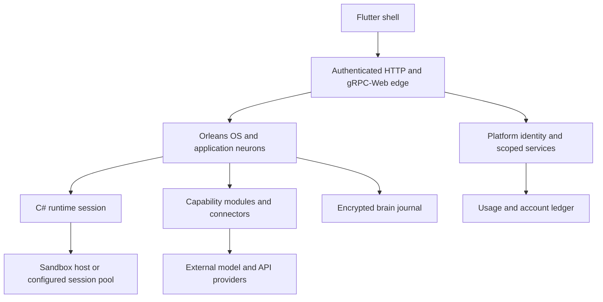

# Architecture and inventory

The inspected DigitalBrain repository implements the AI workspace described by the selected IntoChat strategy. Its OS entry point explicitly calls IntoChat a distribution whose branding, features and configuration sit on the shared OS composition. This is stronger evidence than inferring architecture from a repository name.

**Evidence:** `src/DigitalBrain.OS/DigitalBrain.OS/Program.cs`, `OsCatalog.AddOperatingSystem`, `OsAppsHosting.AddOperatingSystemApps`; snapshot `faddacfc3b5e7cf3a74adfd0efcf8a17e277540b`, 17 October 2026. Paths below are repository-relative. The companion audit establishes that `intochat-cloud` is now a cloud control plane and React account portal, despite its stale travel README. It manages the separate Flutter runtime through a versioned management protocol; it is not a React replacement for the workspace. See [repository boundaries](../reference/repositories).

## Component boundaries

| Location | Responsibility observed in code | Boundary |
|---|---|---|
| `src/DigitalBrain.Framework/DigitalBrain.Framework` | Module definitions, neuron contracts, caller context, compute abstractions | Framework primitives; not the hosted product |
| `src/DigitalBrain.Client` | Client access and Orleans/runtime protocols | SDK/client surface; compatibility still requires release testing |
| `src/DigitalBrain.Platform/DigitalBrain.Platform` | Identity, grants, connections, secrets, storage, usage and ledger | Shared services and authority |
| `src/DigitalBrain.OS/DigitalBrain.OS` | Product module composition and default applications | Shipped distribution |
| `src/DigitalBrain.Modules` | Capability modules with contracts, runtime implementations and optional hosting/deployment projects | A module is developer infrastructure, not necessarily a user application |
| `features/os` and `features/intochat` | Source-defined application bundles and reactions | User-facing applications |
| `src/DigitalBrain.Modules/Google/Flutter/app/{core,ui,shell}` | Flutter workspace packages, login, workspace, application surfaces | Actual client, not React |
| `src/DigitalBrain.AppHost/AppHost.cs` | Aspire composition, shell front, OS and MCP hosts, persistent storage location | Development/deployment orchestration |
| `.github/workflows/{ci,deploy}.yml` | Builds/tests and release-triggered image/web deployment | Automation source, not evidence of successful runs |

**Current implementation diagram:** boxes represent inspected components, not verified live infrastructure. Cloud session-pool operation remains unexecuted.

## Recount: enabled modules

`OsCatalog.BuiltIn()` contains these 21 active constructors. `OsCatalog.Generated()` returns an empty array in this checkout.

| Group | Constructors |
|---|---|
| Runtime and UI | `OrleansModule`, `AppsModule`, `FlutterModule`, `CSharpModule` |
| AI and creative | `AIModule`, `ArtCraftModule` |
| Data | `ClickHouseModule`, `PostgresModule`, `QdrantModule`, `SupabaseModule` |
| Integrations and developer tools | `GmailModule`, `AspireModule`, `GitHubModule`, `PlaywrightModule`, `WindowsModule`, `SalesforceModule` |
| Shared capabilities | `TimeModule`, `ToolsModule`, `McpModule`, `CirclesModule`, `FlameModule` |

`MonnetModule`, `EquifaxModule`, `RiskSealModule` and `TwilioModule` are explicitly commented out of the default composition. Their source and tests do not make them active product capabilities. Roslyn source also exists outside this enabled list. Package availability, module registration, configured credentials and successful execution are separate facts.

## Recount: default applications

`src/DigitalBrain.OS/DigitalBrain.OS/OsApps.cs`, `OsAppsHosting.AddOperatingSystemApps`, names exactly 15 defaults:

| Publisher | Names |
|---|---|
| `os` | `settings`, `router`, `calculator`, `filmcraft`, `photocraft`, `datavisualizer`, `selfimprove`, `memory`, `ino`, `brainview`, `friends`, `circle`, `workspace`, `usage` |
| `intochat` | `customer-researcher` |

`OsDefaults.Created` skips circle brains and installs defaults through `AppInstaller.Install`. Each application error is logged and the loop continues. The feature folder includes additional source bundles, such as Files and Engineer, which are not counted as default entries. No claim of fifteen working or commercially validated applications follows from this list.

## Composition and release identity

`OsCatalog.AddOperatingSystem` registers modules and app defaults together. Aspire's `ModuleHostingScan` and `DigitalBrainModuleProjection` connect module metadata with resource hosting; `DigitalBrainBuilder.RequireHealthyBeforeStart` expresses startup dependencies. This provides composition mechanisms, not proof that every integration's dependency order is correct in a cold deployment.

`global.json` requests .NET `11.0.100-rc.1.26425.128` with prerelease/latest-feature roll-forward. The audit ran on `11.0.100-rc.2.26504.105`. CI pins Flutter `3.47.2`; Dockerfiles pin .NET RC1 images. A release manifest must record these differences, package versions, application bundle digests and deployment configuration before rollout.

Related: [flows](./flows), [operations](./operations), [verification](./verification).
