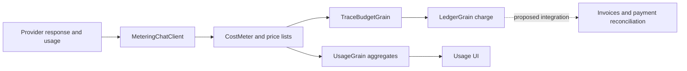

# Usage, ledger and actual payments

The implementation contains meaningful metering, price lists, fees and an account ledger. **It does not establish completed payment collection or a hard prepaid spending limit.** This distinction is essential before a pilot uses platform-funded providers.

Evidence: DigitalBrain `faddacfc3b5e7cf3a74adfd0efcf8a17e277540b`, 17 October 2026. Source prefixes: **Platform** = `src/DigitalBrain.Platform/DigitalBrain.Platform`; **AI** = `src/DigitalBrain.Modules/AI/DigitalBrain.Modules.AI`.

## Current accounting chain

**Mixed diagram:** solid edges reflect inspected code; the dashed payment integration is proposed, not verified. A ledger credit is an internal entry, not proof of money received.

| Layer | Implementation and observed behavior | Limit |
|---|---|---|
| Measurement | AI `Metering/MeteringChatClient.cs` reads input, cached, reasoning and output usage; streaming uses received usage chunks | No usage reported means no token row; failed/abandoned streams can lack final provider totals |
| Pricing | AI `Pricing/ModelPriceList.cs`, `models.prices.json`; Platform `Compute/CostMeter.cs` chooses first non-null price | Catalog freshness and provider token-category overlap need reconciliation |
| Fee | `CostMeter.FeeOn`, `Compute/FeeOptions.cs` add percent to list cost | This is markup on cost, not gross margin on revenue |
| Funding | Local/own connection records zero platform charge; integration/circle applies list plus fee | Zero platform charge does not mean the user's external provider is free |
| Budget | `Compute/TraceBudgetGrain.TrySpend` persists spend per trace | It is not an account-wide reservation across independent traces |
| Ledger | `Compute/LedgerGrain.Charge/Credit/Verify` records signed amounts and hash chain | Balance may become negative; hash-chain verification is not an external financial audit |
| Usage | `Compute/UsageGrain` groups daily buckets by origin/app/synapse/neuron/kind; 90-day retention | Aggregation is not an immutable long-term invoice archive |
| UI | `features/os/Usage`; Flutter `shell/lib/workspace/compute_usage_panel.dart` | Displayed usage is not proof of collection or settlement |

## Code-backed failure modes

1. **Post-call budget enforcement.** `MeteringChatClient.GetResponseAsync` calls the provider first and records usage afterwards. Its `RecordAsync` catches all meter exceptions. Even `BudgetExhaustedException` therefore cannot prevent that provider expense or reliably fail the user call. Streaming similarly records in a finalizer. A hard spending promise is unsupported.
2. **Budget consumption precedes ledger deduplication.** `CostMeter.RecordAsync` invokes `TrySpend` before `LedgerGrain.Charge`. A repeated `TraceId/CostId` can consume budget before the ledger returns “not fresh.” Failure between budget, charge and usage has no single transaction in this path.
3. **Bounded deduplication.** The ledger retains 1,000 charge keys and 10,000 credit keys, with 500 visible entries plus an anchor. A sufficiently late replay outside those windows needs a separate durable event policy.
4. **Unknown prices become zero.** `CostMeter` emits a debug log and records zero micros when no list recognizes an item. This is unsuitable as an unnoticed basis for commercial margin claims.
5. **No prepaid balance check in `Charge`.** The method deducts cost after duplicate checking; it does not reject insufficient funds. Concurrent traces need an account-level reserve/settle design or a clearly disclosed postpaid model.

These are static findings, not claims of observed financial loss. The passed Platform tests validate tested behaviors; they do not remove these product constraints.

## Payments: inspected scope

A search for Stripe, invoice, checkout and PaymentIntent symbols in source did not identify a completed payment route in the active OS composition. A Monnet provider and payment contracts exist under `src/DigitalBrain.Modules/Monnet`, but `OsCatalog` excludes `MonnetModule`. That code must not be presented as integrated IntoChat checkout.

This search conclusion is limited to **DigitalBrain**, not the whole product. The companion cloud audit found `CloudCheckoutService`, `CloudBillingWebhookReceiver`, `BillingReconciliationService`, `ResourceBudgetService` and `ManagedModelGateway` in `intochat-cloud/src/IntoChat.Server.Infrastructure/Services/`. Cloud checkout, resource admission and managed inference code are present. Their deployment, payment settlement and coverage of every runtime inference path are unverified. Do not infer that cloud gateway controls automatically protect direct runtime provider calls. See [repository boundaries](../reference/repositories) and [evidence](../reference/evidence).

The founder's separately mentioned billing implementation is unavailable to this audit. Whether it is the same implementation as the inspected cloud services remains unconfirmed. It is not an additional prerequisite for a controlled deployment without platform-funded spend.

## Acceptance before monetization

Introduce or explicitly select a financial model. For prepaid usage, reserve a bounded maximum atomically per payer before provider dispatch, settle actual usage and release unused reservations. Use stable event IDs across retry/recovery, retain an auditable ledger, and reconcile against provider invoices. Test simultaneous traces, partial streams, timeout after charge, duplicate webhook, late retry, refunds and currency rounding.

Unknown model prices should produce an explicit unavailable/unpriced state or an operator-approved fallback. A payment integration needs authenticated webhooks, idempotent settlement, reconciliation, refunds and a documented invoice/tax responsibility. These are acceptance requirements, not claims that all such mechanisms are absent everywhere.

Track model costs, own compute, storage, external APIs, payment fees and manual support separately. Proposed contribution should be actual collected revenue minus attributable variable costs; a ledger balance or nominal markup cannot substitute for that calculation.

Related: [matrix](./matrix), [verification](./verification), [backlog](./backlog).
