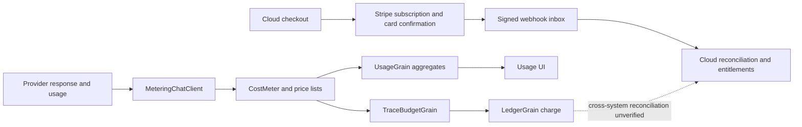

# Usage, ledger and actual payments

**Stripe billing is implemented in IntoChat Cloud.** Runtime metering, price lists, fees and an account ledger are implemented in DigitalBrain. Live Stripe settlement and production operation were not tested in this audit. A hard prepaid spending guarantee across all runtime calls is a separate, unresolved acceptance question.

Evidence: DigitalBrain `faddacfc3b5e7cf3a74adfd0efcf8a17e277540b`, 17 October 2026. Source prefixes: **Platform** = `src/DigitalBrain.Platform/DigitalBrain.Platform`; **AI** = `src/DigitalBrain.Modules/AI/DigitalBrain.Modules.AI`.

## Stripe implementation inventory

Cloud source root: `intochat-cloud/src/IntoChat.Server.Infrastructure/Services/`. These rows describe existing code, independently of live verification. Full routes, wiring and test evidence are in the [cloud inventory](./cloud-inventory).

| Capability | Implementation and source | Availability / verification | Production |
|---|---|---|---|
| Account checkout | **Implemented** — `Billing/CloudCheckoutService.cs`, checkout operation persistence and recovery | Active cloud path; no live checkout run | Not verified |
| Stripe customer creation | **Implemented** — `Billing/CloudBillingProvider.CreateCustomerAsync`; account/operation metadata and idempotency key | Requires Stripe mode/key configuration; no provider call run | Not verified |
| Card subscription creation | **Implemented** — `CloudBillingProvider.CreateSubscriptionAsync`; price, currency, interval and mode validation, incomplete subscription and confirmation secret | Card flow present; live confirmation not exercised | Not verified |
| Signed webhook receipt | **Implemented** — `Billing/CloudBillingWebhookReceiver.cs`; signature/mode verification, encrypted payload and durable inbox deduplication | Registered cloud webhook handler; database-dependent test scope has skips | Not verified |
| Subscription reconciliation and entitlements | **Implemented** — `Billing/BillingReconciliationService.cs`, `BillingEntitlementService.cs`, `CloudBillingWorker.cs` | Worker and durable state present; provider reconciliation not run live | Not verified |
| Checkout recovery | **Implemented** — `Billing/CheckoutRecoveryService.cs` and provider customer/subscription lookups | Recovery code present; external crash/retry scenario not exercised | Not verified |
| Invoice listing | **Implemented** — `Billing/AccountBillingService.InvoicesAsync`, Stripe gateway | Account membership checked; no live invoice fetched | Not verified |
| Payment-method list/default/remove | **Implemented** — `AccountBillingService.PaymentMethodsAsync`, `ChangePaymentMethodAsync`; ownership and required-card checks | Active account APIs; no live card mutation run | Not verified |
| Cancel at period end | **Implemented** — `AccountBillingService.RequestActionAsync`, outbox, `CloudBillingProvider.CancelAtPeriodEndAsync` | Active cancellation workflow; provider outcome not exercised | Not verified |
| Refund review request | **Implemented** — account action `refund.review` stored as `needs_review` | Review queue is implemented; this endpoint does not itself execute a refund | Not verified |
| Older direct refund execution | **Implemented, retained legacy** — `Payments/RefundService.cs` calls Stripe and adjusts user tier | Older payment mutation routes are marked retired; not the active account refund workflow | Not verified |
| Stripe-hosted customer portal | **Not found in inspected scope** | Custom account billing UI exists; do not label it a Stripe hosted portal | Not verified |

Cloud tests previously executed at the recorded snapshot: **120 passed, 66 skipped**; frontend: **447 passed**. These totals do not establish that each Stripe path passed a provider-backed test. The skipped database suite and exact test names are recorded in the [cloud inventory](./cloud-inventory) and [verification log](./verification).

## Current accounting and payment paths

Solid edges represent implemented runtime accounting and cloud payment paths. The dashed edge marks **unverified cross-system reconciliation**, not an assertion that invoices, checkout or reconciliation services are missing. A runtime ledger credit is an internal entry, not by itself proof of money received.

| Layer | Implementation and observed behavior | Limit |
|---|---|---|
| Measurement | AI `Metering/MeteringChatClient.cs` reads input, cached, reasoning and output usage; streaming uses received usage chunks | No usage reported means no token row; failed/abandoned streams can lack final provider totals |
| Pricing | AI `Pricing/ModelPriceList.cs`, `models.prices.json`; Platform `Compute/CostMeter.cs` chooses first non-null price | Catalog freshness and provider token-category overlap need reconciliation |
| Fee | `CostMeter.FeeOn`, `Compute/FeeOptions.cs` add percent to list cost | This is markup on cost, not gross margin on revenue |
| Funding | Local/own connection records zero platform charge; integration/circle applies list plus fee | Zero platform charge does not mean the user's external provider is free |
| Budget | `Compute/TraceBudgetGrain.TrySpend` persists spend per trace | It is not an account-wide reservation across independent traces |
| Ledger | `Compute/LedgerGrain.Charge/Credit/Verify` records signed amounts and hash chain | Balance may become negative; hash-chain verification is not an external financial audit |
| Usage | `Compute/UsageGrain` groups daily buckets by origin/app/synapse/neuron/kind; 90-day retention | Aggregation is not an immutable long-term invoice archive |
| UI | `features/os/Usage`; Flutter `shell/lib/workspace/compute_usage_panel.dart` | Displayed usage is not proof of collection or settlement |

## Code-backed failure modes

1. **Post-call budget enforcement.** `MeteringChatClient.GetResponseAsync` calls the provider first and records usage afterwards. Its `RecordAsync` catches all meter exceptions. Even `BudgetExhaustedException` therefore cannot prevent that provider expense or reliably fail the user call. Streaming similarly records in a finalizer. A hard spending promise is unsupported.
2. **Budget consumption precedes ledger deduplication.** `CostMeter.RecordAsync` invokes `TrySpend` before `LedgerGrain.Charge`. A repeated `TraceId/CostId` can consume budget before the ledger returns “not fresh.” Failure between budget, charge and usage has no single transaction in this path.
3. **Bounded deduplication.** The ledger retains 1,000 charge keys and 10,000 credit keys, with 500 visible entries plus an anchor. A sufficiently late replay outside those windows needs a separate durable event policy.
4. **Unknown prices become zero.** `CostMeter` emits a debug log and records zero micros when no list recognizes an item. This is unsuitable as an unnoticed basis for commercial margin claims.
5. **No prepaid balance check in `Charge`.** The method deducts cost after duplicate checking; it does not reject insufficient funds. Concurrent traces need an account-level reserve/settle design or a clearly disclosed postpaid model.

These are static findings, not claims of observed financial loss. The passed Platform tests validate tested behaviors; they do not remove these product constraints.

## Runtime and cloud boundaries

Stripe checkout belongs to the cloud control plane, not the active DigitalBrain OS module composition. A separate Monnet provider and payment contracts exist under `src/DigitalBrain.Modules/Monnet`, but `OsCatalog` excludes `MonnetModule`; that module is not the active cloud Stripe implementation.

Cloud resource admission and managed inference are also implemented through `ResourceBudgetService` and `ManagedModelGateway`. Their deployment and coverage of every runtime inference path remain unverified. Do not infer that cloud gateway controls automatically protect direct runtime provider calls. See [repository boundaries](../reference/repositories) and [evidence](../reference/evidence).

The assessment above is based on the actual cloud billing source. It does not require an unidentified additional billing implementation to recognize Stripe as implemented.

## Acceptance before monetization

Introduce or explicitly select a financial model. For prepaid usage, reserve a bounded maximum atomically per payer before provider dispatch, settle actual usage and release unused reservations. Use stable event IDs across retry/recovery, retain an auditable ledger, and reconcile against provider invoices. Test simultaneous traces, partial streams, timeout after charge, duplicate webhook, late retry, refunds and currency rounding.

Unknown model prices should produce an explicit unavailable/unpriced state or an operator-approved fallback. A payment integration needs authenticated webhooks, idempotent settlement, reconciliation, refunds and a documented invoice/tax responsibility. These are acceptance requirements, not claims that all such mechanisms are absent everywhere.

Track model costs, own compute, storage, external APIs, payment fees and manual support separately. Proposed contribution should be actual collected revenue minus attributable variable costs; a ledger balance or nominal markup cannot substitute for that calculation.

Related: [matrix](./matrix), [verification](./verification), [backlog](./backlog).
