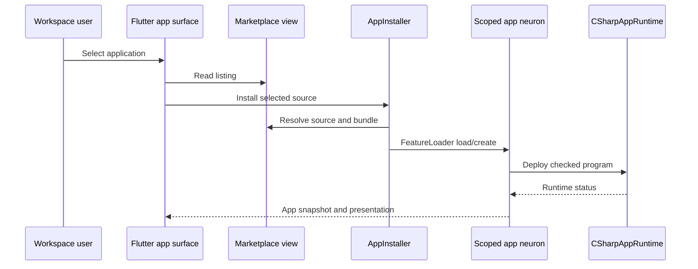

# End-to-end flow assessments

The principal paths are implemented across client, platform and runtime. Most were traced statically; component tests do not substitute for browser-to-provider acceptance. **Evidence date:** 17 October 2026; DigitalBrain `faddacfc3b5e7cf3a74adfd0efcf8a17e277540b`.

## Sign in → workspace → default applications

The Flutter shell's `shell/lib/auth/login_screen.dart` and `brain_session_gate.dart` provide the client entry. `IdentityEndpoints.RegisterAsync` delegates to `PrincipalPasswords.Register`, which validates the username, hashes a 12–256 character password and provisions membership/brain state through `BrainBirths`. Cookie claims carry principal, account, brain and role. `AccountSession.UseAccountSession` stamps the caller for downstream Orleans calls. `SelectBrainAsync` checks membership before switching claims.

`OsDefaults.Created` then installs the default app list into a personal brain through the same installer used by catalog flows. `OsWorkspaceRoot` and the Flutter `workspace/workspace_app.dart` compose the visible workspace. Failure to install one default logs a warning without rolling back the account. Acceptance therefore needs both successful sign-in and explicit checks that the intended launch bundle is installed and opens.

**Verified boundary:** Platform unit suite, including identity and storage tests. **Unverified boundary:** real-browser cookies, reverse proxy, persistent production keys and external identity infrastructure together.

## Discovery → install → run → removal

**Current code path:** `DigitalBrain.Modules.Apps/Marketplace/{MarketplaceEndpoints,MarketplaceView,AppInstaller}.cs`, `Features/FeatureLoader.cs`, `Apps/AppNeuron.cs`, `Runtimes/CSharpAppRuntime.cs`. These paths share the prefix `src/DigitalBrain.Modules/DigitalBrain/Apps/`.

`Install` rejects a duplicate local name and self-install from the same source brain. `InstallPublication` verifies the selected version and digest and records an operation receipt. `Update` refuses to overwrite a locally edited app, except migration handling, and retries deployment when the prior status is unconfirmed. `AppNeuron.Delete` exists and removes the owned marketplace listing where applicable. Removal acceptance must additionally establish the intended data-retention policy: deleting an app is not automatically proof that every external artifact, memory index and backup copy is erased.

## Chat → model/tool → result

`DigitalBrain.Modules.Flutter/Chat/ComposerNeuron.Submit` and `ChatNeuron` manage selected chat context, projection and request identity. `src/DigitalBrain.OS/DigitalBrain.OS/AgentChatSource.cs` connects the OS agent source. AI `Agents/AgentNeuron.cs` and `AgentTurnLoop.cs` implement turns; `Routing/RouterNeuron.cs` inspects the deployed contract catalog, uses a model decision, applies a confidence gate and invokes a selected contract.

Router limits are explicit (`MaxSteps = 8`, `MaxRequestChars = 2000`, confidence gate `0.5`). These are engineering bounds, not measured model quality. Some router work uses `CancellationToken.None`; a client disconnect is not necessarily a cancellation of downstream work. Real provider availability, tool authorization, useful-answer quality and bounded cost need separate acceptance.

## Generate → compile → publish → recipient install

`Apps/Creator.cs` implements authoring, not merely a placeholder: a model produces a spec, a builder loop searches contracts, reads contracts and compile-checks C#. Author retries are bounded at two; builder rounds at twelve. `AppAuthoringPolicy.RequireSandbox` gates implementation. App attempt IDs reject stale builder results.

`AppNeuron.Publish` requires a signed-in publisher and owning brain, snapshots the version, and rejects reusing a version with different content. `ExportRelease` and `AppInstaller.InstallPublication` support immutable release selection and digest checking. `MarketplaceNeuron` delegates catalog records to the platform client; publisher ownership is enforced through `MarketplaceWriteGuard` and authority code.

The remaining claim is deliberately narrow: **a generated-app pipeline exists, but an unconstrained live model producing a useful app and a second account installing that exact release was not executed here.** The earlier [journey assessment](../assessment/app-journey-verification-2026-10-16) remains relevant historical evidence; defects reported against its older snapshot need current reproduction before closure.

## Long-running work and recovery

`Apps/AppWorkQueue.Enqueue` starts process-local asynchronous work with `CancellationToken.None`; the app neuron stores durable state. Its own comment acknowledges that a lost job needs a re-trigger. This is not a durable queue with automatic exactly-once execution.

By contrast, `Microsoft.CSharp/Runtime/BrainRuntimeNeuron.cs` persists assignments/subscriptions, buffers signals until acknowledgement and uses a reconciliation reminder (one-minute period) for lost sessions. `Microsoft.CSharp.Sandbox/Session.cs` reloads failed behavior with backoff capped at sixty seconds; retirement stops the assigned behavior. Replayed side effects still need idempotency in the integration, not just acknowledgement inside the runtime.

Acceptance requires process termination during generation and tool execution, restart, visible status reconciliation, safe retry, explicit cancellation and no duplicated external side effect. This fault-injection journey was not run.

## Memory, provenance and files

`features/os/Memory/Memory.cs` indexes application/source rows, versions, paths, saved times and recent run data, combining terms with embeddings. A generation pointer switches only after its rows are written; fingerprints avoid unnecessary rebuilding. This is concrete provenance structure, not proof of universal factual memory. It depends on Postgres, vector index and embedding capabilities. Table shape changes require new keys according to the source comment.

Brain storage uses `BrainLog`, `BrainGrainStorage` and `BrainSignalJournal`. `HostedRecoveryHost` exports readable state and artifacts but omits authority, credentials, sessions and reminders. Retention and deletion must be specified per data class, including source copies, embeddings, audit trails and backups. See [security](./security) and [operations](./operations).
