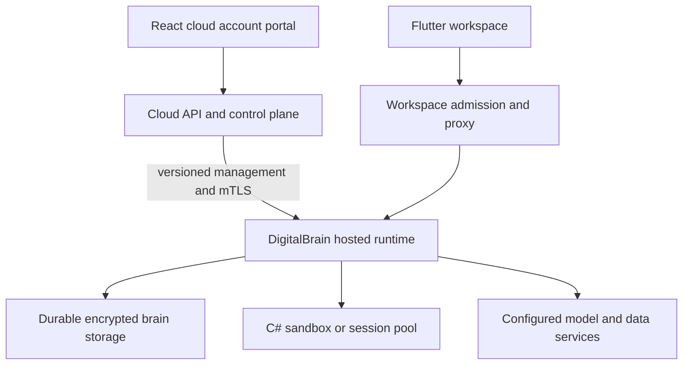

# Deployment and operations

The next engineering milestone is a reproducible controlled deployment of the current code. Existing composition, Dockerfiles, release workflows and recovery paths justify incremental release work. They do not prove a currently healthy production service.

**Inspected:** DigitalBrain `faddacfc3b5e7cf3a74adfd0efcf8a17e277540b`, 17 October 2026; companion [cloud audit](../reference/repositories). No production workflow, migration or infrastructure mutation was executed.

## Topology and ownership

**Current code boundaries, unverified deployed topology.** Cloud `RuntimeManagementClient.ObservationAsync` checks protocol, runtime version and account/brain/runtime identity. Runtime receivers live in Platform `Hosting/HostedRuntimeEndpoints.cs` and `RuntimeManagementEndpoints.cs`. Admission through a cloud portal does not by itself prove the runtime sandbox or model gateway cannot be bypassed.

DigitalBrain's `digitalbrain.cs` launcher starts `src/DigitalBrain.AppHost`. `AppHost.cs` wires the OS, stable fronts, Flutter shell and a standalone MCP host. Its source selects `RunProfile.Cloud`; a “local launch” must not be assumed to use only disposable local resources. Inspect the selected profile and connection targets before running it.

## Immediate gates

| Gate | Evidence / action | Exit condition |
|---|---|---|
| Reproducible dependencies | OS unit restore reports MessagePack `2.5.302` advisory `GHSA-qhrr-8q5h-9q3h`; no suppression performed | Upgrade/reconcile in application work and rerun affected tests |
| Cloud delivery target | Cloud preview and production workflows reference absent `src/IntoChat.MiniApp/IntoChat.MiniApp.csproj` | Correct target and validate workflow locally or in a non-production pipeline |
| Release manifest | Record runtime/cloud SHAs, image digests, .NET/Flutter/package versions and feature bundle versions | Same artifacts are promoted and can be identified by observation endpoint |
| Identity | Explicit Secured posture; scoped controller certificate, trusted TLS and cookie protection | Unauthorized traffic rejected; two-account isolation accepted |
| Durable storage | Persistent writable directory, master-key custody, migration choice | Restart preserves state; keys recoverable without logging them |
| Sandbox | Compatible image, private endpoints or pool config, resource limits | Cold-start and restart tests pass; untrusted access remains disabled until security gate |
| Provider funding | Configure only selected connectors; platform-funded inference remains constrained | Missing auth has visible UI; no uncontrolled paid execution |
| Observability | Health, readiness, trace IDs, structured failure and cost events | Operator can distinguish dependency unavailable, permission denied and runtime failure |

## Deployment sequence

1. Freeze an artifact manifest and inspect effective configuration names, never secret values. Select the intended cloud/runtime pairing and disabled feature flags.
2. Resolve dependency and workflow blockers. Build the same runtime/sandbox contracts together and verify the selected frontend build.
3. Prepare an isolated deployment with persistent storage and key custody. Establish secured identity, certificate trust and workspace proxy routing.
4. Start the minimal application bundle; verify registration, workspace admission, install, launch and restart using test accounts. Cold-start external services explicitly.
5. Rehearse encrypted backup restoration and application rollback before real user data. Keep old images and compatibility notes available.
6. Admit a bounded pilot only after an operator can observe failures and disable a failing connector, publisher or funded provider path.

This is a proposed runbook sequence; it has not been executed against cloud infrastructure.

## Storage, migrations and recovery

`Platform/Storage/BrainStorageHosting.AddBrainStorage` validates a storage directory and installs journal-backed grain storage. Hosted mode refuses to silently replace an existing configured Orleans grain-state store, requiring explicit migration. Production configured-key custody requires explicit acknowledgement; TPM mode requires an available Windows connector/TPM.

`Platform/Hosting/HostedRecoveryHost.Configure` removes runtime background services when recovery-only mode is requested. Its export endpoint authenticates the controller, emits JSON state/artifacts and intentionally omits platform authority, credentials, sessions and reminders. **Portable export is not a complete backup.** It cannot be used as evidence that login, connections and scheduled work will restore.

`BrainRecoveryFacts`, `HostedStorageReadinessFacts` and `HostedExportFacts` are in the passed Platform suite. A deployed restore drill must also preserve encrypted segments, relevant platform state and key custody; verify source versions, secrets access, reminder behavior and connector bindings without printing secret material. Define recovery-point/recovery-time targets only after measurement or label them proposed.

## Rollback and release automation

DigitalBrain `deploy.yml` publishes kernel and sandbox images, updates an Azure Container App and waits for a revision plus health response. It separately deploys Flutter web to Static Web Apps. This is pipeline source, not a recent successful release. Review cross-job ordering and UI/runtime compatibility before promotion. The workflow's comment says northbound MCP image publication was removed, while current AppHost includes an MCP host: decide which distribution actually deploys that component.

An application version rollback is different from a binary/storage rollback. Preserve image digests and a compatible pre-migration backup; define what happens to newer application state. Do not claim that a health check proves complete readiness: it does not exercise provider authentication, marketplace installation or payment settlement.

Related: [verification log](./verification), [security](./security), [technical backlog](./backlog).
