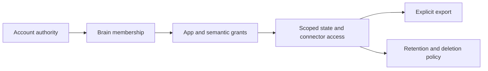

# Security, isolation and generated code

Security mechanisms exist and several local tests passed, but this audit is not a penetration test or certification. Controlled deployment should use explicit secured identity, durable key custody and a private sandbox boundary. Untrusted third-party publishing remains gated on adversarial verification.

**Code evidence:** DigitalBrain `faddacfc3b5e7cf3a74adfd0efcf8a17e277540b`, inspected 17 October 2026. Paths are repository-relative.

## Identity and workspace isolation

`src/DigitalBrain.Platform/DigitalBrain.Platform/Identity/IdentityHosting.cs` requires an explicit Open or Secured posture at startup. `AccountSession` permits a synthetic owner only in Open mode; cookie identity takes precedence over a configured Basic bootstrap credential. Open posture is appropriate only for a deliberately trusted environment. It must not accidentally become the public multi-user posture.

`PrincipalPasswords` hashes passwords with ASP.NET Identity's password hasher; credentials remain in the credential grain. `IdentityEndpoints.SelectBrainAsync` checks membership. `Identity/Directory/DirectoryBrainAccess.cs`, `Identity/Grants/GrantCallFilterStage.cs` and `BrainScope` provide scope/grant enforcement. Hosted runtime options validate a complete scope, pinned controller certificate and durable directory; `HostedWorkspaceEndpoints` validates session state.

The Platform suite includes `BrainMembershipFilterFacts`, `ScopedAuthorityFacts`, `SecretOwnershipFacts`, `GrantFacts` and `RuntimeMachineAuthenticationFacts` and passed as a suite. This supports the tested boundaries; it does not establish every route's resistance to cross-tenant access. A release acceptance test must try two accounts against HTTP, gRPC, subscriptions, exports, app publication and connector credentials, including forged scope identifiers and revocation during an active stream.

Cookie configuration is HttpOnly, SameSite=Lax, secure policy SameAsRequest, with sliding expiration. Therefore TLS termination and forwarded-request behavior matter. No rate-limiter or antiforgery reference was found in the inspected Platform C# scope. This is an investigation gap, not proof that an external gateway lacks protection. Before public registration, establish login throttling, session lifetime, recovery, abuse handling and cross-origin request behavior with the actual deployment.

## Secrets and connector authorization

`Secrets/SecretSealer.cs` creates a fresh encryption key, seals the secret and wraps its key through `IKeyWrapper`. `BrainSecretSealer`, `MasterKeyWrapper` and storage custody code define additional ownership/custody boundaries. `Connections/OAuth/OAuthLoginFlow.cs` uses state and optional PKCE according to connector metadata; callback origin must be configured. Source existence does not demonstrate provider consent, refresh rotation or revocation in a live account.

`Storage/BrainStorageHosting.cs` rejects production configured-key custody unless explicitly acknowledged, or requires the TPM path when selected. Acknowledgement is a deployment choice, not evidence that a recovery key is independently backed up. Record who can unwrap keys, what happens after key loss, how rotation is tested and which logs omit tokens.

## Sandbox boundary

`src/DigitalBrain.Modules/Microsoft/CSharp/DigitalBrain.Modules.Microsoft.CSharp/Sessions/SessionRunner.cs` supports an always-on local sandbox or Azure Container Apps session pool. The pool path attaches an Azure bearer token when a credential is supplied. Session identifiers are derived from a brain hash. `SessionTokens` and runtime edge code carry scoped access back to the brain.

The local sandbox maps start, inspect, judge and stop routes in `DigitalBrain.Modules.Microsoft.CSharp.Sandbox/SandboxEndpoints.cs`; these routes have no authentication check in that mapper. `Session` loads multiple behaviors into the sandbox host. The inspected Dockerfile does not explicitly select a non-root user. None of these observations alone demonstrates a reachable exploit: network policy, container runtime and deployment settings determine exposure. They do mean that the name “sandbox” must not stand in for isolation evidence.

**Before untrusted execution:** verify private ingress, per-tenant session/process isolation, non-root identity, read-only filesystem where possible, resource and time limits, restricted egress, no host Docker socket or credential mounts, and rejection of another brain's token. Test infinite loops, memory exhaustion, host filesystem reads, environment reads and network calls. Record the deployed image digest and effective policy. Avoid using the shared local host as an asserted hostile-code security boundary.

`Workshop/WorkshopSandbox.TryResolve` confines lexical paths and denies segments containing `.git`, `.env`, `appsettings` and `secrets`. It is a write-path guard, not an OS execution sandbox. Symlink/reparse-point behavior requires its own test; the recovery exporter separately excludes reparse points.

## MCP and external side effects

`McpServerNeuron.Connect` accepts absolute HTTP(S) URLs without embedded credentials. The inspected method does not reject private network destinations. `Run` invokes a tool and can retry once after a broken reused session. A connection retry must not duplicate a write action whose first result was lost. Treat tool-provided read-only hints as metadata, not authorization.

Release acceptance should restrict eligible endpoints, establish SSRF/egress protection and explicit tool grants, and test a lost response from a non-idempotent tool. OAuth support for every MCP server is not demonstrated by the generic HTTP transport construction.

## Data ownership and retention

**Mixed diagram:** authority, grants, scoped state and export have code implementations; a complete product retention/deletion policy is a required decision. An app deletion must not be advertised as complete data erasure without tracing indexes, external storage, replicas and backup retention.

Related: [billing risk](./billing), [operations](./operations), [acceptance backlog](./backlog).
