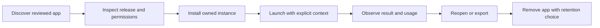

# Reliable workspace and first applications

**Proposed acceptance contract.** The first release needs a small set of complete journeys, not a larger count of registered modules. Keep the universal workspace strategy while limiting the initial supported surface to flows that can be observed, recovered and supported.

## One first-session journey

An invited user signs in, creates or opens their owned workspace, chooses an approved application, reads its permissions and estimated cost boundary, supplies one input, obtains a useful output, and can find that output again after signing out and returning. Failed or cancelled work must show its actual state and any incurred usage.

**Proposed user acceptance flow.** [Current implementation traces](../readiness/flows.md) identify which steps exist and which remain unverified. The diagram does not assert that every listed app completes the flow today.

## Initial application hypotheses

Use the [product experience](../vision/experience.md) as the canonical description. A reasonable proposed bundle is a research application, a creative output application and a memory/context application. Choose two initially if the third adds operational risk. Names such as Customer Researcher, PhotoCraft and Memory are implementation leads, not commitments that their current UI is ready.

For each selected app, define supported inputs, observable output criteria, permission scope, provider dependencies, timeout and cancellation policy, failure explanation, retained data, export path and cost boundary. Disable unsupported actions instead of demonstrating them with fabricated output.

## Core acceptance matrix

| Journey | Required observed behavior | Failure means |
| --- | --- | --- |
| Identity and isolation | Two accounts cannot read or mutate one another’s workspace or connector grants | Block pilot admission |
| Install and remove | Exact release installs once; repeat request is safe; removal revokes execution and explains data retention | Narrow catalog until repaired |
| Run and recover | Success, failure, retry, cancellation and restart produce truthful states without duplicate external effects | Block affected app |
| Shared context | User sees source/owner, grants access, revokes it and cannot retrieve revoked content through another app | Disable cross-app sharing |
| Files and memory | Saved result can be reopened/exported; deletion semantics tested across derived records | Restrict data sensitivity and retention |
| Usage and limits | Concurrent work cannot bypass the approved ceiling; missing rates are visible | Keep funded workloads disabled |

## Quality evaluation

Maintain a small versioned set of representative tasks, including invalid inputs and adversarial permission requests. A suggested initial set is ten tasks per supported app, explicitly a proposed test scope rather than measured quality. Review outputs against task-specific rubrics; a response with plausible prose but missing evidence is not successful research. A visually rendered artifact is not successful generation if requested behavior is absent.

Record model version, app release, input fixture, evaluator rubric, result and cost. Distinguish product defects from provider outages. Test controlled retries with idempotency at external-write boundaries. Continue to the [pilot](pilot.md) only when the agreed supported journeys pass; do not hide failing apps behind an aggregate score.
