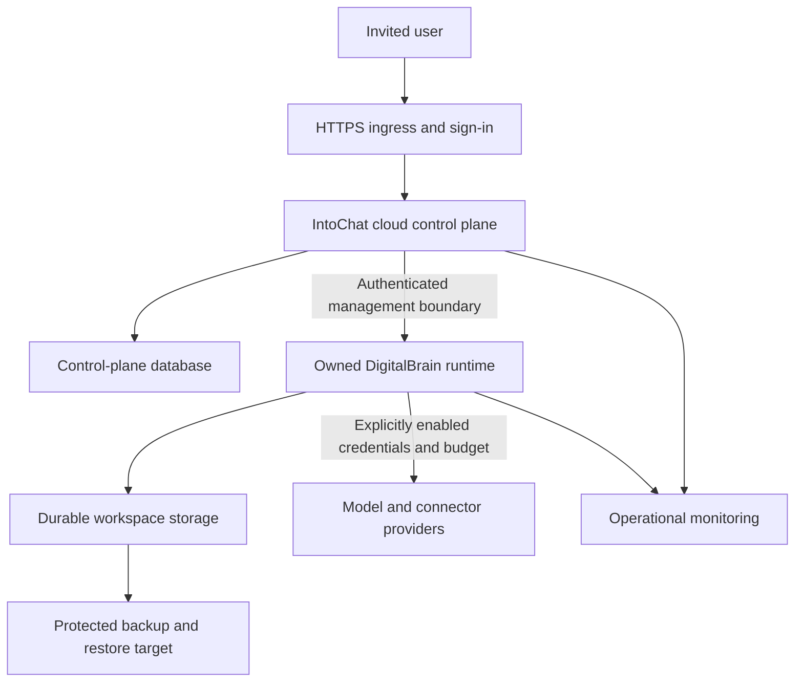

# Deploy the current version

**Proposed delivery plan, informed by inspected code.** The first engineering priority is a controlled deployment of a named current release. Deployment is a distinct acceptance exercise: local builds and unit tests do not establish cloud provisioning, recovery or paid operation.

## What must be decided first

Choose one release pair: the cloud control-plane commit and DigitalBrain runtime commit, with immutable image digests and configuration profiles. Record any working-tree deviations. The [repository map](../reference/repositories.md) explains the real management bridge; the old cloud travel README must not determine release topology.

The founder or release owner must choose a target environment, private access policy, approved provider accounts, initial app allowlist, cost ceiling, retention rules and recovery objectives. These are external inputs, not reasons to rewrite the product. Keep paid providers and checkout disabled until their separate gates are met.

## Ordered release checklist

| Step | Deliverable | Acceptance evidence |
| --- | --- | --- |
| 1. Freeze candidate | Commit pair, image digests, dependency inventory and configuration schema | A clean build reproducible from those inputs; deviations disclosed |
| 2. Repair delivery path | CI references to existing deployable projects; required checks before release | Both workflows cease referencing missing `IntoChat.MiniApp.csproj`; candidate artifact produced without deployment |
| 3. Resolve dependency checks | Reviewed vulnerability remediation or explicit scoped release decision | OS unit suite restores without silently suppressing `NU1902`; [check log](../readiness/verification.md) updated |
| 4. Prepare isolated environment | Private networking, durable storage, secret custody, identity/callback setup, quotas | Configuration review; no secret values in manifests, logs or handbook |
| 5. Rehearse state changes | Fresh install and upgrade on disposable data, backup before change | Migration log and schema checks; no shared/production migration during this documentation task |
| 6. Deploy restricted candidate | Health/readiness, runtime bridge, ownership and access tests | Sign-in → owned workspace → app → saved result; cross-account negative test |
| 7. Recover and roll back | Restore from backup, previous compatible image, incident procedure | Verified data recovery against chosen RPO/RTO; written incompatibility handling |
| 8. Admit invited pilot | Allowlist, support route, monitoring and explicit limits | Release owner signs evidence record; no unresolved critical control failure |

The missing MiniApp workflow target is confirmed in `.github/workflows/preview.yml` and `.github/workflows/deploy-prod.yml` in the cloud repository. See [source and command context](../reference/evidence.md). This task records the defect; application workflows are not modified.

## Proposed deployment topology

**Mixed diagram:** cloud/runtime management and storage code exist; the particular deployed topology, network rules, backup target and operational behavior are proposed until environment evidence confirms them. Model and connector calls must remain disabled in a rehearsal that has no approved paid credentials.

## Release safety and rollback

Preserve the previous image and configuration. Test whether old code can read the new schema; an image rollback alone is insufficient after incompatible migrations. Use an explicit expand/contract sequence or restore rehearsal. A backup that has never been restored is unproven recovery.

Observe error rate, failed sign-ins, provisioning state, stuck work, resource use and unpriced usage. Redact prompts and tokens from logs. Record stop/disable paths and who owns the incident response. Proposed stop conditions include any cross-workspace disclosure, unreconciled monetary writes, uncontrolled provider spend, or inability to recover required data.

## Scope boundary

This plan does not deploy infrastructure, approve spending, select cloud credentials or execute production migrations. It specifies the next authorized engineering work. Once the safe release exists, proceed to [core acceptance](core.md); do not make a new SDK or public marketplace a dependency of the first controlled deployment.
