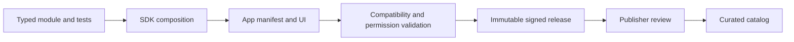

# SDK and developer experience

**Proposed developer release gate.** Expose the smallest stable extension surface that lets another developer produce a useful application without private assistance. Existing modules and runtime types are implementation assets, not proof of a supported public SDK.

## Developer contract

Distinguish a **module** (reusable typed capability, potentially distributed through NuGet) from an **application** (installable user experience composed from capabilities), a **connector** (external service access) and an **agent** (execution behavior). Preserve current code identifiers while naming the customer ecosystem IntoChat. See the [ecosystem boundaries](../vision/ecosystem.md) and [glossary](../reference/glossary.md).

The package contract must name its app ID, publisher, immutable version, runtime compatibility, module dependency versions, required permissions, optional integrations, data ownership/retention, expected resources and support contact. Reject unknown capabilities and incompatible dependency graphs before launch. Runtime authorization must enforce the declared scope; a manifest is not a sandbox.

**Proposed publication contract.** Signature validation, review automation and ecosystem policy are target deliverables, not all confirmed current features. [Readiness flows](../readiness/flows.md) document current publication and install behavior.

## Independent developer acceptance

Provide one minimal sample with local fixtures, one connector example without embedded credentials, a compatibility table, package validator and documented failure messages. A developer outside the implementation team must build a small app, publish to a private test catalog, install it in another account, update it, roll it back and export/delete its data.

Track time to first successful local run, undocumented interventions, contract errors and test outcomes. Proposed threshold: two independent developers complete the workflow, with no private source patches or undocumented steps. This is an early usability gate, not evidence of a healthy marketplace.

## Versioning and lifecycle

Pin dependencies for installed releases. Separate draft edits from published immutable versions. Show permission changes before updates. Define state migration and downgrade compatibility per release; when rollback is unsafe, keep an export and recovery path instead of promising it. Validate uninstall while work is running, revocation during a connector operation, and install retry after interruption.

Publish a support/deprecation policy only after an owner can honor it. Use compatibility tests against supported runtime versions and include negative cases. Do not freeze every internal runtime abstraction: stable public contracts can wrap evolving internals.

## Dependencies and stop conditions

Depends on reliable core lifecycle, permission enforcement, cost accounting and recoverable workspace data. Public untrusted publication also depends on the [security gate](../readiness/security.md). Delay the external SDK if every sample requires private fixes, unsafe permissions or undocumented service access. Keep a curated first-party catalog while resolving these issues.
