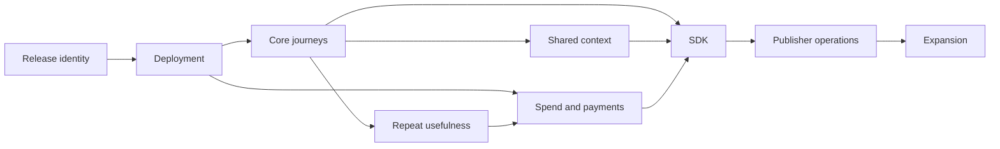

# Epics and dependencies

**Proposed execution contracts.** Each epic has a suggested accountable role, not an invented staffing allocation. No effort range is defensible until the release environment, capacity and external dependencies are confirmed. The default order follows [the roadmap](index.md); independent discovery can overlap, but gate dependencies cannot be waived by calendar pressure.

## E0 — Name and reproduce the release

- **Problem / outcome:** “Current version” is ambiguous across repositories and dirty checkouts. Operators need one reproducible release identity.
- **Scope / deliverables:** Record commit pair, diff provenance, runtime image digest, compatible storage version, build inputs, environment profile and dependency inventory. Repair missing CI project references and restore-blocking vulnerability findings.
- **Non-goals:** Application rewrite, wholesale renaming, production deployment.
- **Evidence:** [Repository map](../reference/repositories.md), [fresh checks](../readiness/verification.md) and missing MiniApp target in [evidence](../reference/evidence.md).
- **Dependencies:** Release owner and artifact destination; approved vulnerability response.
- **Acceptance / validation:** Reproduce builds and mandatory tests on clean inputs; check image identity and CI target existence. Log skipped checks separately.
- **Risk / owner:** Drift between cloud/runtime contracts; release engineering role.
- **Exit / stop:** Pass G0 only with traceable artifacts. Stop release promotion on unresolved critical build/security failures; narrow optional components where safe.

## E1 — Controlled deployment and recovery

- **Problem / outcome:** Passing local code checks does not establish service operation. Invited users need a recoverable, isolated workspace.
- **Scope / deliverables:** Private environment, durable storage, secret custody, migrations rehearsal, health/readiness, management authentication, backup/restore, rollback and incident runbook.
- **Non-goals:** Open registration, paid production workloads, broad provider enablement.
- **Evidence:** [Deployment plan](deployment.md), [operations audit](../readiness/operations.md), [security](../readiness/security.md).
- **Dependencies:** E0; authorized infrastructure and DNS/TLS; recovery/retention decisions.
- **Acceptance / validation:** Deploy candidate, exercise ownership-negative test, recover disposable state and previous compatible release; measure against agreed RPO/RTO.
- **Risk / owner:** Data loss, unintended exposure or billable resources; infrastructure/operations role.
- **Exit / stop:** G1 operational portion passes. Disable access on isolation failure or restore failure; do not expand while observability cannot explain state.

## E2 — Reliable core and initial applications

- **Problem / outcome:** Registration counts can conceal broken journeys. Users need independently useful outputs they can recover.
- **Scope / deliverables:** Choose 2–3 app hypotheses; supported capability list, permission/cost presentation, install/run/cancel/retry/remove acceptance, exports and evaluation fixtures.
- **Non-goals:** Arbitrary app generation promises or every connector/app becoming supported.
- **Evidence:** [Matrix](../readiness/matrix.md), [flow traces](../readiness/flows.md), [first applications](../vision/experience.md).
- **Dependencies:** E1, provider access only where approved, truthful failure handling.
- **Acceptance / validation:** All critical supported journey cases pass, including restart and duplicate request; task outputs satisfy app-specific rubrics.
- **Risk / owner:** Attractive demos mistaken for dependable features; application engineering/product role.
- **Exit / stop:** G1 user-flow portion passes. Remove failing apps from supported catalog instead of averaging failures into an overall score.

## E3 — Demand and repeat usefulness

- **Problem / outcome:** No confirmed demand exists. Users should return for real work without founder orchestration.
- **Scope / deliverables:** Cohort recruitment, interview protocol, consent, outcome rubrics, assistance tagging, repeat-use cohort report and user reasons for leaving.
- **Non-goals:** Paid acquisition scale, market-size claims, a new vertical strategy imposed on the ecosystem.
- **Evidence:** [Users](../vision/users.md), [hypotheses](../vision/hypotheses.md), [pilot protocol](pilot.md).
- **Dependencies:** E2; participant access and support capacity.
- **Acceptance / validation:** Pre-register G2, observe two natural task cycles and report all denominators and failures.
- **Risk / owner:** Selection bias and founder assistance; product research role.
- **Exit / stop:** G2 passes with user artifacts. Narrow jobs/audience if repeat value is absent; do not add applications to mask weak demand.

## E4 — Shared-context benefit and control

- **Problem / outcome:** Sharing data is not inherently useful. Users need measurable benefit without losing control of provenance or access.
- **Scope / deliverables:** Explicit grants, source attribution, revoke/delete behavior, paired task comparisons and a context-boundary test suite.
- **Non-goals:** Global memory of all user data or unrestricted cross-tenant context.
- **Evidence:** [Ecosystem](../vision/ecosystem.md), [security](../readiness/security.md), [metrics](metrics.md).
- **Dependencies:** E2; E3 task observations; ownership model and deletion policy.
- **Acceptance / validation:** G3 paired comparisons plus negative permission tests, including indirect retrieval after revocation and derived artifacts.
- **Risk / owner:** Cross-app disclosure and confounded experiments; platform/security role with product evaluation.
- **Exit / stop:** Demonstrated value and no unresolved critical disclosure. Disable context sharing if controls fail; retain useful standalone apps.

## E5 — Spend enforcement and paid economics

- **Problem / outcome:** Metering and ledger entries are not money collected or a hard spending limit. Users need predictable charges and the operator needs viable unit economics.
- **Scope / deliverables:** Enforced reservations/concurrency boundary, immutable usage and rate evidence, idempotent reconciliation, checkout/webhook lifecycle, refunds policy and cost completeness report.
- **Non-goals:** Dependence on the acquaintance’s unprovided billing system; speculative publisher payouts; live charges in this task.
- **Evidence:** [Billing audit](../readiness/billing.md), [pricing model](../vision/pricing.md), cloud billing records linked in [evidence](../reference/evidence.md).
- **Dependencies:** E1 operations; provider/payment approvals; rates; E3 useful outcomes; policy ownership.
- **Acceptance / validation:** Concurrent admission cannot overspend approved limits; provider failures/retries reconcile once; sandbox disputes/refunds/cancellation tested; subsequent real transactions meet G4.
- **Risk / owner:** Unbounded costs, duplicate debits or false margin; billing engineering/finance operations role.
- **Exit / stop:** Payment and usage reconciled with complete costs. Disable funded admission on unpriced usage or unenforced ceilings; revise price or supported workload when contribution fails.

## E6 — Stable SDK and independent developers

- **Problem / outcome:** Internal extension code may require tribal knowledge. External developers need a supported contract and predictable lifecycle.
- **Scope / deliverables:** Manifest/version/dependency contract, sample apps, validator, local harness, permission tests, compatibility policy and onboarding guide.
- **Non-goals:** Stabilizing every internal API or opening untrusted publication.
- **Evidence:** [Developer plan](developers.md), [modules/app distinction](../vision/ecosystem.md).
- **Dependencies:** E2 lifecycle, E4 permissions and E5 cost responsibility for metered apps.
- **Acceptance / validation:** Two independent developers pass G5 without private patches, including update, recovery and uninstall.
- **Risk / owner:** Locking unstable internals or hiding missing documentation with assistance; developer experience/platform role.
- **Exit / stop:** Reproducible independent adoption. Keep contract experimental if samples need private fixes.

## E7 — Invited publisher marketplace

- **Problem / outcome:** External supply adds value only if safe, maintained and adopted. Users need trustworthy applications with accountable publishers.
- **Scope / deliverables:** Publisher identity, review policy, immutable release review, ownership/license checks, permission changes, takedown/appeal, support and monetization responsibilities.
- **Non-goals:** Unrestricted submission, automated trust guarantees or unvalidated revenue-sharing promises.
- **Evidence:** [Marketplace strategy](../vision/marketplace.md), [launch plan](marketplace.md), [external terms](../vision/market.md).
- **Dependencies:** E6, security approval for untrusted execution, operating capacity and applicable payment/legal decisions.
- **Acceptance / validation:** G6 adoption evidence and a simulated malicious/update-revocation incident; install history and retained user data handled correctly.
- **Risk / owner:** Abuse, abandoned apps and unresolved liability; ecosystem operations role.
- **Exit / stop:** Independent supply produces repeat user outcomes within review capacity. Stay curated when trust or demand is insufficient.

## E8 — Evidence-led expansion

- **Problem / outcome:** Expanding too early multiplies support and cost. Users should receive more useful capabilities without degraded reliability.
- **Scope / deliverables:** Cohort review, category-by-category business cases, operating capacity plan and tested release policy for each added connector/app category.
- **Non-goals:** Growth targets inferred from competitor existence or total module count.
- **Evidence:** G2–G6 records, [commercial hypotheses](../vision/commercial.md), [metrics definitions](metrics.md).
- **Dependencies:** Passed relevant prior gates and complete contribution accounting.
- **Acceptance / validation:** New category repeats outcome, retention, safety and economics evaluation; compare support burden before/after expansion.
- **Risk / owner:** Dilution of product value and hidden variable costs; product/business owner.
- **Exit / stop:** Continue only when measurable incremental value exceeds operating burden. Remove or narrow categories whose outcomes or contribution remain weak.

## Dependency map

**Proposed dependency map.** Completion is an evidence decision against the acceptance contract, not a count of finished tickets. Record rejected hypotheses as useful findings and update [founder decisions](../reference/decisions.md) when direction changes.
