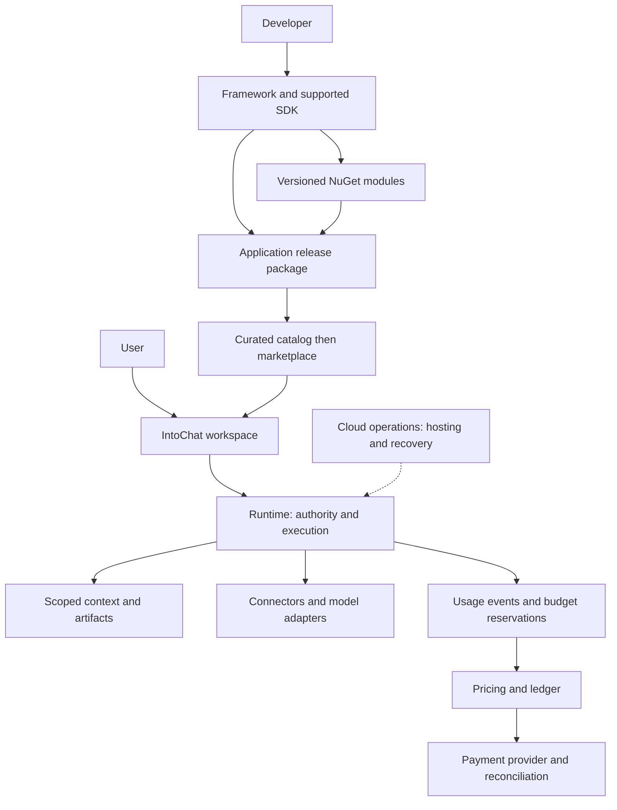
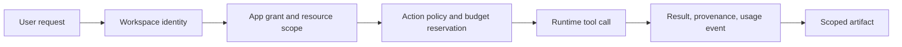

# Ecosystem and architecture

**Proposed architecture and product boundaries · 17 October 2026.** IntoChat combines a user workspace with an application ecosystem. DigitalBrain is the existing technical platform name; this diagram does not assert that every layer is complete or that separate repositories already compose into one deployed product. Consult the [repository map](/reference/repositories) and [existing architecture](/readiness/architecture) for inspected implementation.

## Give each component one responsibility

| Component | Responsibility | What it is not |
| --- | --- | --- |
| Application | Installable user outcome with a UI or interaction, configuration, release identity, permissions, and support owner | Every registered developer module |
| Module | Reusable typed capability, potentially distributed as a NuGet package, consumed by the runtime or applications | Automatically a discoverable end-user product |
| Connector | Adapter to an external system, with authentication, scoped actions, error handling, and credential lifecycle | Permission to perform every action the external system supports |
| Agent | Model-directed execution using granted tools and context | The authority boundary or payment system |
| Framework | Core abstractions and composition conventions used to implement capabilities | A complete hosted workspace |
| SDK | Supported authoring, packaging, testing, and compatibility surface for developers | Whatever internal API happens to be accessible |
| Runtime | Executes application work, checks authority, manages lifecycle, records usage, and persists execution state | Proof of sandbox isolation merely because code runs on a server |
| Cloud | Operated hosting, identity, storage, observability, recovery, and commercial service | A different application format by default |
| Catalog / marketplace | Discovery, release distribution, publisher information, review, and later commercial exchange | A package registry alone |

*Proposed architecture. Solid arrows express responsibility and dependency, not verified implementation. Payment processing is a separate boundary from usage accounting.*

## Package contract before broad SDK promises

A proposed application manifest contains stable application and publisher IDs, immutable release ID, package digest, supported runtime/API ranges, module dependencies, entry points, configuration schema, requested capabilities, storage namespaces, migration declarations, and documentation/support links. Credentials and user data never belong in a distributable package.

Resolve dependencies at installation and record the resulting lock set. A user must be able to inspect the exact release being installed. Reject unavailable or incompatible dependencies before activation. Prevent an upstream mutable package from silently changing the behavior of an already reviewed release.

Semantic versioning communicates compatibility intent but does not prove it. Contract tests, representative run fixtures, and data migration tests establish compatibility. Stage updates, retain a known release, and define rollback of both code and data. If a migration is irreversible, offer export and recovery before upgrading rather than promising one-click rollback.

## Authority at every boundary

*Proposed execution contract. A model's tool choice does not replace server-side authorization.*

Check the authenticated principal, current workspace, installed release, capability, resource scope, and external account before a tool action. Revocation must apply to queued and resumed work as well as new sessions. A scheduled job needs durable, inspectable delegation, an expiry/review policy, and a stop control. Scope external writes more narrowly than read access.

For shared context, the user chooses which objects an app can read or write. Applications should refer to objects and revisions, not receive every workspace secret in a system prompt. Connector credentials are retrieved by the trusted execution layer and remain outside model-visible text and package exports. Untrusted documents and tool responses are data; they cannot grant authority.

## Ownership and portability

**Proposed product policy.** Users retain control of their supplied data and created artifacts; publishers retain their application IP under an explicit license. The platform receives only the processing rights required to provide the service. These are intended contractual boundaries pending legal adoption, not existing binding terms.

Export should include user-owned artifacts in ordinary formats, context records with provenance, application settings without secrets, and installed release/dependency metadata. Reconnection to external services is expected on another host. Exporting a manifest does not imply exporting a proprietary model, licensed publisher code, or reproducing a provider's behavior.

Portability acceptance is an actual export/import exercise with a documented loss report. Self-hosting requires supported operations and license rights, not merely available source. See [commercial model](./commercial), [marketplace](./marketplace), and [experience](./experience).
