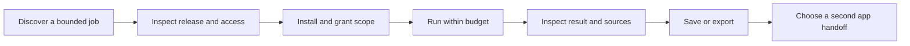

# Experience and first applications

**Proposed experience · not a shipped-feature claim · 17 October 2026.** The first session should end with one inspectable result from the user's own material. The next session should benefit from something deliberately retained. Do not begin by asking the user to design an agent graph or configure every connector.

## First useful session

1. The user enters an invited workspace and sees a small curated catalog. Each application explains its outcome, publisher, release, required access, likely cost drivers, and limitations.
2. The user selects an application and supplies a bounded input, initially an uploaded file or chosen text. Optional connectors are introduced only when needed.
3. Installation shows requested capabilities and data scope. The user can decline optional access. A budget explanation distinguishes an estimate from an enforceable maximum.
4. Execution shows progress, interruption controls, and recoverable errors. A retry does not silently duplicate a costly provider call or external write.
5. The result includes sources, uncertainty, and editable artifacts. The user accepts, corrects, rejects, or exports it; acceptance is distinct from execution completion.
6. Saving context names its destination and audience. A second application receives only the selected material and must request additional authority separately.

*Proposed user journey. The current state of each step belongs in the readiness matrix; arrows are not evidence of working integration.*

## Three application hypotheses

| Application hypothesis | First job | Accepted result | Shared-context test | Scope boundary |
| --- | --- | --- | --- | --- |
| Research brief | Turn a small user-selected source set into a sourced project brief | Claims link to supplied evidence; unknowns remain visible; user can edit/export | Save approved facts and project constraints for another app | No claim of exhaustive web research; no automatic private-source ingestion |
| Project memory | Retrieve and revise agreed project facts and decisions | Answer identifies origin, freshness, and conflicting statements | Both research and creative apps use the same approved project facts | Memory is reviewable and scoped; no invisible global profile |
| Creative draft | Produce a content or visual draft from an approved brief | Editable output follows the brief and records generation settings | Reuse audience, tone, approved facts, and assets without re-entry | Human review before external publication; costly media only with explicit budget |

These are product experiments, not a recount of registered applications. Historical names such as Customer Researcher, Memory, and PhotoCraft may inform implementation choices, but an existing name does not establish the proposed acceptance contract. Prefer the smallest working current capability over a new application framework.

## Make shared context demonstrable

Use the same project task twice: once with the user's normal copying process and once with an explicit workspace handoff. Compare active effort, omitted constraints, unsupported claims, corrections, and accepted output. The workspace wins only if reuse helps enough to justify access and setup. Do not optimize solely for fewer clicks if permission comprehension or result quality gets worse.

Treat context as records with owner, source, collection time, revision, audience, and retention policy. Separate source facts, model interpretations, and user-approved decisions. A correction should supersede the relevant record and expose downstream artifacts that may now be stale. Deleting a source must have a defined effect on retained summaries and derived outputs.

## Failure is part of the product

An expired connector should name the affected account and preserve local work. An unavailable model should offer an explicit retry or a disclosed alternative, with its cost and data-processing implications. A failed run should preserve the stage reached, charged usage, and safe recovery action. Cancellation must explain whether provider work already started and may still be charged.

Removal should stop future schedules and revoke application grants while letting the user export or retain their artifacts. It must distinguish deleting an application installation from deleting shared project data. A publisher update that adds access requires renewed consent. See [ecosystem](./ecosystem) for the proposed permission contract and [marketplace](./marketplace) for release review.
