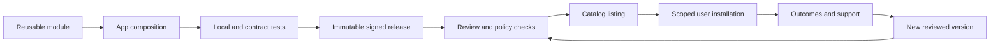

# From catalog to marketplace

**Selected strategy, proposed rollout · 17 October 2026.** Marketplace belongs in IntoChat's destination. Begin with reviewed first-party applications after controlled deployment. Expand publishing only when the platform can explain access, preserve release identity, recover failures, and support users.

## Stage the two-sided ecosystem

| Stage | Supply and distribution | Evidence required to enter | Exit evidence |
| --- | --- | --- | --- |
| Controlled catalog | Small first-party bundle for invited users; exact releases | Core install/run/remove path and support contact work in the deployment | Users repeatedly complete real jobs; catalog descriptions match behavior |
| Invited publishers | A few independently built applications reviewed manually | Supported SDK surface, package validation, credentials separation, update/rollback contract | Publisher ships and maintains an app without privileged source edits or founder rescue |
| Curated external marketplace | Reviewed public discovery with commercial terms | Publisher verification, abuse response, entitlement/refund handling, payment reconciliation | Third-party apps achieve useful outcomes and repeat adoption with sustainable support |
| Broader ecosystem | Additional categories and distribution channels | Capacity to maintain review quality, compatibility, and incident response | Expansion preserves quality and unit economics rather than merely increasing inventory |

These are dependency gates without calendar commitments. No number of registered modules substitutes for buyer use, and no number of submitted apps substitutes for maintained supply.

## Developer onboarding that proves the SDK

Provide a minimal application template, local run path, capability reference, fixture credentials, test harness, and one complete packaging example. A developer should build a bounded application, declare dependencies and permissions, run conformance tests, install it in a clean workspace, and produce a reviewable release without editing runtime internals.

*Proposed publication lifecycle. Signing is a provenance control, not a guarantee that application behavior is safe.*

## Review the release, not just the description

The publisher supplies identity, ownership/license evidence, reproducible package, dependency list, supported runtime versions, privacy and retention disclosures, requested permissions, cost drivers, support route, and an example of a useful outcome. Review checks that advertised actions match reachable behavior, access is minimal, secrets are absent, and a clean recipient installation does not inherit publisher data.

The platform owns listing integrity, permission presentation, package integrity checks, installation enforcement, removal capability, and reports about systemic incidents. Publishers own application behavior, compatibility maintenance, external-service terms, accurate claims, and first-line app support. The operator owns hosting reliability and platform incidents. These responsibilities need named operating contacts before external launch; no staffing is assumed here.

## Updates, moderation, and removal

Treat a permission increase, new data processor, major model routing change, or new external write as a material update requiring review and appropriate user consent. A previously approved publisher does not bypass release review. Publish a compatibility policy and deprecation notice process before customers depend on applications.

Users need report-abuse and report-broken-app actions. The operator needs quarantine, unlisting, disabling new installations, and emergency execution suspension as distinct controls. Preserve export access where safe. Notify affected users about security-relevant removal, explain recovery options, and offer an appeal path for publishers. Maintain an audit trail of review and enforcement decisions without making sensitive incident details public.

Refund and chargeback allocation must be settled before paid external applications. Define responsibility for failed execution, abusive usage, misleading listings, provider outages, and abandoned apps. Platform removal does not automatically erase user-owned output or extinguish a payment dispute.

## Measure useful exchange

Measure time to first independently published valid release; maintainer effort per update; install-to-accepted-outcome conversion; repeat third-party use; refund/support burden; and publisher contribution after variable costs. Report the cohort and denominator. Supply without demand and demand without maintained supply are different failures.

An IntoChat capability exposed through an external assistant may become a distribution channel, subject to its rules. It does not transfer that ecosystem's users, payments, or approvals into IntoChat. See [market research](./market), [commercial model](./commercial), and [hypotheses](./hypotheses).
