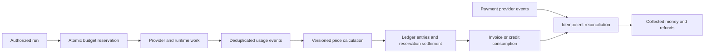

# Pricing and unit economics

**Proposed commercial design · 17 October 2026.** Begin with a bounded paid-workspace experiment after reliable outcomes and reconciled billing exist. A cost counter is not a payment integration. No current revenue, paid customer, or profitable unit economics is asserted.

## Four different systems

| System | Question answered | Required record |
| --- | --- | --- |
| Metering | What resources did this execution actually consume? | Deduplicated events with run, workspace, provider request, quantity, unit, time, and source |
| Pricing | What should this usage cost this customer? | Immutable rate version, currency, unit conversion, discounts, and rounding policy |
| Ledger | What obligation, credit, reservation, or adjustment exists? | Durable entries linked to events and commercial documents; corrections preserve history |
| Payments | Was money authorized, collected, refunded, disputed, and settled? | Verified provider events reconciled to customer, invoice, ledger, and payout records |

*Proposed accounting flow. A displayed balance or invoice does not establish collected cash; a provider authorization does not establish final settlement.*

## Account for every variable cost

| Cost | Measurement basis | Common omission |
| --- | --- | --- |
| Models | Provider-reported input, output, cached tokens, images, audio, and other billed units | Retries, routing fallback, failed but billed requests, long context |
| Own compute | Allocated CPU/memory/execution duration and shared idle capacity | Background jobs, sandbox startup, observability, network egress |
| Storage | Retained bytes, reads/writes, backups, retrieval/indexing | Deleted data retained in backups; vectors and derived artifacts |
| External APIs | Provider operation charges and minimum commitments | Connector pagination, polling, enrichment, media rendering |
| Payment fees | Actual processor, currency conversion, refund, and dispute charges | Fixed transaction fees on small purchases and nonrefundable processing |
| Support and manual operations | Time per onboarded user, failed run, refund, review, and incident | Founder time reported as free, especially during the pilot |

Track both marginal execution cost and fully allocated service cost. Idle infrastructure and fixed commitments may not belong to one run but still determine sustainability. Report a declared allocation method rather than hiding them. Separate promotional credits from cash discounts and avoid counting unused customer credits as immediately earned application revenue without the appropriate accounting policy.

## Markup and margin are different

For cost `C` and price `P`, markup is `(P - C) / C`; margin is `(P - C) / P`. A 25% markup yields a 20% margin before other costs. To target margin `m` on the chosen cost base, `P = C / (1 - m)`.

**Illustrative scenario only — no observed IntoChat data:** one accepted job costs $0.20 in models, $0.03 compute, $0.01 storage allocation, $0.04 external APIs, $0.03 allocated payment fees, and $0.09 variable support. Total variable cost is $0.40. At a $0.60 net price, contribution is $0.20, markup on this cost base is 50%, and contribution margin is 33.3%. Taxes collected for others are excluded from revenue. Fixed engineering, acquisition, and general overhead are not covered by this contribution calculation.

If the model component doubles, cost becomes $0.60 and contribution disappears. If only half of runs produce accepted outcomes and unsuccessful runs cost similarly, the cost per accepted outcome roughly doubles. This is why successful model calls and token markup alone are misleading pricing foundations.

## Pricing experiments

Compare a workspace fee with a small included allowance and explicit overage, a prepaid allowance with transparent unit rates, and bring-your-own-key access with a platform fee. These are proposed alternatives, not launch prices. The first may be easier to understand, the second bounds collection risk, and the third separates model procurement while retaining platform operating costs.

Show participants a concrete offer after they have obtained a useful result. Record actual accepted offers and completed payments separately from stated willingness. Keep the offer and support level consistent within a cohort. Do not present a free trial, founder gift, refundable deposit, or unpaid invoice as recurring revenue. Report refunds and nonrenewal, including reasons.

Avoid “unlimited” model use while cost variance is unknown. Media-intensive applications may need distinct budgets or pricing. BYOK still incurs storage, execution, support, and possibly gateway fees; it is not a zero-cost plan.

## Enforce spending before work starts

A hard cap needs atomic reservations across concurrent runs, bounded tool/model calls, and settlement of actual usage. Reserve before expensive work, reject work that exceeds available balance, and release unused reservations on terminal states. Test concurrent requests, retries, cancellation, delayed provider usage, duplicate events, and worker crashes. Define how much already-started external work can exceed an estimate; do not call an estimate a hard limit.

Use an internal execution budget for low-latency enforcement. Asynchronous billing summaries are unsuitable as the sole admission control, a distinction also exposed in [Stripe's usage-recording documentation](https://docs.stripe.com/billing/subscriptions/usage-based/recording-usage). Reconcile supplier charges, internal usage, customer prices, ledger entries, and payment-provider records independently.

## Payment acceptance gate

Before enabling real collection, demonstrate sandbox and controlled authorized live scenarios for success, failure, delayed/duplicate webhook, refund, dispute, currency/rounding, and account mismatch. Verify webhook signatures and idempotency; never create credit merely because a browser returned from checkout. Name who handles failed reconciliation and customer disputes.

The current implementation assessment must establish which of these stages actually exists. See [readiness](/readiness/), [commercial decisions](./commercial), and [validation hypotheses](./hypotheses).
